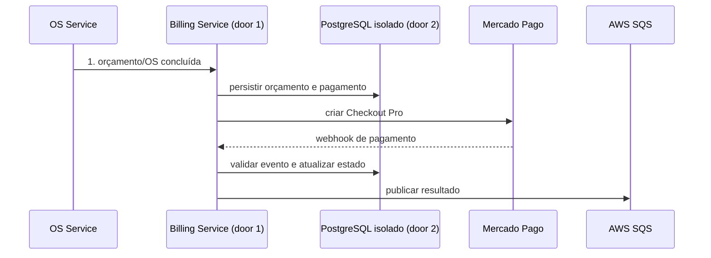
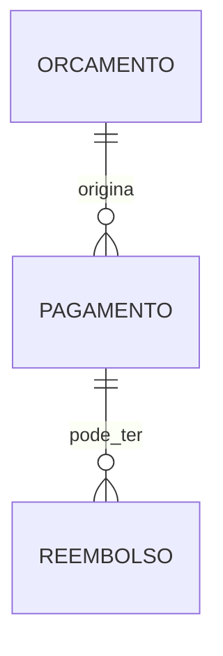

# Fase 4 - Billing, orçamento e Mercado Pago

**Approved**: 2026-11-06 - user: "Pode seguir"
**Expanded**: 2026-11-09 - user: "pode seguir com o OTel neste ciclo" (AC 9 incluído)

## Problem

Orçamento e pagamento ainda não estão isolados em um serviço que coordene aprovação, Checkout Pro e atualização da OS. A oficina precisa cobrar somente após concluir o serviço e antes da entrega, mantendo controle de novas tentativas, reembolso e falhas técnicas. Quando esta entrega estiver pronta, Billing administrará orçamento e pagamento sem duplicar cobranças capturadas.

## Shape

Esta entrega reutiliza o domínio da Fase 3; regras financeiras executam no Billing Service.

1. OS Service envia dados da OS por API/evento ao Billing Service (door 1).
2. Billing persiste orçamento/pagamento no PostgreSQL isolado (door 2), e abre Checkout Pro no Mercado Pago.
3. Webhook validado atualiza o pagamento; Billing publica evento de resultado pela SQS.

New: Orcamento, Pagamento e Reembolso no banco próprio do Billing.

**Changes underneath**

| Front | What changes |
| --- | --- |
| domínio | Billing assume orçamento, pagamento e reembolso. |
| stored data | Novo PostgreSQL/database isolado; sem migração nesta entrega. |
| readers | OS Service consome eventos/APIs; Mercado Pago envia Webhooks. |

## Surface

| Route | Request -> response | Who | Status |
| --- | --- | --- | --- |
| `POST /api/v1/orcamentos` | OS -> orçamento | OS Service autenticado | 201, 401, 403, 422 |
| `POST /api/v1/orcamentos/{id}/aprovacao` | confirmação -> orçamento aprovado e pagamento | cliente autenticado dono da OS | 200, 401, 403, 404, 409 |
| `POST /api/v1/pagamentos/{id}/checkout` | pagamento -> URL Checkout Pro | cliente dono do pagamento ou usuário autorizado | 200, 401, 403, 404, 409 |
| `POST /api/v1/pagamentos/{id}/reembolsos` | valor/aprovação -> reembolso | responsável autorizado | 201, 401, 403, 404, 409, 422 |
| `POST /api/v1/webhooks/mercado-pago` | evento -> aceite/rejeição | Mercado Pago com assinatura válida | 202, 401, 422 |

## Landing

| Door | Literal shape | Alternative rejected and why |
| --- | --- | --- |
| 1 | Billing Service separado com API e pipeline próprios | Manter cobrança no OS Service acopla ciclo operacional ao provedor financeiro. |
| 2 | PostgreSQL/database e usuário exclusivos do Billing | Compartilhar tabelas permitiria escrita cruzada entre serviços. |
| 3 | Checkout Pro + Webhooks validados do Mercado Pago | Polling exclusivo não atende atualização assíncrona do estado de pagamento. |
| 4 | Aprovação do orçamento exige JWT com role `Cliente` e claim `clienteId` igual ao cliente do orçamento; checkout do cliente valida o mesmo vínculo | Link público sem identidade permitiria aprovar o orçamento de outra pessoa. |

## Criteria

### Billing lifecycle (P1)

**Acceptance Criteria**

1. WHEN o OS Service encaminhar orçamento THEN Billing SHALL gerar orçamento persistido e disponibilizar aprovação ao cliente.
2. WHILE orçamento não aprovado ou serviço não concluído THEN Billing SHALL não iniciar cobrança.
3. WHEN serviço concluído e aprovado estiver pronto para retirada THEN Billing SHALL criar uma única tentativa ativa no Checkout Pro.
4. WHEN Mercado Pago enviar Webhook válido THEN Billing SHALL validar origem/assinatura, persistir o estado e publicar resultado; Webhook inválido SHALL ser rejeitado.
5. IF tentativa estiver pendente THEN Billing SHALL aguardar sem criar outra tentativa; após rejeição, cancelamento ou expiração terminal, somente pessoa autorizada poderá iniciar nova tentativa.
6. IF pagamento estiver capturado THEN Billing SHALL nunca repetir a cobrança automaticamente; falha de sincronização SHALL reconciliar para frente e alertar a equipe.
7. WHEN responsável autorizar reembolso total ou parcial THEN Billing SHALL registrar aprovador, valor e referência auditável do reembolso.
8. IF dependência tiver falha transitória THEN Billing SHALL usar limite padrão por dependência, backoff exponencial com jitter e encaminhar falha esgotada à DLQ/alerta.
9. WHEN a API do Billing atender requisições ou registrar logs THEN Billing SHALL exportar traces, métricas e logs via OTLP identificados pelo nome do serviço e pelo ambiente; IF o coletor OTLP estiver indisponível THEN Billing SHALL continuar respondendo às requisições.

## Out of scope

| Excluded | Why |
| --- | --- |
| Entrega física do veículo | Continua responsabilidade operacional da oficina. |
| Pagamentos automáticos antes da conclusão | Contraria decisão aprovada. |

## Assumptions

| Assumption | Chosen default | Rationale | Confirmed? |
| --- | --- | --- | --- |
| Provedor e fluxo | Mercado Pago Checkout Pro e Webhooks validados | Confirmado no plano pai. | y - user: "Sim" |
| Retentativas | Limites padrão por dependência, backoff exponencial com jitter, DLQ/alerta; nunca repetir cobrança capturada | Decisão compartilhada AD-001. | y - user: "Adote limites padrão por dependência, backoff exponencial com jitter e DLQ/alerta ao esgotar; nunca repetir cobrança capturada." |

**Open questions:** none

## Differences from the source

None - este plano não altera elementos do PDF binding.

## Sources

- `.specs/features/fase4/plan.md` - regras de orçamento, cobrança e reembolso confirmadas.
- `.specs/features/fase4/checks.md` - AC 3, 8-9, 15-17.
