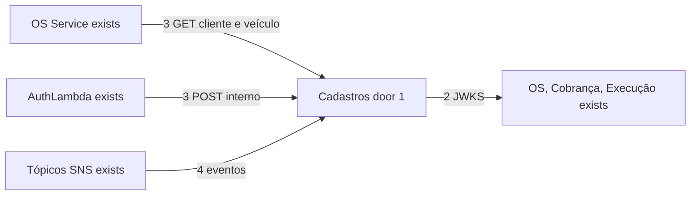
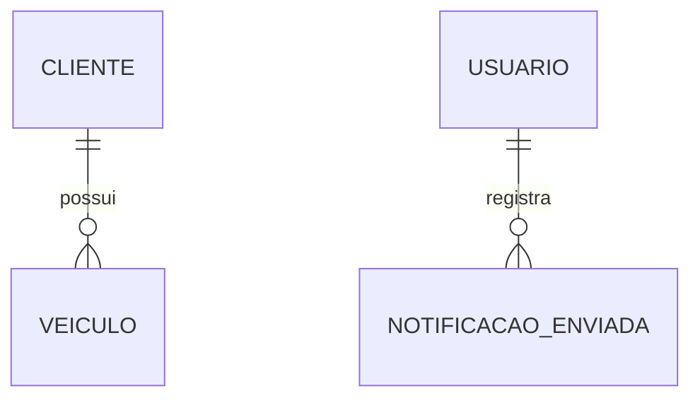

# Fase 4 - App reduzido a Cadastros

**Pendente de aprovação** (10/11/2026). Decisões de origem: D-01, D-11, D-17, D-21, D-23 de `docs/specs/fase4/index.md` (AD-013).

## Problem

O App ainda concentra clientes, veículos, usuários, catálogo, insumos e o fluxo de OS antigo, em paralelo aos serviços novos. Os serviços novos recebem `ClienteId` e `VeiculoId` sem ter onde validá-los e validam JWT por descoberta OIDC, que o App não publica. A AuthLambda lê a tabela de clientes diretamente, o que o PDF proíbe. Quando esta entrega estiver pronta, o App será o serviço de Cadastros: dono de clientes, veículos e usuários, emissor do JWT com JWKS, consultado por REST e responsável pelas notificações por eventos.

## Shape

Esta entrega reduz o App e expõe os contratos de que os outros serviços precisam.

1. App remove OS, orçamento, catálogo, insumos e dashboard, e passa a usar uma database própria renomeada (door 1).
2. Cadastros publica discovery OIDC e JWKS com chave assimétrica (door 2); OS, Cobrança e Execução validam o token por `Authority`.
3. OS valida cliente e veículo por REST; AuthLambda autentica o cliente por endpoint interno.
4. Notificações por e-mail passam a consumir eventos da sua fila assinando os tópicos SNS dos produtores.

New: NotificacaoEnviada (deduplicação por `eventId`); Cliente, Veiculo e Usuario (Identity) continuam do App. Removed: tabelas de OS, orçamento, catálogo e insumos, sem migração de dados (seed nos serviços novos).

**Changes underneath**

| Front | What changes |
| --- | --- |
| domínio | App mantém só clientes, veículos, usuários e notificações. |
| stored data | Remoção de tabelas que mudaram de dono; database renomeada para `cadastros_db`. |
| readers | OS e AuthLambda leem por REST; serviços validam JWT pelo JWKS; frontend usa os novos paths. |

## Surface

| Route | Request -> response | Who | Status |
| --- | --- | --- | --- |
| `GET /api/v1/clientes/{id}` | id -> cliente | usuário ou serviço autorizado | 200, 401, 403, 404 |
| `GET /api/v1/veiculos/{id}` | id -> veículo com dono | usuário ou serviço autorizado | 200, 401, 403, 404 |
| `GET /.well-known/openid-configuration` e `/.well-known/jwks.json` | - -> metadados e chaves públicas | qualquer cliente (público por definição do OIDC) | 200, 404 para caminho inexistente |
| `POST /internal/clientes/autenticar` | CPF -> cliente | AuthLambda (rede interna) | 200, 401, 404 |

## Landing

| Door | Literal shape | Alternative rejected and why |
| --- | --- | --- |
| 1 | Repositório `AutoReparos.Cadastros` (renomeado do App) com database `cadastros_db` | Cadastros dentro do OS reescreveria código testado num serviço já verificado |
| 2 | JWT assinado com chave assimétrica e JWKS público | Chave simétrica compartilhada exigiria distribuir o segredo de assinatura a todos os serviços |

## Criteria

### Ownership and contracts (P1)

**Acceptance Criteria**

1. WHEN o App for implantado como Cadastros THEN ele SHALL não expor rotas nem tabelas de OS, orçamento, catálogo, insumos ou dashboard.
2. WHEN o OS abrir uma OS THEN SHALL validar cliente e veículo pelo REST do Cadastros, e 404 SHALL impedir a abertura.
3. WHEN um serviço validar um JWT emitido pelo Cadastros THEN SHALL obter a chave pública pelo JWKS, sem segredo compartilhado.
4. WHEN a AuthLambda autenticar um cliente THEN SHALL usar o endpoint interno, sem acesso ao banco, e o SG do RDS SHALL deixar de liberar a Lambda.
5. WHEN um evento de orçamento, conclusão, pagamento ou lembrete chegar THEN Cadastros SHALL enviar a notificação ao cliente uma única vez por `eventId`.
6. IF o endpoint interno for chamado de fora da rede do cluster THEN a chamada SHALL ser recusada.

## Out of scope

| Excluded | Why |
| --- | --- |
| Extrair notificações para repositório próprio | Opcional (D-17), só se sobrar tempo. |
| Extrair o frontend | Feature própria (D-03). |

## Assumptions

| Assumption | Chosen default | Rationale | Confirmed? |
| --- | --- | --- | --- |
| Nome do repositório | `AutoReparos.Cadastros` | D-23 / AD-017; a OS mora no repositório novo `AutoReparos.OS`. | y - José: "Pode manter: AutoReparos.Cadastros" |
| AuthLambda | Endpoint interno do Cadastros (D-11 opção A) | Mais simples que manter projeção própria. | n |
| JWT | Chave assimétrica com JWKS (D-21) | Os serviços novos já validam por `Authority`. | n |

**Open questions:** none - as duas suposições não confirmadas acima são recomendações registradas em `docs/specs/fase4/index.md` § 6.3.

## Differences from the source

None - este plano não altera elementos do PDF binding.

## Sources

- `docs/specs/fase4/microsservicos/fase4_spec_separacao_microsservicos.md` § 5 - Etapas 2 e 4.
- `docs/specs/fase4/microsservicos/fase4_spec_bancos_de_dados.md` § 4.3 - AuthLambda.
- `submodules/AutoReparos.App` - código atual.
