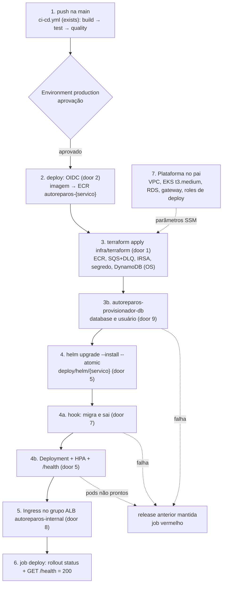

# Deploy por serviço

**Approved**: 2026-11-15 - user: "Plano está aprovado" (na mesma mensagem: "a configuração do github deve ser parte do plano por sua parte, só me peça as variáveis se for necessário ou gere automaticamente" e "Credencial admin do RDS; NAT-> use recomendado", incorporados como D-54, D-55 e D-56)

Decisões de origem: D-40 a D-47, D-50 a D-56 (D-49 substituída pela D-54) em [`especificacao/index.md`](../especificacao/index.md#61-decididas) (AD-043 a AD-054); justificativa em [ADR-004](../../../../docs/architecture/ADR-004-migrations-por-job-pre-upgrade.md) e [ADR-005](../../../../docs/architecture/ADR-005-deploy-independente-por-microsservico.md).

## Problem

O PDF da Fase 4 exige que cada microsserviço tenha infraestrutura própria e um pipeline independente que termine em **deploy automatizado em Kubernetes**, e o vídeo precisa mostrar o deploy de pelo menos um serviço com validação dos testes. Hoje nenhum repositório de serviço implanta nada: o único caminho até o EKS é o `deploy-app.yml` manual do pai, que publica só o Cadastros e o Web num release único sem rollback. OS, Cobrança e Execução não existem na AWS: sem imagem (o OS nem tem Dockerfile), sem `/health`, sem ECR, sem chart, sem rota, sem filas SQS, sem tabelas DynamoDB, sem database e sem identidade AWS nos pods. Evidência: levantamento de 13/11 no § 2 da [spec de CI/CD](../especificacao/cicd/fase4_spec_cicd_e_protecao_de_branches.md#2-estado-atual) e `scripts/specs/assert_pipelines.py --check deploy-producao`, que falha nos 4 serviços.

Quando isto estiver pronto, um merge na `main` de qualquer um dos quatro serviços, depois de build, testes e qualidade verdes e da aprovação no Environment `production`, cria os recursos AWS daquele serviço, migra a database dele e atualiza só aquele serviço no EKS; uma versão que não fica saudável é desfeita sozinha.

## Shape

Reaproveita a plataforma do pai (VPC, EKS, RDS, ALB interno, API Gateway, bucket de state, OIDC do cluster) e o padrão do Cadastros (Job que migra e sai, chart do subchart `api`), em vez de criar uma plataforma nova. As regras que decidem o resultado ficam em artefatos que o repositório consegue testar sem AWS: `terraform validate`, `helm template` e os `assert_*.py` do pai, mais testes .NET para `/health` e para a flag de migration.

1. push na `main` de um serviço -> `ci-cd.yml` do serviço (exists) - `build`, `test` (cobertura ≥ 80%) e `quality` precisam passar; o job novo `deploy` só existe na `main` e espera aprovação no Environment `production`
2. job `deploy` (new) - assume a role OIDC do repositório (door 2) na conta `198903849859`, publica a imagem no ECR do serviço com a tag igual ao SHA
3. `infra/terraform` do serviço (door 1) - `terraform apply` com state `servicos/<servico>/production.tfstate` (door 3): ECR, filas e DLQs de entrada do serviço (door 4), role IRSA, senha da database no Secrets Manager e, no OS, as 2 tabelas DynamoDB da Saga; lê a plataforma só pelos parâmetros SSM `/autoreparos/production/*` (D-53), sem `terraform_remote_state`; em seguida o job chama a Function URL do `autoreparos-provisionador-db` (door 9), assinada com a role do repositório, que cria a database e o usuário do serviço se ainda não existem
4. `deploy/helm/{servico}` (door 5) - `helm upgrade --install --atomic` no namespace do serviço (door 6): o hook migra com `Database__RunMigrations=true` (door 7, D-47), depois o Deployment com 1 réplica, HPA 1–3, probes em `/health` e ServiceAccount com a role IRSA
5. Ingress do serviço no grupo ALB compartilhado `autoreparos-internal` (door 8, o mesmo ALB interno que o VPC Link do API Gateway já usa) - regras por prefixo de rota; o API Gateway (exists) continua mandando `ANY /api/{proxy+}` ao ALB
6. out: `kubectl rollout status` e `GET /health` = 200 no serviço; com falha, o `--atomic` volta a release anterior e o job termina vermelho
7. pai (exists) - `stacks/base` troca o padrão da variável existente `instance_types` para `["t3.medium"]` (2–3 nós), cria os namespaces dos serviços (provider kubernetes no próprio stack) e as roles OIDC de deploy com access entry por namespace (cluster com `access_config` `API_AND_CONFIG_MAP`); a plataforma publica no SSM o que os serviços leem (nome do cluster, provedor OIDC do cluster, endereço do RDS, ARN do segredo admin, URL do API Gateway); `provision-aws.yml` e `deploy-app.yml` deixam de construir e implantar o Cadastros; o chart guarda-chuva perde o subchart `api` e mantém Web e observabilidade; a plataforma ganha a Lambda `autoreparos-provisionador-db` (D-54) e os VPC endpoints gratuitos de S3 e DynamoDB (D-55); `scripts/infra/configurar-github.sh` configura variáveis, secrets e Environments do pai e dos 4 serviços, gerando os valores que não dependem de ninguém (D-56)

Data: none de negócio - nenhum modelo de domínio muda; o que é criado são recursos AWS e databases vazias que as migrations existentes preenchem.

**Changes underneath**

| Front | What changes |
| --- | --- |
| domain | Nenhum termo de domínio muda. |
| stored data | OS, Cobrança e Execução passam a ter database própria no RDS de produção, criada vazia e preenchida pelas migrations existentes; a database do Cadastros (`autoreparos_db`, D-34) não muda e não é recriada. |
| readers | O API Gateway passa a alcançar OS, Cobrança e Execução pelo ALB; os serviços passam a ler URLs de fila, tabelas e connection string de configuração injetada pelo chart; o Cadastros deixa de ser implantado pelo pai. |
| startup | Cobrança e Execução deixam de migrar no startup quando `Database__RunMigrations` não está ligado no cluster; no `docker compose` e nos testes o comportamento atual continua. |

## Surface

| Route | In | Out | Status | Who |
| --- | --- | --- | --- | --- |
| `GET /health` em OS, Cobrança e Execução | nada | texto `Healthy` | `200`; `503` se a database não responde | anyone (probe do kubelet e health check do ALB) |

Roteamento público pelo ALB (o API Gateway não muda):

| Prefixo | Serviço |
| --- | --- |
| `/api/v1/ordens-servico`, `/api/v1/admin/sagas` | OS |
| `/api/v1/orcamentos`, `/api/v1/pagamentos`, `/api/v1/webhooks/mercado-pago` | Cobrança |
| `/api/v1/execucoes`, `/api/v1/fila-execucao`, `/api/v1/servicos`, `/api/v1/insumos` | Execução |
| `/api`, `/.well-known`, `/health` (demais) | Cadastros |

## Landing

| One-way door | Literal shape | Alternative rejected |
| --- | --- | --- |
| 1. IaC exclusiva no repositório do serviço | `infra/terraform/` em cada serviço, `terraform apply` dentro do job `deploy` | Stack central no Infra.K8s: fraco frente a "infraestrutura própria" do PDF (D-42) |
| 2. Role de deploy por repositório | `autoreparos-deploy-<servico>`, criada pelo Terraform da plataforma (`stacks/base`), trust só em `repo:Grupo78-PosTech-15SOAT/AutoReparos.<Repo>:environment:production`; permissões limitadas por nome a `autoreparos-<servico>-*` (ECR, SQS, Secrets Manager `autoreparos/production/<servico>/*`, DynamoDB no OS), à chave `servicos/<servico>/` do state, à tabela de lock e a `lambda:InvokeFunctionUrl` do `autoreparos-provisionador-db`; `iam:CreateRole` só com o permissions boundary `autoreparos-servico-boundary`; access entry com `AmazonEKSEditPolicy` só no namespace do serviço | Reusar o `AWS_ROLE_ARN` do pai: um serviço poderia alterar os recursos e o namespace dos outros |
| 3. State do Terraform do serviço | bucket `autoreparos-tfstate-198903849859` (`TF_STATE_BUCKET`, criado pelo bootstrap na conta nova; o nome antigo pertence à conta 053550652887), chave `servicos/<servico>/production.tfstate`, lock na tabela existente | Bucket por serviço: mais um bootstrap por repositório sem ganho |
| 4. Nomes de recursos e dono da fila | ECR `autoreparos-<servico>`; fila pertence ao consumidor: `autoreparos-<servico>-<finalidade>` e `autoreparos-<servico>-<finalidade>-dlq`, em português (L-02); produtores montam a URL pelo nome e recebem `sqs:SendMessage` só nessas ARNs; tabelas do OS mantêm `autoreparos-os-saga` e `autoreparos-os-saga-eventos` | Fila criada pelo produtor: o consumidor dependeria do deploy de outro serviço para existir |
| 5. Chart no repositório | `deploy/helm/{servico}/`, release `<servico>`, imagem com tag igual ao SHA | Subcharts no guarda-chuva: release único acopla os serviços (D-43) |
| 6. Namespace por serviço | `os`, `cobranca`, `execucao`, `cadastros`; Web e observabilidade continuam em `autoreparos` | Namespace compartilhado: a access entry da role de deploy não consegue limitar um serviço aos próprios objetos |
| 7. Flag de migration | `Database__RunMigrations=true` migra e encerra com código 0 sem abrir HTTP, em todos os serviços (nome do Cadastros) | Uma chave por serviço: o chart e o ADR-004 ficariam com quatro dialetos |
| 8. Grupo do ALB | anotação `alb.ingress.kubernetes.io/group.name: autoreparos-internal` (nome do grupo existente) em todos os Ingress públicos, `group.order` menor para OS, Cobrança e Execução e maior para o `/api` do Cadastros | Um ALB por serviço: o VPC Link do API Gateway aponta para um único listener |
| 9. Database e usuário | `os_db`/`os_app`, `cobranca_db`/`cobranca_app`, `execucao_db`/`execucao_app`; senha em `autoreparos/production/<servico>/database`; criados só pela Lambda `autoreparos-provisionador-db` (Function URL com `AuthType AWS_IAM`), que deriva o serviço da role `autoreparos-deploy-<servico>` que assinou a chamada e é a única que lê a credencial admin do RDS | Usuário admin compartilhado: viola "nenhum serviço acessa o banco de outro"; Job no chart com o admin (D-49): o pipeline de qualquer serviço alcançava o admin |
| 10. Provider AWS do Infra.Database (achado no build, 16/11) | `hashicorp/aws` `>= 6.28, < 7.0` em `submodules/AutoReparos.Infra.Database/terraform` (lock 6.73.0); o state `database/terraform.tfstate` passa a ser gravado pela 6.x | Ficar na 5.x: não existe `invoked_via_function_url` no `aws_lambda_permission`, e um `lambda:InvokeFunction` sem essa condição deixaria a role de deploy invocar o provisionador direto com um evento forjado |

- Nothing else in this change is hard to reverse

## Criteria

### S1: Cada serviço sobe sozinho e diz se está saudável (P1)

O serviço tem imagem, responde à probe e sabe só migrar quando pedido.

**Acceptance Criteria**

1. WHEN `docker build` roda no repositório do OS THEN a imagem SHALL ser construída a partir de um `Dockerfile` do próprio repositório, escutar na porta `8080` e rodar como usuário não root
2. WHEN `GET /health` é chamado em OS, Cobrança ou Execução com a database acessível THEN o serviço SHALL responder `200` sem exigir autenticação
   - sem token → `200`; com database fora → `503`
3. IF `Database__RunMigrations=true` THEN OS, Cobrança e Execução SHALL aplicar as migrations pendentes e encerrar com código `0` sem abrir a porta HTTP
   - database vazia → todas as migrations aplicadas e saída `0`; migration que falha → saída diferente de `0`
4. WHILE o serviço roda no cluster (`Database__SkipStartupMigration=true`) Cobrança e Execução SHALL iniciar sem chamar `MigrateAsync()`
   - sem a flag (compose e testes) → continuam migrando no startup como hoje

### S2: Os recursos AWS de cada serviço vêm do repositório dele (P1)

**Acceptance Criteria**

5. WHEN `terraform validate` roda em `infra/terraform` de OS, Cobrança, Execução e Cadastros THEN SHALL passar, e o backend SHALL usar a chave `servicos/<servico>/production.tfstate`
6. The Terraform de cada serviço SHALL declarar o ECR `autoreparos-<servico>`, as filas de entrada do serviço com a DLQ correspondente (`redrive_policy` com `maxReceiveCount`), uma role IRSA presa ao ServiceAccount `<servico>` do namespace `<servico>` e o segredo `autoreparos/production/<servico>/database`
7. The Terraform do OS SHALL declarar as tabelas `autoreparos-os-saga` e `autoreparos-os-saga-eventos` (esta com TTL) e dar à role IRSA do OS acesso só a elas
8. IF a role IRSA de um serviço tenta `sqs:SendMessage` THEN a política SHALL permitir só as filas que o código do serviço publica e negar as demais
   - OS → filas de entrada de Cobrança, Execução e Cadastros e as próprias; Execução → não alcança a tabela da Saga

### S3: O chart instala, migra e desfaz sozinho (P1)

**Acceptance Criteria**

9. WHEN `helm template deploy/helm/{servico}` renderiza THEN SHALL produzir um Job de migration com hook `pre-install,pre-upgrade` e `hook-delete-policy: before-hook-creation,hook-succeeded`, e nenhum Job de criação de database
10. The Deployment de cada chart SHALL ter 1 réplica, HPA de 1 a 3, `readinessProbe` e `livenessProbe` em `/health` porta `8080`, ServiceAccount com a anotação da role IRSA e as variáveis `AWS_REGION=us-east-1` e `Database__SkipStartupMigration=true`
11. The Ingress de cada chart SHALL usar o grupo ALB `autoreparos-internal` com os prefixos da tabela de roteamento do `Surface`, e o do Cadastros SHALL ter `group.order` maior que os de OS, Cobrança e Execução
12. IF o provisionador recebe a chamada da role `autoreparos-deploy-<servico>` THEN SHALL criar só `<servico>_db` e `<servico>_app` com a senha de `autoreparos/production/<servico>/database`, de forma idempotente
    - database já existe → sucesso sem recriar nem trocar a senha; chamada de outra role (ou sem assinatura) → `403` sem tocar no banco; role do OS → nunca cria `cobranca_db`
13. The chart SHALL ler a connection string do serviço de um Secret do namespace do serviço, e nenhum objeto renderizado pelo chart nem a role de deploy SHALL referenciar a credencial admin do RDS (`autoreparos/production/database/credentials`)

### S4: Merge na `main` implanta o serviço (P1)

**Acceptance Criteria**

14. WHEN há push na `main` de OS, Cobrança, Execução ou Cadastros THEN o workflow de CI/CD do serviço SHALL ter um job `deploy` que depende de `build`, `test` e `quality`, roda só em `refs/heads/main`, usa `environment: production`, `id-token: write`, a região `us-east-1`, chama o provisionador antes do Helm e usa `helm upgrade --install --atomic`
15. IF qualquer um de `build`, `test` ou `quality` falha THEN o job `deploy` SHALL não rodar
16. WHEN o `helm upgrade` termina THEN o job SHALL executar `kubectl rollout status` e um `GET /health` no Service e falhar se a resposta não for `200`
17. WHEN há push na `develop` ou em PR THEN o workflow de CI/CD SHALL não publicar imagem nem implantar (D-41)
18. The `scripts/specs/assert_pipelines.py --check deploy-producao` SHALL passar nos 4 serviços, com a regra de staging removida (AD-044)

### S5: O pai fica só com a plataforma (P1)

**Acceptance Criteria**

19. The `stacks/base` do Infra.K8s SHALL ter a variável `instance_types` com padrão `["t3.medium"]`, `desired`/`min` 2 e `max` 3 (D-44)
20. The plataforma SHALL criar os namespaces `os`, `cobranca`, `execucao` e `cadastros`, o permissions boundary `autoreparos-servico-boundary` e as 4 roles `autoreparos-deploy-<servico>` com trust por `environment:production` do repositório e access entry limitada ao namespace do serviço
    - role da Cobrança tentando `sqs:CreateQueue` com nome `autoreparos-os-*` → negado; tentando criar role IAM sem o boundary → negado
21. WHEN os workflows de provisionamento e de deploy do pai rodam THEN SHALL construir e publicar só a imagem do Web, e o `helm upgrade` do guarda-chuva SHALL não conter mais o subchart `api`
22. The chart guarda-chuva SHALL manter o Ingress do Web no grupo `autoreparos-internal` com a ordem mais alta (último a casar)
23. The plataforma SHALL publicar no SSM `/autoreparos/production/eks/cluster_name`, `/eks/oidc_provider_arn` e `/eks/oidc_provider_url`, além dos parâmetros que já existem (`vpc_id`, sub-redes, `database/address`, `database/secret_arn`, `apigateway/endpoint`), e o Terraform de cada serviço SHALL ler a plataforma só por `aws_ssm_parameter` (D-53)
    - Terraform de serviço com `terraform_remote_state` → reprovado pela prova estática
24. The plataforma SHALL criar a Lambda `autoreparos-provisionador-db` dentro da VPC, com acesso de rede ao RDS, Function URL com `AuthType AWS_IAM` e a única role com `secretsmanager:GetSecretValue` na credencial admin do RDS (D-54)
25. The VPC SHALL ter os endpoints do tipo gateway de S3 e DynamoDB associados às tabelas de rota privadas, mantendo um NAT Gateway (D-55)
26. WHEN `scripts/infra/configurar-github.sh` roda THEN SHALL deixar o pai com `AWS_ACCOUNT_ID=198903849859`, o `TF_STATE_BUCKET` novo e o `AWS_ROLE_ARN` de `autoreparos-github-pai` em `production` e `aws-bootstrap`, e cada serviço com `AWS_REGION`, `TF_STATE_BUCKET`, `TF_LOCK_TABLE` e o Environment `production` (revisores José e Enrico, só `main`, `AWS_ROLE_ARN` da role do serviço), gerando a chave JWT, a `CHAVE_INTERNA` (a mesma no pai e no Cadastros) e a senha do usuário inicial, guardadas também como `SecureString` no SSM; só a chave do SendGrid é pedida (D-56)
    - rodar duas vezes → mesmo estado, sem gerar chaves novas por cima das que existem

### S6: Um serviço implantado de verdade (P1)

**Acceptance Criteria**

27. WHEN a Execução recebe um merge na `main` e a aprovação no Environment `production` THEN o pipeline SHALL terminar verde e `GET <API Gateway>/api/v1/servicos` com um token emitido pelo Cadastros no mesmo ambiente SHALL responder `200` com o catálogo semeado (a rota exige login, então o `200` prova a busca da chave em `/.well-known` pelo ALB)
    - sem token → `401`
28. IF uma versão com `/health` quebrado é implantada THEN o `--atomic` SHALL restaurar a revisão anterior e `helm history` SHALL mostrar a revisão falha como `failed` e a anterior de novo como `deployed`

## Out of scope

| Excluded | Why |
| --- | --- |
| Staging na `develop` | D-41 |
| Tópicos SNS e assinaturas | D-46: entram depois como recurso aditivo, sem trocar filas |
| Propagação de trace nas mensagens, dashboard da Saga | `infra-ci-observabilidade` AC 5 |
| Aplicar a proteção da `main` e o `SONAR_TOKEN` | `infra-ci-observabilidade` AC 2; o `deploy` depende do `quality` verde, então o token precisa existir antes do primeiro deploy |
| Credenciais do Mercado Pago | José ainda não tem; a Cobrança sobe sem elas, checkout e webhook ficam para quando existirem |
| Deploy do Web e da AuthLambda | Continuam no pai (D-45) |
| Rotas públicas de `/api/v1/admin/dlq/reprocessar` | A mesma rota existe em OS, Cobrança e Execução e não dá para separar por prefixo; ficam acessíveis por `kubectl port-forward` |
| Renomear a database do Cadastros | D-34: recriaria o RDS |
| Mudanças no Web e nos endpoints de negócio | Frontend fica como está; `web-adaptacao` é do Enrico |

## Assumptions

| Assumption | Chosen default | Rationale | Confirmed? |
| --- | --- | --- | --- |
| Conta AWS | `198903849859`, do José, plano gratuito com US$ 100; a plataforma é provisionada nela antes do primeiro deploy | D-50 (substitui a D-48) | y - José: "Sim, minha conta (Recommended)" |
| Créditos para testes e vídeo | US$ 100, perto de 330 h a US$ 0,30/h (EKS + NAT + 2 `t3.medium`); o ambiente é destruído depois do vídeo | `freetier get-account-plan-state` em 15/11: FREE, ACTIVE, US$ 100; depois da entrada na organização os créditos ficam na conta gerencial `156342300286`; budget com avisos em US$ 50 e US$ 90 (D-51) | y - José |
| Identidade dos pods | IRSA, pelo OIDC provider que o cluster já tem | O cluster já usa IRSA no LB Controller e no EBS CSI; Pod Identity exigiria outro add-on | n |
| Segredos do serviço | Gerados pelo `configurar-github.sh` (chave JWT, `CHAVE_INTERNA`, senha do usuário inicial) e gravados no GitHub e como `SecureString` no SSM; a chave do SendGrid é pedida ao José; Mercado Pago vazio; senha da database pelo Terraform do serviço no Secrets Manager | D-56 | y - José: "só me peça as variáveis se for necessário ou gere automaticamente" |
| Mercado Pago | Variáveis vazias; a Cobrança sobe e o checkout responde erro de integração | José: "Eu ainda não tenho" | y - José: "Eu ainda não tenho" |
| Validação de JWT entre serviços | `Authentication__Authority` e o issuer do Cadastros recebem a mesma URL pública do API Gateway, lida pelo job de deploy em `/autoreparos/production/apigateway/endpoint`; a variável `CADASTROS_ISSUER` fica dispensada; os pods buscam o discovery pela NAT | O `iss` do token é a URL pública; ler do SSM (D-53) garante o mesmo valor nos 4 serviços | n |
| Ordem do primeiro deploy | Plataforma (pai) → Cadastros → Execução → Cobrança → OS | Cada um depende de JWKS do Cadastros; o OS publica nas filas dos outros, que o consumidor cria | n |
| Teto de gasto | Desligamento automático em US$ 80 do orçamento total de US$ 100 (D-52): apaga EKS, nós, NAT, load balancers e RDS e anexa `autoreparos-congelado` às roles `autoreparos*`, inclusive as de deploy desta feature; fora do Terraform para o `destroy-aws.yml` não apagá-lo | José: "Faça impedir" | y - José: "Faça impedir" |
| Base das branches | `feature/deploy-servicos` no pai e nos submódulos a partir da `feature/saga-compensacoes` | É o backend verificado; o WIP da `web-adaptacao` não entra | n |

**Open questions:** two, both `blocks go-live`, listed below.

- `blocks go-live` - A plataforma precisa ser provisionada na conta `198903849859` (bootstrap e `provision-aws.yml` depois do S5); OIDC do GitHub e `autoreparos-github-pai` criados em 15/11, variáveis pelo AC 26.
- `blocks go-live` - Os merges na `main` dos serviços dependem da cadeia de PRs #49 → #48 → #46 chegar à `develop` e da `develop` chegar à `main`.

## Differences from the source

None - o PDF pede deploy automatizado em Kubernetes por serviço, sem desenho a reproduzir.

## Sources

- [PDF da Fase 4](../../../../docs/tech-challenge/15SOAT%20-%20Fase%204%20-%20Tech%20challenge.pdf) - binding - CI/CD Automatizado, Infraestrutura e Entregáveis (Dockerfile, manifestos Kubernetes, pipelines)
- [Spec de CI/CD § 2–4](../especificacao/cicd/fase4_spec_cicd_e_protecao_de_branches.md) - estado atual de 13/11 e proposta
- [ADR-004](../../../../docs/architecture/ADR-004-migrations-por-job-pre-upgrade.md), [ADR-005](../../../../docs/architecture/ADR-005-deploy-independente-por-microsservico.md)
- [`infra-ci-observabilidade/plan.md`](../infra-ci-observabilidade/plan.md) - ACs 3, 4 e 7 transferidos para esta feature (D-40)
