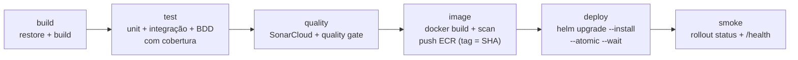

# Especificação Fase 4 — CI/CD por Microsserviço e Proteção de Branches

> **Projeto:** AutoReparos - Sistema Integrado de Oficina Mecânica  
> **Fase:** Tech Challenge FIAP SOAT - Fase 4 (15SOAT)  
> **Critério do PDF:** Requisitos obrigatórios → *CI/CD Automatizado* e Infraestrutura → *Deploy automatizado para ambiente Kubernetes*  
> **Requisitos cobertos (índice):** R22, R23, R24, R25, R26, R28, R33  
> **Repositórios afetados:** os 4 serviços, `AutoReparos.Web`, `AutoReparos.AuthLambda`, `AutoReparos.Infra.K8s`, `AutoReparos.Infra.Database`, `AutoReparos` (pai e `scripts/infra/setup-github-governance.sh`)  
> **Base:** [Diagnóstico do estado atual](../diagnostico/fase4_diagnostico_estado_atual.md) · **Índice:** [`../index.md`](../index.md)  
> **Status:** Revisada em 15/11 — estado atual de 13/11; deploy por serviço decidido (D-40 a D-49) e planejado em `deploy-servicos`

---

## 1. Critério

> Cada microsserviço deverá ter **pipeline independente de CI/CD** com:
> - Build;
> - Testes automatizados;
> - Verificação de qualidade;
> - Deploy automatizado em ambiente Kubernetes.
>
> **Repositórios protegidos** (branch `main` com PR obrigatório e checagens automáticas).

---

## 2. Estado atual

Levantamento de 13/11/2026 na branch `feature/saga-compensacoes` (ponteiros dos submódulos fixados nela). Substitui o retrato de 09/11.

### 2.1 Pipelines e deploy

| Repositório | Workflow | Build | Testes | Qualidade | Imagem | Deploy K8s |
|---|---|---|---|---|---|---|
| OS | `ci-cd.yml` | ✅ | ✅ cobertura ≥ 80% | ✅ SonarCloud | ❌ **sem Dockerfile** | ❌ |
| Cobranca | `ci-cd.yml` | ✅ | ✅ | ✅ | ❌ (Dockerfile na raiz, sem job) | ❌ |
| Execucao | `ci-cd.yml` | ✅ | ✅ unitário + integração | ✅ | ❌ (Dockerfile na raiz, sem job) | ❌ |
| Cadastros | `ci-cd.yml` | ✅ | ✅ | ✅ | só pelo pai | só pelo pai |
| Web | `ci-cd.yml` | ✅ | ✅ | ✅ | só pelo pai | só pelo pai |
| AuthLambda | `ci.yml` (push/PR) | ✅ | ✅ | ❌ | n/a (zip) | n/a (Terraform aplicado pelo pai) |
| Infra.K8s / Infra.Database | `ci.yml` (push/PR) | n/a | `fmt`/`validate`/`helm lint` | ❌ | n/a | apply só pelo pai |
| AutoReparos (pai) — `ci.yml` | push/PR | ✅ só `AutoReparos.slnx` (Cadastros e AuthLambda) e `yarn build` do Web | ✅ | ❌ | — | — |
| AutoReparos (pai) — `provision-aws.yml` / `deploy-app.yml` | **manual** (`workflow_dispatch` na `main`, texto de confirmação, Environment `production`) | ✅ | — | ❌ | ✅ Cadastros → ECR `autoreparos-api`, Web → `autoreparos-web` | ✅ um release Helm único `autoreparos` do chart guarda-chuva `Infra.K8s/k8s`, `--wait` **sem `--atomic`**; smoke só por `rollout status` |

Outros pontos:

- **OIDC:** só o pai autentica na AWS, pelo secret `AWS_ROLE_ARN`. Não há role por repositório nem *access entry*/RBAC por namespace no EKS.
- **Segredos:** a connection string vem do Secrets Manager (`autoreparos/production/database/credentials`); JWT, chave interna, SendGrid e senhas vêm de GitHub Secrets do pai e entram no cluster por `kubectl apply`.
- **Migrations:** três modelos diferentes. Cadastros usa um Job com `Database__RunMigrations=true` criado pelo workflow do pai; Cobrança e Execução chamam `MigrateAsync()` incondicional no startup; o OS não migra (o README manda rodar `dotnet ef database update`).
- **Health:** só Cadastros e Web expõem `/health`; OS, Cobrança e Execução não têm endpoint de saúde para probes nem para o health check do ALB.
- **Actions:** os repositórios de serviço já fixam por SHA com a tag em comentário; pai, AuthLambda e Infra ainda usam tag.
- **Prova:** `scripts/specs/assert_pipelines.py --check deploy-staging` e `--check deploy-producao` já existem e hoje falham nos 5 repositórios.

### 2.2 Plataforma na AWS (Infra.K8s, Infra.Database)

| Recurso | Estado |
|---|---|
| Rede e cluster (`stacks/base`) | VPC `10.0.0.0/16`, 2 AZs, 1 NAT; EKS 1.35 `autoreparos-cluster` em `us-east-1`, node group `t3.small` 2–4 nós |
| Add-ons (`stacks/platform`) | AWS Load Balancer Controller (ALB interno), metrics-server, EBS CSI |
| Borda (`stacks/gateway`) | API Gateway HTTP com VPC Link para o listener do ALB interno; `POST /auth/cliente` (Lambda), `ANY /api/{proxy+}`, `/health`, `/` |
| Ingress (chart guarda-chuva) | `/api` e `/health` inteiros → Cadastros; `/` → Web; `/internal` → Cadastros num ALB separado. **Não há rota para OS, Cobrança e Execução** |
| ECR | só `autoreparos-api` (Cadastros) e `autoreparos-web` |
| RDS (`Infra.Database`) | 1 instância PostgreSQL 16 `db.t4g.micro`, **1 database `autoreparos_db` e 1 usuário admin**; nenhuma database ou usuário para OS, Cobrança e Execução |
| Mensageria e Saga | **nenhuma** fila/DLQ SQS, tópico SNS ou tabela DynamoDB em IaC. O código já depende de SQS (7 URLs no OS, 4 na Cobrança, 5 na Execução, 2 no Cadastros) e de 2 tabelas DynamoDB no OS (`autoreparos-os-saga`, `autoreparos-os-saga-eventos`). Nenhum serviço usa SNS ainda (D-19 adiado por AD-024) |
| Identidade dos pods | sem IRSA/Pod Identity e sem `AWS_REGION` no chart; o node role não tem SQS nem DynamoDB, então nem o consumidor de notificações do Cadastros autentica no EKS |
| Observabilidade | subchart `observability` (OTel Collector, Prometheus, Jaeger, Loki, Grafana em ClusterIP) |

### 2.3 Proteção de branches

`scripts/infra/setup-github-governance.sh` já protege a `main` de OS, Cobranca, Execucao, Cadastros e Web exigindo `build`, `test` e `quality` (D-25); AuthLambda e Infra ficam sem checks e o pai fica fora do script. A aplicação real no GitHub depende do `SONAR_TOKEN` em cada repositório (ver `infra-ci-observabilidade`) e não foi reconferida em 13/11.

---

## 3. Lacunas

1. **Nenhum repositório de serviço publica imagem nem faz deploy.** O único caminho até o EKS é o deploy manual do pai, que só cobre Cadastros e Web, num release único e sem rollback automático.
2. **OS, Cobrança e Execução não existem no cluster:** sem Dockerfile (OS), sem `/health`, sem ECR, sem chart, sem rota no Ingress e no API Gateway.
3. **Recursos de runtime sem IaC:** filas e DLQs SQS, tabelas DynamoDB da Saga e databases/usuários por serviço não são provisionados por ninguém; o Cadastros recebe as URLs de fila por variáveis manuais.
4. **Pods sem identidade AWS:** sem IRSA ou Pod Identity, nenhum serviço consegue usar SQS ou DynamoDB no EKS.
5. **Migrations em três modelos diferentes**, duas delas no startup sem controle de concorrência entre réplicas.
6. **Capacidade:** o node group `t3.small` 2–4 foi dimensionado para um serviço e a observabilidade; quatro serviços com 2 réplicas cada não cabem com folga.
7. **Inconsistências no chart atual:** o Cadastros lê `OpenTelemetry:*`, mas o chart injeta `Telemetry__*` (exporta para `localhost` no EKS); duas chaves de migração (`SkipStartupMigration` e `RunMigrations`); `scripts/infra/build-push-images.sh` e `scripts/k8s/test-local-helm.sh` apontam para um Dockerfile que não existe.
8. **Superadas desde 09/11:** qualidade no CI (os 5 têm `quality` com SonarCloud) e inclusão dos repositórios novos no script de governança.

---

## 4. Proposta (a validar)

> **Decidido em 15/11 (D-40 a D-56):** deploy só em produção, Terraform e chart no repositório de cada serviço, database criada pelo provisionador da plataforma chamado pelo pipeline do serviço (D-54), Job de migration no chart, pai só com a plataforma, endpoints de S3 e DynamoDB na VPC (D-55) e configuração do GitHub por script (D-56). O desenho implementável está no plano [`deploy-servicos`](../../deploy-servicos/plan.md) e a justificativa no [ADR-005](../../../../../docs/architecture/ADR-005-deploy-independente-por-microsservico.md) e no [ADR-004](../../../../../docs/architecture/ADR-004-migrations-por-job-pre-upgrade.md). Onde esta seção diverge, valem as decisões.

### 4.1 Pipeline padrão de cada serviço (`.github/workflows/ci-cd.yml`)

| Job | Quando roda | Detalhes |
|---|---|---|
| `build` | PR e push | `dotnet restore`/`build` |
| `test` | PR e push | Testcontainers no runner; publica `.trx` e cobertura como artefatos |
| `quality` | PR e push | SonarCloud com `sonar.qualitygate.wait=true` ([spec de testes](../testes-qualidade/fase4_spec_testes_e_qualidade.md)) |
| `image` | push na `main` (D-41) | Build da imagem, scan (ECR scan on push já existe), push no ECR do próprio serviço |
| `deploy` | push na `main` → produção com aprovação no Environment `production` (D-41; o staging da D-22 saiu) | OIDC → role do repositório → `aws eks update-kubeconfig` → Job de migration (hook do Helm) → `helm upgrade --install --atomic` no namespace do serviço |
| `smoke` | após o deploy | `kubectl rollout status` e chamada ao `/health` do serviço pelo ingress |

Regras:

- **Rollback automático:** `--atomic` desfaz a release se os pods não ficarem prontos.
- **OIDC por repositório:** uma role IAM por serviço, com trust policy restrita a `repo:Grupo78-PosTech-15SOAT/<repo>:ref:refs/heads/main` e permissões mínimas (push no próprio ECR, `eks:DescribeCluster`), mapeada por *access entry* do EKS para um papel RBAC limitado ao namespace do serviço.
- **Segredos:** GitHub Secrets do próprio repositório ou External Secrets lendo o Secrets Manager. Não usar um segredo compartilhado entre serviços.
- **Versão:** a tag da imagem é o SHA do commit; o chart fica em `deploy/helm/<servico>` no repositório do serviço.
- **Versão das actions:** fixar por SHA completo com a tag em comentário (`uses: actions/checkout@<sha> # v6.0.2`), como pede a regra em `.agents/` e o SonarCloud; o Dependabot atualiza o SHA e o comentário.
- **Environment `production`** no GitHub com proteção (aprovação opcional) para o job de deploy.

### 4.2 Repositórios de plataforma e o pai (D-13)

| Repositório | Papel no CI/CD |
|---|---|
| Infra.K8s, Infra.Database, AuthLambda | CI de validação (`fmt`, `validate`, `tflint`, `helm lint`, testes da Lambda) e `apply` manual ou na `main` com Environment protegido |
| AutoReparos (pai) | CI de integração (build e testes dos submódulos, BDD ponta a ponta opcional) e o **provisionamento da plataforma** que já existe (`Bootstrap`, `Provision AWS`, `Teardown AWS`). **Deixa de fazer** o deploy dos serviços |

**D-13 decidido (convergente com o plano `infra-ci-observabilidade` do Enrico, que rejeita a pipeline única no pai):** manter o provisionamento centralizado do pai (mesclado em 06/11) para a **plataforma** (rede, EKS, RDS, gateway, Lambda) e mover o **deploy dos serviços** para o pipeline de cada repositório, como o PDF exige. O `Deploy application` do pai pode continuar como atalho manual para subir tudo de uma vez (por exemplo, antes de gravar o vídeo), desde que chame os mesmos charts dos repositórios dos serviços. A retirada do `Deploy application` como caminho principal é combinada com o Enrico, autor do modelo atual.

### 4.3 Proteção de branches

Atualizar [`scripts/infra/setup-github-governance.sh`](../../../../../scripts/infra/setup-github-governance.sh):

1. Incluir os repositórios novos com os nomes em português (OS, Cobranca, Execucao, Cadastros, Web e, se houver, Notificacao).
2. Preencher `required_status_checks.contexts` por repositório com os nomes dos jobs (por exemplo, `build`, `test`, `quality`) em vez de `[]`.
3. Aplicar no pai a mesma regra dos filhos (1 aprovação, checks, vale para admins).
4. ~~Proteger também a `develop`~~: fora por D-25 (11/11). Só a `main` tem proteção obrigatória; a `develop` segue como branch de integração sem regra no GitHub.
5. Gerar uma evidência (saída do `gh api .../branches/main/protection` e print da tela de configurações) para o README e o vídeo, atendendo ao feedback da Fase 3.

---

## 5. Passos para a mudança

1. Fechar D-13.
2. Criar o template de workflow `ci-cd.yml` e aplicá-lo nos 4 serviços (a partir do `ci.yml` atual do App e do Execution).
3. Criar o ECR de cada serviço (no Terraform do próprio serviço ou na plataforma) e a role OIDC de cada repositório, com access entry no EKS.
4. Mover o chart da API de `Infra.K8s/k8s/charts/api` para `deploy/helm/` do Cadastros e criar os charts de OS, Cobrança e Execução (ver [spec de infraestrutura](../infraestrutura/fase4_spec_infraestrutura_k8s_e_mensageria.md)).
5. Levar para o chart de cada serviço a execução de migrations que hoje está no fluxo do pai (Job com hook `pre-upgrade`).
6. Ajustar `provision-aws.yml` e `deploy-app.yml` do pai para não publicar mais as imagens nem o chart dos serviços (ou para delegar aos charts dos repositórios); manter CI de integração e provisionamento da plataforma.
7. Configurar o SonarCloud em cada repositório e incluir o job `quality`.
8. Atualizar e executar o script de governança; registrar a evidência.
9. Voltar as actions para SHA completo com a tag em comentário e ativar o Dependabot para `github-actions`, deixando o quality gate do SonarCloud verde novamente.
10. Teste do processo: abrir um PR com um teste quebrado e confirmar que o merge é bloqueado; fazer merge de um PR válido e confirmar o deploy automático (roteiro do vídeo).

---

## 6. Critérios de aceite

- [ ] Cada serviço tem seu workflow com build, testes, qualidade e deploy no EKS, sem depender do pai.
- [ ] Merge na `main` de um serviço publica a imagem e atualiza só aquele serviço no cluster.
- [ ] Release com falha de readiness é revertida automaticamente.
- [ ] `main` de todos os repositórios exige PR, aprovação e status checks (incluindo o quality gate).
- [ ] PR com teste falhando ou quality gate reprovado não pode ser mesclado.
- [ ] Evidência da proteção no README e no vídeo.
