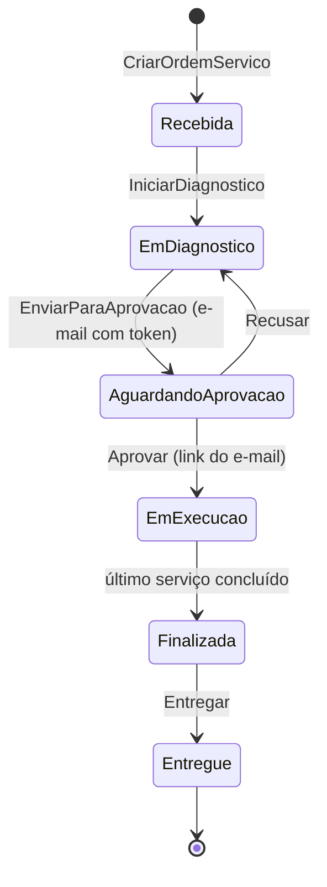

# Diagnóstico do Estado Atual — Base para a Fase 4

> **Projeto:** AutoReparos - Sistema Integrado de Oficina Mecânica  
> **Fase:** Tech Challenge FIAP SOAT - Fase 4 (15SOAT)  
> **Data do levantamento:** 04/11/2026 — **revisado em 09/11/2026** (ver § 0 e § 10)  
> **Índice da fase:** [`../index.md`](../index.md)  
> **Status:** Levantamento concluído (somente leitura: nenhuma alteração de código ou de infraestrutura foi feita)

Este documento registra a base usada por todas as specs da Fase 4. As demais specs citam este diagnóstico e trazem apenas o recorte de cada critério.

---

## 0. Revisão de 09/11/2026 — o que mudou desde 04/11

Entre 05 e 06/11, o Enrico concluiu e mesclou o **provisionamento AWS centralizado** (PRs #42 → `develop` e #43/#44 → `main` no pai; PRs equivalentes nos 4 submódulos). A branch `feature/provisionamento-aws-centralizado` foi apagada. Até a manhã de 09/11 nenhum trabalho da Fase 4 estava visível; na tarde de 09/11 o Enrico publicou os 3 serviços novos (§ 10).

| Tema | 04/11 | 09/11 |
|---|---|---|
| Pai `origin/develop` | `0c23b6a` | `005fa19` (**igual** à `origin/main` `186d83e`) |
| Workflows do pai | `deploy.yml` automático em push na `main` | `ci.yml` (PR/push) + workflows **manuais** `Bootstrap AWS Terraform backend`, `Provision AWS`, `Deploy application` e `Teardown AWS`, com Environment `production` e confirmações por texto |
| Deploy da aplicação | Automático pelo pai | **Manual** pelo pai (`Deploy application`): build das imagens API/Web e `helm upgrade` do chart do Infra.K8s |
| Terraform do Infra.K8s | State único | Stacks separadas `terraform/stacks/base`, `platform` e `gateway`; workflows de apply dos filhos removidos |
| AuthLambda | .NET 8 (`dotnet8`) | **.NET 10** (`dotnet10`) |
| RDS | Retenção de backup 1 dia | Ajustado ao plano gratuito; segredo sem janela de recuperação fixa |
| Actions | Tags (`@v4`), contrariando a regra de SHA | Trocadas **intencionalmente** de SHA para tags (`@v6.0.2` etc.) no PR #44, que **reprovou no quality gate do SonarCloud** (Security Rating C em código novo; o PR só alterava workflows) e foi mesclado mesmo assim, porque nenhum status check é obrigatório. A regra em `.agents/rules/submodules-ci-and-docs-integrity.md` continua pedindo SHA. Recomendação: voltar ao SHA com a tag em comentário (`uses: actions/checkout@<sha> # v6.0.2`) |
| Teste instável `NotificacaoServiceTests` | Falha intermitente | **Corrigido** na `develop` do App (`aca8a6b`, collection `BusinessMetrics`), ainda não referenciado pelo ponteiro do pai |
| Ambiente AWS | — | Provisionado e com deploy em 05 e 06/11 a partir da branch de feature; **Teardown AWS** executado na `main` em 06/11 12:54 e backend recriado às 13:34. Por padrão o teardown mantém RDS, EKS, VPC e ECR; não foi verificado se a remoção completa foi pedida |
| Proteção de branches | Sem status checks obrigatórios | **Sem mudança** |
| Itens da Fase 4 (mensageria, NoSQL, Saga, BDD, Mercado Pago, novos repositórios) | Inexistentes | Sem mudança na `develop`; OS, Billing, Execution, SQS e Mercado Pago na branch `feature/os-service-contracts` (§ 10) |

Impacto nas specs: o provisionamento centralizado deixou de ser "trabalho em andamento" e passou a ser a base atual (ver § 8 e D-13). As seções abaixo mantêm o retrato de 04/11, exceto onde indicado.

---

## 1. Branches e versão analisada

### 1.1 Repositório pai (`AutoReparos`)

| Branch | Commit | Situação |
|---|---|---|
| `origin/develop` | `0c23b6a` | **Base desta análise.** É a branch integrada mais atualizada: contém a `main` + 3 commits (OIDC no deploy, mapeamento do Sonar, `coverlet.runsettings`). |
| `origin/main` | `0fec960` | Release da Fase 3 (PR #39). |
| `origin/feature/provisionamento-aws-centralizado` | `86abe8f` | 3 commits à frente da `develop`, **não mesclada**, criada em 04/11/2026. Centraliza bootstrap, provisionamento e deploy no pai. As 3 últimas execuções de CI nela falharam. Ver [§ 8](#8-provisionamento-aws-centralizado-mesclado-em-0611). |
| `develop` (local) | `949d047` | 17 commits atrás de `origin/develop`. |
| `main` (local) | `ae31a8e` | 142 commits atrás de `origin/main`. |
| Locais com remoto apagado | — | `feat/ai-harness-setup`, `feat/fase3-backend-fixes`, `feat/fase3-sprint2-auth-lambda-e-portal`, `feat/fase3-submodulos`, `feat/fase3-testes-e-iac-cloud`, `feat/fase3-track-a-cloud-iac`, `feat/fase3-track-b-observabilidade`. Já mescladas; podem ser apagadas. |

### 1.2 Submódulos

Os ponteiros gravados no pai (`origin/develop`) apontam para o merge da `main` de cada submódulo. A `develop` de cada submódulo está à frente desses ponteiros. **Esta análise usou a `origin/develop` de cada submódulo.**

| Repositório | Ponteiro no pai | `origin/develop` do submódulo | O que o pai ainda não referencia | `feature/provisionamento-aws-centralizado` |
|---|---|---|---|---|
| AutoReparos.App | `b777de1` | `a3bb5df` | Correlation ID, resiliência do SendGrid, otimização do CI, healthcheck do nginx, ampliação dos testes, correção do proxy OTel no Web | +1 commit (`43ff4bc`, migrations para o deploy centralizado) |
| AutoReparos.AuthLambda | `133626e` | `932d5bb` | Módulo Terraform da Lambda (dotnet8) e workflow de empacotamento com OIDC | +1 commit (`abab863`, state e SG compartilhado) |
| AutoReparos.Infra.Database | `a3695fd` | `9e52b91` | Remote state S3 com lock no DynamoDB, auto-descoberta de VPC, scripts DDL documentais | +1 commit (`1d4c71a`, state isolado do RDS) |
| AutoReparos.Infra.K8s | `f64eb8a` | `607f1de` | Sanitização de credenciais, bootstrap S3/DynamoDB, OIDC, ingress ALB unificado, workflow manual de provisionamento | +1 commit (`b309dbc`, separação das stacks Terraform) |

**Passo preliminar:** atualizar os ponteiros dos submódulos no pai para a `develop` de cada filho antes de começar a Fase 4, para que todos partam da mesma base.

### 1.3 Repositórios da organização `Grupo78-PosTech-15SOAT`

São 5 repositórios públicos: `AutoReparos` (pai), `AutoReparos.App`, `AutoReparos.AuthLambda`, `AutoReparos.Infra.Database` e `AutoReparos.Infra.K8s`. Em 09/11 o Enrico criou `AutoReparos.OS`, `AutoReparos.Billing` e `AutoReparos.Execution` (ver § 10).

---

## 2. Aplicação (`AutoReparos.App`)

Monólito modular em .NET 10 com Clean Architecture (Domain → Application → Infra → API) e o frontend Angular 19 no mesmo repositório. Um único `AppDbContext` (PostgreSQL 16) concentra todos os contextos.

| Contexto | Onde está | Endpoints (`/api/...`) | Observação para a Fase 4 |
|---|---|---|---|
| Autenticação de operadores | `Infra/Identity`, `Application/Auth` | `auth/login` | ASP.NET Identity e JWT próprio |
| Usuários | `Domain/Usuarios` | `usuarios` (CRUD) | — |
| Clientes | `Domain/Clientes` | `clientes` (CRUD), `clientes/meus-veiculos` (portal) | A tabela `Clientes` também é lida **diretamente** pela AuthLambda |
| Veículos | `Domain/Veiculos` | `veiculos` (CRUD, `placa/{placa}`) | — |
| Serviços (catálogo) | `Domain/Servicos` | `servicos` (CRUD, `tempo-medio`) | Fonte do preço usado no orçamento |
| Insumos (estoque) | `Domain/Insumos` | `insumos` (CRUD, `adicionar-estoque`, `remover-estoque`) | Baixa de estoque **imediata** ao incluir o insumo na OS, sem devolução se o orçamento for recusado |
| Ordem de Serviço | `Domain/OrdensServicos` | `ordem-servico` (criação, itens, diagnóstico, envio para aprovação, aprovar/recusar por token, iniciar/concluir serviço, entregar, kanban, fila, consulta pública, `minhas-os`) | Concentra o fluxo que a Fase 4 distribui entre 3 serviços |
| Notificações | `Infra/Services/NotificacaoService.cs` | — | SendGrid com retry para 5xx; uma falha não interrompe o fluxo (gera log e métrica) |
| Token de aprovação | `Infra/Services/AprovacaoTokenService.cs` | — | HMAC do id da OS, **sem expiração** |
| Dashboard | `Infra/Services/DashboardQueryService.cs` | `dashboard/metrics`, `volume-diario`, `tempos-medios` | Calculado a partir dos timestamps da OS |

### 2.1 Máquina de estados atual da OS

Pontos relevantes:

- Não há estado de **pagamento** nem de **cancelamento**.
- Não há **histórico de status** persistido. Existem apenas timestamps na entidade (`DiagnosticoIniciadoEm`, `EnvioAprovacaoEm`, `IniciadoEm`, `FinalizadoEm`, `EntregueEm`) e métricas OTel de transição.
- `CriarOrdemServicoUseCase` usa `TransactionScope` local. Hoje a consistência depende de uma transação ACID num único banco, o que deixa de existir quando cada serviço tiver seu próprio banco.

---

## 3. Testes e cobertura (medição local em 04/11/2026)

Execução local a partir da `origin/develop` de cada repositório, com `coverlet.runsettings` (formato OpenCover) e excluindo `Data/Migrations` (mesma exclusão do Sonar).

| Suíte | Testes | Resultado |
|---|---|---|
| `AutoReparos.Domain.Tests` | 113 | ✅ todos passam |
| `AutoReparos.Application.Tests` | 151 | ⚠️ 1 teste instável: `NotificacaoServiceTests` — "7. Falha persistente após 3 tentativas esgota retries e emite métrica NotificacoesFalhas" falha de forma intermitente (**corrigido em 06/11**, ver § 0) |
| `AutoReparos.IntegrationTests` (Testcontainers) | 78 | ✅ todos passam |
| `AutoReparos.AuthLambda.Tests` | 40 | ✅ todos passam |

| Escopo | Linhas | Branches |
|---|---|---|
| App — somente unitários | 65,8% | 57,3% |
| App — unitários + integração | **93,0%** | **73,6%** |
| AuthLambda | **74,8%** | 62,1% |
| Web (Angular) | não medido: 1 arquivo `.spec.ts` para 71 arquivos `.ts` | — |

> O Sonar calcula "Coverage" combinando linhas e condições. Para o App, o valor estimado fica perto de 90%. A AuthLambda está **abaixo de 80%**. Se o frontend continuar no mesmo projeto Sonar do serviço de OS, ele derruba a cobertura desse serviço.

Não há testes BDD (nenhuma referência a Reqnroll, SpecFlow ou Gherkin).

---

## 4. CI/CD e qualidade

| Repositório | Workflow | Build | Testes | Cobertura publicada | Sonar | Imagem Docker | Deploy |
|---|---|---|---|---|---|---|---|
| AutoReparos.App | `ci.yml` | ✅ | ✅ unit + integração + Angular | ❌ | ❌ | ❌ | ❌ |
| AutoReparos.AuthLambda | `ci.yml` | ✅ | ✅ (coleta cobertura, não publica) | ❌ | ❌ | n/a (ZIP) | Terraform plan/apply manual com confirmação |
| AutoReparos.Infra.Database | `ci.yml` | n/a | `fmt`/`validate` | n/a | ❌ | n/a | Terraform plan/apply manual |
| AutoReparos.Infra.K8s | `ci.yml` + 4 workflows manuais | n/a | `fmt`/`validate` | n/a | ❌ | n/a | Provisionamento manual |
| AutoReparos (pai) | `deploy.yml` | ✅ todos os submódulos | ✅ | ❌ | SonarCloud por **análise automática** (GitHub App) nos PRs do pai, sem importar cobertura | ✅ API e Web → ECR | ✅ `terraform apply` + `helm upgrade` em push na `main` |

Consequência: **o deploy da aplicação acontece pelo repositório pai**, não pelo repositório da aplicação. A Fase 4 exige pipeline independente por microsserviço.

### 4.1 Proteção de branches (consulta à API do GitHub em 04/11/2026)

| Repositório | `main` | Status checks obrigatórios | `develop` |
|---|---|---|---|
| App, AuthLambda, Infra.Database, Infra.K8s | PR + 1 aprovação, `strict`, vale para admins | **Nenhum** (`contexts: []`) | sem proteção |
| AutoReparos (pai) | PR sem aprovação mínima, não vale para admins | **Nenhum** | sem proteção |

O script [`scripts/infra/setup-github-governance.sh`](../../../../../scripts/infra/setup-github-governance.sh) aplica `contexts: []`. Assim, a "checagem automática obrigatória" não é exigida de fato, embora o README da Fase 3 diga o contrário.

---

## 5. Infraestrutura

| Item | Estado | Onde |
|---|---|---|
| EKS (Managed Node Group multi-AZ, subnets privadas, OIDC provider para IRSA) | ✅ | `Infra.K8s/terraform/modules/eks` |
| API Gateway HTTP v2 | ✅ `POST /auth/cliente` → Lambda; `ANY /api/{proxy+}` e `GET /health` → VPC Link → NLB do ingress | `Infra.K8s/terraform/modules/apigateway` |
| Ingress | O Terraform instala ingress-nginx, mas `values.yaml` e `values-production.yaml` usam `className: alb` (divergência já apontada no plano centralizado) | `Infra.K8s/terraform/modules/addons`, `Infra.K8s/k8s/` |
| ECR | Só `autoreparos-api`; o deploy também publica `autoreparos-web` | `Infra.K8s/terraform/main.tf` |
| Helm | Chart guarda-chuva com `api`, `web`, `database` (Postgres no cluster, para uso local) e `observability`, **todos no repositório Infra.K8s** | `Infra.K8s/k8s/` |
| RDS PostgreSQL 16 | Instância única com database única `autoreparos_db`; segredo no Secrets Manager; parâmetros no SSM | `Infra.Database/terraform` |
| Lambda de autenticação | .NET 8; faz `SELECT ... FROM "Clientes"` direto no RDS via Npgsql | `AuthLambda/src/Services/ClienteAuthDatabaseService.cs` |
| Mensageria | ❌ inexistente | — |
| Banco NoSQL | ❌ inexistente | — |
| Observabilidade | OTel Collector → Jaeger (traces), Prometheus (métricas), Loki (logs); Grafana com 3 dashboards; exportação opcional para New Relic; `kube-prometheus-stack` instalado pelo Terraform | `Infra.K8s/k8s/charts/observability`, `docker-compose.yml` do pai, `docs/observability/` |

---

## 6. Documentação e entregáveis existentes

| Item | Estado |
|---|---|
| Swagger | Swashbuckle habilitado em todos os ambientes (`/swagger`) |
| Postman | [`Postman/AutoReparos.postman_collection.json`](../../../../../Postman/AutoReparos.postman_collection.json), atualizada em 22/07/2026. Faltam `/auth/cliente`, `minhas-os`, `meus-veiculos`, `dashboard/*` e `kanban` |
| RFCs e ADRs | [`docs/architecture/`](../../../../../docs/architecture) (RFC-001 a 003, ADR-001 a 003, modelo de dados) |
| Pacote de entrega da Fase 3 | [`docs/entrega/`](../../../../../docs/entrega) (template do portal e roteiro do vídeo) e [`docs/reports/fase3/`](../../../../../docs/reports/fase3) (LaTeX e PDF) |
| Divergências na documentação | `docs/architecture/README.md` diz que o CI do App faz análise SonarQube e gera imagem para o ECR (não faz). A regra de fixar actions por SHA (`.agents/rules/submodules-ci-and-docs-integrity.md`) não é seguida: os workflows usam `@v4`. |

---

## 7. O que a Fase 4 exige e não existe hoje

1. Nenhum microsserviço além do App (monólito) e da Lambda de autenticação.
2. Nenhuma mensageria, Saga, Outbox ou idempotência de mensagens.
3. Nenhum banco NoSQL; um único banco relacional compartilhado por todos os contextos.
4. Nenhuma integração de pagamento (Mercado Pago).
5. Nenhum teste BDD; cobertura não publicada nem verificada no CI.
6. Nenhum pipeline de deploy por serviço; o deploy é centralizado no pai.
7. Proteção de branch sem status checks obrigatórios.

---

## 8. Provisionamento AWS centralizado (mesclado em 06/11)

O que em 04/11 era a branch `feature/provisionamento-aws-centralizado` agora está na `develop` e na `main` de todos os repositórios. Os workflows do pai são `ci.yml`, `bootstrap-aws.yml`, `provision-aws.yml`, `deploy-app.yml` e `destroy-aws.yml`; os states Terraform estão separados (base, platform, gateway, database, lambda-auth) e os filhos só fazem CI. O plano está em `docs/specs/fase3/cloud-iac/plano_provisionamento_aws_centralizado.md`.

- **Conflito com a Fase 4:** o requisito "cada microsserviço deverá ter pipeline independente de CI/CD com deploy automatizado em Kubernetes" vai na direção oposta de `Deploy application`, que publica a aplicação a partir do pai e de forma manual.
- **O que já está resolvido e deve ser mantido:** separação dos states, bootstrap do backend, ECR do Web, Job de migration antes do rollout, Lambda em .NET 10, teardown ordenado e controle de custos.
- **Decisão necessária:** [D-13 no índice](../index.md#63-em-aberto) — combinar com o Enrico como o deploy de cada serviço entra nesse modelo.

---

## 9. Higiene local (não afeta o remoto)

- `develop` e `main` locais foram sincronizadas com as remotas em 09/11 (avanço rápido, nada apagado).
- A cópia local tem pastas antigas na raiz (`AutoReparos.API/`, `AutoReparos.Domain/` etc.) com apenas `bin/` e `obj/`. Elas são ignoradas pelo git e podem ser apagadas.
- Há 7 branches locais com remoto apagado (lista no § 1.1).

---

## 10. Trabalho do Enrico em `feature/os-service-contracts` (09/11)

Em 09/11 o Enrico publicou a branch `feature/os-service-contracts` no pai (partindo da `develop` atual) com a especificação no fluxo **TLC Spec Lean** e três repositórios novos registrados como submódulos. Nenhum PR foi aberto e os repositórios novos não têm `main`. A branch foi mesclada na `docs/fase4-especificacao-inicial` em 09/11 para unificar a documentação; em 10/11 a nossa especificação saiu de `docs/specs/fase4/` e passou a morar em `.specs/features/fase4/especificacao/`, ao lado dos planos TLC (ver [índice § 3.1](../index.md#31-papéis-de-cada-parte)).

### 10.1 O que entrou no pai

| Caminho | Conteúdo |
|---|---|
| `AGENTS.md`, `.agents/AGENTS.md` | Regras para agentes: fluxo TLC, alerta de contexto, delegação a subagentes, padrão de commits |
| `.specs/STATE.md` | Decisões `AD-001` a `AD-009` e handoff |
| `.specs/features/fase4/` | `plan.md` e `checks.md` da iniciativa; `FEATURES.md`; uma pasta por feature (`os-service`, `cobranca`, `execucao`, `saga-mensageria`, `infra-ci-observabilidade`, `pacote-entrega`) |
| `.specs/tlc-spec-lean/` | Scripts de validação de plano, checks, provas, mutações e verificação (Python 3.8+) |
| `.gitmodules` | `submodules/AutoReparos.OS`, `AutoReparos.Billing`, `AutoReparos.Execution` |

### 10.2 Serviços

| Repositório | Branch | Estado | Verifier |
|---|---|---|---|
| `AutoReparos.OS` | `feature/os-service-contracts` | Abertura, consulta, `PATCH` de observação e histórico de criação; PostgreSQL + Outbox → SQS; concorrência por `xmin`/`Revisao` (AD-005); validação de JWT por `Authority` | PASS (3ª rodada), 7/7 provas, 3 mutações mortas |
| `AutoReparos.Billing` | `feature/os-service-contracts` | Orçamento (sem itens), aprovação, Checkout Pro, webhook validado, tentativas, reembolso com reserva `Pendente` (AD-007); consulta o OS por REST antes do checkout | PASS (3ª rodada), 11/11 provas |
| `AutoReparos.Execution` | `feature/execution-service` | Fila, etapas, conclusão, falha, reexecução (AD-008); consome `ordem-servico.liberada.v1`; publica `execucao.concluida.v1` (uma linha de Outbox por destino) e `execucao.falhou.v1`; Dockerfile e `ci.yml` | PASS (1ª rodada), 8/8 provas |

### 10.3 Pontos de atenção

- **Contrato de eventos não fecha:** ninguém publica `ordem-servico.liberada.v1`; ninguém consome `execucao.concluida.v1` nem `execucao.falhou.v1` (próxima feature: `saga-mensageria`).
- **Clientes, veículos, usuários, catálogo e insumos** não estão em nenhum serviço novo (resolvido por D-01: Cadastros e Execução).
- **Ponteiros de submódulo:** na branch do Enrico, App, AuthLambda e Infra.Database apontam para commits mais antigos que a `develop` de cada um. O Infra.K8s aponta para `6e9e644` (telemetria OTLP no chart), numa branch que partiu de `607f1de` e **não contém os 5 commits do provisionamento centralizado**; mesclar esse ponteiro desfaria as stacks separadas. Na mesclagem local foram mantidos os ponteiros da `develop` atual, e a branch do Infra.K8s precisa ser rebaseada antes do PR.
- **Commits:** reescritos duas vezes com `--force-with-lease` para remover atribuição de IA (AD-002); clones antigos precisam ser refeitos.
- **Regras conflitantes:** `AGENTS.md` pede descrição de commit em minúsculas, AD-002 pede maiúscula; `.agents/AGENTS.md` pede actions fixadas por SHA, o PR #44 trocou por tags.
- **Itens abertos de baixa gravidade** em cada `verification.md` (resumidos no handoff do `.specs/STATE.md`).

