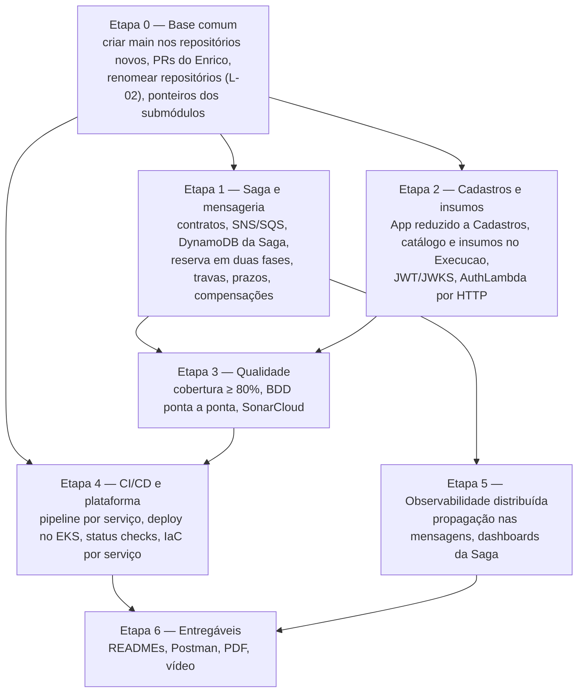

# Índice — Especificação da Fase 4 (Microsserviços, Saga e CI/CD)

> **Projeto:** AutoReparos - Sistema Integrado de Oficina Mecânica  
> **Fase:** Tech Challenge FIAP SOAT - Fase 4 (15SOAT) — Grupo 78  
> **Documento-fonte:** [`15SOAT - Fase 4 - Tech challenge.pdf`](../../../../docs/tech-challenge/15SOAT%20-%20Fase%204%20-%20Tech%20challenge.pdf)  
> **Base analisada:** `origin/develop` do pai e de cada submódulo (04/11/2026, revisada em 09/11/2026) **mais** a branch `feature/os-service-contracts` do Enrico (OS, Billing e Execution, mesclada localmente em 09/11/2026)  
> **Entrega:** 17/11/2026 (terça-feira)  
> **Local:** `.specs/features/fase4/especificacao/` — parte "o quê e por quê" da especificação da Fase 4 (§ 3.1); protocolo de preenchimento no § 8 e no `AGENTS.md` da raiz  
> **Status:** Especificação unificada com os planos TLC da fase. Decisões de arquitetura fechadas em 09 e 10/11/2026; pendências no § 6.3

---

## 1. Objetivo da fase

A oficina passou a operar em escala nacional com várias filiais. A Fase 4 pede que a aplicação seja refatorada para **microsserviços independentes** (no mínimo 3, cada um com repositório, infraestrutura e banco próprios), com **Saga Pattern** para manter a consistência das transações críticas (abertura da OS, aprovação, pagamento) e **automação completa** de build, testes e deploy.

Cada spec desta pasta registra, para o seu critério: o texto do PDF, o **estado atual** do projeto, as lacunas, a proposta e os **passos para a mudança**, com critérios de aceite.

---

## 2. Base analisada

O levantamento completo está em [`diagnostico/fase4_diagnostico_estado_atual.md`](./diagnostico/fase4_diagnostico_estado_atual.md). Resumo:

- **`develop` / `main` (05/11):** 1 monólito (`AutoReparos.App`, .NET 10 + Angular 19) + AuthLambda; 1 PostgreSQL compartilhado; sem mensageria, NoSQL, Saga, BDD ou Mercado Pago; provisionamento e deploy manuais pelo pai (provisionamento centralizado mesclado em 06/11); nenhuma branch exige status checks.
- **Branch `feature/os-service-contracts` (Enrico, 09/11):** 3 serviços novos em repositórios próprios, cada um com PostgreSQL próprio, Outbox e SQS — `AutoReparos.OS` (abertura e consulta da OS), `AutoReparos.Billing` (orçamento, aprovação, Checkout Pro, webhook, reembolso) e `AutoReparos.Execution` (fila, etapas, conclusão, falha, reexecução). Os três passaram no Verifier independente. A Saga, o DynamoDB e o contrato de eventos entre eles ainda não existem (feature `saga-mensageria`). Detalhes no [diagnóstico § 10](./diagnostico/fase4_diagnostico_estado_atual.md#10-trabalho-do-enrico-em-featureos-service-contracts-0911).

---

## 3. Mapa das specs

Toda a especificação da Fase 4 (a nossa e a do Enrico) mora em `.specs/features/fase4/`:

```text
.specs/
├── STATE.md                                        ← decisões AD-xxx (espelho do § 6) e handoff
└── features/fase4/
    ├── plan.md · checks.md                         ← plano TLC da iniciativa (critérios AC 1–17)
    ├── FEATURES.md                                 ← mapa das features TLC
    ├── especificacao/                              ← o quê e por quê (esta pasta)
    │   ├── index.md                                ← este arquivo (registro único de decisões)
    │   ├── diagnostico/
    │   │   └── fase4_diagnostico_estado_atual.md   ← base comum (branches, código, testes, CI, infra)
    │   ├── microsservicos/
    │   │   ├── fase4_spec_separacao_microsservicos.md   ← 3 serviços + Cadastros, repositórios
    │   │   ├── fase4_spec_bancos_de_dados.md            ← banco por serviço, SQL + NoSQL
    │   │   └── fase4_spec_integracao_mercado_pago.md    ← pagamentos na Cobrança
    │   ├── comunicacao/
    │   │   └── fase4_spec_comunicacao_microsservicos.md ← REST, SQS/SNS, catálogo de eventos
    │   ├── saga/
    │   │   └── fase4_spec_saga_pattern.md               ← orquestração, compensações, reserva, travas, prazos
    │   ├── testes-qualidade/
    │   │   └── fase4_spec_testes_e_qualidade.md         ← unitários, BDD, 80%, Sonar
    │   ├── cicd/
    │   │   └── fase4_spec_cicd_e_protecao_de_branches.md ← pipeline por serviço, branch protection
    │   ├── infraestrutura/
    │   │   ├── fase4_spec_infraestrutura_k8s_e_mensageria.md ← K8s por serviço, filas
    │   │   └── fase4_spec_observabilidade_distribuida.md     ← stack da Fase 3 + tracing distribuído
    │   └── entregaveis/
    │       ├── fase4_spec_entregaveis_repositorios.md   ← README, Swagger/Postman, evidências
    │       └── fase4_spec_video_e_documento_portal.md   ← vídeo (≤ 15 min) e PDF do portal
    └── <feature>/                                  ← como, verificável (uma pasta por feature TLC)
        ├── plan.md                                 ← critérios EARS; aprovado pelo usuário
        ├── checks.md                               ← derivado do plano aprovado e congelado
        └── proofs.md · mutations.json · verification.md   ← provas e veredito do Verifier
```

| Seção do PDF | Spec |
|---|---|
| Separação em Microsserviços | [Separação](./microsservicos/fase4_spec_separacao_microsservicos.md) · [Bancos](./microsservicos/fase4_spec_bancos_de_dados.md) · [Mercado Pago](./microsservicos/fase4_spec_integracao_mercado_pago.md) |
| Comunicação entre Microsserviços | [Comunicação](./comunicacao/fase4_spec_comunicacao_microsservicos.md) |
| Implementação do Saga Pattern | [Saga](./saga/fase4_spec_saga_pattern.md) |
| Testes e Qualidade | [Testes e qualidade](./testes-qualidade/fase4_spec_testes_e_qualidade.md) |
| CI/CD Automatizado | [CI/CD e proteção de branches](./cicd/fase4_spec_cicd_e_protecao_de_branches.md) |
| Infraestrutura | [Kubernetes e mensageria](./infraestrutura/fase4_spec_infraestrutura_k8s_e_mensageria.md) · [Observabilidade](./infraestrutura/fase4_spec_observabilidade_distribuida.md) |
| Entregáveis — Repositórios | [Entregáveis dos repositórios](./entregaveis/fase4_spec_entregaveis_repositorios.md) |
| Entregáveis — Vídeo e PDF | [Vídeo e documento do portal](./entregaveis/fase4_spec_video_e_documento_portal.md) |

### 3.1 Papéis de cada parte

| Parte | Papel | Quem lê |
|---|---|---|
| `especificacao/` (esta pasta) | **O quê e por quê:** requisitos do PDF, estado atual, decisões (registro único no § 6), desenho transversal (Saga, contratos, bancos, CI/CD, entregáveis), cronograma | Grupo, banca, autor do PDF final, agentes antes de planejar |
| `<feature>/` | **Como, verificável:** `plan.md` com critérios EARS, `checks.md` congelado, provas, mutações e veredito do Verifier | Quem implementa (pessoa ou agente) |
| `plan.md`, `checks.md`, `FEATURES.md` da fase | Aceite da iniciativa e mapa das features | Todos |
| `.specs/STATE.md` | Decisões em formato `AD-xxx`, cada uma ligada a um `D-xx` deste índice, e handoff | Agentes de IA |

Regras de sincronização (detalhadas no § 8):

1. Uma decisão nova entra **primeiro no § 6 deste índice** e, se afetar a implementação, vira um `AD-xxx` no `.specs/STATE.md` com a referência `D-xx`.
2. Um `plan.md` aprovado não é reescrito por esta pasta. Quando uma decisão daqui muda um plano, o plano é revisado e volta para aprovação (gate do TLC).
3. Desenho detalhado (máquina de estados, contratos) mora aqui; o `plan.md` da feature referencia a seção em vez de copiar.

| Feature (`../<feature>/plan.md`) | Estado (10/11) | Specs desta pasta |
|---|---|---|
| [`os-service`](../os-service/plan.md) | ✅ PASS (abertura, consulta, histórico de criação) | [Separação](./microsservicos/fase4_spec_separacao_microsservicos.md), [Bancos](./microsservicos/fase4_spec_bancos_de_dados.md) |
| [`cobranca`](../cobranca/plan.md) | ✅ PASS (orçamento, Checkout Pro, webhook, reembolso) | [Mercado Pago](./microsservicos/fase4_spec_integracao_mercado_pago.md) |
| [`execucao`](../execucao/plan.md) | ✅ PASS (fila, etapas, conclusão, falha, reexecução) | [Separação](./microsservicos/fase4_spec_separacao_microsservicos.md) |
| [`saga-mensageria`](../saga-mensageria/plan.md) | ✅ PASS (orquestração, compensações de orçamento e execução, cancelamento) | [Saga](./saga/fase4_spec_saga_pattern.md), [Comunicação](./comunicacao/fase4_spec_comunicacao_microsservicos.md) |
| [`saga-compensacoes`](../saga-compensacoes/plan.md) | 📝 Plano novo em 10/11 (D-18, AD-021), aguarda aprovação | [Saga](./saga/fase4_spec_saga_pattern.md) |
| [`eventos-portugues`](../eventos-portugues/plan.md) | ✅ PASS (comando `cobranca.cancelar-orcamento.v1` + normalização e leitura legada) | [Comunicação § 4.5](./comunicacao/fase4_spec_comunicacao_microsservicos.md#45-catálogo-de-mensagens) |
| [`cadastros`](../cadastros/plan.md) e [`insumos`](../insumos/plan.md) | 📝 Plano novo em 10/11, aguarda aprovação | [Separação § 5](./microsservicos/fase4_spec_separacao_microsservicos.md#5-passos-para-a-mudança) |
| [`infra-ci-observabilidade`](../infra-ci-observabilidade/plan.md) | 📝 Plano revisado em 10/11, aguarda aprovação | [CI/CD](./cicd/fase4_spec_cicd_e_protecao_de_branches.md), [Infraestrutura](./infraestrutura/fase4_spec_infraestrutura_k8s_e_mensageria.md), [Observabilidade](./infraestrutura/fase4_spec_observabilidade_distribuida.md), [Testes](./testes-qualidade/fase4_spec_testes_e_qualidade.md) |
| [`pacote-entrega`](../pacote-entrega/plan.md) | 📝 Plano revisado em 10/11, aguarda aprovação | [Entregáveis](./entregaveis/fase4_spec_entregaveis_repositorios.md), [Vídeo e PDF](./entregaveis/fase4_spec_video_e_documento_portal.md) |

---

## 4. Matriz de rastreabilidade

Legenda: ✅ atende · 🟡 parcial · ❌ não atende. Estado em 09/11/2026, contando a branch `feature/os-service-contracts` (ainda sem PR).

### Separação em Microsserviços

| ID | Requisito do PDF | Estado atual | Spec |
|---|---|---|---|
| R01 | No mínimo 3 microsserviços independentes | 🟡 OS, Billing e Execution existem na branch de feature; o App ainda concentra cadastros e o fluxo antigo | [Separação](./microsservicos/fase4_spec_separacao_microsservicos.md) |
| R02 | Repositório próprio por microsserviço | 🟡 Repositórios novos criados, sem `main` e sem PR | [Separação](./microsservicos/fase4_spec_separacao_microsservicos.md) |
| R03 | Infraestrutura própria por microsserviço | ❌ Charts, ECR e banco centralizados em Infra.K8s/Infra.Database | [Infraestrutura](./infraestrutura/fase4_spec_infraestrutura_k8s_e_mensageria.md) |
| R04 | Banco de dados próprio por microsserviço | 🟡 Código: cada serviço tem database e connection string próprias (11/11). AWS: o RDS tem um só `autoreparos_db`; databases e usuários por serviço ficam no C12 de `infra-ci-observabilidade` | [Bancos](./microsservicos/fase4_spec_bancos_de_dados.md) |
| R05 | OS Service: abertura, atualização de status, consulta de status e histórico | 🟡 Abertura, consulta e histórico de criação; transições ficam para a Saga | [Separação](./microsservicos/fase4_spec_separacao_microsservicos.md) · [Saga](./saga/fase4_spec_saga_pattern.md) |
| R06 | Billing: gerar/enviar orçamento, registrar/verificar pagamento, atualizar a OS após pagamento | 🟡 Orçamento, aprovação e pagamento prontos; atualização da OS depende da Saga | [Mercado Pago](./microsservicos/fase4_spec_integracao_mercado_pago.md) |
| R07 | Integração com o Mercado Pago | 🟡 Checkout Pro + webhook validado na branch de feature; falta teste no sandbox | [Mercado Pago](./microsservicos/fase4_spec_integracao_mercado_pago.md) |
| R08 | Execução: fila, status no diagnóstico e reparos, comunicar finalização ao OS Service | 🟡 Pronto no Execution; ninguém consome `execucao.concluida.v1` ainda | [Separação](./microsservicos/fase4_spec_separacao_microsservicos.md) |
| R09 | Pelo menos um banco relacional (SQL) | ✅ PostgreSQL 16 | [Bancos](./microsservicos/fase4_spec_bancos_de_dados.md) |
| R10 | Pelo menos um banco não relacional (NoSQL) | 🟡 Código: DynamoDB implementado e testado no estado da Saga do OS Service (`saga-mensageria`, PASS). AWS: tabela `autoreparos-os-saga` sem Terraform, coberta pelo C12 de `infra-ci-observabilidade` (11/11) | [Bancos](./microsservicos/fase4_spec_bancos_de_dados.md) |

### Comunicação entre Microsserviços

| ID | Requisito do PDF | Estado atual | Spec |
|---|---|---|---|
| R11 | APIs RESTful síncronas (quando necessário) | 🟡 Billing consulta o OS por REST antes do checkout | [Comunicação](./comunicacao/fase4_spec_comunicacao_microsservicos.md) |
| R12 | Mensageria assíncrona para eventos e integração desacoplada | 🟡 Outbox + SQS nos 3 serviços; contrato entre eles não fecha | [Comunicação](./comunicacao/fase4_spec_comunicacao_microsservicos.md) |
| R13 | **Nenhum serviço acessa diretamente o banco de outro** | 🟡 Serviços novos isolados; AuthLambda ainda lê `Clientes` do App | [Comunicação](./comunicacao/fase4_spec_comunicacao_microsservicos.md) · [Bancos](./microsservicos/fase4_spec_bancos_de_dados.md) |

### Implementação do Saga Pattern

| ID | Requisito do PDF | Estado atual | Spec |
|---|---|---|---|
| R14 | Saga coordenando o fluxo transacional da OS | ✅ `saga-mensageria` (PASS); D-18 em `saga-compensacoes` | [Saga](./saga/fase4_spec_saga_pattern.md) |
| R15 | Rollback e compensação em qualquer etapa | ❌ | [Saga](./saga/fase4_spec_saga_pattern.md) |
| R16 | Orquestrado ou coreografado | ✅ Decidido: orquestrado (D-07) | [Saga](./saga/fase4_spec_saga_pattern.md) |
| R17 | Escolha documentada e justificada no README | ❌ | [Saga](./saga/fase4_spec_saga_pattern.md) · [Entregáveis](./entregaveis/fase4_spec_entregaveis_repositorios.md) |

### Testes e Qualidade

| ID | Requisito do PDF | Estado atual | Spec |
|---|---|---|---|
| R18 | Testes unitários em todos os microsserviços | 🟡 App, Lambda e os 3 serviços novos têm testes | [Testes](./testes-qualidade/fase4_spec_testes_e_qualidade.md) |
| R19 | Pelo menos um fluxo completo testado com BDD | ❌ | [Testes](./testes-qualidade/fase4_spec_testes_e_qualidade.md) |
| R20 | Cobertura mínima de 80% por serviço | 🟡 App ~93% linhas; Lambda 74,8%; serviços novos sem medição publicada | [Testes](./testes-qualidade/fase4_spec_testes_e_qualidade.md) |
| R21 | Qualidade via SonarQube ou similar no CI | 🟡 SonarCloud automático só nos PRs do pai, sem cobertura | [Testes](./testes-qualidade/fase4_spec_testes_e_qualidade.md) |

### CI/CD Automatizado

| ID | Requisito do PDF | Estado atual | Spec |
|---|---|---|---|
| R22 | Pipeline independente por serviço com build | 🟡 App, Lambda e Execution têm CI | [CI/CD](./cicd/fase4_spec_cicd_e_protecao_de_branches.md) |
| R23 | … com testes automatizados | 🟡 Idem | [CI/CD](./cicd/fase4_spec_cicd_e_protecao_de_branches.md) |
| R24 | … com verificação de qualidade | ❌ | [CI/CD](./cicd/fase4_spec_cicd_e_protecao_de_branches.md) |
| R25 | … com deploy automatizado em Kubernetes | ❌ Deploy só pelo pai, manual | [CI/CD](./cicd/fase4_spec_cicd_e_protecao_de_branches.md) |
| R26 | `main` protegida com PR obrigatório e checagens automáticas | 🟡 PR + aprovação nos submódulos antigos; nenhum status check; repositórios novos sem `main` | [CI/CD](./cicd/fase4_spec_cicd_e_protecao_de_branches.md) |

### Infraestrutura

| ID | Requisito do PDF | Estado atual | Spec |
|---|---|---|---|
| R27 | Cada microsserviço em repositório próprio | Ver R02 | [Separação](./microsservicos/fase4_spec_separacao_microsservicos.md) |
| R28 | Deploy automatizado para Kubernetes | Ver R25 | [CI/CD](./cicd/fase4_spec_cicd_e_protecao_de_branches.md) · [Infraestrutura](./infraestrutura/fase4_spec_infraestrutura_k8s_e_mensageria.md) |
| R29 | Mensageria para orquestração ou coreografia | 🟡 Código SQS pronto; filas não provisionadas | [Infraestrutura](./infraestrutura/fase4_spec_infraestrutura_k8s_e_mensageria.md) |
| R30 | Monitoramento e observabilidade da Fase 3 | 🟡 Stack completa; serviços novos exportam OTLP | [Observabilidade](./infraestrutura/fase4_spec_observabilidade_distribuida.md) |

### Entregáveis — Repositórios

| ID | Requisito do PDF | Estado atual | Spec |
|---|---|---|---|
| R31 | Código-fonte | 🟡 Serviços novos em branch de feature | [Entregáveis](./entregaveis/fase4_spec_entregaveis_repositorios.md) |
| R32 | Dockerfile e manifestos Kubernetes | 🟡 Dockerfile nos serviços novos; manifestos só no Infra.K8s | [Entregáveis](./entregaveis/fase4_spec_entregaveis_repositorios.md) · [Infraestrutura](./infraestrutura/fase4_spec_infraestrutura_k8s_e_mensageria.md) |
| R33 | Pipelines de CI/CD | 🟡 Ver R22–R25 | [CI/CD](./cicd/fase4_spec_cicd_e_protecao_de_branches.md) |
| R34 | Evidências de cobertura (prints ou links no README) | ❌ | [Testes](./testes-qualidade/fase4_spec_testes_e_qualidade.md) · [Entregáveis](./entregaveis/fase4_spec_entregaveis_repositorios.md) |
| R35 | Documentação da arquitetura do serviço | 🟡 READMEs dos serviços novos em inglês e sem diagrama | [Entregáveis](./entregaveis/fase4_spec_entregaveis_repositorios.md) |
| R36 | Swagger ou collection Postman atualizada | 🟡 Swagger ok; Postman de 22/07/2026 | [Entregáveis](./entregaveis/fase4_spec_entregaveis_repositorios.md) |

### Entregáveis — Vídeo

| ID | Requisito do PDF | Estado atual | Spec |
|---|---|---|---|
| R37 | YouTube ou Vimeo (público ou não listado), até 15 min | ❌ | [Vídeo e PDF](./entregaveis/fase4_spec_video_e_documento_portal.md) |
| R38 | Fluxo completo de uma OS pelos microsserviços | ❌ | [Vídeo e PDF](./entregaveis/fase4_spec_video_e_documento_portal.md) |
| R39 | Execução da Saga e tratamento de falhas | ❌ | [Vídeo e PDF](./entregaveis/fase4_spec_video_e_documento_portal.md) |
| R40 | Deploy automatizado de pelo menos um serviço com validação de testes | ❌ | [Vídeo e PDF](./entregaveis/fase4_spec_video_e_documento_portal.md) |
| R41 | Monitoramento e rastreamento dos fluxos distribuídos | ❌ | [Vídeo e PDF](./entregaveis/fase4_spec_video_e_documento_portal.md) · [Observabilidade](./infraestrutura/fase4_spec_observabilidade_distribuida.md) |

### Entregáveis — PDF do portal

| ID | Requisito do PDF | Estado atual | Spec |
|---|---|---|---|
| R42 | Nome e identificação dos participantes | ✅ Tabela pronta no template da Fase 3 | [Vídeo e PDF](./entregaveis/fase4_spec_video_e_documento_portal.md) |
| R43 | Links dos repositórios | 🟡 Faltam os repositórios novos | [Vídeo e PDF](./entregaveis/fase4_spec_video_e_documento_portal.md) |
| R44 | Link do vídeo | ❌ | [Vídeo e PDF](./entregaveis/fase4_spec_video_e_documento_portal.md) |
| R45 | Diagrama geral: microsserviços, bancos e comunicação | ❌ (proposta na spec de separação) | [Vídeo e PDF](./entregaveis/fase4_spec_video_e_documento_portal.md) |
| R46 | Estratégia escolhida para a Saga | ❌ | [Vídeo e PDF](./entregaveis/fase4_spec_video_e_documento_portal.md) |
| R47 | Justificativa da divisão e das tecnologias | ❌ | [Vídeo e PDF](./entregaveis/fase4_spec_video_e_documento_portal.md) |

### Contexto do desafio (não obrigatório)

- **Múltiplas filiais:** aparece só na descrição do desafio, não nos requisitos obrigatórios. Fica fora do escopo, salvo decisão do grupo (D-16).
- **Resiliência e tolerância a falhas:** coberta pelas garantias de mensageria (Outbox, idempotência, retry, DLQ), pela Saga e por HPA/PDB/health checks.

---

## 5. Feedback da Fase 3

| Ponto do feedback | O que fazer na Fase 4 | Spec |
|---|---|---|
| Elogiado: Clean Architecture, Testcontainers, API Gateway + Lambda, SSM, EKS multi-AZ, HPA, ECR com scan, Terraform + Helm, stack de observabilidade open source | Preservar no novo desenho (cada serviço herda a mesma base) | Todas |
| Vídeo muito curto | Roteiro cronometrado com alvo de 13–14 min | [Vídeo e PDF](./entregaveis/fase4_spec_video_e_documento_portal.md) |
| Não mostrou adequadamente a implementação | Bloco de código: orquestrador, compensação, idempotência | [Vídeo e PDF](./entregaveis/fase4_spec_video_e_documento_portal.md) |
| Não mostrou dashboards | Bloco de observabilidade ao vivo com tráfego real | [Vídeo e PDF](./entregaveis/fase4_spec_video_e_documento_portal.md) · [Observabilidade](./infraestrutura/fase4_spec_observabilidade_distribuida.md) |
| Não mostrou proteção de branches | Tela de configuração + PR bloqueado; corrigir também os status checks que hoje não são exigidos | [CI/CD](./cicd/fase4_spec_cicd_e_protecao_de_branches.md) |

---

## 6. Decisões

Registro único das decisões da Fase 4. A coluna "`.specs`" aponta a decisão equivalente do Enrico (`AD-xxx` no `.specs/STATE.md` ou "Assumptions" do `.specs/features/fase4/plan.md`).

### 6.1 Decididas

| ID | Decisão | `.specs` | Spec |
|---|---|---|---|
| D-01 | **3 serviços de negócio + Cadastros** (09/11): `OS` (ciclo de vida da OS, histórico, orquestrador da Saga), `Cobranca` (orçamento, aprovação, pagamento, reembolso), `Execucao` (fila, etapas, **catálogo de serviços e insumos com reserva**). O App atual vira o serviço de **Cadastros** (clientes, veículos, usuários, emissão do JWT e notificações). Substitui a opção B de 06/11 (Estoque separado) | Plano fase4 "Fronteiras" | [Separação § 4](./microsservicos/fase4_spec_separacao_microsservicos.md#4-divisão-escolhida-3-serviços-de-negócio--cadastros-d-01) |
| D-02 | **Nomes em português** (regra L-02): `AutoReparos.OS`, `AutoReparos.Cobranca` (confirmado em 10/11), `AutoReparos.Execucao`. Renomeia os repositórios `Billing` e `Execution`. O App reduzido vira `AutoReparos.Cadastros` (D-23) | AD-010, AD-016 | [Separação § 4.2](./microsservicos/fase4_spec_separacao_microsservicos.md#42-repositórios) |
| D-03 | Frontend extraído para `AutoReparos.Web` (pipeline e Sonar próprios). Corte possível se faltar tempo: continua no Cadastros | — | [Separação § 4.2](./microsservicos/fase4_spec_separacao_microsservicos.md#42-repositórios) |
| D-04 | **NoSQL = DynamoDB para o estado da Saga no OS Service** (09/11). Substitui "DynamoDB no Estoque" | Plano fase4 "Mensageria e NoSQL", "Orquestrador" | [Bancos § 4.1](./microsservicos/fase4_spec_bancos_de_dados.md#41-d-04--dynamodb-no-estado-da-saga) |
| D-05 | Uma instância RDS PostgreSQL compartilhada, com database e usuário próprios por serviço; cada repositório mantém a IaC dos seus recursos exclusivos | Plano fase4 "Bancos relacionais e IaC" | [Bancos § 4.2](./microsservicos/fase4_spec_bancos_de_dados.md#42-d-05--instância-rds-compartilhada) |
| D-06 | AWS SQS com DLQ, retry com backoff exponencial e jitter (fan-out por SNS em D-19) | AD-001 | [Comunicação § 4.3](./comunicacao/fase4_spec_comunicacao_microsservicos.md#43-d-06--mensageria) |
| D-07 | Saga **orquestrada e persistida**, com o OS Service como orquestrador | Plano fase4 "Saga" | [Saga § 4.1](./saga/fase4_spec_saga_pattern.md#41-d-07--saga-orquestrada-com-o-orquestrador-no-os-service) |
| D-08 | `AWSSDK.SQS` com Outbox, Inbox (deduplicação por `eventId`) e retry do próprio grupo, sem MassTransit | Código dos 3 serviços | [Comunicação § 4.4](./comunicacao/fase4_spec_comunicacao_microsservicos.md#44-d-08--biblioteca) |
| D-09 | **Pagamento depois da conclusão do serviço e antes da entrega.** Sem expiração automática do orçamento; sem estorno automático; reembolso total ou parcial só com aprovação e auditoria; falha técnica após captura segue recuperação para frente; falha na execução vai para intervenção e reexecução manual | Plano fase4 "Momento do pagamento", "Falha técnica após captura", "Reembolsos", "Orçamento sem resposta", "Falha na execução"; AD-007 | [Mercado Pago § 4.1](./microsservicos/fase4_spec_integracao_mercado_pago.md#41-d-09--momento-do-pagamento) · [Saga § 4.4](./saga/fase4_spec_saga_pattern.md#44-passos-compensações-e-pivô) |
| D-10 | Mercado Pago **Checkout Pro** + webhooks com validação de origem | Plano fase4 "Integração de pagamento" | [Mercado Pago § 4.2](./microsservicos/fase4_spec_integracao_mercado_pago.md#42-d-10--checkout-pro) |
| D-13 | **Deploy de cada serviço no pipeline do próprio repositório**; o pai mantém só o provisionamento da plataforma (rede, EKS, RDS, gateway, Lambda) e o atalho manual para subir tudo | `infra-ci-observabilidade` door 1 | [CI/CD § 4.2](./cicd/fase4_spec_cicd_e_protecao_de_branches.md#42-repositórios-de-plataforma-e-o-pai-d-13) |
| D-14 | xUnit + **Reqnroll** para BDD; cobertura medida por serviço | Plano fase4 "Testes e cobertura" | [Testes § 4.2](./testes-qualidade/fase4_spec_testes_e_qualidade.md#42-d-14--onde-fica-o-bdd) |
| D-19 | **Fan-out por SNS** (10/11): um tópico SNS por serviço produtor (`os-eventos`, `cobranca-eventos`, `execucao-eventos`) e uma fila SQS por consumidor assinando o tópico, com filtro por `tipo`. Comandos seguem direto para a fila do participante. Substitui a "uma linha de Outbox por destino" do Execution | AD-014 | [Comunicação § 4.3](./comunicacao/fase4_spec_comunicacao_microsservicos.md#43-d-06--mensageria) |
| D-20 | **Falta de saldo na reserva** (10/11): nada é reservado; a OS fica em `AguardandoInsumos` com alerta diário; a recepção repõe e manda retentar, ou cancela | AD-015 | [Saga § 4.4](./saga/fase4_spec_saga_pattern.md#44-passos-compensações-e-pivô) |
| D-22 | **Ambientes:** desenvolvimento local; push na `develop` implanta em staging (namespace compartilhado no EKS); push na `main` implanta em produção no EKS (`us-east-1`) com aprovação no Environment `production` | Plano fase4 "Alvos de infraestrutura" | [CI/CD § 4.1](./cicd/fase4_spec_cicd_e_protecao_de_branches.md#41-pipeline-padrão-de-cada-serviço-githubworkflowsci-cdyml) |
| D-23 | **App renomeado para `AutoReparos.Cadastros`** (10/11). O nome `OrdemServico` (D-02 de 09/11) deixou de servir: a OS mora no repositório novo `AutoReparos.OS`, e o App fica só com clientes, veículos, usuários e notificações | AD-017 | [Separação § 4.2](./microsservicos/fase4_spec_separacao_microsservicos.md#42-repositórios) |
| D-18 | **Saga além do mínimo** (09/11): (a) reserva de insumos em duas fases — reservar, confirmar, cancelar; (c) travas de estado enquanto um passo da Saga está em andamento; (d) prazos técnicos por passo, lembretes de negócio, console de administração das Sagas e reprocessamento de DLQ. A pré-autorização do pagamento (b) fica fora, porque exigiria trocar o Checkout Pro | AD-011 | [Saga § 4.5–4.7](./saga/fase4_spec_saga_pattern.md#45-reserva-de-insumos-em-duas-fases-d-18a) |
| D-11 | **AuthLambda chama endpoint interno do Cadastros** (11/11): `POST /internal/clientes/autenticar`, fora do API Gateway, sem acesso da Lambda ao banco de clientes | AD-023; Usuário: "confirmo d-11 a d-21" | [Bancos § 4.3](./microsservicos/fase4_spec_bancos_de_dados.md#43-como-garantir-nenhum-acesso-ao-banco-de-outro-serviço) |
| D-21 | **Cadastros emite o JWT com chave assimétrica e publica discovery OIDC + JWKS** (11/11); OS, Cobrança e Execução validam por `Authority` | AD-023; Usuário: "confirmo d-11 a d-21" | [Separação § 5](./microsservicos/fase4_spec_separacao_microsservicos.md#etapa-4--autenticação-entre-serviços) |
| D-12 | **Compartilhamento de contratos de mensagens:** Contratos duplicados em cada serviço + catálogo único documentado (AsyncAPI ou tabela) (11/11) | AD-023; Usuário: "Intervalo inteiro" (confirmação de D-11 a D-21) | [Comunicação § 4.6](./comunicacao/fase4_spec_comunicacao_microsservicos.md#46-garantias) |
| D-14b | **Onde ficam os cenários BDD ponta a ponta:** No pai (`tests/AutoReparos.E2E.Bdd`), rodando contra o `docker compose` (11/11) | AD-023; Usuário: "Intervalo inteiro" (confirmação de D-11 a D-21) | [Testes § 4.2](./testes-qualidade/fase4_spec_testes_e_qualidade.md#42-d-14--onde-fica-o-bdd) |
| D-15 | **Sonar:** SonarCloud por CI, um projeto por repositório (11/11) | AD-023; Usuário: "Intervalo inteiro" (confirmação de D-11 a D-21) | [Testes § 4.4](./testes-qualidade/fase4_spec_testes_e_qualidade.md#44-d-15--sonar-no-ci) |
| D-16 | **Suporte a múltiplas filiais:** Fora do escopo (11/11) | AD-023; Usuário: "Intervalo inteiro" (confirmação de D-11 a D-21) | § 4 (contexto) |
| D-17 | **Notificações como serviço próprio:** Consumidor de eventos dentro do Cadastros (dono do e-mail do cliente); extração só se sobrar tempo (11/11) | AD-023; Usuário: "Intervalo inteiro" (confirmação de D-11 a D-21) | [Separação § 4.1](./microsservicos/fase4_spec_separacao_microsservicos.md#41-dono-de-cada-contexto) |
| D-24 | **Aplicar L-02 aos tipos de mensagem já implementados** (10/11): trocar o comando `billing.orcamento.cancelar.v1` por `cobranca.cancelar-orcamento.v1`, nome já previsto no catálogo; os demais tipos existentes já usam português e conservam sua semântica | AD-022; José: "Vamos trocar os eventos para português" | [Comunicação § 4.5](./comunicacao/fase4_spec_comunicacao_microsservicos.md#45-catálogo-de-mensagens) |
| D-25 | **Proteção obrigatória só na `main`** (11/11): `main` de OS, Cobrança, Execução, Cadastros e Web exige PR com 1 aprovação e os jobs `build`, `test` e `quality` como status checks; a `develop` não recebe proteção obrigatória. O repositório `AutoReparos.Web` foi criado (público) nesta data, confirmando D-03 | AD-026; Usuário: "Branch protegida: main" e "Repositório Web: Vamos criar" | [CI/CD § 4.3](./cicd/fase4_spec_cicd_e_protecao_de_branches.md#43-proteção-de-branches) |

### 6.2 Regras obrigatórias do grupo

| ID | Regra | Origem | `.specs` |
|---|---|---|---|
| L-01 | **Uma transação local, um banco.** Cada passo da Saga grava numa única transação, no mesmo banco: a mudança de estado de negócio, o estado da Saga, as mensagens de saída (Outbox) e o registro da mensagem recebida (Inbox). Nenhum passo grava em dois bancos. Aplicação no OS Service: **opção C** (Saga no DynamoDB e OS no PostgreSQL, ligados por Outbox/Inbox, sem handler que toque os dois) | José, 09/11/2026 | AD-012 |
| L-02 | **Nomes de repositórios, serviços, filas e eventos em português.** Não misturar idiomas. Termos técnicos de framework (`Api`, `Repository`, `DbContext`) seguem a regra do `.agents/AGENTS.md` | José, 09/11/2026 | AD-010 |

### 6.3 Em aberto

Nenhuma em 11/11: D-11, D-12, D-14b, D-15, D-16, D-17 e D-21 passaram para o § 6.1. Novas decisões abertas entram na tabela abaixo.

| ID | Decisão | Recomendação | Bloqueia | Spec |
|---|---|---|---|---|

### 6.4 Histórico de mudanças de decisão

| Data | Mudança | Motivo |
|---|---|---|
| 09/11/2026 | D-01: de 4 serviços (Estoque separado) para 3 + Cadastros | Os 3 serviços do Enrico já estavam prontos e verificados; o Estoque custaria um repositório inteiro a mais |
| 09/11/2026 | D-02: de `OrdemServico`/`Billing`/`Estoque` para nomes em português dos repositórios existentes | Regra L-02 e aproveitamento dos repositórios do Enrico |
| 09/11/2026 | D-04: DynamoDB do Estoque para o estado da Saga | Sem serviço de Estoque; alinhado ao plano aprovado do Enrico |
| 09/11/2026 | D-09: de "pagar antes da execução" para "pagar depois da conclusão" | Modelo real de oficina e Billing já implementado assim; compensações reforçadas por D-18 |
| 10/11/2026 | D-19: de "uma linha de Outbox por destino" para SNS por produtor | Cadastros (notificações) passa a consumir eventos de vários serviços; o produtor não deve conhecer os consumidores |
| 10/11/2026 | D-02/D-23: App deixa de virar `OrdemServico` e passa a `Cadastros` | A OS foi implementada em repositório novo (`AutoReparos.OS`) |
| 11/11/2026 | D-19 e L-01: SNS por produtor e `saga.avancou.v1` com Streams adiados para depois da `saga-compensacoes`; SQS direto e sincronização por despacho seguem | Preservar o PASS de `saga-mensageria` (AD-021) e cumprir o prazo; a feature `infra-ci-observabilidade` assume o SNS (AD-024) |
| 11/11/2026 | D-25: CI/CD § 4.3 deixa de proteger a `develop`; só a `main` é obrigatória | Decisão do usuário ao aprovar `infra-ci-observabilidade` |

---

## 7. Ordem sugerida de execução



### 7.1 Divisão em 5 tarefas (uma por integrante)

Cada integrante assume uma tarefa; o time distribui os números na reunião de início.

| Tarefa | Responsável | Escopo | Feature `.specs` | Depende de |
|---|---|---|---|---|
| **T1 — Plataforma e CI/CD** | Integrante 1 | Renomear repositórios (L-02) e criar `main`; Terraform por serviço (ECR, IRSA, filas, tópicos SNS, DLQs, tabela DynamoDB, VPC endpoint); Job de bootstrap das databases; charts Helm por serviço; pipeline padrão `ci-cd.yml` (build, testes, cobertura, Sonar, imagem, deploy staging/produção); status checks obrigatórios; rebase da branch do Infra.K8s | `infra-ci-observabilidade` | — (começa no dia 1) |
| **T2 — OS e Saga** | Integrante 2 | Orquestrador no DynamoDB (estados, compensações, escrita condicional), publicador da Outbox por Streams, handler `saga.avancou.v1`, travas (409), job de prazos e lembretes, console de administração das Sagas, validação de cliente/veículo no Cadastros, histórico de todas as transições | `saga-mensageria` | Catálogo de mensagens congelado (qua 11/11) |
| **T3 — Cobrança, Mercado Pago e frontend** | Integrante 3 | Itens no orçamento; eventos `orcamento.*` e `pagamento.*` no tópico SNS; consumidores `cobranca.cancelar-orcamento.v1` e `execucao.concluida.v1`; `external_reference` por tentativa e varredura de reembolsos; sandbox e rota do webhook; frontend com os novos paths, telas de orçamento, pagamento, fila e console de Sagas | `cobranca` | Catálogo de mensagens; T1 para a rota do webhook |
| **T4 — Execução, insumos e Cadastros** | Integrante 4 | Catálogo e insumos na Execução com reserva em duas fases; consumidores `reservar-insumos` e `cancelar-reserva`; eventos `execucao.enfileirada.v1` e `reexecutada.v1`; publicação no tópico SNS; App reduzido a Cadastros (REST de cliente e veículo, JWKS, endpoint interno da AuthLambda, notificações por eventos) | `insumos`, `cadastros` | Catálogo de mensagens |
| **T5 — Qualidade, observabilidade e entrega** | Integrante 5 | Catálogo de mensagens e envelope (`contratos-mensagens.md`); `docker-compose.yml` com LocalStack e os 4 serviços; BDD ponta a ponta (Reqnroll); cobertura ≥ 80% e SonarCloud por repositório; propagação de trace nas mensagens e dashboard da Saga; READMEs, Postman, roteiro do vídeo e PDF do portal | `pacote-entrega` (+ observabilidade de `infra-ci-observabilidade`) | Serviços de T2–T4 para o BDD |

Endpoint de reprocessamento da DLQ: cada responsável implementa no próprio serviço (T2 no OS, T3 na Cobrança, T4 na Execução e no Cadastros).

### 7.2 Cronograma até a entrega (17/11/2026)

Seis dias de construção (10 a 16/11) e o último dia (17/11) só para revisão e gravação do vídeo. Cada célula é o que precisa estar **mesclado na `develop`** ao fim do dia.

| Data | Integrante 1 — Plataforma | Integrante 2 — OS e Saga | Integrante 3 — Cobrança e frontend | Integrante 4 — Execução e Cadastros | Integrante 5 — Qualidade e entrega |
|---|---|---|---|---|---|
| **Ter 10/11** | Todos: aprovar os planos, mesclar o PR da unificação, tornar o Billing público e criar `main` nos repositórios novos. Depois: renomear os repositórios (L-02); LocalStack com SQS, SNS e DynamoDB no compose | Tabela da Saga no DynamoDB (PK/SK, GSI, Streams) e máquina de estados | Itens no orçamento (migration e REST) | Catálogo e insumos na Execução (migrations, seed, REST) | Rascunho do catálogo de mensagens e do envelope; biblioteca de Outbox/Inbox com AWSSDK.SQS |
| **Qua 11/11** | Terraform por serviço (ECR, IRSA, filas, tópicos, DLQs, tabela, VPC endpoint); Job de bootstrap das databases | **Catálogo congelado ao meio-dia.** Transições com escrita condicional; compensações; publicador da Outbox por Streams | Eventos `orcamento.*` e `pagamento.*` no SNS; consumidor `cobranca.cancelar-orcamento.v1` | Reserva em duas fases; consumidores `reservar-insumos` e `cancelar-reserva` | `docker-compose.yml` com os 4 serviços; esqueleto do BDD (Reqnroll); levantamento da cobertura atual |
| **Qui 12/11** | Charts Helm por serviço; pipeline `ci-cd.yml` em todos os repositórios | Handler `saga.avancou.v1`; travas (409 `saga_em_andamento`); validação de cliente e veículo no Cadastros | Consumidor `execucao.concluida.v1`; `external_reference` por tentativa e varredura de reembolsos | Eventos `enfileirada`, `concluida`, `falhou` e `reexecutada` no SNS; Cadastros com REST de cliente e veículo | Propagação de trace nas mensagens; cenários BDD do caminho feliz |
| **Sex 13/11** | SonarCloud e status checks obrigatórios; deploy em staging | Job de prazos e lembretes; console de administração; reprocessamento da DLQ | Rota do webhook no gateway; frontend com os novos paths e telas de orçamento e pagamento | JWKS; endpoint interno da AuthLambda; notificações por eventos; reprocessamento da DLQ | **Fluxo ponta a ponta no compose** (todos); cenários BDD de compensação |
| **Sáb 14/11** | Deploy em produção com aprovação; ajustes de IaC | Testes da Saga (unitários e LocalStack) até 80% | Testes da Cobrança até 80%; telas de fila e console de Sagas | Testes da Execução e do Cadastros até 80% | BDD verde no CI; dashboard da Saga |
| **Dom 15/11** | **Ponta a ponta na AWS** (todos); correção do que quebrar no deploy | Correções do ponta a ponta na AWS | Sandbox do Mercado Pago na AWS | Correções do ponta a ponta na AWS | Coleção Postman; cobertura ≥ 80% conferida em todos os repositórios |
| **Seg 16/11** | **Congelamento do código às 18h** (todos). Cada um fecha o README do seu repositório e escreve o roteiro do seu bloco do vídeo | idem | idem | idem | PDF do portal; roteiro geral do vídeo; ensaio às 20h |
| **Ter 17/11** | **Só revisão e gravação.** Revisão cruzada dos READMEs e do PDF; gravação do vídeo; envio no portal | idem | idem | idem | idem |

### 7.3 Combinados do time

- **Contratos primeiro:** o catálogo de mensagens (§ 4.5 da [comunicação](./comunicacao/fase4_spec_comunicacao_microsservicos.md#45-catálogo-de-mensagens)) congela na quarta ao meio-dia; mudança depois disso só aditiva e avisada no grupo.
- **Integração diária:** 15 minutos por dia (o que fiz, o que farei, o que bloqueia); cada tarefa mescla na `develop` do seu repositório pelo menos uma vez por dia.
- **PR pequeno e revisado:** cada PR com um revisor de outra tarefa; nenhum merge com CI vermelho.
- **Decisão nova:** segue o protocolo do § 8 (índice primeiro, depois `STATE.md`).

**O que cortar se o prazo apertar**, nesta ordem: extração do Web (D-03), extração de Notificações (D-17), dashboards além do da Saga, renomeação do repositório do App (D-23 continua valendo no código e na documentação). Não cortar: Saga com compensações, BDD, cobertura e Sonar, deploy por pipeline, vídeo.

---

## 8. Protocolo de preenchimento

Vale para pessoas e agentes de IA. O mesmo protocolo, resumido, está no `AGENTS.md` da raiz.

### 8.1 Onde cada coisa vai

| Conteúdo | Lugar |
|---|---|
| Requisito do PDF, estado atual, lacunas, desenho transversal | Spec em `especificacao/<tema>/fase4_spec_<assunto>.md` |
| Levantamento do código, branches, CI e infraestrutura | `especificacao/diagnostico/` |
| Decisão do grupo | § 6 deste índice (e `AD-xxx` no `.specs/STATE.md`) |
| Plano implementável de uma capacidade | `../<feature>/plan.md` (fluxo TLC Spec Lean) |
| Provas, mutações e veredito | `../<feature>/` (gerados pelos scripts do TLC) |
| Specs das Fases 1 a 3 | Continuam em `docs/specs/fase<N>/`, sem migração |

### 8.2 Decisões

1. Nova decisão: linha no § 6.1 com `D-xx` sequencial, data e as palavras de quem decidiu; decisão ainda aberta vai para o § 6.3 com recomendação e o que ela bloqueia.
2. Se mudar uma decisão anterior: atualizar a linha e registrar a mudança no § 6.4.
3. Se afetar a implementação: criar `AD-xxx` no `.specs/STATE.md` citando o `D-xx` e a frase do usuário.
4. Atualizar a spec transversal afetada e, se houver, revisar o `plan.md` da feature: trocar `**Approved**` por `**Revisão pendente de aprovação**`. A linha `**Approved**: <data> - user: "<palavras>"` só é escrita com as palavras do usuário, e o `checks.md` é derivado de novo depois.

### 8.3 Nova spec transversal

Usar as seções das specs existentes: cabeçalho (Projeto, Fase, Critério do PDF, Requisitos `R-xx`, Repositórios afetados, Feature `.specs`, Base, Índice, Status); 1. Critério (texto do PDF); 2. Estado atual; 3. Lacunas; 4. Desenho (ou Proposta, se houver escolha a fazer); 5. Passos para a mudança; 6. Critérios de aceite. Registrar no mapa (§ 3) e na matriz (§ 4).

### 8.4 Nova feature

Criar `../<feature>/plan.md` no formato do TLC Spec Lean (`.specs/tlc-spec-lean/`), com as decisões de origem (`D-xx`/`AD-xxx`) no topo e a seção da spec transversal em "Sources"; adicionar a feature no `FEATURES.md` e na tabela do § 3.1; aguardar a aprovação do usuário antes de derivar os checks.

### 8.5 Antes de commitar

- `python3 scripts/specs/verificar_links.py` sem problemas (links relativos e âncoras desta pasta).
- `python3 .specs/tlc-spec-lean/scripts/validate_plan.py fase4/<feature>` sem erros para cada plano alterado.
- Diagramas Mermaid validados (ex.: mermaid-cli ou mermaid.live).

### 8.6 Convenções

- Português, com caminhos relativos; nomes de serviços, filas e eventos em português (L-02).
- Arquivos de submódulos aparecem como caminho em código (`submodules/...`), porque links para dentro de submódulos não funcionam no GitHub.
- Sem código de produção, segredos ou dados pessoais nas specs.
