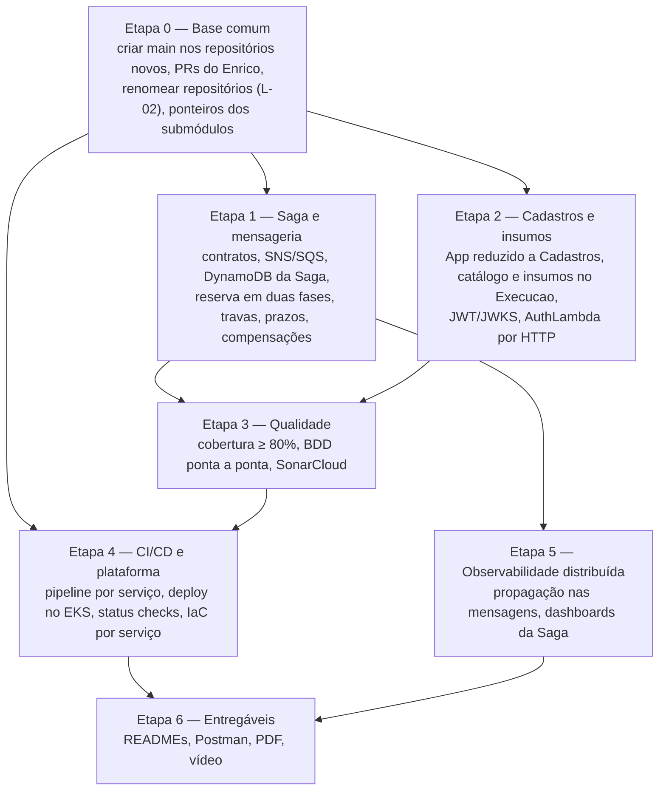

# Índice — Especificação da Fase 4 (Microsserviços, Saga e CI/CD)

> **Projeto:** AutoReparos - Sistema Integrado de Oficina Mecânica  
> **Fase:** Tech Challenge FIAP SOAT - Fase 4 (15SOAT) — Grupo 78  
> **Documento-fonte:** [`15SOAT - Fase 4 - Tech challenge.pdf`](../../../../docs/tech-challenge/15SOAT%20-%20Fase%204%20-%20Tech%20challenge.pdf)  
> **Base analisada:** `origin/develop` do pai e de cada submódulo (04/11/2026, revisada em 09/11/2026) **mais** a branch `feature/os-service-contracts` do Enrico (OS, Billing e Execution, mesclada localmente em 09/11/2026)  
> **Entrega:** 17/11/2026 (terça-feira)  
> **Local:** `.specs/features/fase4/especificacao/` — parte "o quê e por quê" da especificação da Fase 4 (§ 3.1); protocolo de preenchimento no § 8 e no `AGENTS.md` da raiz  
> **Status:** Especificação unificada com os planos TLC da fase. Decisões de arquitetura fechadas em 09 e 10/11/2026; pendências no § 6.3

---

## 1. Objetivo da fase

A oficina passou a operar em escala nacional com várias filiais. A Fase 4 pede que a aplicação seja refatorada para **microsserviços independentes** (no mínimo 3, cada um com repositório, infraestrutura e banco próprios), com **Saga Pattern** para manter a consistência das transações críticas (abertura da OS, aprovação, pagamento) e **automação completa** de build, testes e deploy.

Cada spec desta pasta registra, para o seu critério: o texto do PDF, o **estado atual** do projeto, as lacunas, a proposta e os **passos para a mudança**, com critérios de aceite.

---

## 2. Base analisada

O levantamento completo está em [`diagnostico/fase4_diagnostico_estado_atual.md`](./diagnostico/fase4_diagnostico_estado_atual.md). Resumo:

- **`develop` / `main` (05/11):** 1 monólito (`AutoReparos.App`, .NET 10 + Angular 19) + AuthLambda; 1 PostgreSQL compartilhado; sem mensageria, NoSQL, Saga, BDD ou Mercado Pago; provisionamento e deploy manuais pelo pai (provisionamento centralizado mesclado em 06/11); nenhuma branch exige status checks.
- **Branch `feature/os-service-contracts` (Enrico, 09/11):** 3 serviços novos em repositórios próprios, cada um com PostgreSQL próprio, Outbox e SQS — `AutoReparos.OS` (abertura e consulta da OS), `AutoReparos.Billing` (orçamento, aprovação, Checkout Pro, webhook, reembolso) e `AutoReparos.Execution` (fila, etapas, conclusão, falha, reexecução). Os três passaram no Verifier independente. A Saga, o DynamoDB e o contrato de eventos entre eles ainda não existem (feature `saga-mensageria`). Detalhes no [diagnóstico § 10](./diagnostico/fase4_diagnostico_estado_atual.md#10-trabalho-do-enrico-em-featureos-service-contracts-0911).

---

## 3. Mapa das specs

Toda a especificação da Fase 4 (a nossa e a do Enrico) mora em `.specs/features/fase4/`:

```text
.specs/
├── STATE.md                                        ← decisões AD-xxx (espelho do § 6) e handoff
└── features/fase4/
    ├── plan.md · checks.md                         ← plano TLC da iniciativa (critérios AC 1–17)
    ├── FEATURES.md                                 ← mapa das features TLC
    ├── especificacao/                              ← o quê e por quê (esta pasta)
    │   ├── index.md                                ← este arquivo (registro único de decisões)
    │   ├── diagnostico/
    │   │   └── fase4_diagnostico_estado_atual.md   ← base comum (branches, código, testes, CI, infra)
    │   ├── microsservicos/
    │   │   ├── fase4_spec_separacao_microsservicos.md   ← 3 serviços + Cadastros, repositórios
    │   │   ├── fase4_spec_bancos_de_dados.md            ← banco por serviço, SQL + NoSQL
    │   │   └── fase4_spec_integracao_mercado_pago.md    ← pagamentos na Cobrança
    │   ├── comunicacao/
    │   │   └── fase4_spec_comunicacao_microsservicos.md ← REST, SQS/SNS, catálogo de eventos
    │   ├── saga/
    │   │   └── fase4_spec_saga_pattern.md               ← orquestração, compensações, reserva, travas, prazos
    │   ├── testes-qualidade/
    │   │   └── fase4_spec_testes_e_qualidade.md         ← unitários, BDD, 80%, Sonar
    │   ├── cicd/
    │   │   └── fase4_spec_cicd_e_protecao_de_branches.md ← pipeline por serviço, branch protection
    │   ├── infraestrutura/
    │   │   ├── fase4_spec_infraestrutura_k8s_e_mensageria.md ← K8s por serviço, filas
    │   │   └── fase4_spec_observabilidade_distribuida.md     ← stack da Fase 3 + tracing distribuído
    │   └── entregaveis/
    │       ├── fase4_spec_entregaveis_repositorios.md   ← README, Swagger/Postman, evidências
    │       └── fase4_spec_video_e_documento_portal.md   ← vídeo (≤ 15 min) e PDF do portal
    └── <feature>/                                  ← como, verificável (uma pasta por feature TLC)
        ├── plan.md                                 ← critérios EARS; aprovado pelo usuário
        ├── checks.md                               ← derivado do plano aprovado e congelado
        └── proofs.md · mutations.json · verification.md   ← provas e veredito do Verifier
```

| Seção do PDF | Spec |
|---|---|
| Separação em Microsserviços | [Separação](./microsservicos/fase4_spec_separacao_microsservicos.md) · [Bancos](./microsservicos/fase4_spec_bancos_de_dados.md) · [Mercado Pago](./microsservicos/fase4_spec_integracao_mercado_pago.md) |
| Comunicação entre Microsserviços | [Comunicação](./comunicacao/fase4_spec_comunicacao_microsservicos.md) |
| Implementação do Saga Pattern | [Saga](./saga/fase4_spec_saga_pattern.md) |
| Testes e Qualidade | [Testes e qualidade](./testes-qualidade/fase4_spec_testes_e_qualidade.md) |
| CI/CD Automatizado | [CI/CD e proteção de branches](./cicd/fase4_spec_cicd_e_protecao_de_branches.md) |
| Infraestrutura | [Kubernetes e mensageria](./infraestrutura/fase4_spec_infraestrutura_k8s_e_mensageria.md) · [Observabilidade](./infraestrutura/fase4_spec_observabilidade_distribuida.md) |
| Entregáveis — Repositórios | [Entregáveis dos repositórios](./entregaveis/fase4_spec_entregaveis_repositorios.md) |
| Entregáveis — Vídeo e PDF | [Vídeo e documento do portal](./entregaveis/fase4_spec_video_e_documento_portal.md) |

### 3.1 Papéis de cada parte

| Parte | Papel | Quem lê |
|---|---|---|
| `especificacao/` (esta pasta) | **O quê e por quê:** requisitos do PDF, estado atual, decisões (registro único no § 6), desenho transversal (Saga, contratos, bancos, CI/CD, entregáveis), cronograma | Grupo, banca, autor do PDF final, agentes antes de planejar |
| `<feature>/` | **Como, verificável:** `plan.md` com critérios EARS, `checks.md` congelado, provas, mutações e veredito do Verifier | Quem implementa (pessoa ou agente) |
| `plan.md`, `checks.md`, `FEATURES.md` da fase | Aceite da iniciativa e mapa das features | Todos |
| `.specs/STATE.md` | Decisões em formato `AD-xxx`, cada uma ligada a um `D-xx` deste índice, e handoff | Agentes de IA |

Regras de sincronização (detalhadas no § 8):

1. Uma decisão nova entra **primeiro no § 6 deste índice** e, se afetar a implementação, vira um `AD-xxx` no `.specs/STATE.md` com a referência `D-xx`.
2. Um `plan.md` aprovado não é reescrito por esta pasta. Quando uma decisão daqui muda um plano, o plano é revisado e volta para aprovação (gate do TLC).
3. Desenho detalhado (máquina de estados, contratos) mora aqui; o `plan.md` da feature referencia a seção em vez de copiar.

| Feature (`../<feature>/plan.md`) | Estado (10/11) | Specs desta pasta |
|---|---|---|
| [`servico-os`](../servico-os/plan.md) | ✅ PASS (abertura, consulta, histórico de criação) | [Separação](./microsservicos/fase4_spec_separacao_microsservicos.md), [Bancos](./microsservicos/fase4_spec_bancos_de_dados.md) |
| [`cobranca`](../cobranca/plan.md) | ✅ PASS (orçamento, Checkout Pro, webhook, reembolso) | [Mercado Pago](./microsservicos/fase4_spec_integracao_mercado_pago.md) |
| [`execucao`](../execucao/plan.md) | ✅ PASS (fila, etapas, conclusão, falha, reexecução) | [Separação](./microsservicos/fase4_spec_separacao_microsservicos.md) |
| [`saga-mensageria`](../saga-mensageria/plan.md) | ✅ PASS (orquestração, compensações de orçamento e execução, cancelamento) | [Saga](./saga/fase4_spec_saga_pattern.md), [Comunicação](./comunicacao/fase4_spec_comunicacao_microsservicos.md) |
| [`saga-compensacoes`](../saga-compensacoes/plan.md) | 📝 Plano novo em 10/11 (D-18, AD-021), aguarda aprovação | [Saga](./saga/fase4_spec_saga_pattern.md) |
| [`eventos-portugues`](../eventos-portugues/plan.md) | ✅ PASS (comando `cobranca.cancelar-orcamento.v1` + normalização e leitura legada) | [Comunicação § 4.5](./comunicacao/fase4_spec_comunicacao_microsservicos.md#45-catálogo-de-mensagens) |
| [`cadastros`](../cadastros/plan.md) e [`insumos`](../insumos/plan.md) | 📝 Plano novo em 10/11, aguarda aprovação | [Separação § 5](./microsservicos/fase4_spec_separacao_microsservicos.md#5-passos-para-a-mudança) |
| [`web`](../web/plan.md) | ✅ PASS (extração para `AutoReparos.Web`) | [Separação § 4.2 e § 5](./microsservicos/fase4_spec_separacao_microsservicos.md#42-repositórios) |
| [`web-adaptacao`](../web-adaptacao/plan.md) | ✅ PASS (D-69: 100% Web-only; 22/22 provas, 3/3 mutações mortas, 92,6% de cobertura) | [Separação § 5](./microsservicos/fase4_spec_separacao_microsservicos.md#etapa-5--frontend-d-03), [Saga § 4.7](./saga/fase4_spec_saga_pattern.md) |
| [`web-coerencia-negocio`](../web-coerencia-negocio/plan.md) | 📝 Revisado por D-71 em 16/11 (aprovação pelo cliente, `OsJornadaStore` e acesso do Atendente na S5), aguarda aprovação do plano revisado; aprovado antes em 16/11 (D-70 / AD-075) | [Separação § 5](./microsservicos/fase4_spec_separacao_microsservicos.md#etapa-5--frontend-d-03), [Comunicação](./comunicacao/fase4_spec_comunicacao_microsservicos.md) |
| [`web-deploy`](../web-deploy/plan.md) | 📝 Plano novo em 16/11 (D-72 / AD-077: deploy próprio do Web, chart no repositório, quality corrigido), aguarda aprovação | [CI/CD § 4](./cicd/fase4_spec_cicd_e_protecao_de_branches.md#4-proposta-a-validar), [ADR-005](../../../../docs/architecture/ADR-005-deploy-independente-por-microsservico.md) |
| [`infra-ci-observabilidade`](../infra-ci-observabilidade/plan.md) | ✅ Plano revisado aprovado em 16/11 (D-68: ACs 1, 2, 5 e 6); checks e build em andamento | [CI/CD](./cicd/fase4_spec_cicd_e_protecao_de_branches.md), [Infraestrutura](./infraestrutura/fase4_spec_infraestrutura_k8s_e_mensageria.md), [Observabilidade](./infraestrutura/fase4_spec_observabilidade_distribuida.md), [Testes](./testes-qualidade/fase4_spec_testes_e_qualidade.md) |
| [`deploy-servicos`](../deploy-servicos/plan.md) | 📝 Plano escrito em 15/11, aguarda aprovação (José) | [CI/CD](./cicd/fase4_spec_cicd_e_protecao_de_branches.md), [ADR-004](../../../../docs/architecture/ADR-004-migrations-por-job-pre-upgrade.md), [ADR-005](../../../../docs/architecture/ADR-005-deploy-independente-por-microsservico.md) |
| [`pacote-entrega`](../pacote-entrega/plan.md) | 📝 Plano revisado em 10/11, aguarda aprovação | [Entregáveis](./entregaveis/fase4_spec_entregaveis_repositorios.md), [Vídeo e PDF](./entregaveis/fase4_spec_video_e_documento_portal.md) |

---

## 4. Matriz de rastreabilidade

Legenda: ✅ atende · 🟡 parcial · ❌ não atende. Estado em 09/11/2026, contando a branch `feature/os-service-contracts` (ainda sem PR).

### Separação em Microsserviços

| ID | Requisito do PDF | Estado atual | Spec |
|---|---|---|---|
| R01 | No mínimo 3 microsserviços independentes | 🟡 OS, Billing e Execution existem na branch de feature; o App ainda concentra cadastros e o fluxo antigo | [Separação](./microsservicos/fase4_spec_separacao_microsservicos.md) |
| R02 | Repositório próprio por microsserviço | 🟡 Repositórios novos criados, sem `main` e sem PR | [Separação](./microsservicos/fase4_spec_separacao_microsservicos.md) |
| R03 | Infraestrutura própria por microsserviço | ❌ Charts, ECR e banco centralizados em Infra.K8s/Infra.Database | [Infraestrutura](./infraestrutura/fase4_spec_infraestrutura_k8s_e_mensageria.md) |
| R04 | Banco de dados próprio por microsserviço | 🟡 Código: cada serviço tem database e connection string próprias (11/11). AWS: o RDS tem um só `autoreparos_db`; databases e usuários por serviço passam para `deploy-servicos` (D-42, D-49) | [Bancos](./microsservicos/fase4_spec_bancos_de_dados.md) |
| R05 | OS Service: abertura, atualização de status, consulta de status e histórico | 🟡 Abertura, consulta e histórico de criação; transições ficam para a Saga | [Separação](./microsservicos/fase4_spec_separacao_microsservicos.md) · [Saga](./saga/fase4_spec_saga_pattern.md) |
| R06 | Billing: gerar/enviar orçamento, registrar/verificar pagamento, atualizar a OS após pagamento | 🟡 Orçamento, aprovação e pagamento prontos; atualização da OS depende da Saga | [Mercado Pago](./microsservicos/fase4_spec_integracao_mercado_pago.md) |
| R07 | Integração com o Mercado Pago | 🟡 Checkout Pro + webhook validado na branch de feature; falta teste no sandbox | [Mercado Pago](./microsservicos/fase4_spec_integracao_mercado_pago.md) |
| R08 | Execução: fila, status no diagnóstico e reparos, comunicar finalização ao OS Service | 🟡 Pronto no Execution; ninguém consome `execucao.concluida.v1` ainda | [Separação](./microsservicos/fase4_spec_separacao_microsservicos.md) |
| R09 | Pelo menos um banco relacional (SQL) | ✅ PostgreSQL 16 | [Bancos](./microsservicos/fase4_spec_bancos_de_dados.md) |
| R10 | Pelo menos um banco não relacional (NoSQL) | 🟡 Código: DynamoDB implementado e testado no estado da Saga do OS Service (`saga-mensageria`, PASS). AWS: tabela `autoreparos-os-saga` sem Terraform, coberta por `deploy-servicos` (D-42, 15/11) | [Bancos](./microsservicos/fase4_spec_bancos_de_dados.md) |

### Comunicação entre Microsserviços

| ID | Requisito do PDF | Estado atual | Spec |
|---|---|---|---|
| R11 | APIs RESTful síncronas (quando necessário) | 🟡 Billing consulta o OS por REST antes do checkout | [Comunicação](./comunicacao/fase4_spec_comunicacao_microsservicos.md) |
| R12 | Mensageria assíncrona para eventos e integração desacoplada | 🟡 Outbox + SQS nos 3 serviços; contrato entre eles não fecha | [Comunicação](./comunicacao/fase4_spec_comunicacao_microsservicos.md) |
| R13 | **Nenhum serviço acessa diretamente o banco de outro** | 🟡 Serviços novos isolados; AuthLambda ainda lê `Clientes` do App | [Comunicação](./comunicacao/fase4_spec_comunicacao_microsservicos.md) · [Bancos](./microsservicos/fase4_spec_bancos_de_dados.md) |

### Implementação do Saga Pattern

| ID | Requisito do PDF | Estado atual | Spec |
|---|---|---|---|
| R14 | Saga coordenando o fluxo transacional da OS | ✅ `saga-mensageria` (PASS); D-18 em `saga-compensacoes` | [Saga](./saga/fase4_spec_saga_pattern.md) |
| R15 | Rollback e compensação em qualquer etapa | ❌ | [Saga](./saga/fase4_spec_saga_pattern.md) |
| R16 | Orquestrado ou coreografado | ✅ Decidido: orquestrado (D-07) | [Saga](./saga/fase4_spec_saga_pattern.md) |
| R17 | Escolha documentada e justificada no README | ❌ | [Saga](./saga/fase4_spec_saga_pattern.md) · [Entregáveis](./entregaveis/fase4_spec_entregaveis_repositorios.md) |

### Testes e Qualidade

| ID | Requisito do PDF | Estado atual | Spec |
|---|---|---|---|
| R18 | Testes unitários em todos os microsserviços | 🟡 App, Lambda e os 3 serviços novos têm testes | [Testes](./testes-qualidade/fase4_spec_testes_e_qualidade.md) |
| R19 | Pelo menos um fluxo completo testado com BDD | ❌ | [Testes](./testes-qualidade/fase4_spec_testes_e_qualidade.md) |
| R20 | Cobertura mínima de 80% por serviço | 🟡 App ~93% linhas; Lambda 74,8%; serviços novos sem medição publicada | [Testes](./testes-qualidade/fase4_spec_testes_e_qualidade.md) |
| R21 | Qualidade via SonarQube ou similar no CI | 🟡 SonarCloud automático só nos PRs do pai, sem cobertura | [Testes](./testes-qualidade/fase4_spec_testes_e_qualidade.md) |

### CI/CD Automatizado

| ID | Requisito do PDF | Estado atual | Spec |
|---|---|---|---|
| R22 | Pipeline independente por serviço com build | 🟡 App, Lambda e Execution têm CI | [CI/CD](./cicd/fase4_spec_cicd_e_protecao_de_branches.md) |
| R23 | … com testes automatizados | 🟡 Idem | [CI/CD](./cicd/fase4_spec_cicd_e_protecao_de_branches.md) |
| R24 | … com verificação de qualidade | ❌ | [CI/CD](./cicd/fase4_spec_cicd_e_protecao_de_branches.md) |
| R25 | … com deploy automatizado em Kubernetes | ❌ Deploy só pelo pai, manual | [CI/CD](./cicd/fase4_spec_cicd_e_protecao_de_branches.md) |
| R26 | `main` protegida com PR obrigatório e checagens automáticas | 🟡 PR + aprovação nos submódulos antigos; nenhum status check; repositórios novos sem `main` | [CI/CD](./cicd/fase4_spec_cicd_e_protecao_de_branches.md) |

### Infraestrutura

| ID | Requisito do PDF | Estado atual | Spec |
|---|---|---|---|
| R27 | Cada microsserviço em repositório próprio | Ver R02 | [Separação](./microsservicos/fase4_spec_separacao_microsservicos.md) |
| R28 | Deploy automatizado para Kubernetes | Ver R25 | [CI/CD](./cicd/fase4_spec_cicd_e_protecao_de_branches.md) · [Infraestrutura](./infraestrutura/fase4_spec_infraestrutura_k8s_e_mensageria.md) |
| R29 | Mensageria para orquestração ou coreografia | 🟡 Código SQS pronto; filas não provisionadas | [Infraestrutura](./infraestrutura/fase4_spec_infraestrutura_k8s_e_mensageria.md) |
| R30 | Monitoramento e observabilidade da Fase 3 | 🟡 Stack completa; serviços novos exportam OTLP | [Observabilidade](./infraestrutura/fase4_spec_observabilidade_distribuida.md) |

### Entregáveis — Repositórios

| ID | Requisito do PDF | Estado atual | Spec |
|---|---|---|---|
| R31 | Código-fonte | 🟡 Serviços novos em branch de feature | [Entregáveis](./entregaveis/fase4_spec_entregaveis_repositorios.md) |
| R32 | Dockerfile e manifestos Kubernetes | 🟡 Dockerfile nos serviços novos; manifestos só no Infra.K8s | [Entregáveis](./entregaveis/fase4_spec_entregaveis_repositorios.md) · [Infraestrutura](./infraestrutura/fase4_spec_infraestrutura_k8s_e_mensageria.md) |
| R33 | Pipelines de CI/CD | 🟡 Ver R22–R25 | [CI/CD](./cicd/fase4_spec_cicd_e_protecao_de_branches.md) |
| R34 | Evidências de cobertura (prints ou links no README) | ❌ | [Testes](./testes-qualidade/fase4_spec_testes_e_qualidade.md) · [Entregáveis](./entregaveis/fase4_spec_entregaveis_repositorios.md) |
| R35 | Documentação da arquitetura do serviço | 🟡 READMEs dos serviços novos em inglês e sem diagrama | [Entregáveis](./entregaveis/fase4_spec_entregaveis_repositorios.md) |
| R36 | Swagger ou collection Postman atualizada | 🟡 Swagger ok; Postman de 22/07/2026 | [Entregáveis](./entregaveis/fase4_spec_entregaveis_repositorios.md) |

### Entregáveis — Vídeo

| ID | Requisito do PDF | Estado atual | Spec |
|---|---|---|---|
| R37 | YouTube ou Vimeo (público ou não listado), até 15 min | ❌ | [Vídeo e PDF](./entregaveis/fase4_spec_video_e_documento_portal.md) |
| R38 | Fluxo completo de uma OS pelos microsserviços | ❌ | [Vídeo e PDF](./entregaveis/fase4_spec_video_e_documento_portal.md) |
| R39 | Execução da Saga e tratamento de falhas | ❌ | [Vídeo e PDF](./entregaveis/fase4_spec_video_e_documento_portal.md) |
| R40 | Deploy automatizado de pelo menos um serviço com validação de testes | ❌ | [Vídeo e PDF](./entregaveis/fase4_spec_video_e_documento_portal.md) |
| R41 | Monitoramento e rastreamento dos fluxos distribuídos | ❌ | [Vídeo e PDF](./entregaveis/fase4_spec_video_e_documento_portal.md) · [Observabilidade](./infraestrutura/fase4_spec_observabilidade_distribuida.md) |

### Entregáveis — PDF do portal

| ID | Requisito do PDF | Estado atual | Spec |
|---|---|---|---|
| R42 | Nome e identificação dos participantes | ✅ Tabela pronta no template da Fase 3 | [Vídeo e PDF](./entregaveis/fase4_spec_video_e_documento_portal.md) |
| R43 | Links dos repositórios | 🟡 Faltam os repositórios novos | [Vídeo e PDF](./entregaveis/fase4_spec_video_e_documento_portal.md) |
| R44 | Link do vídeo | ❌ | [Vídeo e PDF](./entregaveis/fase4_spec_video_e_documento_portal.md) |
| R45 | Diagrama geral: microsserviços, bancos e comunicação | ❌ (proposta na spec de separação) | [Vídeo e PDF](./entregaveis/fase4_spec_video_e_documento_portal.md) |
| R46 | Estratégia escolhida para a Saga | ❌ | [Vídeo e PDF](./entregaveis/fase4_spec_video_e_documento_portal.md) |
| R47 | Justificativa da divisão e das tecnologias | ❌ | [Vídeo e PDF](./entregaveis/fase4_spec_video_e_documento_portal.md) |

### Contexto do desafio (não obrigatório)

- **Múltiplas filiais:** aparece só na descrição do desafio, não nos requisitos obrigatórios. Fica fora do escopo, salvo decisão do grupo (D-16).
- **Resiliência e tolerância a falhas:** coberta pelas garantias de mensageria (Outbox, idempotência, retry, DLQ), pela Saga e por HPA/PDB/health checks.

---

## 5. Feedback da Fase 3

| Ponto do feedback | O que fazer na Fase 4 | Spec |
|---|---|---|
| Elogiado: Clean Architecture, Testcontainers, API Gateway + Lambda, SSM, EKS multi-AZ, HPA, ECR com scan, Terraform + Helm, stack de observabilidade open source | Preservar no novo desenho (cada serviço herda a mesma base) | Todas |
| Vídeo muito curto | Roteiro cronometrado com alvo de 13–14 min | [Vídeo e PDF](./entregaveis/fase4_spec_video_e_documento_portal.md) |
| Não mostrou adequadamente a implementação | Bloco de código: orquestrador, compensação, idempotência | [Vídeo e PDF](./entregaveis/fase4_spec_video_e_documento_portal.md) |
| Não mostrou dashboards | Bloco de observabilidade ao vivo com tráfego real | [Vídeo e PDF](./entregaveis/fase4_spec_video_e_documento_portal.md) · [Observabilidade](./infraestrutura/fase4_spec_observabilidade_distribuida.md) |
| Não mostrou proteção de branches | Tela de configuração + PR bloqueado; corrigir também os status checks que hoje não são exigidos | [CI/CD](./cicd/fase4_spec_cicd_e_protecao_de_branches.md) |

---

## 6. Decisões

Registro único das decisões da Fase 4. A coluna "`.specs`" aponta a decisão equivalente do Enrico (`AD-xxx` no `.specs/STATE.md` ou "Assumptions" do `.specs/features/fase4/plan.md`).

### 6.1 Decididas

| ID | Decisão | `.specs` | Spec |
|---|---|---|---|
| D-01 | **3 serviços de negócio + Cadastros** (09/11): `OS` (ciclo de vida da OS, histórico, orquestrador da Saga), `Cobranca` (orçamento, aprovação, pagamento, reembolso), `Execucao` (fila, etapas, **catálogo de serviços e insumos com reserva**). O App atual vira o serviço de **Cadastros** (clientes, veículos, usuários, emissão do JWT e notificações). Substitui a opção B de 06/11 (Estoque separado) | Plano fase4 "Fronteiras" | [Separação § 4](./microsservicos/fase4_spec_separacao_microsservicos.md#4-divisão-escolhida-3-serviços-de-negócio--cadastros-d-01) |
| D-02 | **Nomes em português** (regra L-02): `AutoReparos.OS`, `AutoReparos.Cobranca` (confirmado em 10/11), `AutoReparos.Execucao`. Renomeia os repositórios `Billing` e `Execution`. O App reduzido vira `AutoReparos.Cadastros` (D-23) | AD-010, AD-016 | [Separação § 4.2](./microsservicos/fase4_spec_separacao_microsservicos.md#42-repositórios) |
| D-03 | **Extrair o frontend para `AutoReparos.Web` agora** (11/11): criar `develop` a partir da `main` que contém só README, mover toda a aplicação Angular que hoje está no Cadastros e integrar build, CI e referências no repositório pai. A adaptação às novas APIs e as telas novas ficam para etapa posterior; a extração deixa de ser corte opcional | AD-028; usuário: "vamos criar uma develop e passar toda a camada web para esse repositorio e nessa branch develop" e "Extração e integração do repositório (recomendado)" | [Separação § 4.2](./microsservicos/fase4_spec_separacao_microsservicos.md#42-repositórios) |
| D-04 | **NoSQL = DynamoDB para o estado da Saga no OS Service** (09/11). Substitui "DynamoDB no Estoque" | Plano fase4 "Mensageria e NoSQL", "Orquestrador" | [Bancos § 4.1](./microsservicos/fase4_spec_bancos_de_dados.md#41-d-04--dynamodb-no-estado-da-saga) |
| D-05 | Uma instância RDS PostgreSQL compartilhada, com database e usuário próprios por serviço; cada repositório mantém a IaC dos seus recursos exclusivos | Plano fase4 "Bancos relacionais e IaC" | [Bancos § 4.2](./microsservicos/fase4_spec_bancos_de_dados.md#42-d-05--instância-rds-compartilhada) |
| D-06 | AWS SQS com DLQ, retry com backoff exponencial e jitter (fan-out por SNS em D-19) | AD-001 | [Comunicação § 4.3](./comunicacao/fase4_spec_comunicacao_microsservicos.md#43-d-06--mensageria) |
| D-07 | Saga **orquestrada e persistida**, com o OS Service como orquestrador | Plano fase4 "Saga" | [Saga § 4.1](./saga/fase4_spec_saga_pattern.md#41-d-07--saga-orquestrada-com-o-orquestrador-no-os-service) |
| D-08 | `AWSSDK.SQS` com Outbox, Inbox (deduplicação por `eventId`) e retry do próprio grupo, sem MassTransit | Código dos 3 serviços | [Comunicação § 4.4](./comunicacao/fase4_spec_comunicacao_microsservicos.md#44-d-08--biblioteca) |
| D-09 | **Pagamento depois da conclusão do serviço e antes da entrega.** Sem expiração automática do orçamento; sem estorno automático; reembolso total ou parcial só com aprovação e auditoria; falha técnica após captura segue recuperação para frente; falha na execução vai para intervenção e reexecução manual | Plano fase4 "Momento do pagamento", "Falha técnica após captura", "Reembolsos", "Orçamento sem resposta", "Falha na execução"; AD-007 | [Mercado Pago § 4.1](./microsservicos/fase4_spec_integracao_mercado_pago.md#41-d-09--momento-do-pagamento) · [Saga § 4.4](./saga/fase4_spec_saga_pattern.md#44-passos-compensações-e-pivô) |
| D-10 | Mercado Pago **Checkout Pro** + webhooks com validação de origem | Plano fase4 "Integração de pagamento" | [Mercado Pago § 4.2](./microsservicos/fase4_spec_integracao_mercado_pago.md#42-d-10--checkout-pro) |
| D-13 | **Deploy de cada serviço no pipeline do próprio repositório**; o pai mantém só o provisionamento da plataforma (rede, EKS, RDS, gateway, Lambda) e o atalho manual para subir tudo | `infra-ci-observabilidade` door 1 | [CI/CD § 4.2](./cicd/fase4_spec_cicd_e_protecao_de_branches.md#42-repositórios-de-plataforma-e-o-pai-d-13) |
| D-14 | xUnit + **Reqnroll** para BDD; cobertura medida por serviço | Plano fase4 "Testes e cobertura" | [Testes § 4.2](./testes-qualidade/fase4_spec_testes_e_qualidade.md#42-d-14--onde-fica-o-bdd) |
| D-19 | **Fan-out por SNS** (10/11): um tópico SNS por serviço produtor (`os-eventos`, `cobranca-eventos`, `execucao-eventos`) e uma fila SQS por consumidor assinando o tópico, com filtro por `tipo`. Comandos seguem direto para a fila do participante. Substitui a "uma linha de Outbox por destino" do Execution | AD-014 | [Comunicação § 4.3](./comunicacao/fase4_spec_comunicacao_microsservicos.md#43-d-06--mensageria) |
| D-20 | **Falta de saldo na reserva** (10/11): nada é reservado; a OS fica em `AguardandoInsumos` com alerta diário; a recepção repõe e manda retentar, ou cancela | AD-015 | [Saga § 4.4](./saga/fase4_spec_saga_pattern.md#44-passos-compensações-e-pivô) |
| D-22 | **Ambientes:** desenvolvimento local; push na `develop` implanta em staging (namespace compartilhado no EKS); push na `main` implanta em produção no EKS (`us-east-1`) com aprovação no Environment `production` | Plano fase4 "Alvos de infraestrutura" | [CI/CD § 4.1](./cicd/fase4_spec_cicd_e_protecao_de_branches.md#41-pipeline-padrão-de-cada-serviço-githubworkflowsci-cdyml) |
| D-23 | **App renomeado para `AutoReparos.Cadastros`** (10/11). O nome `OrdemServico` (D-02 de 09/11) deixou de servir: a OS mora no repositório novo `AutoReparos.OS`, e o App fica só com clientes, veículos, usuários e notificações | AD-017 | [Separação § 4.2](./microsservicos/fase4_spec_separacao_microsservicos.md#42-repositórios) |
| D-18 | **Saga além do mínimo** (09/11): (a) reserva de insumos em duas fases — reservar, confirmar, cancelar; (c) travas de estado enquanto um passo da Saga está em andamento; (d) prazos técnicos por passo, lembretes de negócio, console de administração das Sagas e reprocessamento de DLQ. A pré-autorização do pagamento (b) fica fora, porque exigiria trocar o Checkout Pro | AD-011 | [Saga § 4.5–4.7](./saga/fase4_spec_saga_pattern.md#45-reserva-de-insumos-em-duas-fases-d-18a) |
| D-11 | **AuthLambda chama endpoint interno do Cadastros** (11/11): `POST /internal/clientes/autenticar`, fora do API Gateway, sem acesso da Lambda ao banco de clientes | AD-023; Usuário: "confirmo d-11 a d-21" | [Bancos § 4.3](./microsservicos/fase4_spec_bancos_de_dados.md#43-como-garantir-nenhum-acesso-ao-banco-de-outro-serviço) |
| D-21 | **Cadastros emite o JWT com chave assimétrica e publica discovery OIDC + JWKS** (11/11); OS, Cobrança e Execução validam por `Authority` | AD-023; Usuário: "confirmo d-11 a d-21" | [Separação § 5](./microsservicos/fase4_spec_separacao_microsservicos.md#etapa-4--autenticação-entre-serviços) |
| D-12 | **Compartilhamento de contratos de mensagens:** Contratos duplicados em cada serviço + catálogo único documentado (AsyncAPI ou tabela) (11/11) | AD-023; Usuário: "Intervalo inteiro" (confirmação de D-11 a D-21) | [Comunicação § 4.6](./comunicacao/fase4_spec_comunicacao_microsservicos.md#46-garantias) |
| D-14b | **Onde ficam os cenários BDD ponta a ponta:** No pai (`tests/AutoReparos.E2E.Bdd`), rodando contra o `docker compose` (11/11) | AD-023; Usuário: "Intervalo inteiro" (confirmação de D-11 a D-21) | [Testes § 4.2](./testes-qualidade/fase4_spec_testes_e_qualidade.md#42-d-14--onde-fica-o-bdd) |
| D-15 | **Sonar:** SonarCloud por CI, um projeto por repositório (11/11) | AD-023; Usuário: "Intervalo inteiro" (confirmação de D-11 a D-21) | [Testes § 4.4](./testes-qualidade/fase4_spec_testes_e_qualidade.md#44-d-15--sonar-no-ci) |
| D-16 | **Suporte a múltiplas filiais:** Fora do escopo (11/11) | AD-023; Usuário: "Intervalo inteiro" (confirmação de D-11 a D-21) | § 4 (contexto) |
| D-17 | **Notificações como serviço próprio:** Consumidor de eventos dentro do Cadastros (dono do e-mail do cliente); extração só se sobrar tempo (11/11) | AD-023; Usuário: "Intervalo inteiro" (confirmação de D-11 a D-21) | [Separação § 4.1](./microsservicos/fase4_spec_separacao_microsservicos.md#41-dono-de-cada-contexto) |
| D-24 | **Aplicar L-02 aos tipos de mensagem já implementados** (10/11): trocar o comando `billing.orcamento.cancelar.v1` por `cobranca.cancelar-orcamento.v1`, nome já previsto no catálogo; os demais tipos existentes já usam português e conservam sua semântica | AD-022; José: "Vamos trocar os eventos para português" | [Comunicação § 4.5](./comunicacao/fase4_spec_comunicacao_microsservicos.md#45-catálogo-de-mensagens) |
| D-25 | **Proteção obrigatória só na `main`** (11/11): `main` de OS, Cobrança, Execução, Cadastros e Web exige PR com 1 aprovação e os jobs `build`, `test` e `quality` como status checks; a `develop` não recebe proteção obrigatória. O repositório `AutoReparos.Web` foi criado (público) nesta data, confirmando D-03 | AD-026; Usuário: "Branch protegida: main" e "Repositório Web: Vamos criar" | [CI/CD § 4.3](./cicd/fase4_spec_cicd_e_protecao_de_branches.md#43-proteção-de-branches) |
| D-26 | **L-01 não depende de DynamoDB Streams** (11/11): a regra exige um banco por passo, cumprida hoje pelo despacho da Saga (`saga-mensageria`, PASS). Streams é só um dos mecanismos de publicar a Outbox do DynamoDB (o outro é varredura por índice) e fica opcional; `infra-ci-observabilidade` traça SQS e SNS, sem Streams | AD-027; Usuário: "Pode seguir" (recomendação de tirar Streams do AC 5) | [Saga § 4.8](./saga/fase4_spec_saga_pattern.md#48-regra-l-01-no-os-service--opção-c) |
| D-27 | **Pasta TLC da OS renomeada para `servico-os`** (11/11): o nome da feature, seus links e comandos de prova acompanham a pasta; o repositório `AutoReparos.OS`, a branch `feature/os-service-contracts` e os registros históricos de provas conservam seus nomes | AD-029; usuário: "melhor \"servico-os\"" ao definir o nome alvo para a pasta `os-service` no PR #46 | [Plano da OS](../servico-os/plan.md) |
| D-28 | **Cadastros expõe `/api/v1` e mantém o prefixo atual** (12/11): `clientes`, `veiculos` e `usuarios` ficam disponíveis em `/api/v1/...` (contrato do OS) e em `/api/...` (frontend e testes atuais), com os mesmos contratos | AD-030; Usuário: "Expor /api/v1 e manter o antigo (Recommended)" | [Plano do Cadastros](../cadastros/plan.md) |
| D-29 | **Notificações reusam o SendGrid** (12/11): o consumidor de eventos do Cadastros usa o `NotificacaoService` (SendGrid, com retry) já existente; o plano dizia SMTP, mas o App nunca usou SMTP | AD-031; Usuário: "Reusar o SendGrid (Recommended)" | [Plano do Cadastros](../cadastros/plan.md) |
| D-30 | **Cadastros emite o token do cliente** (12/11): `POST /internal/clientes/autenticar` recebe CPF e e-mail (como a AuthLambda já faz), devolve o cliente e o JWT RS256 com `kid`; a AuthLambda deixa de assinar token e de ter segredo | AD-032; Usuário: "Cadastros emite o token (Recommended)" | [Plano do Cadastros](../cadastros/plan.md) |
| D-31 | **CRUD do Cadastros valida com 400** (12/11): a validação de domínio do CRUD de clientes, veículos e usuários continua respondendo 400, como no App; o 422 do plano não existe no contrato atual e não será introduzido | AD-033; Usuário: "Manter 400, ajustar plano" | [Plano do Cadastros](../cadastros/plan.md) |
| D-34 | **Database do Cadastros: `cadastros_db` só no ambiente local** (12/11): o compose local e os testes usam `cadastros_db`/`cadastros_test`; no RDS de produção o `db_name` permanece `autoreparos_db`, porque trocá-lo recria a instância. Renomear fica para a próxima recriação do RDS, em `infra-ci-observabilidade` | AD-036; Usuário: "Ajustar a spec" (achado "Door 1" do Verifier) | [Plano do Cadastros](../cadastros/plan.md) |
| D-35 | **Fila, DLQ, assinaturas SNS e IAM das notificações são de `infra-ci-observabilidade`** (12/11): o Cadastros consome a fila configurada em `Notificacoes__FilaUrl`/`Notificacoes__DlqUrl`; provisioná-las e os produtores incluírem `clienteId` nos eventos ficam fora do plano do Cadastros. Os workflows avisam quando as variables estão vazias | AD-037; Usuário: "Ajustar a spec" (achado AC 5 do Verifier) | [Plano do Cadastros](../cadastros/plan.md) |
| D-36 | **AC 6 do Cadastros vale na aplicação e na entrada de rede** (12/11): o endpoint interno recusa chamada sem `X-Chave-Interna` válida (teste) e só é publicado num ALB interno separado do API Gateway (prova no chart); "fora do cluster" por NetworkPolicy depende de o EKS aplicar política de rede, o que fica para `infra-ci-observabilidade` | AD-038; Usuário: "Ajustar a spec" (achado C6 do Verifier) | [Plano do Cadastros](../cadastros/plan.md) |
| D-37 | **Provas de rede e de IaC do Cadastros são estáticas** (12/11): o SG do RDS sem a Lambda é provado por `grep` nos workflows e em `variables.tf`, e a NetworkPolicy por renderização do chart; um `terraform plan` real exige credenciais AWS e fica para `infra-ci-observabilidade` | AD-039; Usuário: "Ajustar a spec" (achado C5 do Verifier) | [Plano do Cadastros](../cadastros/plan.md) |
| D-32 | **Itens da reserva vêm no `orcamento.aprovado.v1`** (12/11): a Cobrança inclui `itens` (`{insumoId, quantidade}`, do orçamento aprovado com preço congelado) no evento; o OS monta `execucao.reservar-insumos.v1` com eles, sem consultar ninguém. Campo só aditivo no contrato de `saga-mensageria` (PASS, congelado por AD-021); sem `itens` o OS não reserva | AD-034; Usuário: "1. A" (opção A: Cobrança inclui os itens no evento) | [Plano da Saga](../saga-compensacoes/plan.md) |
| D-33 | **Cancelamento espera a confirmação da reserva** (12/11): em `ReservandoInsumos` a Saga não publica `execucao.cancelar-reserva.v1` antes de `insumos.reservados.v1` ou `insumos.reserva-falhou.v1` (o 409 `saga_em_andamento` já bloqueia o comando); a Execução não muda, então o PASS de `insumos` fica | AD-035; Usuário: "2. A" (opção A: a Saga só cancela depois da confirmação) | [Plano da Saga](../saga-compensacoes/plan.md) |
| D-38 | **Lembrete de "orçamento sem resposta" fica fora de `saga-compensacoes`** (13/11): o AC 10 de `saga-compensacoes` cobre só os prazos de negócio que existem dentro da Saga (`AguardandoPagamento`, lembrete a cada 24 h, e `AguardandoInsumos`, junto do alerta diário). O orçamento sem resposta acontece antes de a Saga existir; o lembrete ao cliente (48 h) e o alerta à recepção (7 dias) ficam com a Cobrança, em feature própria, como dívida consciente | AD-040; Usuário: "pode seguir" (opção 1: reduzir o AC 10 aos dois prazos entregues) | ativa |
| D-39 | ~~**Escopo da adaptação do Web com rotas novas no backend**~~ (substituída pela D-69) (13/11): previa criar leituras novas no OS e na Cobrança (`TokenAprovacao` com migration), manter aprovação por token de e-mail, remover telas legadas sem equivalente e exigir 80% de cobertura no código novo e mensagens por `codigo` | AD-042; Usuário: "Criar no backend (Recommended)", "Manter token de e-mail", "Remover (Recommended)" e "80% e mensagens por código (Recommended)" | [Plano do Web](../web-adaptacao/plan.md) |
| D-40 | **Deploy por serviço vira a feature `deploy-servicos`** (15/11): os ACs 3, 4 e 7 de `infra-ci-observabilidade` (deploy no EKS, aprovação de produção e IaC dos recursos exclusivos) passam para a feature nova, conduzida pelo José; observabilidade (AC 5) e proteção de branches (AC 2) continuam em `infra-ci-observabilidade` | AD-043; José: "Feature nova (Recommended)" | [CI/CD § 4](./cicd/fase4_spec_cicd_e_protecao_de_branches.md#4-proposta-a-validar) · [ADR-005](../../../../docs/architecture/ADR-005-deploy-independente-por-microsservico.md) |
| D-41 | **Deploy automatizado só em produção** (15/11): push na `main` de cada serviço implanta no EKS (`us-east-1`) com aprovação no Environment `production`; a `develop` roda só CI, sem namespace de staging. Substitui o staging da D-22 | AD-044; José: "Só produção (Recommended)" | [CI/CD § 4](./cicd/fase4_spec_cicd_e_protecao_de_branches.md#4-proposta-a-validar) · [ADR-005](../../../../docs/architecture/ADR-005-deploy-independente-por-microsservico.md) |
| D-42 | **Terraform dos recursos exclusivos em cada serviço** (15/11): cada repositório de serviço tem `infra/terraform` com ECR, filas e DLQs SQS, role IRSA, database e usuário no RDS e, no OS, as tabelas DynamoDB da Saga, aplicado pelo próprio pipeline antes do deploy; VPC, EKS, instância RDS e API Gateway continuam na plataforma (D-05, D-13) | AD-045; José: "Terraform em cada serviço (Recommended)" | [CI/CD § 4](./cicd/fase4_spec_cicd_e_protecao_de_branches.md#4-proposta-a-validar) · [ADR-005](../../../../docs/architecture/ADR-005-deploy-independente-por-microsservico.md) |
| D-43 | **Chart Helm no repositório de cada serviço** (15/11): `deploy/helm/<servico>` em OS, Cobrança, Execução e Cadastros, um release por serviço; o subchart `api` sai do chart guarda-chuva do Infra.K8s, que fica com Web e observabilidade | AD-046; José: "No repo de cada serviço (Recommended)" | [CI/CD § 4](./cicd/fase4_spec_cicd_e_protecao_de_branches.md#4-proposta-a-validar) · [ADR-005](../../../../docs/architecture/ADR-005-deploy-independente-por-microsservico.md) |
| D-44 | **Node group `t3.medium`, 2 a 3 nós, 1 réplica por serviço** (15/11): o tipo de instância vira variável do Terraform da plataforma (`t3.small` continua possível se a conta não permitir `t3.medium`); cada serviço sobe com 1 réplica e HPA de 1 a 3. EKS e NAT não são cobertos pelo free tier: o ambiente é destruído pelo `destroy-aws.yml` depois da gravação do vídeo | AD-047; José: "estou usando free tier use o recomendado" | [CI/CD § 4](./cicd/fase4_spec_cicd_e_protecao_de_branches.md#4-proposta-a-validar) · [ADR-005](../../../../docs/architecture/ADR-005-deploy-independente-por-microsservico.md) |
| D-45 | **Pai deixa de implantar serviços** (15/11): o pai fica com a plataforma (rede, EKS, RDS, gateway), a Lambda e o release guarda-chuva com Web e observabilidade; subir todos os serviços é disparar o `workflow_dispatch` de cada repositório. Substitui o atalho "Deploy application chama os charts dos serviços" da D-13 | AD-048; José: "Pai só com Web e plataforma (Recommended)" | [CI/CD § 4](./cicd/fase4_spec_cicd_e_protecao_de_branches.md#4-proposta-a-validar) · [ADR-005](../../../../docs/architecture/ADR-005-deploy-independente-por-microsservico.md) |
| D-46 | **SNS fica para depois, como recurso aditivo** (15/11): o Terraform de `deploy-servicos` cria só as filas e DLQs SQS que o código usa; quando a D-19 for implementada, o produtor cria o tópico e o consumidor assina a fila que já existe, sem mock e sem trocar filas | AD-049; José: "pode seguir da forma recomendada" | [CI/CD § 4](./cicd/fase4_spec_cicd_e_protecao_de_branches.md#4-proposta-a-validar) · [ADR-005](../../../../docs/architecture/ADR-005-deploy-independente-por-microsservico.md) |
| D-47 | **Migrations por Job Helm `pre-upgrade` em todos os serviços** (15/11): a imagem do serviço roda com uma flag que migra e sai, como o Cadastros já fazia; migração no startup desligada no cluster | AD-050; José: "pode seguir o modelo de cadastros que realmente é muito melhor e deve ir para as nossas ADRs" | [CI/CD § 4](./cicd/fase4_spec_cicd_e_protecao_de_branches.md#4-proposta-a-validar) · [ADR-004](../../../../docs/architecture/ADR-004-migrations-por-job-pre-upgrade.md) |
| D-48 | ~~**Conta AWS do deploy: `053550652887`**~~ (substituída pela D-50) (15/11): a mesma dos workflows do pai (`AWS_ACCOUNT_ID`, bucket de state, role OIDC do Environment `production`);  | AD-051; José: "053550652887 (a dos workflows)" | [CI/CD § 4](./cicd/fase4_spec_cicd_e_protecao_de_branches.md#4-proposta-a-validar) · [ADR-005](../../../../docs/architecture/ADR-005-deploy-independente-por-microsservico.md) |
| D-49 | ~~**Database e usuário de cada serviço criados por Job no chart do próprio serviço**~~ (substituída pela D-54) (15/11): Job Helm `pre-install,pre-upgrade` roda no cluster (o runner não alcança o RDS privado), usa a credencial admin do RDS e cria de forma idempotente a database e o usuário do serviço; a senha do usuário é gerada pelo Terraform do serviço no Secrets Manager. Executa antes do Job de migration (D-47). Risco aceito em 15/11: o pipeline de cada serviço alcança a credencial admin do RDS; mitigação futura é um usuário provisionador só com `CREATEDB`/`CREATEROLE` | AD-052; José: "Job no chart de cada serviço (Recommended)" e, ciente do risco, "D-49 opção a. Cada serviço cria o próprio database inves de centralizar" | [CI/CD § 4](./cicd/fase4_spec_cicd_e_protecao_de_branches.md#4-proposta-a-validar) · [ADR-005](../../../../docs/architecture/ADR-005-deploy-independente-por-microsservico.md) |
| D-50 | **Conta AWS da Fase 4: `198903849859` (do José)** (15/11): conta-membro da organização `156342300286` do José, com recursos avançados ativos (plano pago, US$ 120 em créditos na conta gerencial). A SCP `AdvancedModeRegionRestrictionSecurityControlPolicy` (`p-dpzaddee`) foi editada pelo José removendo o bloco `UsEast1Partitional`, o que libera a `us-east-1`; a `RegionFloor` continua limitando a `us-east-1`, `us-east-2` e `us-west-2`. Plataforma e serviços passam a ser provisionados nela; `AWS_ACCOUNT_ID` e `AWS_ROLE_ARN` do pai mudam em combinação com o Enrico. Acesso humano por um IAM user por pessoa (grupo `autoreparos-equipe`, `AdministratorAccess`), sem credencial compartilhada; o GitHub entra só por OIDC. Substitui a D-48 | AD-054; José: "eu prefiro usar o meu login", conta nova criada em 15/11; "todas as outras contas que não esta atual, devem ser esquecidas", "Sim, minha conta (Recommended)", "Eu e o Enrico", "Admin para todos (Recommended)" | [CI/CD § 4](./cicd/fase4_spec_cicd_e_protecao_de_branches.md#4-proposta-a-validar) · [ADR-005](../../../../docs/architecture/ADR-005-deploy-independente-por-microsservico.md) |
| D-51 | **Acesso humano pelo IAM Identity Center e orçamento na conta de produção** (15/11): a conta `198903849859` é membro da organização `o-z6su3sei0t` (gerencial `156342300286`, Identity Center delegado à `286899917783`); o Enrico recebe um usuário no Identity Center, no grupo `autoreparos-equipe`, com o mesmo permission set de administrador que o José usa (`AccountFullAccessRole`), atribuído só à `198903849859`, com MFA; não há usuários IAM. Os créditos ficam na conta gerencial (Billing → Credits). Orçamento `autoreparos-limite-total` na `198903849859` (substituiu o `autoreparos-producao-mensal`): teto total de US$ 100 acumulado de 01/11/2026 a 31/10/2027 (não zera por mês; José: "Isto não é mensal é o total da conta, nunca deve passar disso"), custo sem descontar créditos e reembolsos, avisos por e-mail ao José com gasto real acima de US$ 50 e de US$ 90. Substitui a parte de usuários IAM da D-50 | AD-055; José: "Identity Center, admin (Recommended)", "198903849859 pela CLI (Recommended)" | [CI/CD § 4](./cicd/fase4_spec_cicd_e_protecao_de_branches.md#4-proposta-a-validar) · [ADR-005](../../../../docs/architecture/ADR-005-deploy-independente-por-microsservico.md) |
| D-52 | **Teto de gasto com desligamento automático** (15/11): o orçamento `autoreparos-limite-total` (US$ 100 no total, 01/11/2026 a 31/10/2027, sem descontar créditos) avisa por e-mail em US$ 50 e US$ 90 e, em US$ 80, publica no SNS `autoreparos-limite-gastos`, que dispara a Lambda de mesmo nome: anexa a política `autoreparos-congelado` (nega criar instâncias, clusters, NAT, load balancers, RDS) a toda role `autoreparos*` e apaga node groups e cluster EKS, load balancers, NAT Gateways e Elastic IPs, instâncias EC2 e instâncias RDS (com snapshot final). A margem de US$ 20 cobre o atraso dos dados de custo (até ~12 h) e o que sobra cobrando por mês (segredos, KMS, ECR, snapshot) até o `destroy-aws.yml`. Fica fora do Terraform da plataforma (`scripts/infra/limite-gastos/`) para não ser destruído junto | AD-056; José: "Isto não é mensal é o total da conta, nunca deve passar disso" e "O orçamento avisa, mas não impede gasto -> Faça impedir" | [CI/CD § 4](./cicd/fase4_spec_cicd_e_protecao_de_branches.md#4-proposta-a-validar) |
| D-53 | **Serviços leem a plataforma pelo SSM** (15/11): o Terraform de cada serviço lê cluster, provedor OIDC do cluster, RDS e API Gateway pelos parâmetros `/autoreparos/production/*` que a plataforma publica, sem `terraform_remote_state` dos states do Infra.K8s e do Infra.Database | AD-057; José: "A plataforma vive em dois repositórios -> Vamos trocar pela recomendação" | [ADR-005](../../../../docs/architecture/ADR-005-deploy-independente-por-microsservico.md) |
| D-54 | **Database criada pelo provisionador da plataforma** (15/11): a Lambda `autoreparos-provisionador-db`, na VPC e única dona da credencial admin do RDS, expõe uma Function URL com `AuthType AWS_IAM`; o job de deploy de cada serviço a chama assinando com a role `autoreparos-deploy-<servico>`, e a Lambda deriva o serviço dessa role e cria, de forma idempotente, só `<servico>_db`/`<servico>_app` com a senha do segredo do serviço. O Job de bootstrap sai do chart; cada serviço continua dono do ciclo de vida da própria database. Substitui a D-49 e fecha o risco aceito nela | AD-058; José: "Credencial admin do RDS; NAT-> use recomendado" | [ADR-005](../../../../docs/architecture/ADR-005-deploy-independente-por-microsservico.md) |
| D-55 | **Um NAT e endpoints gratuitos de S3 e DynamoDB** (15/11): a VPC mantém um NAT Gateway e ganha os endpoints do tipo gateway de S3 (camadas do ECR) e DynamoDB nas tabelas de rota privadas; NAT por zona, endpoints de interface e JWKS lido dentro do cluster ficam como cenário ideal fora do prazo | AD-059; José: "Credencial admin do RDS; NAT-> use recomendado" | [CI/CD § 4](./cicd/fase4_spec_cicd_e_protecao_de_branches.md#4-proposta-a-validar) |
| D-56 | **Configuração do GitHub faz parte de `deploy-servicos`** (15/11): `scripts/infra/configurar-github.sh` aplica variáveis, secrets e Environments do pai e dos 4 serviços, gerando chave JWT, `CHAVE_INTERNA` e senha do usuário inicial (cópia em `SecureString` no SSM); só pede ao José o que não dá para gerar (chave do SendGrid). A URL do emissor vem do SSM, sem `CADASTROS_ISSUER` | AD-060; José: "a configuração do github deve ser parte do plano por sua parte, só me peça as variáveis se for necessário ou gere automaticamente" | [Plano `deploy-servicos`](../deploy-servicos/plan.md) |
| D-57 | **Audiência do JWT** (16/11, achado no build de `deploy-servicos`): o Cadastros emite token sem `aud`, e OS, Cobrança e Execução validam a audiência (`Authentication:Audience`), então todo token do Cadastros recebe `401` nos serviços Decidido: O Cadastros emite `aud = autoreparos` (`Jwt:Audience`) e os 4 charts preenchem `Authentication__Audience=autoreparos`; mudança de uma linha no `JwtService` do Cadastros, sem afrouxar a validação nos serviços | AD-061; José: "Cadastros emite aud (Recommended)" (16/11) | [Plano `deploy-servicos`](../deploy-servicos/plan.md) |
| D-58 | **Token de serviço da Cobrança** (16/11, achado no build): `OsService:BearerToken` e `Execucao:BearerToken` são JWT estáticos que a Cobrança manda ao OS (prontidão) e à Execução (preços); em produção nada os gera, então essas chamadas respondem `401` e o orçamento com itens falha Decidido: O `configurar-github.sh`, rodado de novo depois do provisionamento (precisa da URL do gateway como emissor), assina com a chave do Cadastros no SSM um JWT de serviço (`sub = cobranca`, papel `Administrador`, `aud = autoreparos`, validade de 30 dias) e o grava no Environment `production` da Cobrança; o job `deploy` o injeta como Secret | AD-062; José: "Gerar no configurar-github (Recommended)" (16/11) | [Plano `deploy-servicos`](../deploy-servicos/plan.md) |
| D-59 | **Mensagens sem consumidor** (16/11, achado no build): a Execução publica `execucao.concluida.v1` para a Cobrança, que não consome esse evento; o OS publica `ordem-servico.criada/atualizada.v1` sem consumidor Decidido: Manter como o builder deixou: fila `autoreparos-cobranca-execucoes` (com DLQ) sem consumidor, as mensagens expiram pela retenção; `Sqs:QueueUrl` do OS vazio (o publicador se desliga com um log). Consumir esses eventos fica fora do prazo | AD-063; José: "Manter assim (Recommended)" (16/11) | [`contratos.md`](../deploy-servicos/contratos.md) |
| D-60 | **Deploy manual com o quality vermelho** (16/11): o projeto do Cadastros no SonarCloud está com Automatic Analysis ligada e recusa a análise do CI, então o `quality` falha e o `deploy` não roda. O `ci-cd.yml` do Cadastros ganha o disparo manual na `main` com `ignorar_quality=true`, que aceita o `quality` vermelho mas exige `build` e `test` verdes e a aprovação no Environment `production`; push na `main` continua exigindo o `quality` verde (exceção manual ao AC 15 de `deploy-servicos`) | AD-064; José: "we need to find another way to active this deploy for now, like fixing issues or allowing manual turn on" | [Plano `deploy-servicos`](../deploy-servicos/plan.md) |
| D-61 | **Roles de deploy aceitam o assunto imutável do OIDC do GitHub** (16/11): os repositórios de serviço emitem o `sub` na forma imutável (`repo:Grupo78-PosTech-15SOAT@272379485/AutoReparos.<Repo>@<id>:environment:production`) e o GitHub não deixa desligá-la (a API responde 201 e mantém `use_immutable_subject: true`); o trust de cada `autoreparos-deploy-<servico>` aceita as duas formas do mesmo assunto (mesmo repositório, só o Environment `production`). Muda o literal da porta 2 do plano `deploy-servicos` | AD-065; José: "You can run the Github fix" e "we need to find another way to active this deploy for now, like fixing issues" (16/11) | [Plano `deploy-servicos`](../deploy-servicos/plan.md) |
| D-62 | **Credenciais do Mercado Pago no deploy da Cobrança** (16/11): substitui o "variáveis vazias" do plano `deploy-servicos`. Aplicação de teste `AutoReparos Cobranca` (Checkout Pro com a API de Preferences, D-09/D-10, sem migrar para Orders); o José grava o Access Token e a assinatura do webhook como `SecureString` em `/autoreparos/production/cobranca/mercadopago-access-token` e `mercadopago-webhook-secret`; o `configurar-github.sh` os copia para os segredos `MERCADOPAGO_ACCESS_TOKEN` e `MERCADOPAGO_WEBHOOK_SECRET` do Environment `production` da Cobrança, sem pedir nada (D-56); o job `deploy` os grava no Secret `cobranca-segredos` e o chart os entrega como `MercadoPago__AccessToken` e `MercadoPago__WebhookSecret`, opcionais. Webhook cadastrado no painel em `<API Gateway>/api/v1/webhooks/mercado-pago`, evento Pagamentos (a preferência não envia `notification_url`) | AD-066; José: "yes make mercado pago changes" e "acabei de colocar a assinatura e o access token na aws com o comando do ssm, mas quero colocar no github" (16/11) | [Plano `deploy-servicos`](../deploy-servicos/plan.md) · [Mercado Pago](./microsservicos/fase4_spec_integracao_mercado_pago.md) |
| D-63 | **BDD no OS Service, não no pai** (16/11): o fluxo completo da OS e as compensações (R19) ficam em `AutoReparos.OS.BddTests` (Reqnroll + xUnit, cenários em português) sobre o `SagaHarness` existente, com Cobrança e Execução simuladas; roda no CI do OS e conta na cobertura dele. O compose do pai não sobe OS, Cobrança nem Execução, e montá-lo não cabe até a entrega; o complemento no pai fica como dívida registrada. Substitui a D-14b | AD-067; Usuário: "No OS, com harness (Recommended)" (16/11) | [Testes § 4.2](./testes-qualidade/fase4_spec_testes_e_qualidade.md#42-d-14--onde-fica-o-bdd) · [Plano `pacote-entrega`](../pacote-entrega/plan.md) |
| D-64 | **Claim `clienteId` no JWT do Cliente** (16/11): achado ao preparar o checkout de ponta a ponta. A Cobrança lê o claim `clienteId` para aprovar o orçamento e abrir o checkout como Cliente, mas o Cadastros emitia só `sub` com o id do cliente, e todo cliente real recebia `403`. O Cadastros passa a emitir `clienteId` (igual ao `sub`) no token de Cliente; a Cobrança e a `web-adaptacao` não mudam | AD-067; José: "Cadastros emite clienteId (Recommended)" (16/11) | [Plano `deploy-servicos`](../deploy-servicos/plan.md) · [Mercado Pago](./microsservicos/fase4_spec_integracao_mercado_pago.md) |
| D-65 | **Trace W3C dentro do envelope das mensagens** (16/11): `traceparent` e `tracestate` entram no JSON do envelope quando a mensagem é criada, na mesma transação da Outbox (no OS, no `Corpo` do comando da Saga no DynamoDB), sem coluna nova nem migration. Cada serviço declara `ActivitySource("AutoReparos.<Servico>.Mensageria")`, abre um span `Producer` ao publicar e um `Consumer` ao consumir, com o pai extraído do envelope e o atributo `ordem_servico.id`; mensagem sem contexto válido vira raiz nova e continua sendo processada. Vale para OS, Cobrança, Execução e Cadastros | AD-070; José: "Trace, depois SNS mínimo (Recommended)" (16/11) | [Observabilidade § 4](./infraestrutura/fase4_spec_observabilidade_distribuida.md#4-proposta) · [Plano `infra-ci-observabilidade`](../infra-ci-observabilidade/plan.md) |
| D-66 | **Dashboard da Saga com métricas do OS** (16/11): o OS publica pelo OTLP que já existe um `Meter("AutoReparos.OS.Saga")` com `sagas_iniciadas_total`, `sagas_concluidas_total`, `sagas_compensadas_total` (dimensão `passo`), Sagas paradas (gauge) e profundidade da DLQ da Saga (gauge, `GetQueueAttributes` na fila do próprio OS). O painel "Saga" entra no chart de observabilidade do Infra.K8s, que também passa a apontar os datasources do Grafana para os Services reais (`autoreparos-jaeger`, `autoreparos-prometheus`, `autoreparos-loki`). Feito depois do trace e antes do SNS | AD-071; José: "Vamos fazer ambos, primeiro dash e depois SNS" (16/11) | [Observabilidade § 4](./infraestrutura/fase4_spec_observabilidade_distribuida.md#4-proposta) · [Plano `infra-ci-observabilidade`](../infra-ci-observabilidade/plan.md) |
| D-67 | **SNS mínimo: só o tópico da Execução** (16/11): o Terraform da Execução cria `autoreparos-execucao-eventos`, que recebe todos os eventos dela (uma linha de Outbox por evento, atributo de mensagem `tipo`). Assinam com raw message delivery e `filter_policy` em `tipo` a fila da Saga do OS (os tipos que o OS consome) e a de notificações do Cadastros (`execucao.concluida.v1`); cada consumidor cria a própria assinatura e a política da fila. OS e Cobrança continuam publicando direto nas filas, e a fila `autoreparos-cobranca-execucoes` deixa de receber mensagens (D-59). A política de deploy e o boundary do `stacks/base` liberam SNS por prefixo do serviço e são aplicados na conta por CLI, iguais ao Terraform. Hora-limite do deploy em produção: 00h30 de 17/11; depois disso o código fica em PR e o SNS vira dívida | AD-072; José: "Trace, depois SNS mínimo (Recommended)" e "AWS CLI, igual ao Terraform (Recommended)" (16/11) | [Comunicação § 4.3](./comunicacao/fase4_spec_comunicacao_microsservicos.md#43-d-06--mensageria) · [Infraestrutura](./infraestrutura/fase4_spec_infraestrutura_k8s_e_mensageria.md) · [Plano `infra-ci-observabilidade`](../infra-ci-observabilidade/plan.md) |
| D-68 | **`infra-ci-observabilidade` fica com os ACs 1, 2, 5 e 6** (16/11): os ACs 3, 4 e 7 já estão em `deploy-servicos` (D-40) e o staging saiu do escopo (D-41). AC 1 (CI) e AC 6 (backoff e DLQ) já existem e só recebem provas; AC 2 (proteção da `main` com status checks) é aplicado em 17/11 antes da gravação, porque o C6 do `pacote-entrega` mostra um PR bloqueado; AC 5 passa a ser D-65, D-66 e D-67 | AD-073; José: "Revisar infra-ci-obs (Recommended)" (16/11) | [Plano `infra-ci-observabilidade`](../infra-ci-observabilidade/plan.md) |
| D-69 | **Adaptação do Web 100% no repositório `AutoReparos.Web`** (16/11): `web-adaptacao` é retomada exclusivamente em `submodules/AutoReparos.Web`, sem tocar nem criar migrations nos serviços C# (`OS`, `Cobranca`, `Execucao`, `Cadastros`) já implantados no EKS. O Web consome apenas as rotas existentes na `main` dos serviços (`/api/v1/ordens-servico`, `/api/v1/admin/sagas`, `/api/v1/orcamentos`, `/api/v1/pagamentos`, `/api/v1/fila-execucao`, `/api/v1/execucoes`, `/api/v1/servicos`, `/api/v1/insumos`, `/api/v1/{clientes,veiculos,usuarios}`, `/api/auth/login` e `POST /auth/cliente`), aprova o orçamento autenticado como Cliente (`POST /auth/cliente` + `POST /api/v1/orcamentos/{id}/aprovacao`), remove as telas legadas sem equivalente (dashboard, entregar, mudança manual de status, itens soltos da OS, busca por placa/CPF), traduz `{codigo}` nos erros HTTP e exige 80% de cobertura no código novo/alterado. Substitui a parte de backend da D-39 | AD-074; José: "prefiro retomar o plano completo, atualize ele e as branches", "Your changes shouldn't be just web changes?" e "entendido pode continuar" (16/11) | [Plano `web-adaptacao`](../web-adaptacao/plan.md) |
| D-70 | **Coerência de negócio, identidade visual e remoção de consulta pública no `AutoReparos.Web`** (16/11): nova feature `web-coerencia-negocio` (100% Web-only em `submodules/AutoReparos.Web`, mantendo `web-adaptacao` congelada em PASS). Remove a rota/página `/consulta-publica` e seus links, pois `GET /api/v1/ordens-servico/{id}` exige JWT de operador (`OperarOS`) sem consulta anônima no backend; alinha os payloads reais de orçamento (`valor: 0` com `itens`, agrupamento sem duplicados), serviços (`precoUnitario`), insumos (`quantidadeDisponivel`/`quantidadeReservada`/`quantidadeInicial`), execução (`descricao` em etapas, `?mecanico=`, `EstadoExecucao`), veículos (`chassi`/`renavam`), clientes/usuários (`PUT /api/v1/usuarios/{id}`), máscara `cpfCnpj` e catálogo completo de erros; conecta o Kanban (`Recebida`) e o fluxo OS ↔ Orçamento ↔ Aprovação ↔ Pagamento via `OsJornadaStore`; e padroniza todas as telas nos tokens CSS e componentes compartilhados reutilizáveis (`ModalDialogComponent`, `AlertBannerComponent`, `PageContainerComponent`, badges e selects) | AD-075; José: "Pode adicionar todos estes pontos que você mencionou no plano. Sim estamos falando agora de Web-only, se consulta publica já foi removida do backend então vamos tirar do front também. Sim pode criar a feature tlc" (16/11) | [Plano `web-coerencia-negocio`](../web-coerencia-negocio/plan.md) |
| D-71 | **Jornada da S5 de `web-coerencia-negocio` revista** (16/11): (1) o link do Detalhe da OS para `/aprovar-orcamento` leva só `orcamentoId`; o cliente digita o próprio CPF e e-mail, e nenhum dado pessoal vai para URL nem `localStorage`; (2) `OsJornadaStore` vira atalho local opcional (só IDs, limpo no logout), sem promessa de jornada "100% integrada"; para o Administrador, `GET /api/v1/admin/sagas/{osId}` (traz `orcamentoId`) é a fonte servidor; `pagamentoId` por entrada manual quando não estiver no atalho; (3) `403` de `fila-execucao` para o Atendente vira estado "sem acesso à execução", sem erro; (4) correções factuais: AC 8 `{ tipo, descricao }`, AC 14 `tipo` numérico, AC 17 com os 8 códigos omitidos | AD-076; José: "D-71 use a sua recomendação, passar o orçamentoId e o cliente passa suas próprias infos" (16/11) | [Plano `web-coerencia-negocio`](../web-coerencia-negocio/plan.md) |
| D-72 | **Web com deploy próprio** (16/11): o `AutoReparos.Web` passa a se implantar pelo próprio `ci-cd.yml` (job `deploy` no Environment `production`, role OIDC `autoreparos-deploy-web` com política mínima, chart `deploy/helm/web`, release `web` no namespace `web`, Ingress catch-all com `group.order: 999`); o `quality` vermelho desde 12/11 é diagnosticado e corrigido, com escape `workflow_dispatch` + `ignorar_quality` igual ao Cadastros (D-60); o pai deixa de implantar o Web (`web.enabled: false` no guarda-chuva). A proteção da `main` do Web fica para 17/11 com os outros repositórios. Muda a D-45 | AD-077; José: "Quero ajustar o Web para isto, crie a spec"; "Chart próprio no Web (Recommended)"; "Corrigir e ter escape (Recommended)"; "Fica para amanhã (Recommended)" (16/11) | [Plano `web-deploy`](../web-deploy/plan.md) |

### 6.2 Regras obrigatórias do grupo

| ID | Regra | Origem | `.specs` |
|---|---|---|---|
| L-01 | **Uma transação local, um banco.** Cada passo da Saga grava numa única transação, no mesmo banco: a mudança de estado de negócio, o estado da Saga, as mensagens de saída (Outbox) e o registro da mensagem recebida (Inbox). Nenhum passo grava em dois bancos. Aplicação no OS Service: **opção C** (Saga no DynamoDB e OS no PostgreSQL, ligados por Outbox/Inbox, sem handler que toque os dois) | José, 09/11/2026 | AD-012 |
| L-02 | **Nomes de repositórios, serviços, filas e eventos em português.** Não misturar idiomas. Termos técnicos de framework (`Api`, `Repository`, `DbContext`) seguem a regra do `.agents/AGENTS.md` | José, 09/11/2026 | AD-010 |

### 6.3 Em aberto

Nenhuma em 11/11: D-11, D-12, D-14b, D-15, D-16, D-17 e D-21 passaram para o § 6.1. Novas decisões abertas entram na tabela abaixo.

| ID | Decisão | Recomendação | Bloqueia | Spec |
|---|---|---|---|---|

Nenhuma em 16/11: D-57, D-58 e D-59 passaram para o § 6.1.

### 6.4 Histórico de mudanças de decisão

| Data | Mudança | Motivo |
|---|---|---|
| 09/11/2026 | D-01: de 4 serviços (Estoque separado) para 3 + Cadastros | Os 3 serviços do Enrico já estavam prontos e verificados; o Estoque custaria um repositório inteiro a mais |
| 09/11/2026 | D-02: de `OrdemServico`/`Billing`/`Estoque` para nomes em português dos repositórios existentes | Regra L-02 e aproveitamento dos repositórios do Enrico |
| 09/11/2026 | D-04: DynamoDB do Estoque para o estado da Saga | Sem serviço de Estoque; alinhado ao plano aprovado do Enrico |
| 09/11/2026 | D-09: de "pagar antes da execução" para "pagar depois da conclusão" | Modelo real de oficina e Billing já implementado assim; compensações reforçadas por D-18 |
| 10/11/2026 | D-19: de "uma linha de Outbox por destino" para SNS por produtor | Cadastros (notificações) passa a consumir eventos de vários serviços; o produtor não deve conhecer os consumidores |
| 10/11/2026 | D-02/D-23: App deixa de virar `OrdemServico` e passa a `Cadastros` | A OS foi implementada em repositório novo (`AutoReparos.OS`) |
| 11/11/2026 | D-19 e L-01: SNS por produtor e `saga.avancou.v1` com Streams adiados para depois da `saga-compensacoes`; SQS direto e sincronização por despacho seguem | Preservar o PASS de `saga-mensageria` (AD-021) e cumprir o prazo; a feature `infra-ci-observabilidade` assume o SNS (AD-024) |
| 11/11/2026 | D-25: CI/CD § 4.3 deixa de proteger a `develop`; só a `main` é obrigatória | Decisão do usuário ao aprovar `infra-ci-observabilidade` |
| 11/11/2026 | D-26: AC 5 de `infra-ci-observabilidade` deixa de exigir traces por DynamoDB Streams; L-01 lida como "um banco por passo", sem mecanismo obrigatório de publicação | Streams adiado por AD-024 e fora do escopo de infra; prazo de 17/11 |
| 11/11/2026 | D-03: extração do Web deixa de ser corte opcional e ganha plano próprio; rotas para as novas APIs e telas novas ficam para depois | Usuário pediu a `develop` do Web e a migração da camada Angular nesta etapa; escolheu "Extração e integração do repositório (recomendado)" |
| 12/11/2026 | D-28: `/api/v1` passa a coexistir com o prefixo atual; D-17: e-mail por SendGrid em vez de SMTP (D-29) | O código do App usa `/api/...` e SendGrid; o plano supunha `/api/v1` e SMTP |
| 12/11/2026 | D-11: o endpoint interno recebe CPF e e-mail e devolve também o JWT; D-21: o token do cliente passa a ser emitido pelo Cadastros (D-30) | A AuthLambda assinava o próprio HS256 e buscava por CPF e e-mail |
| 12/11/2026 | D-31: status 422 do CRUD do Cadastros substituído por 400 (contrato atual) | O App sempre respondeu 400 à validação; "contratos mantidos sem mudança" prevalece |
| 12/11/2026 | D-34: Door 1 do Cadastros passa a `cadastros_db` só no local; RDS mantém `autoreparos_db` | Renomear o `db_name` recria o RDS |
| 12/11/2026 | D-35: AC 5 do Cadastros deixa de provisionar fila, DLQ e SNS; D-36: AC 6 deixa de exigir prova de "fora do cluster" por NetworkPolicy; D-37: provas de rede e IaC estáticas | Achados do Verifier que dependem de infraestrutura e de credenciais AWS |
| 12/11/2026 | D-32: `orcamento.aprovado.v1` ganha o campo `itens` (aditivo); D-33: cancelamento só depois da confirmação da reserva | O evento não levava os itens que a reserva exige; `insumos` deixou aberta a ordem entre reservar e cancelar |
| 13/11/2026 | D-18d: lembrete de orçamento sem resposta sai do AC 10 de `saga-compensacoes` | O prazo é anterior à Saga; só a Cobrança pode emiti-lo (D-38) |
| 15/11/2026 | D-22: staging automático na `develop` sai do escopo; deploy automatizado só em produção (D-41); deploy dos serviços sai de `infra-ci-observabilidade` para `deploy-servicos` (D-40) | Dois dias de construção até o congelamento; cada ambiente exige filas, tabelas e databases próprias, e o PDF pede só "deploy automatizado em ambiente Kubernetes" |
| 15/11/2026 | D-13: o `Deploy application` do pai deixa de ser atalho para os serviços e fica só com Web, observabilidade e Lambda (D-45) | Um caminho de deploy por serviço; manter dois caminhos não cabe no prazo |
| 15/11/2026 | D-48 → D-50: conta do deploy passa da `053550652887` (Enrico, free tier no mínimo) para a `198903849859` (José, plano gratuito, US$ 100) | Créditos para os testes e o vídeo; a conta do Enrico está dimensionada no mínimo do free tier |
| 15/11/2026 | D-49 → D-54: a database deixa de ser criada por Job no chart com a credencial admin e passa ao provisionador da plataforma chamado pelo pipeline do serviço | Fechar o risco aceito na D-49 (pipeline de qualquer serviço alcançava o admin) sem tirar a database do ciclo de vida do serviço |
| 15/11/2026 | D-50 → D-51: acesso humano passa de usuários IAM para o IAM Identity Center; créditos conferidos na conta gerencial | A conta entrou numa organização com Identity Center delegado; o José já entra por ele, e os créditos deixaram de aparecer pela API da conta membro |
| 16/11/2026 | D-60: AC 15 de `deploy-servicos` ganha a exceção do disparo manual com `ignorar_quality` no Cadastros | SonarCloud do Cadastros com Automatic Analysis ligada recusa a análise do CI e ninguém com acesso pôde desligá-la a tempo |
| 16/11/2026 | D-61: trust das roles de deploy (porta 2) passa a aceitar também o assunto imutável do OIDC | O GitHub mantém o assunto imutável nos repositórios de serviço e o deploy falhava no `AssumeRoleWithWebIdentity` |
| 16/11/2026 | D-62: credenciais do Mercado Pago passam de "variáveis vazias" (José: "Eu ainda não tenho") para segredos injetados na Cobrança implantada | O José criou a aplicação de teste e as credenciais |
| 16/11/2026 | D-14b → D-63: os cenários BDD saem do pai (`tests/AutoReparos.E2E.Bdd`, contra o `docker compose`) e vão para `AutoReparos.OS.BddTests` | O compose do pai não sobe os serviços de negócio e montá-lo não cabe até 17/11; a recomendação original do § 4.2 roda no CI do OS |
| 16/11/2026 | D-63 (claim `clienteId`, branch `feature/deploy-servicos`) → D-64: só a numeração; no merge com a `develop` a D-63 já era o BDD no OS (AD-067); o AD do `clienteId` passa a AD-069 |
| 16/11/2026 | D-46 → D-67: o SNS deixa de ficar para depois e entra no mínimo, com o tópico da Execução; a D-19 fica parcial (OS e Cobrança sem tópico) | O AC 5 de `infra-ci-observabilidade` pede trace atravessando SQS e SNS, e um produtor com fan-out cabe no prazo |
| 16/11/2026 | D-26 → D-65, D-66 e D-68: o AC 5 de `infra-ci-observabilidade` passa a trace no envelope, dashboard da Saga com métricas do OS e SNS mínimo; os ACs 3, 4 e 7 saem do plano (já em `deploy-servicos`) | Revisão do plano pendente desde 15/11; José pediu trace e SNS antes da entrega |
| 16/11/2026 | D-39 → D-69: `web-adaptacao` deixa de criar rotas e migrations em `OS` e `Cobranca` e passa a alterar exclusivamente `AutoReparos.Web` sobre os endpoints já em produção | Os 4 serviços de backend já estão implantados e verificados no EKS; o escopo do Web deve mexer só no repositório Web |
| 16/11/2026 | D-71: S5 de `web-coerencia-negocio` deixa de usar `OsJornadaStore` como fonte da jornada e de pré-preencher CPF/e-mail no link de aprovação | O link permitia ao operador aprovar como o cliente; o `localStorage` não liga a jornada entre aparelhos; o Atendente recebe `403` da fila |
| 16/11/2026 | D-45 → D-72: o pai deixa de implantar o Web; o Web ganha deploy próprio como os 4 serviços | Um merge na `main` do Web não chegava à produção sem disparar o pipeline do pai, que também mexe na `AuthLambda` e na observabilidade |

---

## 7. Ordem sugerida de execução



### 7.1 Divisão em 5 tarefas (uma por integrante)

Cada integrante assume uma tarefa; o time distribui os números na reunião de início.

| Tarefa | Responsável | Escopo | Feature `.specs` | Depende de |
|---|---|---|---|---|
| **T1 — Plataforma e CI/CD** | Integrante 1 | Renomear repositórios (L-02) e criar `main`; Terraform por serviço (ECR, IRSA, filas, tópicos SNS, DLQs, tabela DynamoDB, VPC endpoint); Job de bootstrap das databases; charts Helm por serviço; pipeline padrão `ci-cd.yml` (build, testes, cobertura, Sonar, imagem, deploy staging/produção); status checks obrigatórios; rebase da branch do Infra.K8s | `infra-ci-observabilidade` | — (começa no dia 1) |
| **T2 — OS e Saga** | Integrante 2 | Orquestrador no DynamoDB (estados, compensações, escrita condicional), publicador da Outbox por Streams, handler `saga.avancou.v1`, travas (409), job de prazos e lembretes, console de administração das Sagas, validação de cliente/veículo no Cadastros, histórico de todas as transições | `saga-mensageria` | Catálogo de mensagens congelado (qua 11/11) |
| **T3 — Cobrança, Mercado Pago e frontend** | Integrante 3 | Itens no orçamento; eventos `orcamento.*` e `pagamento.*` no tópico SNS; consumidores `cobranca.cancelar-orcamento.v1` e `execucao.concluida.v1`; `external_reference` por tentativa e varredura de reembolsos; sandbox e rota do webhook; frontend com os novos paths, telas de orçamento, pagamento, fila e console de Sagas | `cobranca` | Catálogo de mensagens; T1 para a rota do webhook |
| **T4 — Execução, insumos e Cadastros** | Integrante 4 | Catálogo e insumos na Execução com reserva em duas fases; consumidores `reservar-insumos` e `cancelar-reserva`; eventos `execucao.enfileirada.v1` e `reexecutada.v1`; publicação no tópico SNS; App reduzido a Cadastros (REST de cliente e veículo, JWKS, endpoint interno da AuthLambda, notificações por eventos) | `insumos`, `cadastros` | Catálogo de mensagens |
| **T5 — Qualidade, observabilidade e entrega** | Integrante 5 | Catálogo de mensagens e envelope (`contratos-mensagens.md`); `docker-compose.yml` com LocalStack e os 4 serviços; BDD ponta a ponta (Reqnroll); cobertura ≥ 80% e SonarCloud por repositório; propagação de trace nas mensagens e dashboard da Saga; READMEs, Postman, roteiro do vídeo e PDF do portal | `pacote-entrega` (+ observabilidade de `infra-ci-observabilidade`) | Serviços de T2–T4 para o BDD |

Endpoint de reprocessamento da DLQ: cada responsável implementa no próprio serviço (T2 no OS, T3 na Cobrança, T4 na Execução e no Cadastros).

### 7.2 Situação real e plano até a entrega (revisto em 15/11/2026)

O cronograma de 10/11 previa seis dias de construção com cinco integrantes em paralelo e tudo mesclado na `develop` a cada dia. Não aconteceu assim: o trabalho entregue até 15/11 está em branches encadeadas e nada da Fase 4 chegou à `develop` desde o PR #45. O plano original fica no histórico do git; esta seção registra o que existe e o que cabe até a entrega de **terça, 17/11/2026**.

**Situação em 15/11**

| Frente | Feature `.specs` | Estado | Onde está |
|---|---|---|---|
| OS, Cobrança e Execução (serviços base) | `servico-os`, `cobranca`, `execucao` | ✅ PASS | PR #46 (`feature/os-service-contracts` → `develop`), aberto |
| Saga orquestrada, DynamoDB, Outbox/Inbox, SQS | `saga-mensageria` | ✅ PASS | PR #46 |
| Eventos em português | `eventos-portugues` | ✅ PASS | PR #46 |
| Cadastros (App reduzido, JWT RS256/JWKS, endpoint interno da Lambda) | `cadastros` | ✅ PASS | PR #47 mesclado em `feature/os-service-contracts` |
| Catálogo e reserva de insumos em duas fases | `insumos` | ✅ PASS | PR #48 (→ `feature/os-service-contracts`), aberto |
| Compensações, travas, prazos, lembretes, console de Sagas, DLQ | `saga-compensacoes` | ✅ PASS | PR #49 (→ `feature/insumos`), aberto |
| Extração do Web | `web` | ✅ PASS | PR #46 |
| Adaptação do Web às APIs novas | `web-adaptacao` | ⏸️ WIP interrompido em 13/11, sem build nem testes; **o frontend fica como está** (José, 13/11) | `feature/web-adaptacao` |
| CI por serviço (build, testes ≥ 80%, SonarCloud) | `infra-ci-observabilidade` (AC 1) | 🟡 workflows prontos; `quality` falha sem `SONAR_TOKEN` | `ci-cd.yml` dos 5 repositórios |
| Proteção da `main` | `infra-ci-observabilidade` (AC 2) | 🟡 script pronto, não aplicado (depende do `quality` verde) | `scripts/infra/setup-github-governance.sh` |
| Deploy automatizado no EKS por serviço, IaC exclusiva | `deploy-servicos` (D-40) | 🔴 spec em revisão; nenhum serviço novo roda na AWS | `feature/deploy-servicos` |
| SNS (D-19) | — | 🔴 não iniciado; entra depois como recurso aditivo (D-46) | — |
| Propagação de trace nas mensagens e dashboard da Saga | `infra-ci-observabilidade` (AC 5) | 🔴 não iniciado | — |
| BDD de um fluxo completo (Reqnroll) | `pacote-entrega` / D-14b | 🔴 não iniciado | — |
| READMEs com evidências, Postman/Swagger, PDF, vídeo | `pacote-entrega` | 🔴 plano sem aprovação | — |

**Plano até a entrega**

| Data | Deploy e plataforma (José) | Serviços e integração (Enrico) | Entrega (todos) |
|---|---|---|---|
| **Dom 15/11** | Fechar a spec e o plano `deploy-servicos`; Dockerfile do OS, `/health` e flag de migration nos serviços | Mesclar a cadeia #49 → #48 → #46 na `develop` | Confirmar créditos da conta AWS; criar `SONAR_TOKEN` nos repositórios |
| **Seg 16/11** | Terraform e chart dos 4 serviços; pipeline de deploy; primeiro deploy em produção; SNS só se sobrar tempo | BDD de um fluxo completo; propagação de trace | READMEs com cobertura e arquitetura; Postman |
| **Ter 17/11** | Correções do deploy até o meio-dia; proteção da `main` aplicada | Correções da integração até o meio-dia | Gravar o vídeo (fluxo, Saga com falha, deploy de um serviço, observabilidade), PDF, envio no portal; destruir o ambiente AWS depois |

Os responsáveis pelas colunas "Serviços e integração" e "Entrega" são uma proposta: confirmar com o Enrico e o resto do grupo.

### 7.3 Combinados do time

- **Contratos primeiro:** o catálogo de mensagens (§ 4.5 da [comunicação](./comunicacao/fase4_spec_comunicacao_microsservicos.md#45-catálogo-de-mensagens)) congela na quarta ao meio-dia; mudança depois disso só aditiva e avisada no grupo.
- **Integração diária:** 15 minutos por dia (o que fiz, o que farei, o que bloqueia); cada tarefa mescla na `develop` do seu repositório pelo menos uma vez por dia.
- **PR pequeno e revisado:** cada PR com um revisor de outra tarefa; nenhum merge com CI vermelho.
- **Decisão nova:** segue o protocolo do § 8 (índice primeiro, depois `STATE.md`).

**O que cortar se o prazo apertar** (revisto em 15/11), nesta ordem: SNS (D-46, fica como dívida registrada), dashboards além do da Saga, extração de Notificações (D-17). Já cortados: telas novas do Web (o frontend fica como está) e staging (D-41). Não cortar: Saga com compensações, deploy automatizado por serviço, BDD de um fluxo, cobertura e Sonar, vídeo.

---

## 8. Protocolo de preenchimento

Vale para pessoas e agentes de IA. O mesmo protocolo, resumido, está no `AGENTS.md` da raiz.

### 8.1 Onde cada coisa vai

| Conteúdo | Lugar |
|---|---|
| Requisito do PDF, estado atual, lacunas, desenho transversal | Spec em `especificacao/<tema>/fase4_spec_<assunto>.md` |
| Levantamento do código, branches, CI e infraestrutura | `especificacao/diagnostico/` |
| Decisão do grupo | § 6 deste índice (e `AD-xxx` no `.specs/STATE.md`) |
| Plano implementável de uma capacidade | `../<feature>/plan.md` (fluxo TLC Spec Lean) |
| Provas, mutações e veredito | `../<feature>/` (gerados pelos scripts do TLC) |
| Specs das Fases 1 a 3 | Continuam em `docs/specs/fase<N>/`, sem migração |

### 8.2 Decisões

1. Nova decisão: linha no § 6.1 com `D-xx` sequencial, data e as palavras de quem decidiu; decisão ainda aberta vai para o § 6.3 com recomendação e o que ela bloqueia.
2. Se mudar uma decisão anterior: atualizar a linha e registrar a mudança no § 6.4.
3. Se afetar a implementação: criar `AD-xxx` no `.specs/STATE.md` citando o `D-xx` e a frase do usuário.
4. Atualizar a spec transversal afetada e, se houver, revisar o `plan.md` da feature: trocar `**Approved**` por `**Revisão pendente de aprovação**`. A linha `**Approved**: <data> - user: "<palavras>"` só é escrita com as palavras do usuário, e o `checks.md` é derivado de novo depois.

### 8.3 Nova spec transversal

Usar as seções das specs existentes: cabeçalho (Projeto, Fase, Critério do PDF, Requisitos `R-xx`, Repositórios afetados, Feature `.specs`, Base, Índice, Status); 1. Critério (texto do PDF); 2. Estado atual; 3. Lacunas; 4. Desenho (ou Proposta, se houver escolha a fazer); 5. Passos para a mudança; 6. Critérios de aceite. Registrar no mapa (§ 3) e na matriz (§ 4).

### 8.4 Nova feature

Criar `../<feature>/plan.md` no formato do TLC Spec Lean (`.specs/tlc-spec-lean/`), com as decisões de origem (`D-xx`/`AD-xxx`) no topo e a seção da spec transversal em "Sources"; adicionar a feature no `FEATURES.md` e na tabela do § 3.1; aguardar a aprovação do usuário antes de derivar os checks.

### 8.5 Antes de commitar

- `python3 scripts/specs/verificar_links.py` sem problemas (links relativos e âncoras desta pasta).
- `python3 .specs/tlc-spec-lean/scripts/validate_plan.py fase4/<feature>` sem erros para cada plano alterado.
- Diagramas Mermaid validados (ex.: mermaid-cli ou mermaid.live).

### 8.6 Convenções

- Português, com caminhos relativos; nomes de serviços, filas e eventos em português (L-02).
- Arquivos de submódulos aparecem como caminho em código (`submodules/...`), porque links para dentro de submódulos não funcionam no GitHub.
- Sem código de produção, segredos ou dados pessoais nas specs.
