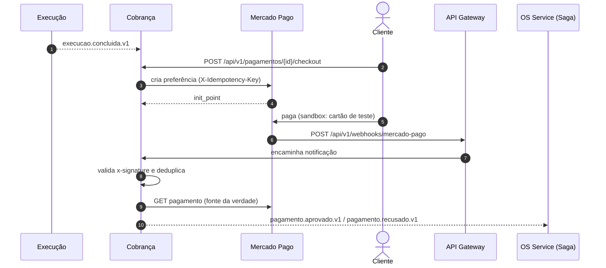

# Especificação Fase 4 — Integração de Pagamentos com Mercado Pago (Cobrança)

> **Projeto:** AutoReparos - Sistema Integrado de Oficina Mecânica  
> **Fase:** Tech Challenge FIAP SOAT - Fase 4 (15SOAT)  
> **Critério do PDF:** Separação em Microsserviços → Orçamento e Pagamento (Billing Service) → *Obs.: para a parte de pagamentos devemos nos integrar com o Mercado Pago*  
> **Requisitos cobertos (índice):** R06, R07  
> **Repositórios afetados:** `AutoReparos.Billing` → `AutoReparos.Cobranca`, `AutoReparos.Infra.K8s` (rota do webhook no API Gateway), `AutoReparos.Web`  
> **Feature `.specs`:** `.specs/features/fase4/cobranca/` (PASS em 09/11)  
> **Base:** [Diagnóstico do estado atual](../diagnostico/fase4_diagnostico_estado_atual.md) · **Índice:** [`../index.md`](../index.md)  
> **Status:** Decidido (D-09, D-10). Implementado na branch do Enrico; faltam integração com a Saga, sandbox e itens abertos do Verifier

---

## 1. Critério

> **Billing Service** — Registro e verificação de pagamentos; atualização do status da OS após pagamento. Para a parte de pagamentos devemos nos integrar com o Mercado Pago.

Documentação oficial: <https://www.mercadopago.com.br/developers/pt/docs>.

---

## 2. Estado atual

- **`develop`:** nenhuma integração de pagamento. Orçamento por e-mail (SendGrid) com token HMAC sem expiração; a aprovação leva a OS direto para `EmExecucao`.
- **Branch do Enrico (`AutoReparos.Billing`):**
  - `POST /api/v1/orcamentos` (identidade `ServicoOS`, administrador ou recepcionista) cria o orçamento com `OrdemServicoId`, `ClienteId` e `Valor` — **sem itens**.
  - `POST /api/v1/orcamentos/{id}/aprovacao` (cliente dono da OS).
  - `POST /api/v1/pagamentos/{id}/checkout` abre o Checkout Pro só depois da aprovação **e** da conclusão da OS (confirmada por REST no OS Service), com uma tentativa ativa por vez e chave de idempotência por tentativa.
  - `POST /api/v1/webhooks/mercado-pago` valida a assinatura e consulta o pagamento no Mercado Pago (fonte da verdade).
  - `POST /api/v1/pagamentos/{id}/reembolsos` com aprovação e auditoria; reserva `Pendente` antes de chamar o provedor (AD-007).
  - Publica o resultado do pagamento na SQS; alertas `billing.payment_sync_failed`, `billing.refund_outcome_unknown` e outros.
- **Itens abertos do Verifier (baixa gravidade):** checkout concorrente chama o Mercado Pago duas vezes com a mesma chave; webhook de tentativa antiga pode ser aplicado à nova (mesmo `external_reference`); sem varredura de reembolsos `Pendente`; status 409/502/503 fora da tabela do plano.
- O API Gateway não tem rota para o webhook.

---

## 3. Lacunas

1. Orçamento sem itens: a reserva de insumos precisa de insumo, quantidade e valor.
2. Eventos de orçamento e pagamento fora do catálogo (§ 4.5 da comunicação) e sem consumo de `execucao.concluida.v1`.
3. Nenhum teste no sandbox real.
4. Rota pública do webhook ausente; segredos não provisionados no cluster.

---

## 4. Desenho

### 4.1 D-09 — Momento do pagamento

**Decidido:** pagamento **depois da conclusão do serviço e antes da entrega**. O orçamento aprovado libera a execução; o veículo fica pronto para retirada até a confirmação do pagamento. Regras herdadas do plano do Enrico:

| Situação | Regra |
|---|---|
| Orçamento sem resposta | Sem expiração automática; lembretes (D-18d) |
| Pagamento pendente | Aguardar; uma tentativa ativa por vez |
| Pagamento recusado, cancelado ou expirado | Nova tentativa só iniciada por pessoa |
| Falha técnica após captura | Recuperação para frente: reconciliar, retry e alerta; sem estorno automático |
| Reembolso | Total ou parcial, só com aprovação de responsável e trilha de auditoria |
| Cobrança capturada | Nunca repetida automaticamente (AD-001) |

Como a cobrança acontece depois do pivô da Saga (início da execução), não existe compensação financeira automática; as compensações automáticas ficam antes do pivô ([Saga § 4.4](../saga/fase4_spec_saga_pattern.md#44-passos-compensações-e-pivô)).

### 4.2 D-10 — Checkout Pro

**Decidido:** Checkout Pro + webhooks validados. A Cobrança cria uma *preferência* com `external_reference` ligado ao pagamento; o cliente paga na página do Mercado Pago; dados de cartão nunca passam pelo sistema. A pré-autorização com captura posterior (D-18b) exigiria Checkout Transparente e ficou fora.

### 4.3 Fluxo

### 4.4 Regras da integração

| Tema | Regra |
|---|---|
| Fonte da verdade | O webhook só avisa; a Cobrança sempre consulta o pagamento antes de mudar o status |
| Assinatura | Validar `x-signature` com o segredo do webhook |
| Idempotência | `X-Idempotency-Key` por tentativa; chave única por id externo; notificações repetidas não geram eventos repetidos |
| Tentativas | `external_reference` distinto por tentativa (fecha o item aberto do webhook antigo) |
| Conciliação | Job periódico para pagamentos pendentes e reembolsos `Pendente` |
| Resiliência | Timeout, retry com backoff e circuit breaker |
| Segredos | `MercadoPago__AccessToken` e `MercadoPago__WebhookSecret` em Secrets Manager/Secret; nunca no repositório |
| Dados sensíveis | Guardar só id externo, status, valor e datas |

### 4.5 Ambiente de testes (sandbox)

- Contas de teste (vendedor e comprador) e credenciais de teste do painel do desenvolvedor.
- Cartões de teste: o nome do titular define o resultado (ex.: `APRO` aprovado, `OTHE` recusado; conferir a lista vigente).
- Webhook local: túnel (ngrok, cloudflared) ou notificação simulada com `curl` assinado.

---

## 5. Passos para a mudança

1. Renomear o repositório e os projetos para `Cobranca` (L-02).
2. Acrescentar itens ao orçamento (serviço ou insumo do catálogo do Execução, quantidade, valor unitário copiado) e calcular o valor total a partir deles.
3. Publicar `orcamento.gerado.v1`, `orcamento.aprovado.v1` (com itens), `orcamento.recusado.v1`, `orcamento.cancelado.v1`, `pagamento.aprovado.v1` e `pagamento.recusado.v1` com o envelope padrão.
4. Consumir `cobranca.cancelar-orcamento.v1` e `execucao.concluida.v1` (habilita o checkout sem depender da consulta REST, que pode ficar como verificação extra).
5. Fechar os itens abertos do Verifier que afetam o vídeo: `external_reference` por tentativa e varredura de reembolsos `Pendente`.
6. Criar a aplicação no Mercado Pago, as contas de teste e o segredo do webhook; guardar nos segredos do repositório e do cluster.
7. Adicionar a rota do webhook no API Gateway (`AutoReparos.Infra.K8s/terraform/modules/apigateway`) e no ingress da Cobrança.
8. Tela de orçamento e de pagamento no portal do cliente.
9. Testes: WireMock.Net simulando o Mercado Pago (aprovado, recusado, pendente, 5xx, assinatura inválida, duplicada); cenário BDD de pagamento recusado e nova tentativa.
10. README em português: fluxo, credenciais de teste e como reproduzir aprovado e recusado.

---

## 6. Critérios de aceite

- [ ] Uma OS concluída gera um link de pagamento real do sandbox do Mercado Pago.
- [ ] Pagamento aprovado leva a OS a `ProntaParaRetirada` (via Saga); recusado mantém `AguardandoPagamento` e permite nova tentativa manual.
- [ ] Webhook com assinatura inválida é rejeitado; notificação repetida não duplica efeitos.
- [ ] Reembolso aprovado aparece no painel de testes do Mercado Pago com trilha de auditoria.
- [ ] Nenhuma credencial versionada.

---

## 7. Riscos

- **URL pública para o webhook:** exige o API Gateway no ar ou um túnel no ambiente local.
- **Limitações do sandbox:** preferir cartão de teste para os cenários do vídeo.
- **Mudanças na API do Mercado Pago:** conferir a documentação vigente antes de implementar.
