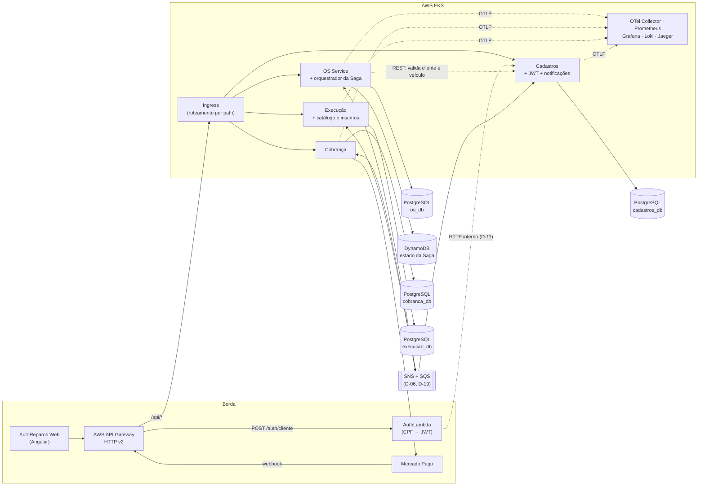

# Especificação Fase 4 — Separação em Microsserviços

> **Projeto:** AutoReparos - Sistema Integrado de Oficina Mecânica  
> **Fase:** Tech Challenge FIAP SOAT - Fase 4 (15SOAT)  
> **Critério do PDF:** Requisitos obrigatórios → *Separação em Microsserviços* e Infraestrutura → *Cada microsserviço deve estar em seu próprio repositório*  
> **Requisitos cobertos (índice):** R01, R02, R05, R06, R08, R27  
> **Repositórios afetados:** `AutoReparos.OS`, `AutoReparos.Billing` → `Cobranca`, `AutoReparos.Execution` → `Execucao`, `AutoReparos.App` → `Cadastros`, `AutoReparos.Web`, `AutoReparos` (pai)  
> **Features `.specs`:** `os-service`, `cobranca`, `execucao` (prontas); `cadastros` e `insumos` (a criar)  
> **Base:** [Diagnóstico do estado atual](../diagnostico/fase4_diagnostico_estado_atual.md) · **Índice:** [`../index.md`](../index.md)  
> **Status:** Divisão decidida em 09/11/2026 (D-01, D-02) e nome do Cadastros em 10/11 (D-23); substitui a opção B de 06/11

---

## 1. Critério

> Refatore a aplicação em, no mínimo, **3 microsserviços independentes**, cada um com seu próprio repositório, infraestrutura e banco de dados.

Sugestões do PDF:

| Serviço sugerido | Responsabilidades |
|---|---|
| **Ordem de Serviço (OS Service)** | Abertura da OS; atualização de status; consulta de status e histórico |
| **Orçamento e Pagamento (Billing Service)** | Geração e envio de orçamentos para aprovação; registro e verificação de pagamentos (Mercado Pago); atualização do status da OS após pagamento |
| **Execução e Produção** | Gerenciar a fila de execução da OS; atualizar status durante diagnóstico e reparos; comunicar finalização ao OS Service |

Os requisitos de banco (SQL + NoSQL) estão em [`fase4_spec_bancos_de_dados.md`](./fase4_spec_bancos_de_dados.md) e o Mercado Pago em [`fase4_spec_integracao_mercado_pago.md`](./fase4_spec_integracao_mercado_pago.md).

---

## 2. Estado atual

### 2.1 `develop`

- Todo o negócio está em `AutoReparos.App` (monólito modular com Clean Architecture), com um `AppDbContext` para todos os contextos: Clientes, Veículos, Usuários/Identity, Serviços (catálogo), Insumos, OS (status, orçamento por e-mail, aprovação por token, Kanban), Dashboard e Notificações.
- O frontend Angular (`AutoReparos.Web`) está no mesmo repositório da API.

### 2.2 Branch `feature/os-service-contracts` (Enrico, 09/11)

| Repositório | Já faz | Não faz |
|---|---|---|
| `AutoReparos.OS` | Abertura da OS (`ClienteId`, `VeiculoId`), consulta, `PATCH` de observação, histórico de criação, Outbox → SQS, concorrência otimista | Transições de status (ficaram para a Saga, AD-004); valida cliente/veículo |
| `AutoReparos.Billing` | Orçamento, aprovação, Checkout Pro, webhook validado, tentativas de pagamento, reembolso auditado (AD-007), evento de resultado na SQS | Consumir eventos da execução (consulta o OS por REST antes do checkout) |
| `AutoReparos.Execution` | Fila, etapas de diagnóstico e reparo, conclusão, falha, reexecução por administrador; consome `ordem-servico.liberada.v1`; publica `execucao.concluida.v1` e `execucao.falhou.v1` (AD-008) | Catálogo de serviços, insumos e reservas |

Nenhum dos três tem clientes, veículos, usuários ou catálogo: esses dados continuam só no App.

| Responsabilidade do PDF | Onde está hoje |
|---|---|
| Abertura da OS | ✅ OS (feature) · App (`develop`) |
| Atualização de status | 🟡 App; no OS, depende da Saga |
| Consulta de status e histórico | 🟡 OS (histórico só da criação) |
| Geração e envio de orçamento | ✅ Billing (feature) |
| Registro e verificação de pagamentos | ✅ Billing (feature) |
| Atualização da OS após pagamento | ❌ Depende da Saga |
| Fila de execução e status no diagnóstico e reparos | ✅ Execution (feature) |
| Comunicar finalização ao OS Service | 🟡 Evento publicado; ninguém consome |

---

## 3. Lacunas

1. Clientes, veículos, usuários, catálogo e insumos sem dono entre os serviços novos.
2. Nomes misturam inglês e português (regra L-02).
3. O App ainda roda o fluxo de OS antigo, em paralelo ao OS Service.
4. JWT: os serviços novos validam por `Authority` (descoberta OIDC), mas o App emite JWT com chave simétrica e não publica discovery/JWKS.
5. Repositórios novos sem `main` nem PR.

---

## 4. Divisão escolhida: 3 serviços de negócio + Cadastros (D-01)

Seguimos a sugestão do PDF (OS, Cobrança, Execução), aproveitando os serviços que o Enrico já implementou e verificou. O App não é descartado: perde o fluxo de OS e vira o serviço de **Cadastros**. Catálogo e insumos vão para o Execução, onde a reserva em duas fases vira passo e compensação da Saga.

| Opção avaliada | Por que não foi escolhida |
|---|---|
| B — 4 serviços com Estoque separado (escolhida em 06/11) | Um repositório inteiro a mais (pipeline, chart, Sonar, 80%) quando 3 serviços já estavam prontos |
| Cadastros dentro do OS | Reescreveria código testado do App (93% de cobertura) dentro de um serviço já verificado |

### 4.1 Dono de cada contexto

| Contexto | Serviço | Motivo |
|---|---|---|
| OS: abertura, status, histórico, consulta pública, Kanban | **OS** | Responsabilidade direta do PDF |
| Orquestrador e estado da Saga (DynamoDB) | **OS** | Dono do ciclo de vida da OS (ver [Saga](../saga/fase4_spec_saga_pattern.md)) |
| Dashboard de métricas da oficina | **OS** | Calculado a partir do histórico de status |
| Orçamento, aprovação, pagamento (Mercado Pago), reembolso | **Cobrança** | Responsabilidade direta do PDF |
| Fila, diagnóstico, etapas, conclusão, falha, reexecução | **Execução** | Responsabilidade direta do PDF |
| Catálogo de serviços (nome, valor, tempo estimado) | **Execução** | A oficina define o que executa |
| Insumos: cadastro, saldo, entrada e saída, **reserva, confirmação e cancelamento** | **Execução** | A reserva é passo e compensação da Saga e precisa da mesma transação da conclusão (L-01) |
| Clientes, Veículos | **Cadastros** | Código atual do App; consultado por REST |
| Usuários e login dos operadores (Identity), emissão do JWT e JWKS | **Cadastros** | Código atual do App; os demais serviços só validam o token |
| Notificações ao cliente (e-mail) | **Cadastros** (consumidor de eventos; extração opcional — D-17) | Dono do e-mail do cliente; não participa da Saga |

### 4.2 Repositórios

| Repositório (alvo) | Hoje | Papel |
|---|---|---|
| `AutoReparos.OS` | `AutoReparos.OS` | OS Service + orquestrador |
| `AutoReparos.Cobranca` | `AutoReparos.Billing` (renomear) | Orçamento e pagamento |
| `AutoReparos.Execucao` | `AutoReparos.Execution` (renomear) | Execução, catálogo e insumos |
| `AutoReparos.Cadastros` | `AutoReparos.App` (renomear e reduzir) | Clientes, veículos, usuários, JWT, notificações |
| `AutoReparos.Web` | Pasta do App | Frontend Angular (D-03) |
| `AutoReparos.AuthLambda` | Mantido | Autenticação do cliente por CPF; passa a chamar o Cadastros por HTTP (D-11) |
| `AutoReparos.Infra.K8s` | Mantido | Plataforma: VPC, EKS, API Gateway, ingress, observabilidade |
| `AutoReparos.Infra.Database` | Mantido | Instância RDS compartilhada (D-05) |
| `AutoReparos` (pai) | Mantido | Submódulos, documentação, `.specs`, stack local, BDD ponta a ponta |

Renomear no GitHub preserva histórico, issues e PRs e redireciona os links antigos. Os nomes de projeto .NET seguem o repositório (`AutoReparos.Cobranca.Api`, `AutoReparos.Execucao.Domain`); sufixos técnicos (`Api`, `Infrastructure`, `Tests`) continuam como estão (regra do `.agents/AGENTS.md`).

### 4.3 Arquitetura-alvo

### 4.4 Estados da OS

A lista final está na [spec da Saga § 4.3](../saga/fase4_spec_saga_pattern.md#43-máquina-de-estados-da-saga). Cada transição grava um registro no histórico da OS (status anterior, novo status, data, evento de origem, usuário), aplicado pelo handler de `saga.avancou.v1`.

---

## 5. Passos para a mudança

### Etapa 0 — Base comum

1. Criar a `main` nos repositórios `OS`, `Billing` e `Execution`, abrir os PRs do Enrico (feature → `develop` → `main`) e aplicar a governança de branches.
2. Renomear no GitHub `Billing` → `Cobranca`, `Execution` → `Execucao` e `App` → `Cadastros`; atualizar `.gitmodules`, caminhos dos submódulos, nomes de projeto, namespaces e as referências nas specs e no `.specs`.
3. Atualizar no pai os ponteiros dos submódulos (ver [diagnóstico § 1.2](../diagnostico/fase4_diagnostico_estado_atual.md#12-submódulos)).
4. Fechar o catálogo de contratos antes de mover código (ver [comunicação § 4.5](../comunicacao/fase4_spec_comunicacao_microsservicos.md#45-catálogo-de-mensagens)).

### Etapa 1 — Catálogo e insumos no Execução (feature `insumos`)

1. Levar `Domain/Servicos` e `Domain/Insumos` do App para o Execução, com migrations e seed próprios.
2. Separar no insumo a quantidade disponível e a reservada; criar a reserva por (OS, insumo) com status `Reservada`/`Confirmada`/`Cancelada` ([Saga § 4.5](../saga/fase4_spec_saga_pattern.md#45-reserva-de-insumos-em-duas-fases-d-18a)).
3. Consumir `execucao.reservar-insumos.v1` e `execucao.cancelar-reserva.v1`; confirmar a reserva na transação da conclusão.
4. Expor `/api/v1/servicos` e `/api/v1/insumos` (cadastro, entrada e saída manual, disponibilidade). O frontend usa o catálogo para montar o orçamento na Cobrança.

### Etapa 2 — App reduzido a Cadastros (feature `cadastros`)

1. Remover do App a OS, o orçamento, o catálogo, os insumos e o dashboard (que vão para OS, Cobrança e Execução); manter Clientes, Veículos, Usuários/Identity e Notificações.
2. Expor `GET /api/v1/clientes/{id}` e `GET /api/v1/veiculos/{id}` para o OS validar a abertura (REST síncrono: a recepção precisa da resposta na hora).
3. Expor o endpoint interno de autenticação por CPF para a AuthLambda (D-11).
4. Transformar o `NotificacaoService` em consumidor de eventos (`orcamento.gerado.v1`, `execucao.concluida.v1`, `pagamento.aprovado.v1`, lembretes da Saga).
5. Migrations: remover as tabelas que saíram; renomear a database para `cadastros_db`.

### Etapa 3 — Ajustes nos serviços do Enrico

1. OS: validar cliente e veículo no Cadastros ao abrir; receber a Saga (feature `saga-mensageria`).
2. Cobrança: publicar os eventos de orçamento e pagamento do catálogo; consumir `cobranca.cancelar-orcamento.v1` e `execucao.concluida.v1`.
3. Execução: publicar `execucao.enfileirada.v1` e `execucao.reexecutada.v1`.
4. Traduzir os READMEs para português e incluir diagrama e decisões (ver [entregáveis](../entregaveis/fase4_spec_entregaveis_repositorios.md)).

### Etapa 4 — Autenticação entre serviços

1. Cadastros publica discovery OIDC e JWKS com chave assimétrica (D-21); OS, Cobrança e Execução já validam por `Authority`/`Audience`.
2. Identidade de serviço (ex.: `ServicoOS`, já usada pela Cobrança) emitida pelo Cadastros por client credentials, ou chamadas internas protegidas por NetworkPolicy.
3. Ajustar a AuthLambda conforme D-11.

### Etapa 5 — Frontend (D-03)

1. Mover `AutoReparos.Web` para o novo repositório, com pipeline próprio.
2. Manter uma única URL base (API Gateway); o ingress roteia por path para cada serviço.
3. Adicionar telas para orçamento, pagamento, fila de execução, histórico da OS e console de Sagas.

### Etapa 6 — Repositório pai

Atualizar `.gitmodules`, `docker-compose.yml` (4 serviços, bancos, LocalStack e observabilidade), o README e o `.specs/features/fase4/FEATURES.md`.

---

## 6. Critérios de aceite

- [ ] Quatro repositórios de serviço com nomes em português (OS, Cobranca, Execucao, Cadastros); cada um compila, testa e sobe sozinho.
- [ ] O App não tem mais OS, orçamento, catálogo nem insumos.
- [ ] Nenhum `ProjectReference` entre serviços; o compartilhamento é só por contratos.
- [ ] Cada serviço com banco e credenciais próprios.
- [ ] Cada responsabilidade da tabela do § 1 implementada no serviço correspondente, inclusive o histórico de status.
- [ ] Rotas de cada serviço publicadas no ingress e acessíveis pelo API Gateway.

---

## 7. Riscos e pontos de atenção

- **Renomear repositórios com trabalho em andamento:** combinar uma janela com o Enrico; os PRs abertos acompanham a renomeação, mas clones locais precisam atualizar o remoto.
- **Código repetido** (JWT, OpenTelemetry, tratamento de exceções) nos 4 serviços: aceitar a duplicação ou criar um pacote `BuildingBlocks`, que reintroduz acoplamento.
- **Cadastros é um 4º serviço com pipeline, Sonar e 80%:** o App já tem CI e cobertura alta, então o custo é menor que criar um serviço do zero.
- **Contexto do desafio (múltiplas filiais):** fora do escopo, salvo decisão do grupo (D-16).
