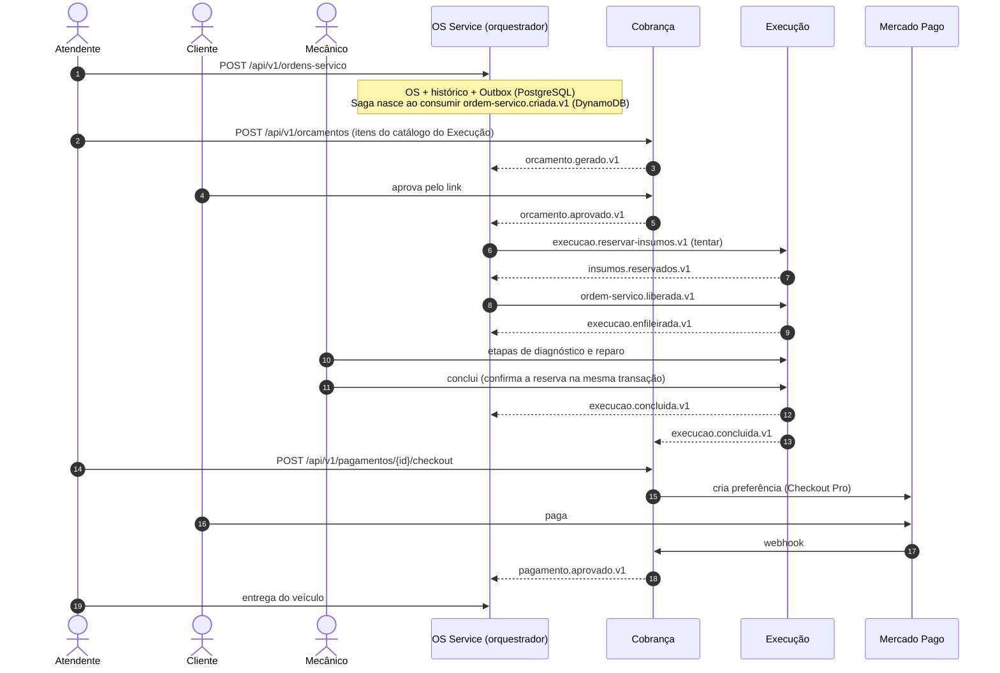
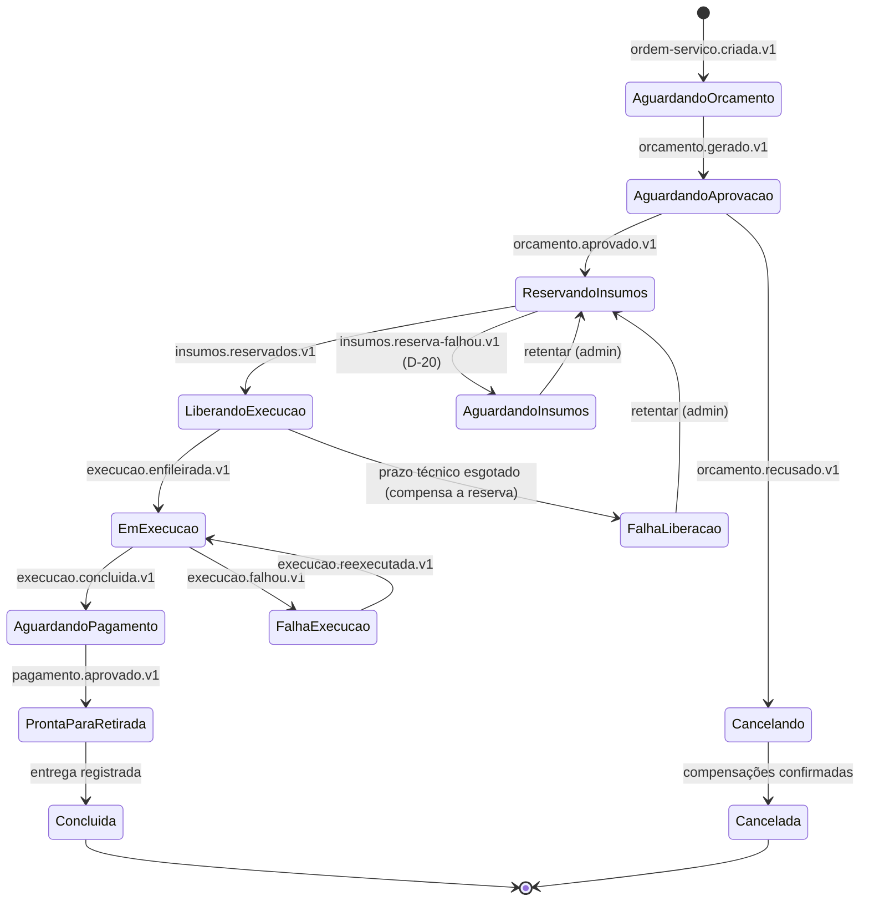

# Especificação Fase 4 — Saga Pattern no Ciclo de Vida da OS

> **Projeto:** AutoReparos - Sistema Integrado de Oficina Mecânica  
> **Fase:** Tech Challenge FIAP SOAT - Fase 4 (15SOAT)  
> **Critério do PDF:** Requisitos obrigatórios → *Implementação do Saga Pattern*  
> **Requisitos cobertos (índice):** R14, R15, R16, R17  
> **Repositórios afetados:** `AutoReparos.OS` (orquestrador), `AutoReparos.Cobranca`, `AutoReparos.Execucao`, `AutoReparos` (README)  
> **Feature `.specs`:** `.specs/features/fase4/saga-mensageria/plan.md` (revisão pendente de aprovação)  
> **Base:** [Diagnóstico do estado atual](../diagnostico/fase4_diagnostico_estado_atual.md) · **Índice:** [`../index.md`](../index.md)  
> **Status:** Desenho decidido em 09 e 10/11/2026 (D-07, D-09, D-18, D-19, D-20, L-01 opção C)

---

## 1. Critério

> - Implementar o **Saga Pattern** para coordenar o fluxo transacional das ordens de serviço (exemplo: ao abrir uma OS → gerar orçamento → aguardar aprovação → enviar para execução).
> - Deve haver **rollback e compensação** no caso de falha em qualquer etapa.
> - Pode ser aplicado via **orquestrado** (com um orquestrador central) ou **coreografado** (via eventos entre serviços).
> - **Documentar a escolha e justificar no README.**

---

## 2. Estado atual

- **`develop`:** não há Saga. O fluxo inteiro roda dentro do App, numa transação no único banco (`TransactionScope` em `CriarOrdemServicoUseCase`). Insumos são baixados quando entram na OS e não voltam se o orçamento for recusado. Não existe estado `Cancelada`.
- **Branch `feature/os-service-contracts` (Enrico):**
  - OS, Billing e Execution gravam no próprio PostgreSQL com Outbox e publicam na SQS com retry, backoff com jitter e DLQ (AD-001).
  - O contrato entre eles **não fecha**: o OS só publica `ordem-servico.criada.v1` e `atualizada.v1`; ninguém publica `ordem-servico.liberada.v1`, que o Execution espera; ninguém consome `execucao.concluida.v1` nem `execucao.falhou.v1`.
  - O plano `saga-mensageria` (aprovado em 06/11) prevê orquestração no OS com estado no DynamoDB, mas ainda não define estados, compensações nem prazos.
- Não há catálogo de serviços nem insumos em nenhum dos serviços novos.

---

## 3. Lacunas

1. Nenhum orquestrador nem estado persistido da Saga.
2. Nenhuma compensação implementada; insumos sem reserva.
3. Contrato de eventos incompleto entre os 3 serviços.
4. Nenhum prazo técnico, lembrete ou ferramenta para Sagas paradas.
5. Escolha (orquestração × coreografia) não documentada no README.

---

## 4. Desenho

### 4.1 D-07 — Saga orquestrada, com o orquestrador no OS Service

Justificativa para o README:

1. **Fluxo sequencial com dependências claras** (orçamento → aprovação → reserva → execução → pagamento). O orquestrador deixa a ordem e as compensações explícitas num só lugar.
2. **O OS Service já é dono do ciclo de vida da OS** e responde "qual é o status e o histórico". O estado da Saga alimenta esse histórico.
3. **Rastreabilidade e operação:** a etapa atual, as compensações e as Sagas paradas de cada OS ficam visíveis num único registro, o que facilita o suporte, o console de administração (§ 4.7), os dashboards e o vídeo.
4. **Evita a lógica espalhada** da coreografia, em que cada serviço precisaria conhecer os eventos dos outros e a ordem de compensação ficaria implícita.
5. **Custo aceito:** o orquestrador é um ponto central. Ele conhece só contratos (comandos e eventos), nunca bancos ou código dos participantes, e roda com réplicas e concorrência otimista sobre o estado da Saga.

### 4.2 Fluxo feliz

### 4.3 Máquina de estados da Saga

Estados terminados em **"-ando"** são **pendentes** (passo em andamento, sujeito a trava e prazo técnico — § 4.6 e § 4.7).

Cancelamento pedido pelo atendente leva a `Cancelando` a partir de `AguardandoOrcamento`, `AguardandoAprovacao`, `AguardandoInsumos`, `FalhaLiberacao` e `FalhaExecucao` (setas omitidas no diagrama).

Status da OS visível ao usuário: `Aberta`, `AguardandoAprovacao`, `AguardandoInsumos`, `EmExecucao`, `FalhaExecucao`, `AguardandoPagamento`, `ProntaParaRetirada`, `Entregue`, `Cancelada`. Os estados pendentes (`ReservandoInsumos`, `LiberandoExecucao`, `Cancelando`) e `FalhaLiberacao` aparecem só no histórico e no console de administração.

### 4.4 Passos, compensações e pivô

Classificação usual do padrão Saga: **compensável** (pode ser desfeito), **pivô** (ponto de não retorno) e **retentável** (depois do pivô, só avança).

| # | Passo | Serviço | Tipo | Falha | Reação |
|---|---|---|---|---|---|
| 1 | Abrir OS | OS | Compensável | — | Compensação: OS → `Cancelada` |
| 2 | Gerar orçamento | Cobrança | Compensável | — | Compensação: `cobranca.cancelar-orcamento.v1` |
| 3 | Aprovação do cliente | Cobrança | Compensável | Recusa | `Cancelando`: cancela o orçamento → OS `Cancelada` (nada foi reservado) |
| 4 | Reservar insumos (tentar) | Execução | Compensável | Sem saldo | Nada é gravado (transação única). OS → `AguardandoInsumos` com alerta; retentar ou cancelar (D-20) |
| 5 | Liberar para execução | Execução | Compensável | Sem resposta após o prazo técnico e os reenvios | **Compensação automática:** `execucao.cancelar-reserva.v1` → `FalhaLiberacao`; o admin retenta (refaz a reserva) ou cancela |
| 6 | **Início da execução** | Execução | **Pivô** | — | A partir daqui não há cancelamento automático; só intervenção |
| 7 | Execução e conclusão | Execução | Retentável | Falha operacional | `FalhaExecucao`: intervenção; o administrador reexecuta (etapas preservadas) ou cancela (cancela a reserva não confirmada e o orçamento; nada é cobrado) |
| 8 | Confirmar insumos | Execução | Retentável | — | Na mesma transação da conclusão (mesmo banco) |
| 9 | Pagamento | Cobrança + Mercado Pago | Retentável | Recusado ou expirado | Continua `AguardandoPagamento`; nova tentativa só por pessoa; nunca repetir cobrança capturada (AD-001) |
| 10 | Sincronizar pagamento com a OS | OS | Retentável | Falha técnica após captura | Recuperação para frente: retry, reconciliação e alerta; sem estorno automático |
| 11 | Entrega | OS | — | — | Fim; reembolso posterior só com aprovação (AD-007) |

**Cadeia de cancelamento** (estado `Cancelando`): em ordem inversa, `execucao.cancelar-reserva.v1` (se houver reserva) → `cobranca.cancelar-orcamento.v1` (se houver orçamento) → OS `Cancelada`. Cada compensação é idempotente e reenviada até confirmar; se esgotar os reenvios, a mensagem vai para a DLQ, a Saga fica em `Cancelando` com `compensacaoPendente = true` e um alerta é disparado.

**Compensações automáticas demonstráveis** (BDD e vídeo): recusa do orçamento (passo 3), cancelamento pelo atendente com reserva feita (cadeia completa) e falha de liberação (passo 5).

### 4.5 Reserva de insumos em duas fases (D-18a)

Os insumos ficam no Execução, no PostgreSQL dele (D-01). Cada insumo tem `QuantidadeDisponivel` e `QuantidadeReservada`; cada OS tem uma reserva por insumo, com status `Reservada` → `Confirmada` ou `Cancelada`.

| Fase | Quando | Transação (um banco, regra L-01) |
|---|---|---|
| **Tentar** (reservar) | Comando `execucao.reservar-insumos.v1` após a aprovação | Inbox + para cada item `UPDATE ... SET disponivel = disponivel - q, reservado = reservado + q WHERE id = ? AND disponivel >= q` + reservas + Outbox `insumos.reservados.v1`. Se um item não tiver saldo: rollback, e numa segunda transação Inbox + Outbox `insumos.reserva-falhou.v1` (com os itens em falta) |
| **Confirmar** (baixa) | Conclusão da execução | Na mesma transação da conclusão: `reservado -= q`, reserva → `Confirmada`, Outbox `execucao.concluida.v1` |
| **Cancelar** (devolução) | Compensação `execucao.cancelar-reserva.v1` | Inbox + reservas `Reservada` → `Cancelada` + `disponivel += q, reservado -= q` + Outbox `insumos.reserva-cancelada.v1`. Reserva já `Confirmada` não é cancelada |

Idempotência: a reserva é única por (OS, insumo); reservar de novo a mesma OS não reserva o dobro, e cancelar duas vezes não devolve o dobro.

### 4.6 Travas de estado (D-18c)

- Enquanto a Saga está num estado pendente (`ReservandoInsumos`, `LiberandoExecucao`, `Cancelando`), o OS recusa comandos que conflitam com o passo em andamento (cancelar, alterar itens) com **409 e código estável `saga_em_andamento`**. O cliente tenta de novo quando o passo terminar.
- Cada transição grava com **escrita condicional** no DynamoDB (`ConditionExpression` sobre `versao` e `estado` esperado). Dois eventos concorrentes para a mesma Saga não avançam os dois: o segundo relê e reavalia.
- Nos participantes, a trava é o próprio estado do agregado: o Execução recusa etapas numa ordem `Cancelada`; a Cobrança recusa checkout de orçamento `Cancelado`. Isso usa o controle otimista que o Enrico já implementou (AD-005).

### 4.7 Prazos, lembretes e operação (D-18d)

**Prazos técnicos** (por passo pendente, configuráveis; minutos no ambiente de demonstração):

| Estado | Prazo | Ao vencer |
|---|---|---|
| `ReservandoInsumos` | 2 min | Reenvia o comando (idempotente) até 3 vezes com backoff; depois `FalhaLiberacao` e alerta |
| `LiberandoExecucao` | 2 min | Reenvia até 3 vezes; depois compensa a reserva → `FalhaLiberacao` |
| `Cancelando` | 5 min | Reenvia as compensações pendentes; depois `compensacaoPendente = true` e alerta |

**Lembretes de negócio** (sem expiração automática, D-09): orçamento sem resposta → lembrete ao cliente após 48 h e alerta à recepção após 7 dias; `AguardandoPagamento` → lembrete após 24 h; `AguardandoInsumos` → alerta diário.

**Implementação:** um job periódico no OS consulta o índice `estado + prazoEm` da tabela da Saga (§ 4.8). A SQS só atrasa mensagens até 15 minutos, então não serve para prazos longos.

**Console de administração** (papel `Administrador`, fora do Ingress público ou protegido por policy):

| Rota | Serviço | Uso |
|---|---|---|
| `GET /api/v1/admin/sagas?estado=&paradaHaMinutos=` | OS | Lista Sagas paradas |
| `GET /api/v1/admin/sagas/{ordemServicoId}` | OS | Estado, passos, mensagens e erros |
| `POST /api/v1/admin/sagas/{ordemServicoId}/retentar` | OS | Reenvia o passo atual (de `AguardandoInsumos`, `FalhaLiberacao` ou `Cancelando`) |
| `POST /api/v1/admin/sagas/{ordemServicoId}/cancelar` | OS | Inicia a cadeia de cancelamento |
| `GET /api/v1/admin/dlq` e `POST /api/v1/admin/dlq/reprocessar` | Cada serviço, para a própria DLQ | Lista e devolve mensagens da DLQ para a fila de origem |

Métricas e alertas: `saga_paradas{estado}`, `saga_compensacoes_total{passo}`, `dlq_mensagens{fila}` (ver [observabilidade](../infraestrutura/fase4_spec_observabilidade_distribuida.md)).

### 4.8 Regra L-01 no OS Service — opção C

**Regra obrigatória:** cada passo grava numa única transação, no mesmo banco, o estado de negócio, o estado da Saga, a Outbox e a Inbox. Não existe transação atômica entre PostgreSQL e DynamoDB.

**Como o OS cumpre a regra mantendo a Saga no DynamoDB (decisão do Enrico):** nenhum handler grava nos dois bancos. Os dois se sincronizam pelo mesmo mecanismo Outbox/Inbox usado entre serviços.

| Handler | Banco | Grava na mesma transação |
|---|---|---|
| Abrir OS (REST) | PostgreSQL | OS + histórico + Outbox `ordem-servico.criada.v1` (já existe) |
| Eventos dos participantes e da própria OS | DynamoDB | Inbox + transição da Saga + Outbox (comandos e o evento interno `saga.avancou.v1`) num único `TransactWriteItems` |
| `saga.avancou.v1` | PostgreSQL | Inbox + status da OS + histórico |
| Comandos REST do atendente que mexem na Saga (cancelar, entregar) | DynamoDB | Transição condicional + Outbox |

Publicação da Outbox do DynamoDB: **DynamoDB Streams** acionando o publicador (ou varredura por índice como alternativa). O status da OS no PostgreSQL atualiza milissegundos depois da Saga; a consulta de status lê o PostgreSQL, e o console de administração lê a Saga.

Modelo da tabela `autoreparos-os-saga`:

| Item | PK | SK | Atributos |
|---|---|---|---|
| Estado | `SAGA#{ordemServicoId}` | `ESTADO` | `estado`, `versao`, `orcamentoId`, `pagamentoId`, `prazoEm`, `tentativas`, `compensacaoPendente` |
| Passo | `SAGA#{ordemServicoId}` | `PASSO#{data}#{id}` | mensagem recebida ou enviada, resultado, erro |
| Inbox | `INBOX#{eventId}` | `INBOX` | data; TTL de 7 dias |
| Outbox | `OUTBOX#{id}` | `OUTBOX` | tipo, destino, payload, `traceparent`; removido após publicar |
| Índice GSI1 | `estado` | `prazoEm` | Sagas vencidas e paradas |

Alternativas descartadas: (A) Saga no PostgreSQL do OS e DynamoDB em outro lugar — contraria a decisão do Enrico; (B) OS inteiro no DynamoDB — reescreve a persistência já verificada.

### 4.9 Como provocar falhas para testes e para o vídeo

| Cenário | Como provocar |
|---|---|
| Orçamento recusado | Recusar pelo link |
| Falta de saldo | Orçamento com insumo de saldo zero |
| Falha de liberação (compensação da reserva) | Escalar o deployment do Execução para 0 réplicas depois da reserva e esperar o prazo técnico |
| Participante fora do ar sem perda | Escalar a Cobrança para 0 réplicas e voltar: mensagens ficam na fila e o fluxo continua |
| Mensagem duplicada | Reenviar a mesma mensagem pela DLQ ou pelo console: a Inbox descarta |
| Pagamento recusado | Cartão de teste do Mercado Pago com titular `OTHE` |
| Falha na execução e reexecução | `POST .../falha` e `.../reexecucao` no Execução |

---

## 5. Passos para a mudança

1. Revisar o plano `.specs/features/fase4/saga-mensageria/plan.md` com este desenho (estados, compensações, D-18, L-01) e obter nova aprovação antes de derivar os checks.
2. Trocar no Execution a "uma linha de Outbox por destino" pela publicação no tópico `execucao-eventos` (D-19).
3. Registrar a decisão em `docs/architecture/ADR-004-saga-orquestrada.md` e na seção "Saga Pattern" do README do pai e do OS (R17).
4. Fechar o catálogo de comandos e eventos (ver [spec de comunicação § 4.5](../comunicacao/fase4_spec_comunicacao_microsservicos.md#45-catálogo-de-mensagens)).
5. **OS Service:** tabela DynamoDB (IaC), máquina de estados com escrita condicional, Inbox/Outbox no DynamoDB, publicador via Streams, handler `saga.avancou.v1`, travas, job de prazos e lembretes, console de administração, novos status e histórico de todas as transições.
6. **Execução:** catálogo e insumos (feature `insumos`), reserva em duas fases, consumidores `reservar-insumos`, `cancelar-reserva` e `ordem-servico.liberada.v1` (já existe), publicação de `execucao.enfileirada.v1` e `execucao.reexecutada.v1`, confirmação na conclusão.
7. **Cobrança:** publicar `orcamento.gerado.v1`, `orcamento.aprovado.v1`, `orcamento.recusado.v1` e `pagamento.aprovado.v1`; consumir `cobranca.cancelar-orcamento.v1` e `execucao.concluida.v1` (substitui a consulta REST antes do checkout ou a mantém como verificação).
8. **Todos:** endpoint de reprocessamento da DLQ.
9. Remover a baixa imediata de estoque do fluxo antigo do App (que deixa de ter OS).
10. Observabilidade: métricas e atributo `ordem_servico.id` em spans e logs; `traceparent` em toda mensagem.
11. Testes: unitários de cada transição e compensação; integração com LocalStack (SQS, SNS, DynamoDB) cobrindo duplicidade, concorrência e participante fora do ar; BDD do fluxo feliz e das 3 compensações demonstráveis.

---

## 6. Critérios de aceite

- [ ] Uma OS percorre o fluxo feliz até `Entregue` passando pelos 3 serviços, com todos os passos da Saga por mensagens.
- [ ] Recusa, cancelamento com reserva e falha de liberação terminam com o orçamento cancelado e nenhuma reserva ativa.
- [ ] Nenhum handler grava em dois bancos (revisão de código e teste de falha entre os dois passos do OS).
- [ ] Mensagens repetidas e eventos concorrentes não duplicam reserva, cobrança ou transição.
- [ ] Reiniciar qualquer serviço no meio do fluxo não perde o estado da Saga.
- [ ] Sagas paradas aparecem no console e podem ser retentadas ou canceladas; mensagens da DLQ podem ser reprocessadas.
- [ ] O histórico da OS mostra todos os passos e compensações.
- [ ] README explica a escolha (orquestração), o pivô e a justificativa.
