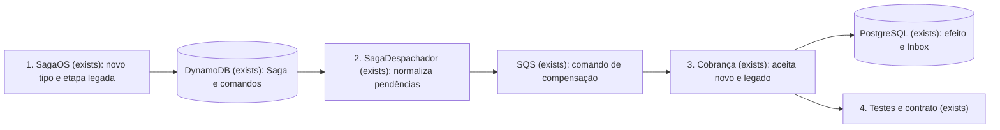
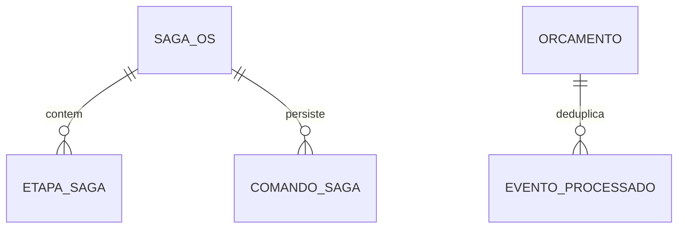

# Fase 4 - Tipos de mensagens em português

**Approved**: 2026-11-10 - user: "Pode seguir"

**Decisões de origem:** D-02/L-02 e D-24 em `../especificacao/index.md`; AD-010, AD-021 e AD-022 em `.specs/STATE.md`.

## Problem

O comando de compensação emitido pelo OS Service usa `billing.orcamento.cancelar.v1`, embora o catálogo da Fase 4 determine `cobranca.cancelar-orcamento.v1`. A Cobrança aceita somente o tipo antigo. Quem integrar os serviços conforme o catálogo terá o comando rejeitado e enviado à DLQ. O tipo antigo também está gravado em etapas e comandos pendentes de Sagas no DynamoDB.

Após esta mudança, o OS Service publicará o comando com nome em português e a Cobrança o processará sem perder mensagens antigas nem repetir o cancelamento. Os outros tipos já implementados conservarão seus nomes e comportamentos.

## Shape

A mudança reutiliza a Saga, a Outbox e a Inbox existentes nos serviços OS e Cobrança. As regras de normalização e leitura dos tipos ficam no domínio/aplicação, onde os testes de contrato já as alcançam.

1. `SagaOS` (exists) cria comandos novos com `cobranca.cancelar-orcamento.v1` e normaliza o tipo legado de etapas persistidas antes de criar a compensação.
2. `SagaDespachador` (exists) lê comandos pendentes do DynamoDB, normaliza `ComandoSaga.Tipo` e `ComandoSaga.Corpo.tipo` legados para o nome novo sem mudar `eventId`, `correlacaoId` ou os demais campos, e os envia pela SQS existente.
3. `ProcessadorComandoCancelamento` da Cobrança (exists) aceita tanto o nome novo quanto o antigo nas mensagens já em trânsito e usa a Inbox existente para deduplicar pelo mesmo `eventId`.
4. Os testes e a documentação de contrato dos dois serviços passam a exigir o nome novo na saída e registram o nome antigo apenas como entrada legada.

New: nothing - nenhum agregado ou esquema novo; a Saga e a Inbox existentes guardam os mesmos identificadores.

**Changes underneath**

| Front | What changes |
| --- | --- |
| domínio | A compensação do orçamento passa a emitir `cobranca.cancelar-orcamento.v1`; o processador da Cobrança reconhece também o nome antigo enquanto houver mensagens legadas. |
| stored data | Nenhum backfill de tabela; etapas e comandos antigos no DynamoDB são normalizados na geração/publicação, preservando `eventId` dos comandos já criados. Mensagens antigas na SQS ou DLQ continuam legíveis. |
| readers | Consumidor da Cobrança, despachador do OS e testes/READMEs de ambos os serviços; a Inbox continua deduplicando por `eventId`. |

## Surface

None - nenhuma rota HTTP muda. A interface externa alterada é o campo `tipo` do comando interno versionado, fixado em Landing.

## Landing

| One-way door | Literal shape | Alternative rejected |
| --- | --- | --- |
| Tipo do comando de compensação | Novo envio: `tipo: "cobranca.cancelar-orcamento.v1"`, mantendo `eventId`, `correlacaoId`, `ordemServicoId`, `orcamentoId`, `ocorreuEm` e `motivo`; entrada legada `billing.orcamento.cancelar.v1` aceita pela Cobrança. Cobrança com leitura dupla entra antes de OS com envio novo. | Corte imediato que rejeita o nome antigo perderia comandos já persistidos no DynamoDB ou presentes em SQS/DLQ. |

- Nothing else in this change is hard to reverse.

## Criteria

### S1: Compensação com tipo em português (P1)

Quando a Saga compensar um orçamento, OS e Cobrança deverão concordar sobre um único nome publicado, mesmo após reinício ou reenvio.

**Acceptance Criteria**

1. WHEN o OS Service criar uma compensação de orçamento THEN o comando persistido e o JSON publicado SHALL conter `tipo: "cobranca.cancelar-orcamento.v1"` com `eventId`, `correlacaoId`, `ordemServicoId`, `orcamentoId`, `ocorreuEm` e `motivo` preservados.
2. WHEN uma Saga persistida tiver `EtapaSaga.Compensacao = "billing.orcamento.cancelar.v1"` THEN a próxima compensação gerada SHALL usar `cobranca.cancelar-orcamento.v1` sem criar uma segunda etapa.
3. WHEN um `ComandoSaga` pendente tiver `Tipo` e `Corpo.tipo` legados THEN o despachador SHALL enviar o nome novo, preservar o `eventId` e os demais campos e manter a mesma política de retry/ordem.
4. WHEN a Cobrança receber `cobranca.cancelar-orcamento.v1` THEN SHALL aplicar a regra atual de cancelamento e registrar o `eventId` na Inbox na mesma transação do efeito.
5. IF a Cobrança receber `billing.orcamento.cancelar.v1` já em trânsito THEN SHALL aplicar a mesma regra; IF o mesmo `eventId` chegar sob ambos os nomes THEN SHALL produzir um único efeito e uma única resposta de negócio.
6. IF a Cobrança receber um tipo desconhecido, como `billing.orcamento.apagar.v1`, THEN SHALL manter a rejeição e o encaminhamento à DLQ existentes.
7. WHEN os contratos forem verificados THEN testes dos repositórios OS e Cobrança SHALL exigir o literal novo na saída e o catálogo/READMEs SHALL documentar o nome antigo somente como entrada legada.

## Out of scope

| Excluded | Why |
| --- | --- |
| Renomear `Sqs:BillingQueueUrl`, destinos de Outbox, namespaces, projetos ou códigos de alerta `billing.*` | São identificadores diferentes do campo de evento `tipo` pedido nesta mudança; alguns estão persistidos e exigem migração própria. |
| Mudar `pagamento.resultado.v1` para eventos de aprovação/recusa ou criar eventos novos | Isso altera a semântica e pertence às features de Cobrança/Saga ainda planejadas. |
| Implantar SNS, criar filas ou fazer deploy | D-19 e a infraestrutura têm planos próprios; esta mudança usa o transporte atual e documenta a ordem de implantação. |
| Reabrir os checks ou o veredito de `saga-mensageria` | AD-021 mantém a feature concluída congelada; esta é uma evolução separada. |

## Assumptions

| Assumption | Chosen default | Rationale | Confirmed? |
| --- | --- | --- | --- |
| Janela de compatibilidade de mensagens antigas | Cobrança aceita o alias legado até haver prova de que SQS, DLQ e Sagas pendentes não o contêm; nenhuma publicação nova usa o alias. | Evita perda de compensações durante implantação independente. | n |
| Versão do novo tipo | `cobranca.cancelar-orcamento.v1` | O catálogo transversal já fixou esse literal e o payload permanece igual. | y - D-24/L-02 |

**Open questions:** none - a compatibilidade operacional está explicitada acima para aprovação neste plano.

## Differences from the source

None - o tipo novo coincide com o catálogo transversal da Fase 4.

## Sources

- [Índice § 6, D-02/L-02 e D-24](../especificacao/index.md) - decisões de nomenclatura e origem.
- [Comunicação § 4.5](../especificacao/comunicacao/fase4_spec_comunicacao_microsservicos.md) - catálogo transversal com o nome alvo.
- [Contrato entregue da Saga](../saga-mensageria/contracts.md) - formato e comando anteriores, preservados para compatibilidade.
- User: "Vamos trocar os eventos para português" (10/11/2026) - escopo desta migração.
