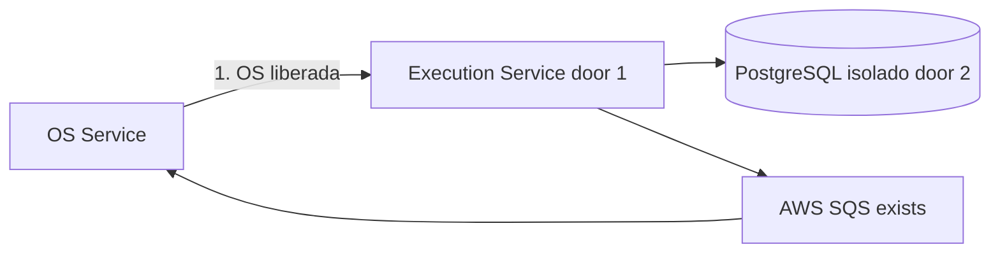
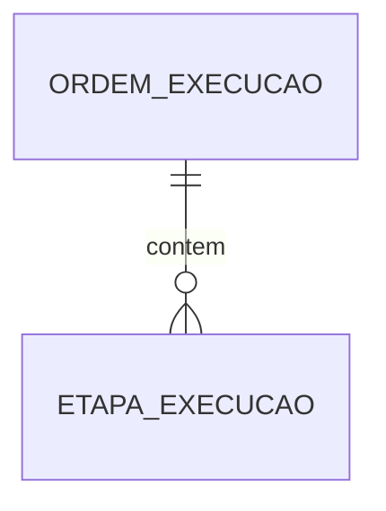

# Fase 4 - Execução

**Approved**: 2026-11-06 - user: "Pode seguir"

## Problem

A oficina precisa organizar veículos liberados para execução, acompanhar diagnóstico e reparos e informar a conclusão sem depender do banco do serviço de OS. Quando esta entrega estiver pronta, a equipe poderá conduzir cada OS em uma fila e registrar falhas que exigem intervenção.

## Shape

Esta entrega reutiliza as regras de serviço da Fase 3; as transições de execução ficam no domínio do Execution Service.

1. OS Service encaminha OS aprovada pela API/evento para Execution Service (door 1).
2. Execution Service persiste fila e etapas no PostgreSQL isolado (door 2).
3. Mecânico atualiza diagnóstico/reparos; conclusão ou falha é comunicada ao OS Service via evento SQS.

New: OrdemExecucao e EtapaExecucao no banco próprio do serviço.

**Changes underneath**

| Front | What changes |
| --- | --- |
| domínio | Execução e fila passam ao Execution Service. |
| stored data | Novo PostgreSQL/database isolado; sem migração nesta entrega. |
| readers | OS Service recebe estado/conclusão via API ou evento. |

## Surface

| Route | Request -> response | Who | Status |
| --- | --- | --- | --- |
| `GET /api/v1/fila-execucao` | filtros -> fila | mecânico autorizado | 200, 401, 403 |
| `POST /api/v1/execucoes/{id}/etapas` | diagnóstico/reparo -> etapa | mecânico autorizado | 201, 401, 403, 404, 422 |
| `POST /api/v1/execucoes/{id}/reexecucao` | motivo -> reexecução | supervisor autorizado | 202, 401, 403, 404, 409 |

## Landing

| Door | Literal shape | Alternative rejected and why |
| --- | --- | --- |
| 1 | Execution Service autônomo | Manter fila no OS Service impede evolução e deploy independentes. |
| 2 | PostgreSQL/database e usuário exclusivos | Persistência compartilhada quebra isolamento. |

## Criteria

### Execution workflow (P1)

**Acceptance Criteria**

1. WHEN OS aprovada for recebida THEN Execution Service SHALL inserir a OS uma vez na fila de execução.
2. WHEN mecânico registrar diagnóstico ou reparo THEN o serviço SHALL persistir a etapa, responsável e horário no histórico da execução.
3. WHEN execução concluir THEN Execution Service SHALL comunicar conclusão ao OS Service e Billing.
4. IF execução falhar THEN o serviço SHALL marcar intervenção requerida, preservar etapas concluídas e permitir reexecução manual após correção.
5. IF uma mensagem for repetida THEN Execution Service SHALL deduplicar pelo identificador do evento sem duplicar entrada ou etapa.
6. IF banco ou mensageria falhar transitoriamente THEN o serviço SHALL usar limites padrão por dependência, backoff exponencial com jitter e DLQ/alerta ao esgotar.

## Out of scope

| Excluded | Why |
| --- | --- |
| Aprovar orçamento e cobrar | Billing Service. |
| Orquestrar compensações da Saga | Feature Saga. |

## Assumptions

| Assumption | Chosen default | Rationale | Confirmed? |
| --- | --- | --- | --- |
| Banco e comunicação | PostgreSQL isolado, AWS SQS | Confirmado no plano da fase4. | y - user: "Adotar essa divisão" |
| Falha operacional | Intervenção e reexecução manual preservando etapas | Confirmado no plano da fase4. | y - user: "Adotar intervenção e reexecução manual" |

**Open questions:** none

## Differences from the source

None - este plano não altera elementos do PDF binding.

## Sources

- `.specs/features/fase4/plan.md` - limites de serviço e política de falha operacional.
- `.specs/features/fase4/checks.md` - AC 3, 7, 9-10, 12, 14-15.
