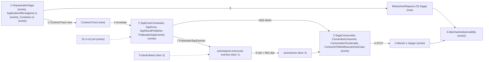
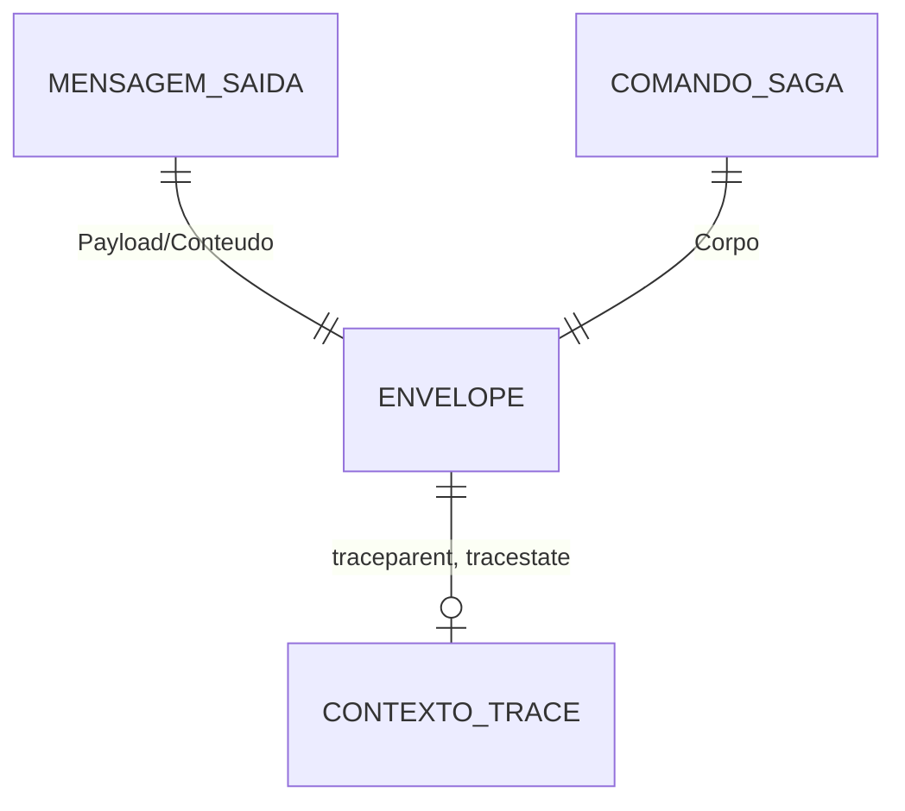

# Fase 4 - Infraestrutura, CI/CD e observabilidade

**Approved**: 2026-11-16 - user: "Se estiver no formato esperado, então plano está aprovado" (formato conferido: o PDF da Fase 4 não fixa formato de rastreamento; W3C Trace Context no envelope é o § 4.1 da spec de observabilidade). Revisão D-68: ACs 1, 2, 5 e 6; os ACs 3, 4 e 7 estão em [`deploy-servicos`](../deploy-servicos/plan.md) (D-40) e o staging saiu (D-41); AC 5 = D-65, D-66 e D-67.

Aprovações anteriores: 2026-11-11 - user: "Sim, aprovo e crio" (branch protegida só `main`; repositório Web criado nesta entrega); 2026-11-11 - user: "Pode seguir" (AC 5 sem DynamoDB Streams, D-26); 2026-11-06 - user: "Pode seguir".

## Problem

Os quatro serviços de negócio (OS, Cobrança, Execução e Cadastros) estão em produção desde 16/11, mas um fluxo de OS que atravessa os serviços não pode ser seguido:
- nenhuma mensagem leva contexto de trace;
- os publicadores de Outbox rodam em segundo plano, sem relação com a requisição que gerou a mensagem;
- OS, Cobrança e Execução não registram nenhum `ActivitySource`.

No Jaeger, cada serviço aparece isolado. Os datasources do Grafana apontam para `jaeger:16686`, `prometheus:9090` e `loki:3100`, mas os Services do cluster são `autoreparos-jaeger`, `autoreparos-prometheus` e `autoreparos-loki`, então os painéis não carregam traces nem logs. Não há dashboard da Saga: o OS não exporta nenhuma métrica própria. Também não existe SNS em código nem em Terraform, embora a D-19 e o README do Cadastros o descrevam.

A `main` de OS, Cobrança, Execução e Web não tem proteção. A do Cadastros exige PR, mas com 0 aprovações e sem checks.

Quem paga é a avaliação da Fase 4:
- o vídeo precisa mostrar o rastreamento dos fluxos distribuídos (R41) e a proteção de branch bloqueando um PR (C6 do `pacote-entrega`);
- a matriz do índice marca o R26 (proteção) e o R30 (observabilidade) como parciais.

Quando isto estiver pronto, quem avalia vê:
- uma OS percorrendo OS, Execução e Cobrança num trace único no Jaeger;
- o dashboard da Saga com valores;
- o fan-out por SNS de um produtor;
- um PR barrado pela proteção da `main`.

## Shape

Reaproveita o OTLP que os quatro serviços já exportam para o OTel Collector, o Jaeger, o Prometheus, o Loki e o Grafana da Fase 3 (chart `k8s/charts/observability` do Infra.K8s), as filas SQS e as IRSA de `deploy-servicos`, e os workflows `ci-cd.yml` de cada repositório. As regras que mudam um resultado (injetar e extrair o contexto, rotear eventos para o tópico, contar as métricas) ficam no código de cada serviço e são cobertas pelos testes unitários e de integração dele. O IAM, as assinaturas e o chart são provados por `terraform test`, simulação de IAM e `helm template`.

**AC 5, trace (D-65):**
1. Uma requisição HTTP ou uma mensagem consumida entra num serviço com uma `Activity` corrente → ao criar a mensagem de saída, `ContextoTrace` (new) grava `traceparent` e `tracestate` no JSON do envelope, na mesma transação da Outbox:
   - OS: `Corpo` do `ComandoSaga` no DynamoDB, em `OrquestradorSaga` (exists);
   - Cobrança: `mensagens_saida`, em `Application/Mensageria.cs` (exists), e `SqsResultPublisher` (exists, envio direto);
   - Execução: `mensagens_saida`, em `Contratos.cs` (exists).
2. O publicador abre um span Producer "publicar {tipo}", com pai vindo do envelope:
   - `SqsEnvioComandos` (OS), `SqsEnvio` (Cobrança) e `PublicadorSqsEventos` (Execução), todos (exists);
   - envia o corpo sem outra mudança.
3. O consumidor lê o corpo, extrai o contexto e abre um span Consumer "processar {tipo}" com o atributo `ordem_servico.id`, envolvendo o handler:
   - `SagaConsumidor` (OS), `ComandosConsumer` (Cobrança), `ConsumidorOsLiberada` (Execução) e `ConsumirFilaNotificacoesUseCase` (Cadastros), todos (exists);
   - as mensagens que o handler gera voltam ao passo 1 com o mesmo trace.
4. Os spans saem pelo OTLP (exists) para o Collector e o Jaeger (exists). Cada serviço registra o `ActivitySource` no próprio `Program.cs` (no Cadastros, em `OpenTelemetryExtensions`, exists).

**AC 5, dashboard (D-66):**

5. O `OrquestradorSaga` (exists) conta o início, a conclusão e cada compensação no `Meter(AutoReparos.OS.Saga)` (new). Os gauges de Sagas paradas e de profundidade da `autoreparos-os-saga-dlq` são lidos sob demanda pelo exportador de métricas do OS (exists).
6. O chart `k8s/charts/observability` (exists) ganha o painel "Saga" e passa a usar os nomes reais dos Services nos datasources. É implantado pelo `deploy-app.yml` do pai (exists).

**AC 5, SNS mínimo (D-67):**

7. A Execução grava uma linha de Outbox por evento, em vez de uma por destino. O `PublicadorSqsEventos` (exists) publica no tópico `autoreparos-execucao-eventos` (door 1) com o atributo de mensagem `tipo`.
8. O SNS entrega, com raw message delivery, nas filas assinantes (door 2):
   - `autoreparos-os-saga`, filtrando os tipos que o OS consome;
   - `autoreparos-cadastros-notificacoes`, filtrando `execucao.concluida.v1`.
   - Os consumidores do passo 3 leem a mensagem como hoje.
9. A política de deploy e o boundary do `stacks/base` (exists) liberam SNS só no prefixo do próprio serviço (door 3).

**AC 1, AC 2 e AC 6:**

10. Push ou PR → `ci-cd.yml` (exists) roda `build`, `test` (cobertura de 80%) e `quality` (SonarCloud com quality gate). A proteção da `main` exige PR com 1 aprovação e os checks `build` e `test`.

New: o campo `traceparent`/`tracestate` dentro do JSON do envelope (door 4). Não há tabela nova nem coluna nova.

**Changes underneath**

| Front | What changes |
| --- | --- |
| contrato das mensagens | O envelope ganha os campos opcionais `traceparent` e `tracestate`. Quem lê o envelope hoje: `MensagemSaga.TentarLer` (OS), `ComandoCancelamento.Ler` (Cobrança), `ConsumidorOsLiberada` (Execução) e `EventoNotificacao` (Cadastros); todos precisam ignorar campos desconhecidos (critério 5.4) |
| roteamento da Execução | `MensagemSaida.Destino` deixa de separar OS e Cobrança: uma linha por evento, publicada no tópico. As linhas pendentes com o `Destino` antigo no momento do deploy também vão para o tópico, e o Inbox do OS deduplica pelo `eventId` |
| stored data | Nada a migrar. Mensagens já gravadas sem `traceparent` são publicadas e consumidas como raiz nova |
| leitores | Jaeger (traces por serviço passam a se ligar), Grafana (painel Saga e datasources), fila de notificações do Cadastros (passa a receber `execucao.concluida.v1` e envia o e-mail que `EventoNotificacao` já aceita) |
| fila `autoreparos-cobranca-execucoes` | Deixa de receber mensagens, porque não assina o tópico; continua sem consumidor (D-59) |

## Surface

None - nenhuma rota HTTP nova nem alterada. As superfícies operacionais são o tópico SNS, as assinaturas, o painel do Grafana e a proteção das branches, descritas em `Landing` e nos critérios.

## Landing

| One-way door | Literal shape | Alternative rejected |
| --- | --- | --- |
| 1 - tópico da Execução | `aws_sns_topic "eventos"` com `name = "autoreparos-execucao-eventos"`, no Terraform da Execução; o ARN vai ao pod em `Sns__EventosTopicArn`; cada publicação leva `MessageAttributes = { tipo = <tipo do envelope> }` | Um tópico por tipo de evento, porque multiplica tópicos, assinaturas e permissões sem ganho para dois consumidores |
| 2 - assinatura pelo consumidor | No Terraform do consumidor: `aws_sns_topic_subscription` com `protocol = "sqs"`, `raw_message_delivery = true`, `filter_policy = jsonencode({ tipo = [...] })` e `aws_sqs_queue_policy` que só aceita `sqs:SendMessage` de `sns.amazonaws.com` com `aws:SourceArn` igual ao ARN do tópico. O ARN é montado pelo nome determinístico | Assinatura no Terraform do produtor, porque obriga a Execução a conhecer as filas dos consumidores e contradiz a D-46. Sem raw delivery, OS e Execução não leem o envelope do SNS |
| 3 - IAM base para SNS | `deploy-servico.json.tftpl`: `sns:*` em `arn:aws:sns:us-east-1:<conta>:autoreparos-${servico}-*`, mais `sns:Subscribe`, `sns:Unsubscribe`, `sns:GetSubscriptionAttributes` e `sns:SetSubscriptionAttributes` em `arn:aws:sns:us-east-1:<conta>:autoreparos-*`; `servico-boundary.json.tftpl`: `sns:Publish` em `arn:aws:sns:us-east-1:<conta>:autoreparos-${aws:PrincipalTag/Servico}-*`. Aplicado por CLI igual ao Terraform | `sns:*` sem prefixo, porque deixaria um serviço publicar ou apagar o tópico de outro (L-009, L-017) |
| 4 - campos do envelope | `"traceparent": "00-<32 hex>-<16 hex>-<2 hex>"` (W3C) e `"tracestate"` opcional, na raiz do JSON do envelope, ao lado de `eventId` e `tipo` | Atributos de mensagem SQS, porque a Outbox grava em segundo plano e perderia o contexto, e exigiria coluna nova em três bancos; coluna nova na Outbox pela mesma razão |
| 5 - proteção da `main` | Em OS, Cobrança, Execução, Cadastros e Web: PR obrigatório com 1 aprovação, `dismiss_stale_reviews`, status checks `strict` com `build` e `test`, force push e exclusão bloqueados, `enforce_admins` desligado | Exigir `quality`, porque o quality do Web está vermelho desde 12/11 e travaria qualquer merge nele; `enforce_admins` ligado, porque impede o José de corrigir na véspera da entrega |

- Nothing else in this change is hard to reverse

## Criteria

### S1: o fluxo de uma OS aparece num trace único entre os serviços (P1)

Uma etapa automática da Saga (HTTP → mensagem → consumidor → mensagem) aparece no Jaeger como um trace só.

**Acceptance Criteria**

5.1. WHEN um serviço cria uma mensagem de saída com uma `Activity` corrente THEN o envelope gravado SHALL ter `traceparent` igual a `Activity.Current.Id` (formato W3C) e `tracestate` igual ao da `Activity`, quando houver
   - OS ao gerar um comando da Saga → `ComandoSaga.Corpo` com `traceparent`; Cobrança ao aprovar orçamento e ao publicar `pagamento.resultado.v1` → payload com `traceparent`; Execução ao concluir → conteúdo com `traceparent`; sem `Activity` corrente → envelope sem o campo, e a mensagem é gravada normalmente

5.2. WHEN o publicador envia uma mensagem cujo envelope tem `traceparent` THEN o serviço SHALL registrar um span `Producer` "publicar {tipo}" com o mesmo `TraceId` do envelope, no `ActivitySource` `AutoReparos.<Servico>.Mensageria`

5.3. WHEN um consumidor recebe uma mensagem com `traceparent` válido THEN o serviço SHALL processá-la dentro de um span `Consumer` "processar {tipo}" cujo pai é o contexto do envelope e que tem o atributo `ordem_servico.id` do envelope; as mensagens que o handler gerar SHALL levar o mesmo `TraceId`
   - OS consome `execucao.concluida.v1` com trace T → comando seguinte da Saga gravado com trace T; Cadastros consome `saga.lembrete.v1` com trace T → span de envio de e-mail sob T

5.4. IF a mensagem não tem `traceparent`, ou ele é inválido THEN o consumidor SHALL processá-la como hoje, num span raiz novo, sem mandar para a DLQ
   - sem o campo → processada; `traceparent` = `"abc"` → processada, raiz nova; campo desconhecido extra no envelope → processada

5.5. WHEN uma OS passa por aprovação do orçamento e conclusão da execução em produção THEN o Jaeger SHALL mostrar pelo menos um trace com spans de pelo menos dois serviços (OS e Execução, ou OS e Cobrança) sob o mesmo `TraceId`

### S2: o dashboard da Saga mostra o estado das Sagas (P1)

O Grafana mostra quantas Sagas começam, terminam, compensam e param, e a DLQ da Saga.

**Acceptance Criteria**

5.6. WHEN o `OrquestradorSaga` inicia, conclui ou compensa uma Saga THEN o OS SHALL incrementar, no `Meter` `AutoReparos.OS.Saga`, `sagas_iniciadas_total`, `sagas_concluidas_total` ou `sagas_compensadas_total` com a dimensão `passo` (o comando de compensação despachado)
   - uma Saga concluída → iniciadas +1 e concluídas +1; liberação recusada com cancelamento do orçamento e da reserva → compensadas +1 para cada passo compensado

5.7. WHEN o exportador de métricas do OS coleta THEN o OS SHALL publicar os gauges `sagas_paradas` (Sagas não terminais que a consulta de prazos do console de Sagas marca como vencidas) e `saga_dlq_mensagens` (`ApproximateNumberOfMessages` da `autoreparos-os-saga-dlq`)
   - IF a leitura da DLQ falhar THEN o gauge SHALL omitir a amostra daquela coleta, e o OS não para nem lança exceção

5.8. The chart de observabilidade SHALL configurar no Grafana os datasources `Prometheus`, `Jaeger` e `Loki` com as URLs `http://autoreparos-prometheus:9090`, `http://autoreparos-jaeger:16686` e `http://autoreparos-loki:3100`, e o dashboard "Saga" com os painéis `Sagas iniciadas`, `Sagas concluídas`, `Compensações por passo`, `Sagas paradas` e `DLQ da Saga`

5.9. WHEN uma OS completa a Saga em produção depois do deploy THEN o painel `Sagas concluídas` do dashboard "Saga" SHALL mostrar um valor maior que 0 na janela da última hora

### S3: um produtor distribui eventos por SNS (P2)

A Execução publica uma vez, e o SNS entrega a cada consumidor interessado.

**Acceptance Criteria**

5.10. WHEN a Execução publica um evento da Outbox THEN ela SHALL chamar `sns:Publish` uma única vez no `autoreparos-execucao-eventos`, com o envelope inalterado no corpo e o atributo de mensagem `tipo` igual ao `tipo` do envelope
   - `execucao.concluida.v1` → 1 publicação (hoje são 2 linhas, OS e Cobrança); linha pendente com `Destino` antigo → publicada no tópico

5.11. WHEN o tópico recebe uma mensagem THEN o SNS SHALL entregar o corpo cru (raw) na `autoreparos-os-saga` se o `tipo` estiver entre os que o OS consome, e na `autoreparos-cadastros-notificacoes` só se o `tipo` for `execucao.concluida.v1`
   - `insumos.reservados.v1` → só o OS; `execucao.concluida.v1` → OS e Cadastros; tipo fora do filtro → nenhuma fila

5.12. IF um serviço tentar publicar, assinar ou alterar um tópico fora do prefixo `autoreparos-<servico>-` THEN o IAM SHALL negar
   - IRSA da Cobrança publicando no tópico da Execução → negado; role de deploy do OS criando `autoreparos-execucao-x` → negado; IRSA da Execução publicando no próprio tópico → permitido

5.13. WHEN uma execução é concluída em produção depois do deploy THEN a Saga do OS SHALL avançar como antes, o Cadastros SHALL registrar o processamento de `execucao.concluida.v1`, e as DLQs `autoreparos-os-saga-dlq` e `autoreparos-cadastros-notificacoes-dlq` SHALL continuar com 0 mensagens

### S4: CI, proteção da `main` e resiliência (P1)

O que já roda passa a ter prova, e a `main` passa a barrar o que não passou.

**Acceptance Criteria**

1. WHEN um PR para a `main` ou um push na `main` acontece em OS, Cobrança, Execução ou Cadastros THEN o workflow de CI/CD do repositório SHALL rodar `build`, `test` com cobertura mínima de 80% de linhas e `quality` com o quality gate do SonarCloud, e a última execução na `main` de cada um SHALL ter os três em `success`

2. WHEN alguém tenta mesclar na `main` de OS, Cobrança, Execução, Cadastros ou Web THEN o GitHub SHALL exigir PR com 1 aprovação e os status checks `build` e `test` verdes (strict), bloquear force push e exclusão, e deixar `enforce_admins` desligado
   - PR com teste quebrado → botão de merge bloqueado pelo check `test`; PR sem aprovação → bloqueado

6. IF uma mensagem falha no processamento até o limite THEN o serviço SHALL aplicar backoff exponencial com jitter entre tentativas e, ao esgotar, mover a mensagem para a DLQ da fila, sem perdê-la
   - OS, Cobrança, Execução e Cadastros: comportamento já existente, provado pelos testes de resiliência e DLQ de cada um; `maxReceiveCount` de 5 nas filas do Terraform

## Out of scope

| Excluded | Why |
| --- | --- |
| Tópicos SNS do OS e da Cobrança (D-19 completa) | D-67: só um produtor cabe no prazo; OS e Cobrança seguem com SQS direto |
| Propagar trace pelo HTTP entre serviços | Já é feito pela instrumentação `HttpClient` e AspNetCore que os serviços têm |
| Dashboards "Saúde dos microsserviços" e "Mensageria" e alertas do § 4.4 da spec | Cortes de 15/11 (§ 7.3 do índice: dashboards além do da Saga) |
| Persistência do Jaeger | O Jaeger all-in-one guarda em memória; os traces da demonstração são gerados depois do último deploy da observabilidade |
| Deploy, aprovação de produção e IaC por serviço (antigos ACs 3, 4 e 7) | Em `deploy-servicos` (D-40) |
| Staging | D-41 |
| Proteção da `main` de AuthLambda, Infra.K8s, Infra.Database e pai | Mantêm a proteção atual; não têm o `ci-cd.yml` com `build` e `test` deste plano |
| Corrigir o `quality` do Web | Frontend fica como está (José, 13/11); por isso o `quality` não é check obrigatório |

## Assumptions

| Assumption | Chosen default | Rationale | Confirmed? |
| --- | --- | --- | --- |
| Ordem do trabalho | Trace, depois dashboard, depois SNS | Decisão do José | y - José: "Vamos fazer ambos, primeiro dash e depois SNS" |
| Hora-limite do SNS | Deploy em produção até 00h30 de 17/11; depois disso fica em PR e vira dívida | Véspera da entrega; a Saga em produção não pode ficar instável na manhã da gravação | n |
| Aplicação do IAM base | AWS CLI com o JSON igual ao Terraform, com OK a cada comando | Decisão do José; o `provision-aws.yml` roda a plataforma inteira (~35 min) | y - José: "AWS CLI, igual ao Terraform (Recommended)" |
| Proteção da `main` | `build` e `test` obrigatórios, 1 aprovação, `enforce_admins` desligado, aplicada em 17/11 antes da gravação | Proposta do José na retomada | y - José: "Proposta: PR obrigatório, checks build e test (sem quality no Cadastros se o SonarCloud dele voltar a falhar), 1 aprovação, enforce_admins desligado" |
| Sagas paradas | A mesma regra de prazo vencido que o console de Sagas e os lembretes do `saga-compensacoes` já usam | Não inventar uma segunda definição de "parada" | n |
| Repositórios do AC 1 | OS, Cobrança, Execução e Cadastros (o Web tem `quality` vermelho e o frontend fica como está) | O AC 1 prova o que está em produção | n |

**Open questions:** none - all resolved or logged above.

## Differences from the source

None - nenhum elemento do PDF binding é alterado. O R41 (rastreamento) e o R26 (proteção) passam a ter prova.

## Sources

- `.specs/features/fase4/especificacao/index.md` - D-19, D-26, D-40, D-41, D-46, D-59, D-65 a D-68; § 7.3 (cortes).
- [Observabilidade § 4](../especificacao/infraestrutura/fase4_spec_observabilidade_distribuida.md#4-proposta) - `traceparent` no envelope (4.1), `ordem_servico.id` (4.2), métricas (4.3) e dashboard da Saga (4.4).
- [Comunicação § 4.3](../especificacao/comunicacao/fase4_spec_comunicacao_microsservicos.md#43-d-06--mensageria) - SNS por produtor e assinatura por consumidor.
- [Infraestrutura](../especificacao/infraestrutura/fase4_spec_infraestrutura_k8s_e_mensageria.md) - o produtor cria o tópico e o consumidor assina.
- [CI/CD](../especificacao/cicd/fase4_spec_cicd_e_protecao_de_branches.md) - pipelines e proteção da `main`.
- `.specs/features/fase4/pacote-entrega/checks.md` C6 - o vídeo mostra a proteção bloqueando um PR.
- `.specs/LESSONS.md` - L-009, L-013, L-014 e L-017 (boundary por tag, nome da fila, mudança de decisão, casos negativos de IAM).
