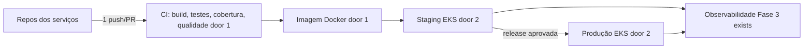

# Fase 4 - Infraestrutura, CI/CD e observabilidade

**Approved**: 2026-11-06 - user: "Pode seguir"

## Problem

Os microsserviços da Fase 4 precisam ser implantáveis e verificáveis de forma independente, mas dependem de recursos de nuvem, gates de qualidade e observabilidade para operar em conjunto. Quando esta entrega estiver pronta, cada repositório terá pipeline verificável em Kubernetes e o fluxo distribuído será rastreável nos ambientes aprovados.

## Shape

Esta entrega reutiliza cluster EKS e observabilidade da Fase 3; IaC de recursos exclusivos fica nos repositórios de serviço e Infra.K8s mantém recursos compartilhados.

1. Push/PR nos repositórios OS, Billing e Execução aciona CI (door 1).
2. CI executa build, testes, gate de 80% de cobertura e qualidade.
3. Pipeline autorizada publica imagem e implanta em namespace de staging; release aprovada pode promover a produção EKS (door 2).
4. Serviços exportam logs, métricas e traces correlacionados para a stack da Fase 3.

Data: none - IaC e pipeline não alteram modelo de negócio; recursos são descritos em infraestrutura.

**Changes underneath**

| Front | What changes |
| --- | --- |
| domínio | Nenhuma semântica de domínio muda. |
| stored data | Nenhum dado de negócio migrado; IaC provisiona recursos e permissões. |
| readers | Pipelines e stack de observabilidade passam a ler métricas/logs/traces dos novos serviços. |

## Surface

None - nothing consumed outside as a public route; pipelines e recursos EKS/AWS são superfícies operacionais internas.

## Landing

| Door | Literal shape | Alternative rejected and why |
| --- | --- | --- |
| 1 | Build, testes, cobertura mínima 80% e qualidade como gates em cada repo | Pipeline única no pai não bloqueia regressões no ciclo independente do serviço. |
| 2 | Deploy em staging compartilhado EKS e produção somente após aprovação de release | Deploy direto à produção sem gate não é compatível com alvos aprovados. |

## Criteria

### Delivery and operations (P1)

**Acceptance Criteria**

1. WHEN PR elegível for aberto em cada serviço THEN CI SHALL executar build, testes automatizados, cobertura mínima 80% e análise de qualidade.
2. WHEN alterações forem integradas pela branch protegida `main` THEN repositório SHALL exigir PR e checks automáticos aprovados.
3. WHEN pipeline de staging passar THEN serviço SHALL ser implantado no namespace staging do EKS e expor resultado da implantação.
4. IF produção for alvo THEN deploy SHALL exigir aprovação de release e usar EKS na região `us-east-1`.
5. WHEN cada serviço processar uma OS THEN stack SHALL exibir logs, métricas e traces correlacionados entre serviços.
6. IF AWS, banco ou mensageria tiver falha transitória THEN pipeline/serviço SHALL aplicar limites padrão, backoff exponencial com jitter e DLQ/alerta ao esgotar onde houver mensagem.

## Out of scope

| Excluded | Why |
| --- | --- |
| Criar conta AWS ou alterar credenciais | Reutiliza conta/role existente; segredos não entram nos arquivos. |
| Alterar código de negócio para instrumentação específica | Cada plano de serviço define instrumentação local necessária. |

## Assumptions

| Assumption | Chosen default | Rationale | Confirmed? |
| --- | --- | --- | --- |
| Alvos | Desenvolvimento local, staging namespace compartilhado, produção EKS após release, `us-east-1` | Confirmado no plano pai. | y - user: "Sim, adotar esses alvos" |
| Infra compartilhada | Serviços mantêm IaC exclusiva; Infra.K8s mantém cluster e observabilidade | Confirmado no plano pai. | y - user: "Adotar essa divisão" |

**Open questions:** none

## Differences from the source

None - este plano não altera elementos do PDF binding.

## Sources

- `.specs/features/fase4/plan.md` - alvos, cobertura, CI e observabilidade confirmados.
- `.specs/features/fase4/checks.md` - AC 9, 11-15.
- `submodules/AutoReparos.Infra.K8s` - infraestrutura compartilhada existente.
