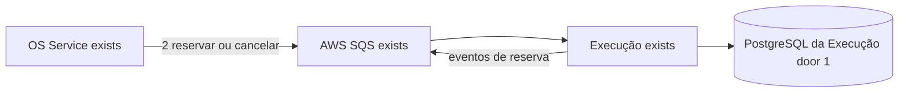
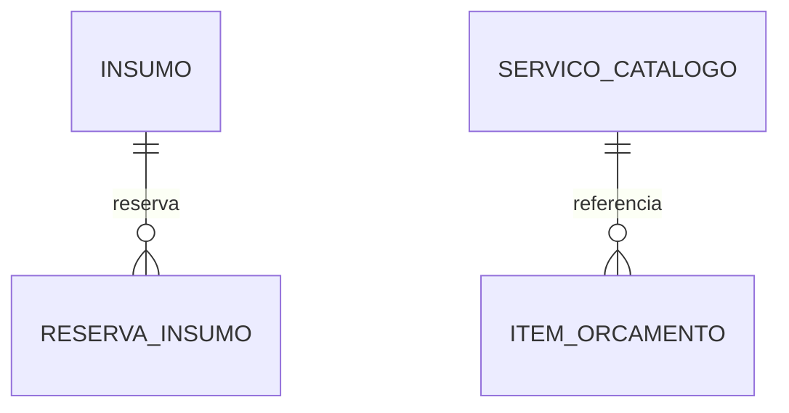

# Fase 4 - Catálogo e insumos com reserva em duas fases

**Pendente de aprovação** (10/11/2026). Decisões de origem: D-01, D-18a, D-20 de `.specs/features/fase4/especificacao/index.md` (AD-011, AD-013, AD-015).

## Problem

Os serviços novos não têm catálogo de serviços nem insumos: esses dados continuam só no App, que baixa o estoque no momento em que o insumo entra na OS e não devolve se o orçamento for recusado. Sem reserva, a Saga não tem o que compensar antes do início da execução. Quando esta entrega estiver pronta, a Execução manterá o catálogo e os saldos, reservará insumos na aprovação, confirmará a baixa na conclusão e devolverá o saldo na compensação, sem reserva parcial nem duplicada.

## Shape

Esta entrega move catálogo e insumos do App para a Execução e liga a reserva aos comandos da Saga.

1. Execução expõe catálogo de serviços e insumos por REST, com migrations e seed próprios no PostgreSQL dela (door 1).
2. O comando de reserva da Saga reserva todos os itens numa transação, só se houver saldo; caso contrário publica a falha de reserva.
3. A conclusão da execução confirma a reserva na mesma transação; o comando de cancelamento da Saga devolve o saldo das reservas não confirmadas.

New: Insumo com `QuantidadeDisponivel` e `QuantidadeReservada`, ReservaInsumo única por (OS, insumo) com status `Reservada`, `Confirmada` ou `Cancelada`, e ServicoCatalogo no banco da Execução.

**Changes underneath**

| Front | What changes |
| --- | --- |
| domínio | Insumo ganha saldo reservado; reserva em duas fases; catálogo de serviços na Execução. |
| stored data | Tabelas novas na Execução com seed; no App, as tabelas de serviços e insumos saem na feature `cadastros`. |
| readers | Frontend e Cobrança leem catálogo e preços por REST; a Saga consome os eventos de reserva. |

## Surface

| Route | Request -> response | Who | Status |
| --- | --- | --- | --- |
| `GET /api/v1/servicos` | filtros -> catálogo | usuário autenticado | 200, 401 |
| `POST /api/v1/servicos` | serviço -> criado | Administrador | 201, 401, 403, 422 |
| `GET /api/v1/insumos` | filtros -> insumos com saldos | usuário autenticado | 200, 401 |
| `POST /api/v1/insumos` | insumo -> criado | Administrador | 201, 401, 403, 422 |
| `POST /api/v1/insumos/{id}/entradas` | quantidade -> saldo | Administrador ou recepcionista | 200, 401, 403, 404, 422 |

## Landing

| Door | Literal shape | Alternative rejected and why |
| --- | --- | --- |
| 1 | Catálogo, insumos e reservas no PostgreSQL da Execução, reserva por `UPDATE ... WHERE disponivel >= q` na mesma transação da Inbox e da Outbox | Serviço de Estoque próprio custaria um repositório a mais; DynamoDB para insumos colocaria dois bancos na Execução |

## Criteria

### Reservation (P1)

**Acceptance Criteria**

1. WHEN `execucao.reservar-insumos.v1` for consumido THEN Execução SHALL reservar todos os itens numa única transação com a Inbox e a Outbox `insumos.reservados.v1`.
2. IF algum item não tiver saldo THEN Execução SHALL não gravar nenhuma reserva e SHALL publicar `insumos.reserva-falhou.v1` com os itens em falta.
3. IF o mesmo comando ou outro comando de reserva da mesma OS chegar de novo THEN Execução SHALL não reservar o dobro.
4. WHEN a execução for concluída THEN Execução SHALL confirmar as reservas na mesma transação da conclusão.
5. WHEN `execucao.cancelar-reserva.v1` for consumido THEN Execução SHALL devolver o saldo das reservas `Reservada` e publicar `insumos.reserva-cancelada.v1`; reserva `Confirmada` SHALL permanecer.
6. WHILE uma ordem de execução estiver `Cancelada` THEN Execução SHALL recusar etapas e conclusão com 409.

### Catalog (P2)

7. WHEN um usuário autenticado consultar catálogo ou insumos THEN Execução SHALL devolver valores e saldos disponível e reservado.
8. WHEN um administrador registrar entrada de insumo THEN Execução SHALL aumentar o saldo disponível e registrar a movimentação.

## Out of scope

| Excluded | Why |
| --- | --- |
| Baixa parcial de insumos por etapa | Simplificação: confirmação integral na conclusão. |
| Compra e fornecedores | Fora do PDF. |

## Assumptions

| Assumption | Chosen default | Rationale | Confirmed? |
| --- | --- | --- | --- |
| Dono dos insumos | Execução (sem serviço de Estoque) | D-01 / AD-013. | y - José aceitou a recomendação de 09/11 |
| Falta de saldo | Nada reservado; a Saga vai para `AguardandoInsumos` | D-20 / AD-015. | y - José: "Ok, pode ser" |
| Dados iniciais | Seed próprio, sem migrar dados do App | Não há dados reais em produção. | n |

**Open questions:** none

## Differences from the source

None - este plano não altera elementos do PDF binding.

## Sources

- `.specs/features/fase4/especificacao/saga/fase4_spec_saga_pattern.md` § 4.5 - reserva em duas fases.
- `.specs/features/fase4/especificacao/microsservicos/fase4_spec_separacao_microsservicos.md` § 5 - Etapa 1.
- `.specs/features/fase4/execucao/plan.md` - serviço existente.
