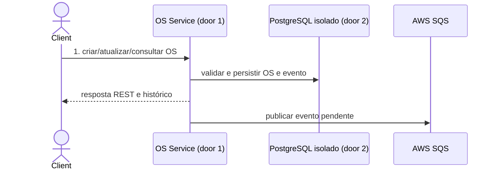
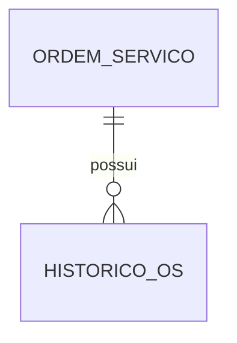

# Fase 4 - OS Service e contratos

**Approved**: 2026-11-06 - user: "Pode seguir"

## Problem

A OS continua sem um serviço autônomo que seja responsável por seu ciclo de vida. Billing e Execução precisam trocar informações sobre a OS sem acessar diretamente dados de outro serviço. Quando esta entrega estiver pronta, clientes e serviços autorizados poderão abrir, atualizar e consultar o histórico da OS por contratos estáveis.

## Shape

Esta entrega reutiliza os conceitos e fluxos existentes da Fase 3; as regras de ciclo de vida executam no domínio e aplicação do OS Service.

1. Requisição REST entra no OS Service (door 1), valida os dados e persiste a OS no PostgreSQL isolado do serviço.
2. A transação registra a OS e um evento no outbox PostgreSQL; o serviço responde ao chamador e um publicador envia o evento à SQS (exists no alvo AWS), com retentativas e DLQ.
3. Consultas autorizadas retornam status e histórico persistidos.

New: OrdemServico, HistoricoOS e mensagens de outbox persistidos no banco próprio do serviço.

**Changes underneath**

| Front | What changes |
| --- | --- |
| domínio | Ciclo de vida da OS passa a ser responsabilidade do OS Service. |
| stored data | Novo PostgreSQL/database isolado; sem migração de dados da Fase 3 nesta entrega. |
| readers | Billing e Execução consomem APIs/eventos; nenhum acesso direto ao banco. |

Data: OrdemServico e HistoricoOS; não se migram registros existentes nesta entrega.

## Surface

| Route | Request -> response | Who | Status |
| --- | --- | --- | --- |
| `POST /api/v1/ordens-servico` | dados da OS -> id/status | usuário autenticado | 201, 401, 403, 422 |
| `PATCH /api/v1/ordens-servico/{id}` | alterações -> estado atualizado | usuário/serviço autorizado | 200, 401, 403, 404, 422 |
| `GET /api/v1/ordens-servico/{id}` | id -> status e histórico | usuário/serviço autorizado | 200, 401, 403, 404 |

## Landing

| Door | Literal shape | Alternative rejected and why |
| --- | --- | --- |
| 1 | Repositório e API próprios para OS Service | Manter OS no monólito impede implantação independente exigida pela Fase 4. |
| 2 | PostgreSQL/database e usuário isolados do serviço no RDS compartilhado | Banco compartilhado sem isolamento permite acoplamento e escrita cruzada. |

## Criteria

### OS lifecycle and contracts (P1)

**Acceptance Criteria**

1. WHEN uma pessoa ou serviço autorizado cria uma OS válida THEN OS Service SHALL persistir e retornar seu identificador e status inicial.
2. IF a criação ou atualização contiver dados inválidos THEN OS Service SHALL retornar 422 com código de erro estável e não persistir alteração.
3. WHEN um chamador autorizado consulta uma OS THEN OS Service SHALL retornar status atual e histórico ordenado cronologicamente.
4. IF um chamador não autorizado consultar ou alterar uma OS THEN OS Service SHALL retornar 401 ou 403 sem revelar dados da OS.
5. WHEN Billing ou Execução precisar de dados da OS THEN o serviço SHALL obter dados via API ou evento, sem credencial/permissão de leitura do banco alheio.

## Out of scope

| Excluded | Why |
| --- | --- |
| Aprovação de orçamento e cobrança | Responsabilidade da feature Billing. |
| Diagnóstico, fila e execução física | Responsabilidade da feature Execução. |
| Implementar Saga completa | Responsabilidade da feature Saga e mensageria. |

## Assumptions

| Assumption | Chosen default | Rationale | Confirmed? |
| --- | --- | --- | --- |
| Persistência e isolamento | PostgreSQL no RDS compartilhado com database/usuário próprios | Decisão aprovada no plano da fase4. | y - user: "Adotar essa divisão" |
| Integração assíncrona | AWS SQS para comandos/eventos | Decisão aprovada no plano da fase4. | y - user: "AWS SQS + DynamoDB" |

**Open questions:** none

## Differences from the source

None - este plano não altera elementos do PDF binding.

## Sources

- `.specs/features/fase4/plan.md` - decisões e critérios aprovados para a iniciativa.
- `.specs/features/fase4/checks.md` - AC 1-3.
- `README.md`, `submodules/AutoReparos.App` - contexto da Fase 3.
