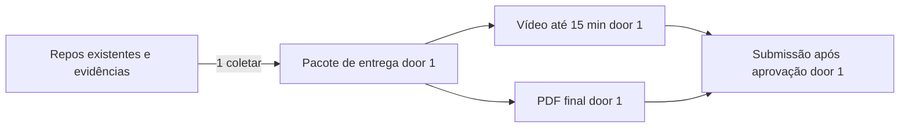

# Fase 4 - Pacote acadêmico de entrega

**Revisão pendente de aprovação** (10/11/2026): inclui os 4 serviços e o Web e as correções pedidas no feedback da Fase 3 (vídeo curto, implementação, dashboards e proteção de branches não mostrados). A versão anterior foi aprovada em 2026-11-06 - user: "Pode seguir". Os `checks.md` desta feature precisam ser derivados de novo depois da aprovação.

## Problem

A conclusão da Fase 4 exige evidências técnicas e acadêmicas em cada repositório, um vídeo de demonstração e um PDF final. Sem um pacote coerente, avaliadores não conseguem verificar arquitetura, Saga, cobertura, deploy e rastreamento ponta a ponta. Quando esta entrega estiver pronta, a equipe terá os artefatos organizados para revisão e submissão.

## Shape

Esta entrega reúne evidências produzidas pelos serviços e infraestrutura; não duplica código nem altera artefatos-fonte dos repositórios.

1. Coletar README, documentação, API, cobertura e manifests dos repositórios OS, Cobranca, Execucao, Cadastros e Web (exists).
2. Preparar roteiro cronometrado (alvo de 13 a 14 minutos) e vídeo público/não listado com demonstração de fluxo, falhas, código, deploy, proteção de branches e observabilidade (roteiro na spec de vídeo, exists).
3. Preparar PDF com participantes, links, diagrama e justificativas e submetê-lo ao portal após revisão/autorização (door 1).

Data: none - esta entrega organiza documentos e evidências, sem persistência de produto.

**Changes underneath**

| Front | What changes |
| --- | --- |
| domínio | Nenhuma semântica de domínio muda. |
| stored data | Nenhum dado de produção; artefatos acadêmicos são criados. |
| readers | Participantes e avaliadores consomem pacote final e links. |

## Surface

None - nothing consumed outside as a software route; leitores consomem README/documentação, vídeo e PDF.

## Landing

| Door | Literal shape | Alternative rejected and why |
| --- | --- | --- |
| 1 | Submissão externa somente após revisão da equipe e autorização explícita | Publicação sem revisão pode expor conteúdo incompleto ou informação pessoal. |

## Criteria

### Evidence package (P1)

**Acceptance Criteria**

1. WHEN repositório de microsserviço for entregue THEN SHALL conter código, Dockerfile, manifests Kubernetes, CI/CD, evidência de cobertura no README, arquitetura e Swagger ou Postman atualizado.
2. WHEN vídeo for entregue THEN SHALL durar no máximo 15 minutos e estar público ou não listado no YouTube ou Vimeo.
3. WHEN vídeo demonstrar o sistema THEN SHALL incluir fluxo completo de OS, Saga e tratamento de falha, deploy automatizado de ao menos um serviço com validação dos testes, monitoramento e tracing.
4. WHEN vídeo for gravado THEN SHALL mostrar o código do orquestrador, de uma compensação e da idempotência, os dashboards com tráfego real e a proteção de branches bloqueando um PR (feedback da Fase 3).
5. WHEN PDF final for preparado THEN SHALL conter participantes, links dos repositórios e vídeo, diagrama de serviços/bancos/comunicação, estratégia e justificativa da Saga e justificativas da divisão/tecnologias.
6. IF participantes ou URLs finais estiverem ausentes THEN o pacote SHALL identificar cada entrada pendente e não submeter versão incompleta.
7. IF for submetido conteúdo externamente THEN a equipe SHALL revisar e autorizar explicitamente a submissão.

## Out of scope

| Excluded | Why |
| --- | --- |
| Criar conteúdo ou evidências inexistentes | Devem vir das entregas técnicas e da equipe. |
| Publicar vídeo ou submeter PDF sem revisão/consentimento | A submissão é uma ação externa e exige autorização específica. |

## Assumptions

| Assumption | Chosen default | Rationale | Confirmed? |
| --- | --- | --- | --- |
| Valores personalizados | Participantes e URLs serão fornecidos pela equipe antes da geração/submissão final | Não aparecem no contexto disponível. | n |

**Open questions:** none - valores pendentes são entradas de conteúdo antes da execução final.

## Differences from the source

None - este plano preserva os entregáveis acadêmicos do PDF binding.

## Sources

- `.specs/features/fase4/plan.md` - critérios acadêmicos confirmados no plano pai.
- `.specs/features/fase4/checks.md` - AC 15-17.
- `docs/specs/fase4/entregaveis/` - matriz de entregáveis, modelo de README, roteiro do vídeo e modelo do PDF.
- `docs/specs/fase4/index.md` § 5 - feedback da Fase 3.
