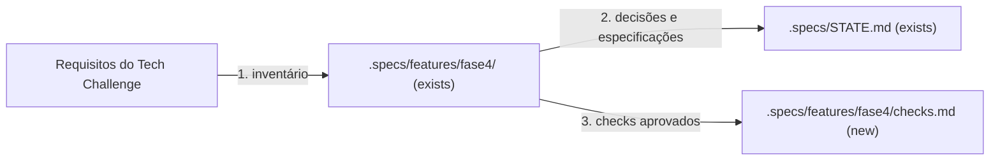

# Fase 4 - Plano inicial de especificações

**Approved**: 2026-11-06 - user: "Revisei o documento de plano da fase4, aprovo."

## Problem

A Fase 3 do AutoReparos está organizada em quatro repositórios e a aplicação principal ainda concentra os fluxos de negócio. O desafio da Fase 4 exige ao menos três microsserviços independentes, com repositório, infraestrutura e banco próprios, transações distribuídas com Saga e automação de build, testes e deploy. O PDF não descreve a estrutura atual do código nem decide a divisão final dos serviços.

Quando o trabalho da Fase 4 estiver concluído, a oficina deverá conseguir conduzir uma OS através de serviços independentes, tratar falhas distribuídas com compensação e demonstrar execução, qualidade, deploy e observabilidade conforme os entregáveis exigidos.

## Shape

Este plano organiza as especificações da Fase 4 sob `.specs/features/fase4/` e referencia os repositórios existentes como contexto, sem duplicar código ou decisões da Fase 3. As regras de negócio e contratos serão especificados nos planos individuais, depois de decididas as fronteiras dos serviços e da Saga.

A decomposição aprovada em features com responsabilidade única e rastreabilidade dos AC está em [FEATURES.md](FEATURES.md). Este plano e seus checks permanecem como visão de aceite da iniciativa; cada feature filha terá plano e checks TLC próprios antes de implementação.

1. Requisitos do PDF entram neste plano de iniciativa e são organizados em especificações menores dentro de `.specs/features/fase4/` (exists).
2. Cada especificação futura identifica os repositórios e módulos existentes que lê ou altera; decisões que atravessam serviços são registradas em `.specs/STATE.md` (exists).
3. As especificações aprovadas derivam `.specs/features/fase4/checks.md` (new); implementação e verificação seguem os gates TLC Spec Lean.

**Changes underneath**

| Front | What changes |
| --- | --- |
| domínio | Nenhuma semântica de domínio muda neste plano; cada serviço deverá especificar as regras sob sua responsabilidade. |
| stored data | Nada a migrar neste artefato; cada plano de serviço deverá identificar bancos, dados e migrações. |
| readers | Nenhum leitor de produção muda neste artefato. |

Data: none - este plano somente organiza os requisitos e as próximas especificações.

## Surface

None - nothing consumed outside; este artefato é documentação interna de planejamento.

## Landing

None - este plano não cria contratos de software, schemas ou dependências; as decisões irreversíveis serão avaliadas nos planos das features correspondentes.

## Criteria

### S1: Microsserviços e responsabilidades (P1)

A arquitetura entregue separa responsabilidades de OS, orçamento/pagamento e execução em pelo menos três serviços independentes.

**Acceptance Criteria**

1. WHEN a arquitetura da Fase 4 for entregue THEN the system SHALL conter pelo menos 3 microsserviços, cada qual com repositório, infraestrutura e banco de dados próprios.
2. WHEN cada serviço acessar dados de outro serviço THEN the system SHALL fazê-lo por APIs ou mensagens, sem acesso direto ao banco alheio.
3. WHERE os serviços forem definidos THEN the system SHALL cobrir abertura, atualização e consulta de status/histórico de OS; geração e envio de orçamento para aprovação; registro/verificação de pagamento e atualização do status da OS após pagamento; fila de execução, atualização durante diagnóstico/reparos e comunicação de finalização ao serviço de OS.

### S2: Persistência, comunicação e consistência distribuída (P1)

Os serviços persistem seus próprios dados e coordenam o fluxo da OS com tolerância a falhas.

**Acceptance Criteria**

4. WHEN a arquitetura de persistência for entregue THEN the system SHALL usar pelo menos um banco relacional SQL e pelo menos um banco não relacional NoSQL entre os serviços.
5. WHEN serviços precisarem trocar dados THEN the system SHALL definir APIs REST síncronas quando necessário e mensageria assíncrona para eventos e integração desacoplada.
6. WHEN uma OS percorrer criação, geração de orçamento, aprovação e encaminhamento à execução THEN the system SHALL coordenar as etapas com Saga orquestrada ou coreografada, documentar a escolha e justificá-la no README.
7. IF uma etapa da Saga falhar THEN the system SHALL executar rollback/compensação das etapas anteriores aplicáveis.
8. WHEN pagamentos forem processados THEN the Billing Service SHALL integrar-se ao Mercado Pago.

### S3: Testes, qualidade e entrega contínua (P1)

Cada serviço tem qualidade verificável e implantação automatizada em Kubernetes.

**Acceptance Criteria**

9. WHEN cada microsserviço for integrado THEN the system SHALL possuir testes unitários e cobertura mínima de 80% por serviço.
10. WHEN o fluxo distribuído principal for validado THEN the system SHALL possuir pelo menos um teste completo em BDD.
11. WHEN alterações forem submetidas a CI THEN the system SHALL executar validação de qualidade por SonarQube ou ferramenta similar.
12. WHEN cada repositório de microsserviço receber alterações elegíveis THEN its pipeline SHALL executar build, testes automatizados, verificação de qualidade e deploy automatizado em Kubernetes.
13. WHEN o código for integrado à branch `main` de cada repositório THEN the repository SHALL exigir Pull Request e checagens automáticas.

### S4: Observabilidade e pacote de entrega (P1)

A equipe consegue demonstrar o fluxo ponta a ponta e entregar as evidências acadêmicas exigidas.

**Acceptance Criteria**

14. WHEN os serviços distribuídos processarem um fluxo de OS THEN the system SHALL reutilizar/adaptar as ferramentas de monitoramento e observabilidade da Fase 3 para monitorar e rastrear o fluxo entre serviços.
15. WHEN cada repositório de microsserviço for entregue THEN it SHALL conter código-fonte, Dockerfile, manifestos Kubernetes, pipeline CI/CD, evidências de cobertura (prints ou links no README), documentação de arquitetura e Swagger ou collection Postman atualizada.
16. WHEN a demonstração em vídeo for entregue THEN it SHALL durar no máximo 15 minutos, estar no YouTube ou Vimeo como pública ou não listada, e demonstrar fluxo completo de OS, Saga e tratamento de falhas, deploy automatizado de ao menos um serviço com validação de testes, monitoramento e rastreamento distribuído.
17. WHEN a documentação final for submetida ao portal THEN it SHALL ser um PDF com identificação dos participantes, links dos repositórios, link do vídeo, diagrama geral com microsserviços/bancos/comunicação, estratégia e justificativa da Saga, e justificativas da divisão dos serviços e tecnologias.

## Out of scope

| Excluded | Why |
| --- | --- |
| Escolher silenciosamente requisitos ainda indefinidos, como políticas de cancelamento/estorno ou ambientes-alvo | Esses detalhes precisam ser acordados antes de congelar os checks que os cobrem. |
| Implementar qualquer serviço ou alterar infraestrutura neste plano | Este artefato inicia as specs; cada implementação depende de plano e aprovação próprios. |
| Reescrever specs históricas em `docs/specs/` | A instrução do repositório exclui essa migração sem solicitação específica. |

## Assumptions

| Assumption | Chosen default | Rationale | Confirmed? |
| --- | --- | --- | --- |
| Local das specs TLC da Fase 4 | `.specs/features/fase4/` | Segue o agrupamento de fase pedido pelo usuário e mantém cada capacidade como feature TLC separada. | n |
| Observabilidade e infraestrutura | Reutilizar AWS/EKS e a observabilidade da Fase 3 | Escolha confirmada pelo usuário; também atende ao pedido do PDF de usar a observabilidade existente. | y - user: "Reutilizar AWS/EKS e observabilidade" |
| Mensageria e NoSQL | AWS SQS + DynamoDB | Escolha confirmada pelo usuário, satisfaz os requisitos de mensageria e banco não relacional. | y - user: "AWS SQS + DynamoDB" |
| Testes e cobertura | xUnit + Reqnroll; medir cobertura por serviço | Escolha confirmada pelo usuário. A meta mínima de 80% por serviço vem do PDF. | y - user: "xUnit + Reqnroll; cobertura medida por serviço" |
| Fronteiras dos microsserviços | OS; Billing (orçamento/pagamento); Execução/Produção | Divisão sugerida no PDF e confirmada pelo usuário. Execução recebe OSs liberadas, mantém a fila, registra diagnóstico/reparos e informa a conclusão ao OS Service. | y - user: "sim" |
| Repositórios dos microsserviços | Repositório Git independente por serviço, registrado como submódulo no pai | Cumpre o requisito de repositórios separados e segue a organização da Fase 3; confirmado pelo usuário. | y - user: "sim" |
| Saga | Orquestração persistida | Escolha confirmada pelo usuário; o estado persistido torna o fluxo e suas compensações observáveis após falhas/reinícios. | y - user: "orquestração persistida" |
| Integração de pagamento | Mercado Pago Checkout Pro com Webhooks validados para atualizações de status | O PDF exige Mercado Pago. Documentação oficial descreve preferências para iniciar o checkout e Webhooks para atualizações de pagamento, com validação de origem. Escolha confirmada pelo usuário. | y - user: "Sim" |
| Cobertura de testes | Continuar com Coverlet XPlat Code Coverage e acrescentar gate de CI por serviço que falhe abaixo de 80%, com formato alinhado ao Sonar | O repositório já inclui `coverlet.collector`, `coverlet.runsettings` e comandos `--collect:"XPlat Code Coverage"`. O collector gera relatórios, mas não aplica sozinho o limite de cobertura; a spec de CI definirá como impor e publicar a métrica. | y - user: "pode seguir com a recomendação" |
| Momento do pagamento | Cobrar após conclusão do serviço e antes da entrega/retirada | O orçamento aprovado libera a execução; pagamento no fim mantém o veículo pronto para retirada até a confirmação. | y - user: "Sim: cobrar ao concluir, antes da entrega" |
| Alvos de infraestrutura | Mesma conta/role AWS da Fase 3, região `us-east-1`, desenvolvimento local, staging em namespace compartilhado do EKS e produção no EKS após aprovação de release | Valores alinhados à infraestrutura documentada e à decisão do usuário; conta e credenciais não serão escritas nos specs. | y - user: "Sim, adotar esses alvos" |
| Orquestrador e estado da Saga | OS Service orquestra; estado persistido em tabela DynamoDB própria; SQS transporta comandos/eventos | Responsabilidade alinhada ao ciclo de vida da OS e às tecnologias escolhidas. | y - user: "Sim, OS Service + DynamoDB + SQS" |
| Retentativas de pagamento | Enquanto pendente, aguardar; manter uma tentativa ativa; após rejeição/cancelamento/expiração terminal, permitir nova tentativa iniciada por pessoa; nunca refazer cobrança automaticamente | Evita cobrança duplicada e respeita estados assíncronos do provedor. | y - user: "Adotar essa regra" |
| Falha técnica após captura | Recuperação para frente: reconciliar pagamento e atualizar OS com retry; alertar equipe; não estornar automaticamente | O serviço já foi concluído; erro técnico de sincronização não deve desfazer automaticamente um pagamento válido. | y - user: "Adotar recuperação para frente e reembolso explícito" |
| Reembolsos | Reembolso total ou parcial exige aprovação de responsável e registro auditável | Mercado Pago suporta ambos; a autorização e trilha de auditoria preservam controle financeiro. | y - user: "Permitir total ou parcial com aprovação de responsável e auditoria" |
| Retentativas técnicas | Limites padrão por dependência, backoff exponencial com jitter e DLQ/alerta ao esgotar; cobrança capturada nunca é repetida | Evita retries ilimitados e cobranças duplicadas; cada spec define valores padrão concretos | y - user: "Adote limites padrão por dependência, backoff exponencial com jitter e DLQ/alerta ao esgotar; nunca repetir cobrança capturada." |
| Orçamento sem resposta/recusado | Sem expiração automática; não cobrar; fechar/cancelar Saga apenas após recusa explícita ou cancelamento por funcionário | Evita prazo arbitrário e cobrança sem aprovação. | y - user: "Adotar sem expiração automática" |
| Falha na execução | Marcar para intervenção da equipe; permitir reexecução após correção; preservar etapas já executadas; Billing inicia cobrança somente após conclusão | Falha operacional não apaga trabalho realizado nem gera cobrança antes da conclusão. | y - user: "Adotar intervenção e reexecução manual" |
| Bancos relacionais e IaC | RDS PostgreSQL compartilhado com database/usuário isolados por serviço; cada repositório mantém IaC dos recursos exclusivos do serviço; `Infra.K8s` mantém cluster e observabilidade | Atende ao isolamento lógico por serviço e reduz custo de infraestrutura duplicada. | y - user: "Adotar essa divisão" |

**Open questions:**

- **open** - Quem fornecerá nomes/identificação dos participantes e URLs finais do vídeo/repositórios para preencher a documentação acadêmica? Publicação externa depende de autorização explícita quando ocorrer.

## Differences from the source

None - este plano não altera nem remove elementos desenhados pelo PDF.

## Sources

- Arquivo fornecido pelo usuário: “SOAT - Fase 4 - Tech challenge.pdf” - binding - requisitos oficiais da Fase 4, páginas 2 a 6.
- `.specs/STATE.md` - decisões TLC atuais; nenhuma decisão ativa registrada.
- `README.md` e `.gitmodules` - contexto da organização multi-repositório da Fase 3.
- Manual de referência de um sistema de oficina: [Actana ERP - Ordem de serviço para oficina mecânica](https://actana.com.br/ordem-de-servico-para-oficina-mecanica) - exemplo de OS aprovada antes da execução e finalizada aguardando pagamento e retirada; referência informativa, não regra universal do negócio.
