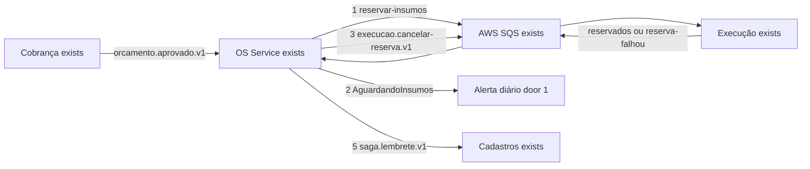
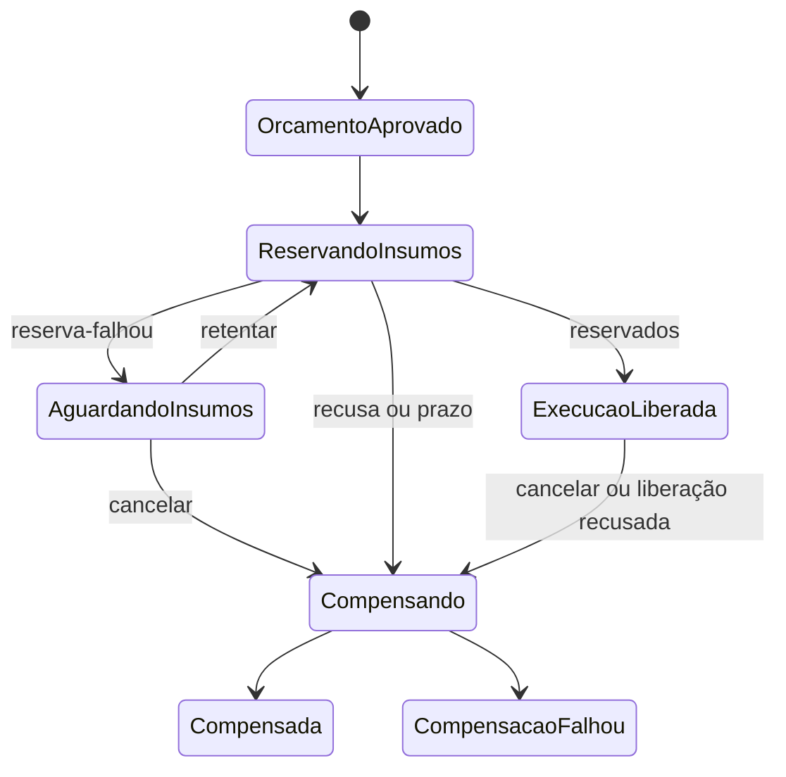
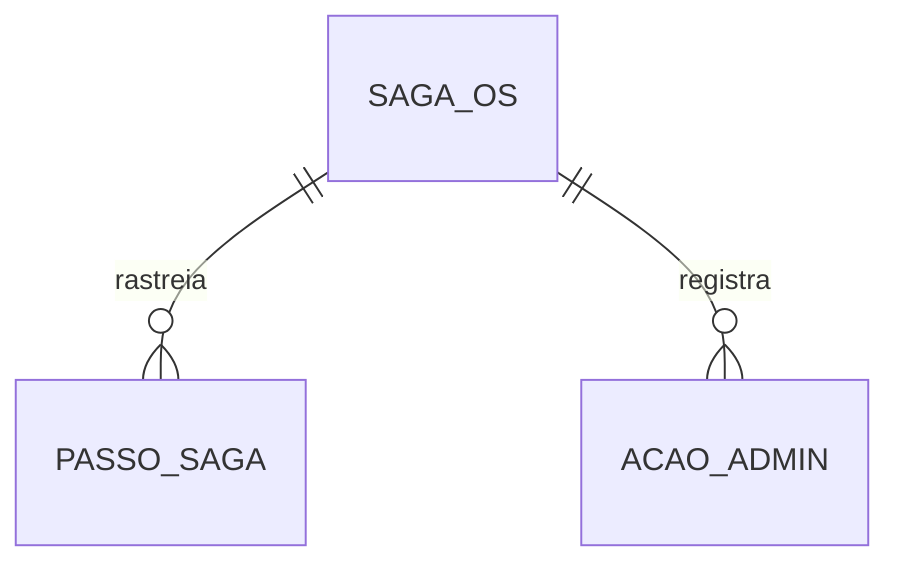

# Fase 4 - Saga: compensações, reserva de insumos e operação

**Approved**: 2026-11-12 - user: "Aprovo" (revisão por D-32 e D-33; aprovação anterior de 2026-11-11, "Aprovo", cobria o plano sem elas). Revisado em 12/11/2026 por D-32 (itens no `orcamento.aprovado.v1`, Cobrança passa a mudar) e D-33 (cancelamento só depois da confirmação da reserva); a aprovação anterior (2026-11-11, "Aprovo") valia para o plano sem essas duas decisões. Plano reescrito em 11/11/2026 para estender `saga-mensageria` (PASS, plano aprovado em 2026-11-06, congelado por AD-021) em vez de repetir o que ele já entrega. Decisões de origem: D-18, D-20, D-32, D-33, L-01 e D-19 (adiada) de `.specs/features/fase4/especificacao/index.md` § 6, AD-011, AD-015, AD-019, AD-021, AD-024, AD-034 e AD-035 do `.specs/STATE.md`. Os checks foram derivados de novo em 2026-11-12, depois desta aprovação. Depende de `insumos` (PASS).

## Problem

A Saga entregue por `saga-mensageria` já compensa o orçamento e a liberação, mas não conhece insumos: não reserva, não espera saldo, não trava comandos conflitantes enquanto um passo está pendente, não reenvia passos sem resposta nem oferece à equipe um jeito de ver e destravar Sagas paradas. Quando esta entrega estiver pronta, a Saga reservará insumos antes de liberar a execução, aguardará saldo sem cancelar, compensará a reserva junto com o orçamento antes do pivô (início da execução), recusará comandos conflitantes com 409, reenviará passos sem resposta, emitirá lembretes de negócio e permitirá à equipe consultar, retentar e reprocessar filas paradas.

## Shape

Esta entrega estende a Saga existente no OS Service e liga-a à reserva de `insumos`. Os critérios 1 a 5 e 12 do plano original (Saga persistida, deduplicação, transação única, sincronização da OS e retry com DLQ) já estão entregues e verificados em `saga-mensageria` e ficam herdados. Desenho detalhado em `.specs/features/fase4/especificacao/saga/fase4_spec_saga_pattern.md` § 4.4 a 4.7.

1. Entre `OrcamentoAprovado` (exists) e `ExecucaoLiberada` (exists) entra o estado `ReservandoInsumos` (door 1): a Saga publica `execucao.reservar-insumos.v1` com os itens e só libera a execução com `insumos.reservados.v1`. Os itens vêm no `orcamento.aprovado.v1`, que a Cobrança passa a publicar com `itens` (campo aditivo, D-32); sem `itens` a Saga não reserva e o evento vai para a DLQ.
2. Sem saldo (`insumos.reserva-falhou.v1`, door 2) a Saga vai para `AguardandoInsumos`, sem compensar, com alerta diário; a pessoa autorizada retenta ou cancela.
3. A compensação antes do pivô passa a incluir `execucao.cancelar-reserva.v1` (door 2), em ordem inversa da reserva e do orçamento. Em `ReservandoInsumos` o cancelamento espera `insumos.reservados.v1` ou `insumos.reserva-falhou.v1` antes de publicar `cancelar-reserva` (D-33); a Saga consome `insumos.reserva-cancelada.v1` como resultado do passo.
4. Travas: enquanto a Saga está em `ReservandoInsumos` (door 1) ou `Compensando` (exists), comandos conflitantes recebem 409 `saga_em_andamento`.
5. Job de prazos reenvia passos sem resposta e emite `saga.lembrete.v1` (door 2); console administrativo lista, detalha e retenta Sagas; cada serviço reprocessa a própria DLQ.

New: estados `ReservandoInsumos` e `AguardandoInsumos` e a etapa de reserva em `PassoSaga`, na tabela DynamoDB já existente. Nenhuma tabela nova.

Equivalência com os nomes do plano original (decisão de reaproveitar os estados implementados): `Cancelando` = `Compensando`; `Cancelada` = `Compensada`; `FalhaExecucao` = `IntervencaoRequerida`; `FalhaLiberacao` = `Compensada` com motivo `liberacao_sem_resposta` (ou `CompensacaoFalhou` se a compensação falhar).

**Changes underneath**

| Front | What changes |
| --- | --- |
| domínio | Saga ganha dois estados, a etapa de reserva, travas e prazos configuráveis. |
| stored data | Itens e etapas novos na tabela DynamoDB `autoreparos-os-saga`; sem migração. |
| readers | Cadastros consome `saga.lembrete.v1`; console administrativo consulta a Saga por REST. |
| contrato da Cobrança | `orcamento.aprovado.v1` ganha `itens` (aditivo, D-32); a Cobrança entra no build e nos testes desta feature. |

## Surface

**Expanded**: 2026-11-10 - user: "Adicionar rota de cancelamento" (rota herdada de `saga-mensageria`). A rota `POST /api/v1/admin/sagas/{id}/cancelar` do plano anterior foi removida (11/11): o console usa a rota de cancelamento da OS. Demais integrações continuam sendo mensagens internas versionadas em SQS.

| Route | Request -> response | Who | Status |
| --- | --- | --- | --- |
| `POST /api/v1/ordens-servico/{id}/cancelamento` (herdada) | motivo -> cancelamento aceito; passa a responder 409 `saga_em_andamento` durante `ReservandoInsumos` e `Compensando` | Administrador ou Atendente | 202, 401, 403, 404, 409, 422 |
| `GET /api/v1/admin/sagas` | filtros estado e paradaHaMinutos -> lista | Administrador | 200, 401, 403 |
| `GET /api/v1/admin/sagas/{ordemServicoId}` | id -> estado, passos, erros | Administrador | 200, 401, 403, 404 |
| `POST /api/v1/admin/sagas/{ordemServicoId}/retentar` | - -> passo reenviado | Administrador | 202, 401, 403, 404, 409 |
| `POST /api/v1/admin/dlq/reprocessar` (OS, Cobrança e Execução) | fila e quantidade máxima -> mensagens devolvidas | Administrador | 202, 401, 403, 422 |

Mensagens internas versionadas: catálogo em `.specs/features/fase4/especificacao/comunicacao/fase4_spec_comunicacao_microsservicos.md` § 4.5.

## Landing

| Door | Literal shape | Alternative rejected and why |
| --- | --- | --- |
| 1 | Estado em DynamoDB `autoreparos-os-saga`, com os dois estados e a etapa de reserva acrescentados à máquina existente (herda a escrita condicional por versão) | Tabela separada para a reserva partiria o estado da Saga em dois lugares |
| 2 | Comandos por SQS direto para a fila do participante, envelope e `traceparent` herdados; o fan-out por SNS (D-19) fica adiado para `infra-ci-observabilidade` e só é necessário nos eventos que o Cadastros consome | Trocar agora o transporte SQS direto, já verificado, por SNS e Streams reabriria o PASS de `saga-mensageria` (AD-021) |

## Criteria

### Reservation and compensation (P1)

**Acceptance Criteria**

1. WHEN `orcamento.aprovado.v1` for consumido THEN OS Service SHALL levar a Saga a `ReservandoInsumos` e publicar `execucao.reservar-insumos.v1` com `ordemServicoId` e os itens `{insumoId, quantidade}` lidos do próprio evento (a Cobrança passa a incluí-los), gravando transição, Inbox e comando pendente numa única transação do DynamoDB, antes de qualquer `ordem-servico.liberada.v1`.
2. WHEN `insumos.reservados.v1` chegar THEN OS Service SHALL levar a Saga a `ExecucaoLiberada` e publicar `ordem-servico.liberada.v1`.
3. IF `insumos.reserva-falhou.v1` chegar THEN OS Service SHALL levar a Saga a `AguardandoInsumos` sem compensar o orçamento, emitir o alerta `saga.aguardando-insumos` uma vez por dia enquanto durar, e `retentar` SHALL reenviar a reserva enquanto o cancelamento SHALL compensar.
4. IF o orçamento for recusado ou a OS for cancelada antes do início da execução THEN OS Service SHALL publicar `execucao.cancelar-reserva.v1` quando houver reserva e `cobranca.cancelar-orcamento.v1`, em ordem inversa, e terminar em `Compensada`, registrando o resultado de cada passo.
5. IF a liberação ou a reserva não for confirmada após o prazo técnico e os reenvios THEN OS Service SHALL compensar a reserva e o orçamento e terminar em `Compensada` com motivo `liberacao_sem_resposta`; se a compensação falhar, SHALL terminar em `CompensacaoFalhou` com alerta.
6. IF um cancelamento chegar depois da conclusão da execução THEN OS Service SHALL recusá-lo com 409 e a reserva `Confirmada` SHALL permanecer.
6a. WHILE a Saga estiver em `ReservandoInsumos` THEN OS Service SHALL NOT publicar `execucao.cancelar-reserva.v1` antes de `insumos.reservados.v1` ou `insumos.reserva-falhou.v1`; a compensação por prazo esgotado é a única exceção e fica registrada como risco consciente.

### Locks and concurrency (P1)

7. WHILE a Saga estiver em `ReservandoInsumos` ou `Compensando` THEN OS Service SHALL recusar `retentar` e novo cancelamento com 409 e código `saga_em_andamento`.
8. IF dois eventos concorrentes chegarem para a mesma Saga, inclusive nos estados novos, THEN só uma transição SHALL ser gravada (escrita condicional por versão) e a outra SHALL ser reavaliada ou rejeitada com registro.

### Deadlines, reminders and operation (P2)

9. WHEN um prazo técnico vencer (`PrazoReserva` 2 min, `PrazoLiberacao` 2 min e `PrazoCompensacao` 15 min, configuráveis, com até 3 reenvios) THEN o job SHALL reenviar o passo e, esgotados os reenvios, compensar ou marcar intervenção com alerta.
10. WHEN um prazo de negócio vencer (orçamento sem resposta, `AguardandoPagamento`, `AguardandoInsumos`) THEN o job SHALL publicar `saga.lembrete.v1` e SHALL não expirar nem cancelar o orçamento.
11. WHEN um administrador consultar uma Saga, listar Sagas paradas ou retentar um passo THEN OS Service SHALL executar a ação e registrar autor, data e motivo no histórico, aplicado à OS por mensagem de transição (sem gravar nos dois bancos).
12. WHEN um administrador reprocessar a DLQ de um serviço THEN o serviço SHALL devolver à fila de origem até a quantidade pedida e registrar a ação.

## Out of scope

| Excluded | Why |
| --- | --- |
| `saga.avancou.v1` e DynamoDB Streams (L-01 literal) | Dívida consciente (AD-024): o PASS de `saga-mensageria` já sincroniza a OS por despacho com um banco por passo. |
| Fan-out por SNS (D-19) | Adiado para `infra-ci-observabilidade`, para os eventos que o Cadastros consome. |
| Tela do console de Sagas | Depende da feature `web`, ainda sem plano. |
| README da estratégia orquestrada | Passa para `pacote-entrega`. |
| Cobrança automática de retry após captura | Proibida pela decisão AD-001. |
| Pré-autorização do pagamento com captura posterior | Exigiria trocar o Checkout Pro (D-18b recusado). |

## Assumptions

| Assumption | Chosen default | Rationale | Confirmed? |
| --- | --- | --- | --- |
| Orquestrador e storage | OS Service + DynamoDB + SQS | Confirmado no plano da fase4. | y - user: "Sim, OS Service + DynamoDB + SQS" |
| Retry técnico | Limite padrão por dependência, backoff exponencial com jitter, DLQ e alerta ao esgotar | Decisão compartilhada AD-001. | y - user: "Adote limites padrão por dependência, backoff exponencial com jitter e DLQ/alerta ao esgotar; nunca repetir cobrança capturada." |
| Mecanismos além do mínimo | Reserva em duas fases, travas, prazos e console (AD-011) | Escolha do grupo entre as opções a-d. | y - José: "Vamos então fazer o a, c e d" |
| Falta de saldo | `AguardandoInsumos` com alerta diário, sem cancelar | D-20 / AD-015. | y - José: "Ok, pode ser" |
| Estados reaproveitados e SQS direto | Estender a máquina de estados e o transporte entregues; L-01 literal e SNS adiados | Evitar reabrir o PASS de `saga-mensageria` (AD-021) e cumprir o prazo de 17/11. | y - User: "Sim, todas" (11/11) |
| Prazos técnicos | 2 min reserva e liberação, 15 min compensação, 3 reenvios | Valores iniciais configuráveis; 15 min é o padrão já implementado. | y - User: "Sim, todas" (11/11) |

**Open questions:** none

## Differences from the source

None - este plano não altera elementos do PDF binding.

## Sources

- `.specs/features/fase4/plan.md` - Saga e regras de falha aprovadas.
- `.specs/features/fase4/saga-mensageria/contracts.md` - estados, mensagens e prazos já implementados.
- `.specs/features/fase4/especificacao/saga/fase4_spec_saga_pattern.md` - desenho detalhado da Saga.
- `.specs/features/fase4/especificacao/comunicacao/fase4_spec_comunicacao_microsservicos.md` - catálogo de mensagens.
- `.specs/STATE.md` - AD-001, AD-010 a AD-015, AD-019, AD-021, AD-024, AD-034 e AD-035.
