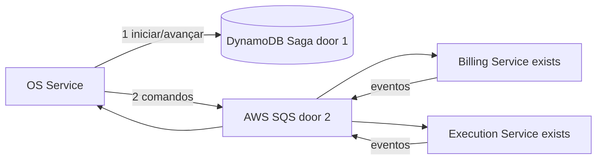
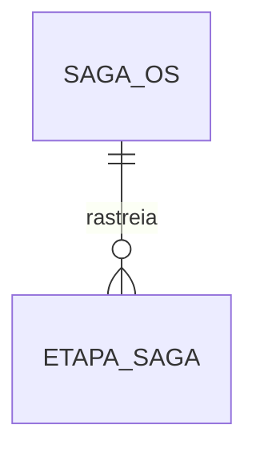

# Fase 4 - Saga e mensageria

**Approved**: 2026-11-06 - user: "Pode seguir"

## Problem

O ciclo da OS atravessa serviços com bancos isolados e pode falhar depois de etapas já persistidas. Sem coordenação durável, reinícios e mensagens repetidas podem deixar OS, orçamento e execução em estados divergentes. Quando esta entrega estiver pronta, OS Service retomará a Saga persistida e aplicará compensações ou recuperação para frente conforme o ponto do fluxo.

## Shape

Esta entrega conecta OS Service, Billing e Execution Service já definidos; estado e regras de orquestração executam no OS Service.

1. OS Service cria estado da Saga em DynamoDB próprio (door 1).
2. Orquestrador envia comandos pela SQS (door 2) a Billing e Execution.
3. Eventos de resposta atualizam estado persistido; falhas disparam compensação aplicável ou intervenção.

New: SagaOS e EtapaSaga em tabela DynamoDB própria do OS Service.

**Changes underneath**

| Front | What changes |
| --- | --- |
| domínio | OS Service coordena estados e decisões de compensação. |
| stored data | Tabela DynamoDB nova para estado recuperável da Saga. |
| readers | Serviços consomem comandos/eventos SQS; sem leitura do DynamoDB alheio. |

## Surface

**Expanded**: 2026-11-10 - user: "Adicionar rota de cancelamento" (decisão tomada após o Verifier apontar que a compensação não tinha gatilho de produção). Demais integrações continuam sendo mensagens internas versionadas em SQS.

| Route | Request -> response | Who | Status |
| --- | --- | --- | --- |
| `POST /api/v1/ordens-servico/{id}/cancelamento` | motivo -> cancelamento aceito (Saga compensa de forma assíncrona) | Administrador ou Atendente | 202, 401, 403, 404, 409, 422 |

## Landing

| Door | Literal shape | Alternative rejected and why |
| --- | --- | --- |
| 1 | OS Service como orquestrador persistido; estado em DynamoDB | Coreografia sem estado central dificulta retomada/visibilidade exigidas. |
| 2 | AWS SQS para comandos/eventos assíncronos | Chamadas REST encadeadas não desacoplam disponibilidade dos participantes. |

## Criteria

### Durable orchestration (P1)

**Acceptance Criteria**

1. WHEN uma OS iniciar o fluxo THEN OS Service SHALL persistir etapa e identificador de correlação antes de publicar comando.
2. WHEN processo reiniciar com Saga não terminal THEN OS Service SHALL retomar do último estado persistido sem perder etapas.
3. IF mensagem duplicada for recebida THEN consumidor SHALL deduplicar por event id e não repetir efeito de negócio.
4. IF cada etapa compensável falhar THEN orquestrador SHALL executar a compensação definida e registrar resultado/erro.
5. IF pagamento estiver capturado e sincronização falhar THEN Saga SHALL seguir recuperação para frente e alertar, sem estorno automático.
6. IF falha transitória esgotar limites padrão com backoff exponencial e jitter THEN mensagem SHALL ir à DLQ e gerar alerta acionável.
7. WHEN fluxo principal for concluído THEN README SHALL documentar a estratégia orquestrada e justificativa.

## Out of scope

| Excluded | Why |
| --- | --- |
| Regras internas de orçamento e execução | Pertencem às features dos respectivos serviços. |
| Cobrança automática de retry após captura | Proibida pela decisão AD-001 e plano pai. |

## Assumptions

| Assumption | Chosen default | Rationale | Confirmed? |
| --- | --- | --- | --- |
| Orquestrador e storage | OS Service + DynamoDB + SQS | Confirmado no plano da fase4. | y - user: "Sim, OS Service + DynamoDB + SQS" |
| Retry técnico | Limite padrão por dependência, backoff exponencial com jitter, DLQ/alerta ao esgotar | Decisão compartilhada AD-001. | y - user: "Adote limites padrão por dependência, backoff exponencial com jitter e DLQ/alerta ao esgotar; nunca repetir cobrança capturada." |

**Open questions:** none

## Differences from the source

None - este plano não altera elementos do PDF binding.

## Sources

- `.specs/features/fase4/plan.md` - Saga e regras de falha aprovadas.
- `.specs/features/fase4/checks.md` - AC 5-7, 10, 14.
