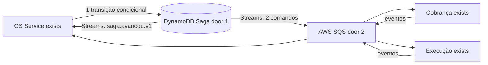
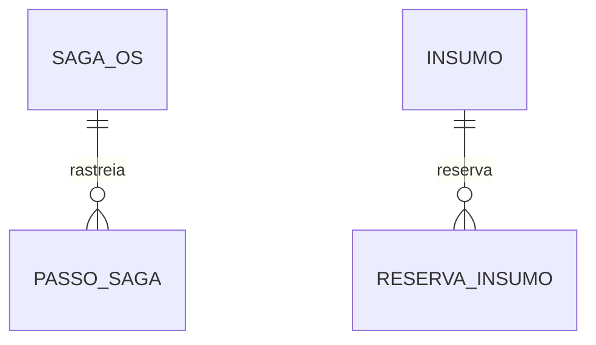

# Fase 4 - Saga e mensageria

**Revisão pendente de aprovação** (10/11/2026): incorpora D-01, D-04, D-09, D-18, D-19, D-20 e a regra L-01 (opção C) de `docs/specs/fase4/index.md` § 6 e AD-010 a AD-015 do `.specs/STATE.md`. A versão anterior foi aprovada em 2026-11-06 - user: "Pode seguir". Os `checks.md` desta feature precisam ser derivados de novo depois da aprovação.

## Problem

O ciclo da OS atravessa serviços com bancos isolados e pode falhar depois de etapas já persistidas. Sem coordenação durável, reinícios e mensagens repetidas podem deixar OS, orçamento, reserva de insumos e execução em estados divergentes. Hoje o contrato entre os serviços não fecha: ninguém publica `ordem-servico.liberada.v1` e ninguém consome `execucao.concluida.v1` nem `execucao.falhou.v1`. Quando esta entrega estiver pronta, o OS Service conduzirá a Saga persistida, aplicará compensações antes do pivô (início da execução) e recuperação para frente depois dele, e permitirá à equipe ver e destravar Sagas paradas.

## Shape

Esta entrega conecta OS Service, Cobrança e Execução já existentes. Desenho detalhado (estados, compensações, prazos, modelo da tabela) em `docs/specs/fase4/saga/fase4_spec_saga_pattern.md`.

1. OS Service grava o estado da Saga em tabela DynamoDB própria (door 1); cada handler grava em um único banco (regra L-01): eventos dos participantes no DynamoDB (Inbox + transição + Outbox num `TransactWriteItems`), status e histórico da OS no PostgreSQL ao consumir `saga.avancou.v1`.
2. Orquestrador envia comandos pela SQS (door 2) à Cobrança e à Execução e recebe eventos pelos tópicos SNS de cada produtor; a Outbox do DynamoDB é publicada por DynamoDB Streams.
3. Execução reserva insumos em duas fases (reservar, confirmar na conclusão, cancelar na compensação).
4. Eventos de resposta avançam a Saga; falhas antes do pivô disparam compensação; depois do pivô, intervenção ou recuperação para frente.
5. Job de prazos reenvia passos pendentes, compensa ou alerta; console de administração lista, retenta e cancela Sagas paradas e reprocessa DLQs.

New: SagaOS, PassoSaga, Inbox e Outbox na tabela DynamoDB do OS Service; ReservaInsumo e saldos reservados no PostgreSQL da Execução.

**Changes underneath**

| Front | What changes |
| --- | --- |
| domínio | OS Service coordena estados, travas e compensações; Execução ganha reserva em duas fases; Cobrança ganha itens no orçamento e cancelamento por comando. |
| stored data | Tabela DynamoDB nova para a Saga; colunas e tabela de reserva na Execução; itens de orçamento na Cobrança. |
| readers | Serviços consomem comandos/eventos SQS; status da OS no PostgreSQL atualizado por `saga.avancou.v1`; nenhum acesso a banco alheio. |

## Surface

| Route | Request -> response | Who | Status |
| --- | --- | --- | --- |
| `GET /api/v1/admin/sagas` | filtros estado/paradaHaMinutos -> lista | Administrador | 200, 401, 403 |
| `GET /api/v1/admin/sagas/{ordemServicoId}` | id -> estado, passos, erros | Administrador | 200, 401, 403, 404 |
| `POST /api/v1/admin/sagas/{ordemServicoId}/retentar` | - -> passo reenviado | Administrador | 202, 401, 403, 404, 409 |
| `POST /api/v1/admin/sagas/{ordemServicoId}/cancelar` | motivo -> cancelamento iniciado | Administrador ou atendente | 202, 401, 403, 404, 409 |
| `POST /api/v1/admin/dlq/reprocessar` (em cada serviço) | fila -> mensagens devolvidas | Administrador | 202, 401, 403 |

Mensagens internas versionadas: catálogo em `docs/specs/fase4/comunicacao/fase4_spec_comunicacao_microsservicos.md` § 4.5.

## Landing

| Door | Literal shape | Alternative rejected and why |
| --- | --- | --- |
| 1 | OS Service como orquestrador persistido; estado em DynamoDB `autoreparos-os-saga` (PK/SK, GSI `estado`+`prazoEm`, Streams), sem handler que grave também no PostgreSQL | Coreografia dificulta retomada e visibilidade; Saga no PostgreSQL contraria a escolha de NoSQL; OS inteiro no DynamoDB reescreveria a persistência verificada |
| 2 | AWS SQS para comandos (uma fila por participante) e SNS por produtor para eventos (uma fila SQS por consumidor assinando o tópico), envelope camelCase com `eventId`, `tipo`, `correlacaoId`, `causaId`, `ocorridoEm`, `traceparent` | Chamadas REST encadeadas acoplam a disponibilidade dos participantes; uma linha de Outbox por destino obriga o produtor a conhecer os consumidores |

## Criteria

### Durable orchestration (P1)

**Acceptance Criteria**

1. WHEN `ordem-servico.criada.v1` for consumido THEN OS Service SHALL criar a Saga com o id da OS como correlação, na mesma transação da Inbox, antes de publicar qualquer comando.
2. WHEN processo reiniciar com Saga não terminal THEN OS Service SHALL retomar do último estado persistido sem perder etapas.
3. IF mensagem duplicada for recebida THEN consumidor SHALL deduplicar por `eventId` na mesma transação do efeito e não repetir efeito de negócio.
4. WHERE um handler alterar estado THEN ele SHALL gravar estado, Inbox e Outbox numa única transação de um único banco; nenhum handler SHALL gravar no DynamoDB e no PostgreSQL.
5. WHEN a Saga transitar THEN OS Service SHALL refletir status e histórico da OS no PostgreSQL ao consumir `saga.avancou.v1`.

### Compensation and recovery (P1)

6. IF o orçamento for recusado ou a OS for cancelada antes do início da execução THEN orquestrador SHALL cancelar a reserva existente e o orçamento, em ordem inversa, e terminar em `Cancelada`, registrando cada resultado.
7. IF a reserva falhar por falta de saldo THEN Execução SHALL não gravar reserva parcial e a Saga SHALL ir para `AguardandoInsumos` com alerta.
8. IF a liberação para execução não for confirmada após o prazo técnico e os reenvios THEN orquestrador SHALL cancelar a reserva e ir para `FalhaLiberacao`.
9. WHEN a execução for concluída THEN Execução SHALL confirmar a reserva na mesma transação da conclusão.
10. IF a execução falhar THEN Saga SHALL ir para `FalhaExecucao` e aguardar reexecução ou cancelamento por pessoa autorizada.
11. IF pagamento estiver capturado e sincronização falhar THEN Saga SHALL seguir recuperação para frente e alertar, sem estorno automático.
12. IF falha transitória esgotar limites padrão com backoff exponencial e jitter THEN mensagem SHALL ir à DLQ e gerar alerta acionável.

### Locks, deadlines and operation (P1)

13. WHILE a Saga estiver em estado pendente (`ReservandoInsumos`, `LiberandoExecucao`, `Cancelando`) THEN OS Service SHALL recusar comandos conflitantes com 409 e código `saga_em_andamento`.
14. IF dois eventos concorrentes chegarem para a mesma Saga THEN só uma transição SHALL ser gravada (escrita condicional por versão).
15. WHEN um prazo técnico vencer THEN o job SHALL reenviar o passo até o limite e depois compensar ou marcar intervenção com alerta; prazos de negócio SHALL gerar lembretes sem expirar o orçamento.
16. WHEN um administrador consultar, retentar ou cancelar uma Saga, ou reprocessar uma DLQ THEN o serviço SHALL executar a ação e registrá-la no histórico.
17. WHEN fluxo principal for concluído THEN README SHALL documentar a estratégia orquestrada, o pivô e a justificativa.

## Out of scope

| Excluded | Why |
| --- | --- |
| Regras internas de orçamento e execução além das listadas | Pertencem às features dos respectivos serviços. |
| Cobrança automática de retry após captura | Proibida pela decisão AD-001 e plano pai. |
| Pré-autorização do pagamento com captura posterior | Exigiria trocar o Checkout Pro (D-18b recusado). |

## Assumptions

| Assumption | Chosen default | Rationale | Confirmed? |
| --- | --- | --- | --- |
| Orquestrador e storage | OS Service + DynamoDB + SQS | Confirmado no plano da fase4. | y - user: "Sim, OS Service + DynamoDB + SQS" |
| Retry técnico | Limite padrão por dependência, backoff exponencial com jitter, DLQ/alerta ao esgotar | Decisão compartilhada AD-001. | y - user: "Adote limites padrão por dependência, backoff exponencial com jitter e DLQ/alerta ao esgotar; nunca repetir cobrança capturada." |
| Atomicidade | Opção C de L-01 (AD-012) | Regra do grupo: um passo, um banco. | y - José: "a duplicidade atômica como transação do saga e postgres deve ser lei" |
| Mecanismos além do mínimo | Reserva em duas fases, travas, prazos e console (AD-011) | Escolha do grupo entre as opções a-d. | y - José: "Vamos então fazer o a, c e d" |
| Falta de saldo | `AguardandoInsumos` com alerta, sem cancelar | D-20 / AD-015. | y - José: "Ok, pode ser" |
| Fan-out de eventos | SNS por produtor + SQS por consumidor | D-19 / AD-014. | y - José: "Recomendado" |
| Prazos técnicos | 2 min reserva e liberação, 5 min cancelamento, 3 reenvios | Valores iniciais configuráveis. | n |

**Open questions:** none

## Differences from the source

None - este plano não altera elementos do PDF binding.

## Sources

- `.specs/features/fase4/plan.md` - Saga e regras de falha aprovadas.
- `docs/specs/fase4/saga/fase4_spec_saga_pattern.md` - desenho detalhado da Saga.
- `docs/specs/fase4/comunicacao/fase4_spec_comunicacao_microsservicos.md` - catálogo de mensagens.
- `.specs/STATE.md` - AD-001, AD-010 a AD-015.
