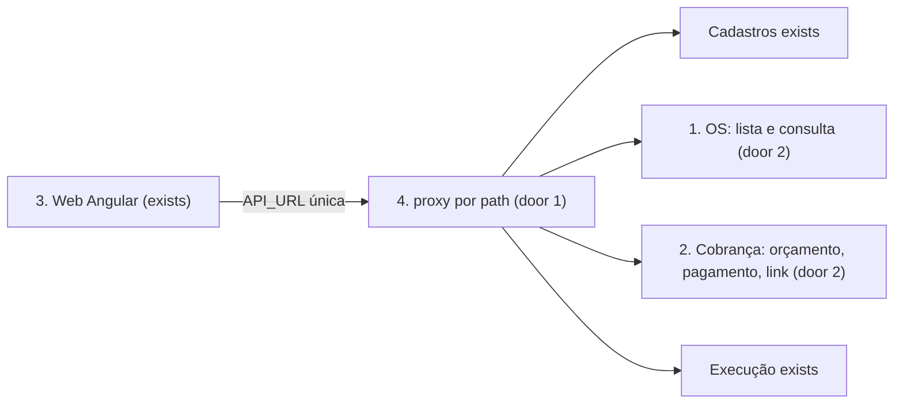
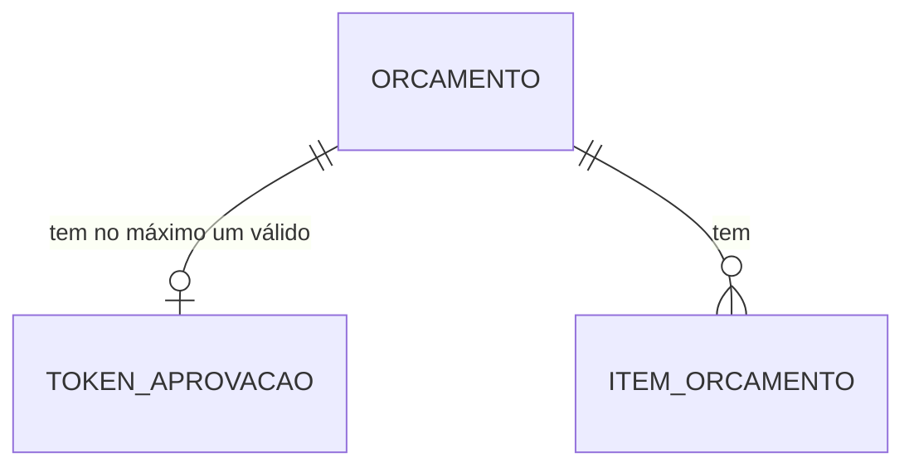

# Fase 4 - Adaptação do Web às APIs dos serviços

**Revisão pendente de aprovação** - plano escrito em 13/11/2026; o usuário respondeu as quatro perguntas de escopo (D-39 / AD-042) e ainda não aprovou o texto. Nunca escrever a linha `**Approved**` sem as palavras do usuário.

**Decisões de origem:** D-03 / AD-028 (Web extraído; esta é a etapa funcional posterior), D-39 / AD-042 (escopo desta etapa), D-28 a D-31 e D-37 (Cadastros em `/api/v1` e JWT RS256 com JWKS), D-13 (cada repositório mantém seu pipeline), D-18 / AD-011 (console de Sagas e reprocessamento). Levantamento em [levantamento.md](levantamento.md).

## Problem

O Web ainda fala só com o monólito Cadastros, em `/api/...` sem versão, e parte dessas chamadas já nem batia com o próprio backend (POST/PUT onde havia PATCH, `PATCH /status` inexistente, aprovação por GET). Os serviços novos expõem outro desenho: OS, Cobrança e Execução em `/api/v1`, status da OS dirigido pela Saga, orçamento e pagamento na Cobrança, fila e etapas na Execução, catálogo e insumos na Execução. O Cadastros deixou de servir OS, orçamento, catálogo, insumos e dashboard. Hoje quem abre o Web não consegue abrir uma OS, montar um orçamento, aprovar, pagar, acompanhar a execução nem destravar uma Saga parada.

Faltam também as leituras que as telas precisam: o OS não lista, a Cobrança não consulta orçamento nem pagamento, e a aprovação por link de e-mail não tem backend.

Quando esta entrega estiver pronta, o atendente abre a OS, monta o orçamento com serviços e insumos, gera o link de aprovação, acompanha o Kanban com os status reais da Saga e vê o pagamento; o mecânico trabalha a fila de execução; o administrador cuida do catálogo, do estoque e do console de Sagas; o cliente aprova o orçamento pelo link; tudo por uma só `API_URL`.

## Shape

Esta entrega tem três frentes ligadas pelo contrato HTTP: leituras novas no backend, camada HTTP e roteamento do Web, e as telas.

1. OS (exists) ganha a lista paginada e a consulta pública por id (door 2).
2. Cobrança (exists) ganha consulta de orçamento e de pagamento e o link de aprovação por token (door 2).
3. O Web (exists) troca `api-endpoints.ts` por `/api/v1`, passa a traduzir `{codigo}` dos erros e remove as telas sem equivalente (door 1).
4. A imagem do Web (exists) roteia por prefixo de path para cada serviço a partir de uma única `API_URL` (door 1); o compose do pai sobe os serviços novos atrás dela.

New: TokenAprovacao na Cobrança (hash do token, validade de 7 dias, uso único, orçamento dono); Orcamento e ItemOrcamento já existem.

**Changes underneath**

| Front | What changes |
| --- | --- |
| domain | Cobrança guarda um token de aprovação por orçamento (hash, validade, uso único); o Web troca o enum `StatusOS` pelos status reais da OS. |
| stored data | Uma coluna/tabela de token na Cobrança (migration); nada novo no OS, na Execução ou no Cadastros. |
| readers | Web, console e o link do cliente passam a ler OS, orçamento, pagamento, fila, catálogo e Sagas pelos novos paths. |

## Surface

Backend novo (todas sob `/api/v1`; o erro de validação é `422 {codigo}`):

| Route | Request -> response | Who | Status |
| --- | --- | --- | --- |
| `GET /ordens-servico?status=&pagina=&tamanho=` (OS) | filtros -> `{total, itens[{id, clienteId, veiculoId, status, atualizadaEm}]}`, mais recentes primeiro, `tamanho` até 100 | Administrador, Atendente, Mecanico | 200, 401, 403, 422 `filtro_invalido` |
| `GET /ordens-servico/{id}/consulta` (OS) | -> `{id, status, historico[{status, em}]}`, sem cliente nem veículo | público | 200, 404 |
| `GET /orcamentos?ordemServicoId=` (Cobrança) | -> orçamento com itens (snapshot de preço), valor, status e `pagamentoId` | Administrador, Atendente | 200, 401, 403, 404, 422 |
| `GET /pagamentos/{id}` (Cobrança) | -> `{id, status, valor, checkoutUrl?}` | Administrador, Atendente | 200, 401, 403, 404 |
| `POST /orcamentos/{id}/link-aprovacao` (Cobrança) | -> `{token, expiraEm}`, token novo invalida o anterior | Administrador, Atendente | 201, 401, 403, 404, 409 `orcamento_nao_pendente` |
| `GET /orcamentos/publico?token=` (Cobrança) | -> resumo do orçamento (valor, itens, status) | público (token) | 200, 404 `token_invalido` |
| `POST /orcamentos/publico/aprovacao` (Cobrança) | `{token}` -> orçamento `Aprovado` e `orcamento.aprovado.v1` pelo Outbox existente | público (token) | 200, 404 `token_invalido`, 409 `orcamento_nao_pendente` |

Rotas existentes que o Web passa a usar: OS `POST/GET/PATCH /ordens-servico`, `POST .../{id}/cancelamento`, `GET/POST /admin/sagas...`; Cobrança `POST /orcamentos`, `POST /pagamentos/{id}/checkout`, `POST /pagamentos/{id}/reembolsos`; Execução `GET /fila-execucao`, `POST /execucoes/{id}/etapas|conclusao|falha|reexecucao`, `/servicos`, `/insumos`, `/insumos/{id}/entradas`; Cadastros `/api/v1/{clientes,veiculos,usuarios}` e `/api/auth/login`.

Roteamento por prefixo (único `API_URL`): `/api/v1/ordens-servico` e `/api/v1/admin/sagas` -> OS; `/api/v1/orcamentos` e `/api/v1/pagamentos` -> Cobrança; `/api/v1/execucoes`, `/api/v1/fila-execucao`, `/api/v1/servicos`, `/api/v1/insumos` -> Execução; `/api/v1/clientes`, `/api/v1/veiculos`, `/api/v1/usuarios` e `/api/auth` -> Cadastros. `POST /api/v1/admin/dlq/reprocessar` existe nos três serviços com o mesmo path e por isso **não** entra no proxy nem na UI.

## Landing

| Door | Literal shape | Alternative rejected and why |
| --- | --- | --- |
| 1 - contrato de URL do navegador | O navegador usa uma só `API_URL` (`window.__env.apiUrl`) e a tabela de prefixos acima; a imagem do Web resolve cada prefixo para o serviço (Nginx local) e o API Gateway/Ingress faz o mesmo na nuvem (`infra-ci-observabilidade`). | Uma URL por serviço no navegador exigiria CORS nos três serviços novos e deixaria o Web conhecendo a topologia. |
| 2 - superfície pública | Duas rotas anônimas novas (`/ordens-servico/{id}/consulta` e `/orcamentos/publico...`) protegidas por id/token imprevisível, sem dados pessoais. | Exigir login do cliente criaria o portal por CPF, fora do escopo (D-39). |

- A tabela de status da OS (`Recebida`, `OrcamentoAprovado`, `EmExecucao`, `Concluida`, `Paga`, `IntervencaoRequerida`, `Cancelada`) é a do OS; o Web não mantém outra.

## Criteria

### S1: Camada HTTP e roteamento (P1)

**Acceptance Criteria**

1. WHEN o Web chamar qualquer serviço THEN SHALL usar `API_URL` + path de `/api/v1` da tabela de roteamento, sem URL por serviço; `api-endpoints.ts` SHALL conter só os endpoints da Surface.
2. WHEN a imagem do Web iniciar com `API_URL` vazio THEN o Nginx SHALL encaminhar cada prefixo da tabela ao serviço configurado por variável (`OS_URL`, `COBRANCA_URL`, `EXECUCAO_URL`, `CADASTROS_URL`) e `GET /` SHALL responder 200
   - `/api/v1/ordens-servico` → OS; `/api/v1/orcamentos` → Cobrança; `/api/v1/fila-execucao` → Execução; `/api/v1/clientes` → Cadastros; prefixo desconhecido → 404
3. WHEN o compose do pai subir THEN SHALL iniciar OS, Cobrança e Execução (com seus bancos, DynamoDB local e filas locais) além do Cadastros e do Web, e uma chamada autenticada a `/api/v1/fila-execucao` pelo Web SHALL responder 200.
4. WHEN uma resposta 401, 403, 404, 409, 422 ou 503 trouxer `{codigo}` THEN o `errorInterceptor` SHALL mostrar a mensagem do catálogo de códigos do Web (por exemplo `saga_em_andamento`, `orcamento_nao_pendente`, `token_invalido`, `filtro_invalido`, `execucao_estado_invalido`) e, para código desconhecido, a mensagem genérica por status
   - 409 `saga_em_andamento` → "A saga desta OS ainda está em andamento. Tente novamente em instantes."; 422 com código desconhecido → mensagem genérica de validação
5. WHEN o operador entrar THEN o login SHALL ser `POST /api/auth/login` do Cadastros e o `jwtInterceptor` SHALL enviar o token só às rotas da Surface; IF o token expirar (401) THEN o Web SHALL voltar ao login.

### S2: Leituras novas no backend (P1)

**Acceptance Criteria**

6. WHEN um operador autorizado listar OS THEN o OS SHALL devolver a página pedida ordenada por `atualizadaEm` decrescente
   - 25 OS, `tamanho=10&pagina=3` → 5 itens; `tamanho=100` aceito; `tamanho=101` → 422 `filtro_invalido`; `status=Inexistente` → 422; `status=Paga` → só pagas
7. WHEN qualquer pessoa consultar `GET /ordens-servico/{id}/consulta` THEN o OS SHALL devolver status e histórico sem `clienteId` nem `veiculoId`; id desconhecido SHALL responder 404.
8. WHEN um atendente consultar `GET /orcamentos?ordemServicoId=` THEN a Cobrança SHALL devolver o orçamento com os itens e o snapshot de preço; OS sem orçamento SHALL responder 404.
9. WHEN um atendente pedir `link-aprovacao` de um orçamento `Pendente` THEN a Cobrança SHALL gerar um token imprevisível (mínimo 128 bits), guardar só o hash com validade de 7 dias e devolver o token uma única vez
   - segundo pedido → token novo e o anterior passa a dar 404; orçamento `Aprovado` → 409 `orcamento_nao_pendente`
10. WHEN o cliente aprovar por `POST /orcamentos/publico/aprovacao` com token válido THEN a Cobrança SHALL aprovar o orçamento e gravar `orcamento.aprovado.v1` no Outbox na mesma transação, e o token SHALL deixar de valer
    - token expirado → 404 `token_invalido`; repetido → 409 `orcamento_nao_pendente`; sem token → 404
11. IF as rotas públicas receberem token ou id malformado THEN SHALL responder 404 sem distinguir "inexistente" de "expirado" nem registrar o token no log.

### S3: Ordens de serviço e Kanban (P1)

**Acceptance Criteria**

12. WHEN o atendente abrir "Nova OS" e escolher cliente e veículo THEN o Web SHALL chamar `POST /ordens-servico` e abrir o detalhe da OS criada; IF a resposta for 422 THEN SHALL mostrar o erro no formulário.
13. WHEN o operador abrir a fila (Kanban) THEN o Web SHALL mostrar uma coluna por status real da OS, alimentada por `GET /ordens-servico?status=`, com estado vazio por coluna e carregando enquanto espera.
14. WHEN o operador abrir uma OS THEN o detalhe SHALL mostrar status e histórico (`GET /ordens-servico/{id}`), o orçamento (critério 8) e o estado da execução.
15. WHEN o atendente ou administrador cancelar uma OS THEN o Web SHALL pedir motivo, chamar `POST .../cancelamento` e mostrar o estado devolvido; IF a resposta for 409 `saga_em_andamento` ou `cancelamento_indisponivel` THEN SHALL mostrar a mensagem do código e manter a OS.
16. WHEN alguém abrir a consulta pública e informar o código da OS THEN o Web SHALL chamar o critério 7 e mostrar status e histórico; a busca por placa ou CPF deixa de existir.

### S4: Orçamento e pagamento (P1)

**Acceptance Criteria**

17. WHEN o atendente montar o orçamento de uma OS THEN o Web SHALL listar serviços e insumos do catálogo da Execução com preço e saldo, calcular o total no cliente e enviar `POST /orcamentos` com os itens; o valor mostrado depois SHALL ser o devolvido pela Cobrança.
18. WHEN o atendente pedir "Gerar link de aprovação" THEN o Web SHALL chamar o critério 9 e mostrar o link para copiar, uma única vez, com a validade.
19. WHEN o cliente abrir o link com token THEN a página SHALL mostrar o resumo (critério 8 público) e o botão "Aprovar"; WHEN aprovar THEN SHALL chamar o critério 10 e mostrar a confirmação; token inválido SHALL mostrar "Link inválido ou expirado".
20. WHEN o orçamento estiver aprovado e a execução concluída THEN o atendente SHALL ver o pagamento (critério `GET /pagamentos/{id}`) e "Iniciar checkout" SHALL chamar `POST /pagamentos/{id}/checkout` e abrir a URL devolvida; o administrador SHALL poder solicitar reembolso com valor e referência.

### S5: Execução e catálogo (P2)

**Acceptance Criteria**

21. WHEN o mecânico abrir "Fila de execução" THEN o Web SHALL listar `GET /fila-execucao` com filtro de status e de mecânico, e registrar etapa (`Diagnostico` ou `Reparo`), concluir, marcar falha e (administrador) reexecutar com motivo, mostrando o `{codigo}` em 409 `execucao_estado_invalido`.
22. WHEN o administrador gerir serviços e insumos THEN o Web SHALL usar `GET/POST /servicos`, `GET/POST /insumos` e `POST /insumos/{id}/entradas` (Administrador ou Atendente), mostrando saldo disponível e reservado; a edição e a exclusão que o backend não tem SHALL não aparecer.

### S6: Console de Sagas (P2)

**Acceptance Criteria**

23. WHEN o administrador abrir "Sagas" THEN o Web SHALL listar `GET /admin/sagas` com filtro de estado e de parada, abrir o detalhe (etapas, comandos, registros) e, em `AguardandoInsumos`, oferecer "Retentar reserva" com motivo obrigatório.
24. IF a retentativa responder 409 `saga_em_andamento` ou `retentativa_indisponivel` THEN o Web SHALL mostrar a mensagem do código e manter a Saga como está.
25. WHERE o usuário não for Administrador THEN o menu e a rota do console SHALL não existir (guard de papel).

### S7: Limpeza e qualidade (P1)

**Acceptance Criteria**

26. WHEN a entrega estiver pronta THEN o Web SHALL não conter rota, menu, serviço nem chamada para dashboard, entregar, mudança manual de status, itens soltos da OS ou busca por placa/CPF (AD-042).
27. WHEN `yarn test --watch=false` rodar THEN SHALL passar com cobertura de linhas de pelo menos 80% sobre o código novo ou alterado, e `yarn build` SHALL sair com 0.
28. WHEN a suíte do Web rodar em Node 25 ou 26 THEN SHALL passar sem flag extra (`src/test-setup.ts` fica).

## Out of scope

| Excluded | Why |
| --- | --- |
| Portal do cliente com login por CPF (Minhas OS, pagar logado) | O usuário manteve o link por token (D-39); depende de AuthLambda e de desenho próprio. |
| Envio automático do e-mail com o link | O link é gerado e copiado pelo atendente; o envio depende de evento de notificação no Cadastros (`infra-ci-observabilidade`). |
| Recusa do orçamento pelo cliente | Não há evento de recusa para a Saga; recusar equivale a o atendente cancelar a OS. |
| Dashboard gerencial, "entregar", status manual, itens soltos e busca por placa/CPF | Sem equivalente nos serviços; removidos (AD-042). |
| Edição e exclusão de serviços e insumos | A Execução não expõe PUT nem DELETE. |
| Reprocessamento de DLQ na UI e Ingress, API Gateway e charts dos serviços novos | O path repete nos três serviços; Ingress e Gateway pertencem a `infra-ci-observabilidade`. |
| Projeto SonarCloud, `SONAR_TOKEN` e proteção de `main` | Governança fica com `infra-ci-observabilidade`. |

## Assumptions

| Assumption | Chosen default | Rationale | Confirmed? |
| --- | --- | --- | --- |
| Leituras ausentes | Criadas no backend nesta feature (lista do OS, consulta, orçamento, pagamento, link) | Resposta à pergunta de escopo | y - user: "Criar no backend (Recommended)" |
| Aprovação do cliente | Link com token de e-mail mantido, sem portal logado | Resposta à pergunta do portal | y - user: "Manter token de e-mail" |
| Telas sem equivalente | Removidas | Resposta à pergunta do legado | y - user: "Remover (Recommended)" |
| Qualidade | Cobertura de 80% no código novo e mensagens por `codigo` | Resposta à pergunta de qualidade | y - user: "80% e mensagens por código (Recommended)" |
| Login do operador | `POST /api/auth/login` do Cadastros permanece | O plano do Cadastros só migra `clientes`, `veiculos` e `usuarios` para `/api/v1` | n |
| Consulta pública | Por código (id) da OS, sem placa/CPF | Evita que o OS dependa do Cadastros para uma rota anônima | n |
| Compose local | O pai sobe OS, Cobrança, Execução e dependências locais | Sem isso nenhuma tela funciona na demonstração | n |
| Validade do link | 7 dias, uso único, hash guardado | Espelha a validade do orçamento sem resposta da spec da Saga (7 dias) | n |
| Papéis do Kanban e da fila | Kanban: Administrador, Atendente, Mecanico; fila de execução: Mecanico, Administrador | Papéis das rotas existentes | n |

**Open questions:** none - as quatro decisões de escopo foram respondidas; as linhas `n` valem como default até a aprovação do plano.

## Differences from the source

| Source | Departure | Reason | Confirmed |
| --- | --- | --- | --- |
| Telas atuais do Web (dashboard, entregar, status manual, itens soltos da OS, consulta por placa/CPF, aprovação com recusa) | Removidas ou reduzidas | Sem equivalente nos serviços novos | y - AD-042 |

## Sources

- [levantamento.md](levantamento.md) - estado do Web, rotas e mapeamento legado para novo (12/11/2026).
- [Separação de microsserviços § 5, Etapa 5](../especificacao/microsservicos/fase4_spec_separacao_microsservicos.md#etapa-5--frontend-d-03) - telas e roteamento por uma URL base.
- [Saga § 4.7](../especificacao/saga/fase4_spec_saga_pattern.md) - console administrativo e prazos.
- `.specs/features/fase4/saga-compensacoes/plan.md` e `insumos/plan.md` - rotas de Saga, catálogo e insumos já entregues.
- `submodules/AutoReparos.Web` em `6975b7f`, OS, Cobrança e Execução na branch `feature/saga-compensacoes` - código lido.
