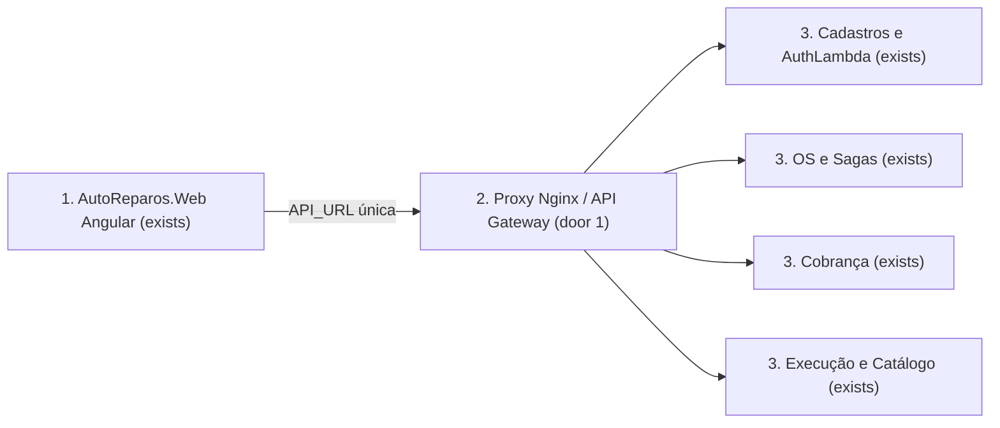

# Fase 4 - Adaptação do Web às APIs dos serviços

**Approved**: 2026-11-16 - user: "entendido pode continuar" (escopo revisado para 100% Web-only sobre as APIs já em produção, D-69 / AD-074; aprovação anterior em 2026-11-13 - user: "Aprovo").

**Decisões de origem:** D-03 / AD-028 (Web extraído; esta é a etapa funcional posterior), D-69 / AD-074 (escopo 100% Web-only sobre os serviços já implantados, substituindo a parte de backend da D-39 / AD-042), D-28 a D-31 e D-64 (Cadastros em `/api/v1` e JWT RS256 com `clienteId`), D-13 (cada repositório mantém seu pipeline), D-18 / AD-011 (console de Sagas). Levantamento em [levantamento.md](levantamento.md).

## Problem

O Web ainda fala só com o monólito antigo em `/api/...` sem versão, e parte dessas chamadas nem batia mais com os contratos (POST/PUT onde havia PATCH, `PATCH /status` inexistente, aprovação por GET). Os quatro microsserviços já implantados no EKS expõem outro desenho: OS, Cobrança, Execução e Cadastros em `/api/v1`, status da OS dirigido pela Saga, orçamento e pagamento na Cobrança, fila, etapas, catálogo e insumos na Execução e autenticação de cliente por CPF e e-mail em `POST /auth/cliente`. O Cadastros deixou de servir OS, orçamento, catálogo, insumos e dashboard. Hoje quem abre o Web não consegue abrir uma OS, montar um orçamento, aprovar, pagar, trabalhar a fila de execução nem operar o console de Sagas.

Quando esta entrega estiver pronta, o atendente abre a OS, monta o orçamento com serviços e insumos, acompanha o Kanban com os 7 status reais da Saga e inicia o checkout; o cliente aprova o orçamento autenticando com CPF e e-mail; o mecânico opera a fila de execução; e o administrador cuida do catálogo, do estoque, dos reembolsos e do console de Sagas, tudo a partir de uma única `API_URL` e sem alterar nenhum microsserviço de backend.

## Shape

Esta entrega adapta exclusivamente o projeto Angular e sua imagem Nginx em `submodules/AutoReparos.Web`, mantendo as regras de mapeamento HTTP, catálogo de erros e guards de papel testadas por Vitest na própria camada do frontend.

1. O navegador aciona `AutoReparos.Web` (exists), que troca `api-endpoints.ts` por `/api/v1` (mais `/api/auth/login` e `/auth/cliente`), traduz `{codigo}` no `errorInterceptor` e remove as telas legadas sem equivalente (door 1).
2. A imagem Nginx de `AutoReparos.Web` (exists) encaminha cada prefixo de `/api/v1/...` e `/api/auth` ao serviço configurado por variável (`OS_URL`, `COBRANCA_URL`, `EXECUCAO_URL`, `CADASTROS_URL`) quando usada como proxy local, enquanto na nuvem o API Gateway e o Ingress já encaminham os mesmos prefixos (door 1).
3. As telas do Web (new/exists) consomem somente as rotas existentes de OS, Cobrança, Execução, Cadastros e AuthLambda.

Data: none - esta entrega altera apenas o frontend `AutoReparos.Web`, sem criar tabelas ou migrações nos serviços.

**Changes underneath**

| Front | What changes |
| --- | --- |
| domain | O Web substitui o enum numérico legado `StatusOS` pelos 7 status textuais reais da Saga no OS (`Recebida`, `OrcamentoAprovado`, `EmExecucao`, `Concluida`, `Paga`, `IntervencaoRequerida`, `Cancelada`). |
| stored data | Nenhuma alteração em bancos de dados ou migrações. |
| readers | Operadores, mecânicos, administradores e clientes passam a consumir OS, orçamento, pagamento, fila, catálogo e Sagas pelos novos paths em `/api/v1`. |

## Surface

None - nenhuma rota nova de backend é exposta; o Web consome apenas as rotas já existentes nos serviços sob `API_URL`:
- **OS:** `POST /api/v1/ordens-servico`, `GET /api/v1/ordens-servico/{id}`, `PATCH /api/v1/ordens-servico/{id}`, `POST /api/v1/ordens-servico/{id}/cancelamento`, `GET /api/v1/admin/sagas`, `GET /api/v1/admin/sagas/{id}`, `POST /api/v1/admin/sagas/{id}/retentar`.
- **Cobrança:** `POST /api/v1/orcamentos`, `POST /api/v1/orcamentos/{id}/aprovacao`, `POST /api/v1/pagamentos/{id}/checkout`, `POST /api/v1/pagamentos/{id}/reembolsos`.
- **Execução:** `GET /api/v1/fila-execucao`, `POST /api/v1/execucoes/{id}/etapas`, `POST /api/v1/execucoes/{id}/conclusao`, `POST /api/v1/execucoes/{id}/falha`, `POST /api/v1/execucoes/{id}/reexecucao`, `GET/POST /api/v1/servicos`, `GET/POST /api/v1/insumos`, `POST /api/v1/insumos/{id}/entradas`.
- **Cadastros e AuthLambda:** `POST /api/auth/login`, `POST /auth/cliente`, `GET/POST/PUT/DELETE /api/v1/clientes`, `GET/POST/PUT/DELETE /api/v1/veiculos`, `GET/POST/PUT/DELETE/PATCH /api/v1/usuarios`.

## Landing

| One-way door | Literal shape | Alternative rejected |
| --- | --- | --- |
| 1 - contrato de URL do navegador e proxy por prefixo | O navegador usa uma só `API_URL` (`window.__env.apiUrl`) com prefixos `/api/v1/ordens-servico` e `/api/v1/admin/sagas` -> OS; `/api/v1/orcamentos` e `/api/v1/pagamentos` -> Cobrança; `/api/v1/execucoes`, `/api/v1/fila-execucao`, `/api/v1/servicos` e `/api/v1/insumos` -> Execução; `/api/v1/clientes`, `/api/v1/veiculos`, `/api/v1/usuarios` e `/api/auth` -> Cadastros; e `/auth/cliente` -> AuthLambda. O Nginx da imagem resolve os 4 serviços por `OS_URL`, `COBRANCA_URL`, `EXECUCAO_URL` e `CADASTROS_URL`. | Configurar uma URL base por microsserviço no navegador exigiria CORS em todos os serviços e acoplaria o bundle à topologia interna. |

- A tabela de status da OS (`Recebida`, `OrcamentoAprovado`, `EmExecucao`, `Concluida`, `Paga`, `IntervencaoRequerida`, `Cancelada`) é a única no Web.

## Criteria

### S1: Camada HTTP e roteamento (P1)

O Web centraliza todas as chamadas em `API_URL`, traduz os códigos de erro de domínio e encaminha prefixos no Nginx.

**Acceptance Criteria**

1. WHEN o Web chamar qualquer serviço THEN SHALL usar `API_URL` + path de `/api/v1` (ou `/api/auth/login` e `/auth/cliente`) da tabela de roteamento, sem URL por serviço; `api-endpoints.ts` SHALL conter só os endpoints da Surface existente.
2. WHEN a imagem do Web iniciar THEN o Nginx SHALL encaminhar cada prefixo da tabela ao serviço configurado por variável (`OS_URL`, `COBRANCA_URL`, `EXECUCAO_URL`, `CADASTROS_URL`), responder 404 para prefixo `/api/v1/` desconhecido e `GET /` SHALL responder 200
   - `/api/v1/ordens-servico` → OS; `/api/v1/orcamentos` → Cobrança; `/api/v1/fila-execucao` → Execução; `/api/v1/clientes` → Cadastros; `/api/v1/desconhecido` → 404
3. WHEN uma resposta 401, 403, 404, 409, 422 ou 503 trouxer `{codigo}` THEN o `errorInterceptor` SHALL mostrar a mensagem do catálogo de códigos do Web (`saga_em_andamento`, `orcamento_nao_pendente`, `token_invalido`, `filtro_invalido`, `execucao_estado_invalido`, `cancelamento_indisponivel`, `retentativa_indisponivel`, `dependencia_indisponivel`) e, para código desconhecido, a mensagem genérica por status
   - 409 `saga_em_andamento` → "A saga desta OS ainda está em andamento. Tente novamente em instantes."; 422 com código desconhecido → mensagem genérica de validação
4. WHEN o operador entrar THEN o login SHALL ser `POST /api/auth/login` do Cadastros e o `jwtInterceptor` SHALL enviar o token só às rotas `/api/v1/` autenticadas da Surface (sem enviá-lo em `/api/auth/login`, `/auth/cliente` ou origens externas); IF o token expirar (401 fora do login) THEN o Web SHALL limpar a sessão e voltar ao login.

### S2: Ordens de serviço e Kanban (P1)

O operador abre, consulta, edita observação, acompanha no Kanban de 7 status e cancela ordens de serviço.

**Acceptance Criteria**

5. WHEN o atendente abrir "Nova OS" e escolher cliente e veículo THEN o Web SHALL chamar `POST /api/v1/ordens-servico` e abrir o detalhe da OS criada; IF a resposta for 422 THEN SHALL mostrar o erro no formulário.
6. WHEN o operador abrir o Kanban THEN o Web SHALL mostrar uma coluna para cada um dos 7 status reais da OS (`Recebida`, `OrcamentoAprovado`, `EmExecucao`, `Concluida`, `Paga`, `IntervencaoRequerida`, `Cancelada`), alimentada pelas rotas existentes (`GET /api/v1/fila-execucao` e, quando Administrador, `GET /api/v1/admin/sagas`) e busca direta por código da OS (`GET /api/v1/ordens-servico/{id}`), com estado vazio por coluna e carregando enquanto espera.
7. WHEN o operador abrir uma OS THEN o detalhe SHALL mostrar status, observação e histórico (`GET /api/v1/ordens-servico/{id}`), permitir salvar observação (`PATCH /api/v1/ordens-servico/{id}`), mostrar o estado da execução (`GET /api/v1/fila-execucao`) e acessar orçamento, pagamento e cancelamento.
8. WHEN o atendente ou administrador cancelar uma OS THEN o Web SHALL pedir motivo, chamar `POST /api/v1/ordens-servico/{id}/cancelamento` e mostrar o estado devolvido; IF a resposta for 409 `saga_em_andamento` ou `cancelamento_indisponivel` THEN SHALL mostrar a mensagem do código e manter a OS.
9. WHEN alguém abrir a consulta por código e informar o ID da OS THEN o Web SHALL consultar `GET /api/v1/ordens-servico/{id}` e mostrar status e histórico; a busca legada por placa ou CPF deixa de existir.

### S3: Orçamento, aprovação do cliente e pagamento (P1)

O atendente monta o orçamento com itens do catálogo, o cliente aprova autenticando com CPF e e-mail, e o pagamento abre o Checkout Pro ou registra reembolso.

**Acceptance Criteria**

10. WHEN o atendente montar o orçamento de uma OS THEN o Web SHALL listar serviços (`GET /api/v1/servicos`) e insumos (`GET /api/v1/insumos`) do catálogo da Execução com preço e saldo, somar o total no cliente e enviar `POST /api/v1/orcamentos` com os itens, mostrando o valor, o status e o `id` devolvidos pela Cobrança.
11. WHEN o cliente abrir a página de aprovação de orçamento THEN SHALL informar o código do orçamento, CPF e e-mail, autenticar em `POST /auth/cliente` e chamar `POST /api/v1/orcamentos/{id}/aprovacao` com o JWT retornado, mostrando a confirmação e o `pagamentoId` gerado; IF a resposta for 401, 403, 404 ou 409 THEN SHALL mostrar a mensagem de erro correspondente.
12. WHEN o operador ou cliente abrir a tela de pagamento, informar o `pagamentoId` e acionar "Iniciar checkout" THEN o Web SHALL chamar `POST /api/v1/pagamentos/{id}/checkout` e exibir/abrir a `urlCheckout` devolvida; WHEN o administrador solicitar reembolso com valor e referência THEN SHALL chamar `POST /api/v1/pagamentos/{id}/reembolsos` e mostrar a confirmação.

### S4: Execução e catálogo (P2)

O mecânico opera a fila de execução e o administrador/atendente gerem serviços e insumos.

**Acceptance Criteria**

13. WHEN o mecânico ou administrador abrir "Fila de execução" THEN o Web SHALL listar `GET /api/v1/fila-execucao` com filtro de status e de mecânico, e executar registrar etapa (`Diagnostico` ou `Reparo` em `POST /api/v1/execucoes/{id}/etapas`), concluir (`/conclusao`), marcar falha (`/falha`) e, quando Administrador, reexecutar com motivo (`/reexecucao`), mostrando a mensagem do `{codigo}` em 409 `execucao_estado_invalido`.
14. WHEN o operador gerir serviços e insumos THEN o Web SHALL usar `GET/POST /api/v1/servicos`, `GET/POST /api/v1/insumos` e `POST /api/v1/insumos/{id}/entradas` (Administrador ou Atendente), mostrando saldo disponível e reservado; os controles de editar e excluir que o backend não expõe SHALL não aparecer.

### S5: Console de Sagas (P2)

O administrador inspeciona Sagas e comanda retentativa de reserva de insumos.

**Acceptance Criteria**

15. WHEN o administrador abrir "Sagas" THEN o Web SHALL listar `GET /api/v1/admin/sagas` com filtro de estado e de parada (`paradaHaMinutos`), abrir o detalhe (`GET /api/v1/admin/sagas/{id}`) com etapas, comandos e registros e, em `AguardandoInsumos`, oferecer "Retentar reserva" com motivo obrigatório (`POST /api/v1/admin/sagas/{id}/retentar`).
16. IF a retentativa responder 409 `saga_em_andamento` ou `retentativa_indisponivel` THEN o Web SHALL mostrar a mensagem do código e manter a Saga como está.
17. WHERE o usuário não for Administrador THEN o menu e a rota do console de Sagas SHALL bloquear o acesso (`roleGuard`).

### S6: Limpeza e qualidade (P1)

O código legado incompatível sai do repositório e a suíte garante cobertura e compatibilidade com Node 25+.

**Acceptance Criteria**

18. WHEN a entrega estiver pronta THEN o Web SHALL não conter rota, menu, serviço nem chamada para dashboard, entregar, mudança manual de status, itens soltos da OS ou busca por placa/CPF (AD-074).
19. WHEN `yarn test --watch=false` rodar THEN SHALL passar com cobertura de linhas de pelo menos 80% sobre o código novo ou alterado, e `yarn build` SHALL sair com 0.
20. WHEN a suíte do Web rodar em Node 25 ou 26 THEN SHALL passar sem flag extra (`src/test-setup.ts` fica).

## Out of scope

| Excluded | Why |
| --- | --- |
| Criar rotas novas ou migrations em `AutoReparos.OS`, `AutoReparos.Cobranca`, `AutoReparos.Execucao` ou `AutoReparos.Cadastros` | Os quatro serviços já estão implantados e verificados no EKS; o usuário definiu escopo 100% Web-only (D-69 / AD-074). |
| Alterar `docker-compose.yml` do repositório pai | Escopo restrito a `AutoReparos.Web` para não colidir com infraestrutura e observabilidade do pai. |
| Dashboard gerencial, "entregar", status manual, itens soltos da OS e busca por placa/CPF | Sem equivalente nos serviços novos; removidos (AD-074). |
| Edição e exclusão de serviços e insumos | A Execução não expõe PUT nem DELETE. |
| Reprocessamento de DLQ na UI | O path `/api/v1/admin/dlq/reprocessar` repete nos três serviços e fica fora do proxy e da UI. |

## Assumptions

| Assumption | Chosen default | Rationale | Confirmed? |
| --- | --- | --- | --- |
| Escopo de repositórios | Alterar apenas `submodules/AutoReparos.Web` (e `.specs/`), usando somente as rotas existentes dos serviços | Confirmação explícita do usuário (D-69 / AD-074) | y - user: "entendido pode continuar" |
| Aprovação do orçamento pelo cliente | Autenticação em `POST /auth/cliente` (CPF e e-mail) seguida de `POST /api/v1/orcamentos/{id}/aprovacao` | É o contrato real em produção validado no E2E (D-64 / `smoke.md`), sem exigir migration nova na Cobrança | y - user: "entendido pode continuar" |
| Telas sem equivalente | Removidas (dashboard, entregar, status manual, itens soltos, busca por placa/CPF) | Decisão confirmada em D-39 e mantida em D-69 | y - user: "Remover (Recommended)" |
| Qualidade | Cobertura de 80% no código novo/alterado e mensagens por `codigo` | Decisão confirmada em D-39 e mantida em D-69 | y - user: "80% e mensagens por código (Recommended)" |
| Login do operador | `POST /api/auth/login` do Cadastros permanece | Rota já exposta pelo Cadastros e no Ingress | n |
| Papéis do Kanban e da fila | Kanban: Administrador, Atendente, Mecanico; fila de execução: Mecanico, Administrador | Papéis das rotas existentes nos serviços | n |

**Open questions:** none - todas as decisões de escopo foram confirmadas pelo usuário.

## Differences from the source

| Source | Departure | Reason | Confirmed |
| --- | --- | --- | --- |
| Telas atuais do Web (dashboard, entregar, status manual, itens soltos da OS, consulta por placa/CPF) | Removidas ou adaptadas aos endpoints reais da Fase 4 | Sem equivalente nos microsserviços implantados | y - AD-074 |

## Sources

- [levantamento.md](levantamento.md) - estado do Web, rotas e mapeamento legado para novo.
- [Separação de microsserviços § 5, Etapa 5](../especificacao/microsservicos/fase4_spec_separacao_microsservicos.md#etapa-5--frontend-d-03) - telas e roteamento por uma URL base.
- [Saga § 4.7](../especificacao/saga/fase4_spec_saga_pattern.md) - console administrativo e prazos.
- `.specs/features/fase4/saga-compensacoes/plan.md`, `insumos/plan.md` e `deploy-servicos/plan.md` - rotas em produção nos microsserviços.
- `submodules/AutoReparos.Web` em `6975b7f` e WIP `66c8554` - código base da aplicação Angular.
