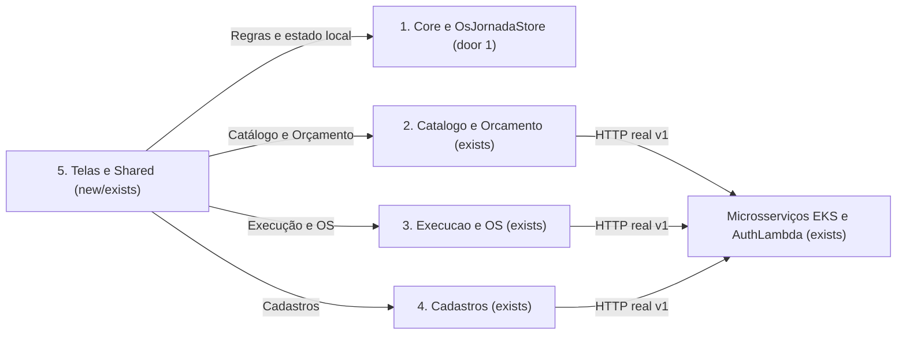

# Fase 4 - Coerência de Negócio, Identidade Visual e Integrações do Web

**Approved**: 2026-11-16 - user: "Aprovo o plano revisado da web-coerencia-negocio com a D-71"

> **Revisão por D-71 (decidida em 16/11 - user: "D-71 use a sua recomendação, passar o orçamentoId e o cliente passa suas próprias infos"):** door 1 e ACs 8, 9, 10, 14, 15, 16 e 17 reescritos abaixo.

**Decisões de origem:** D-70 / AD-075 (escopo 100% Web-only em `submodules/AutoReparos.Web`, remoção de `/consulta-publica`, estrutura de 4 pilares por fatia e extração de componentes reutilizáveis), D-69 / AD-074 (`web-adaptacao` congelada em PASS sobre as rotas em produção), D-03 / AD-028 (frontend isolado em `AutoReparos.Web`).

## Problem

Embora a entrega `web-adaptacao` tenha migrado os prefixos de rota para `/api/v1`, uma auditoria ponta a ponta contra o código em produção dos quatro microsserviços (`OS`, `Cobranca`, `Execucao`, `Cadastros`) e da `AuthLambda` revela que várias chamadas reais ainda falham ou exibem dados quebrados: `POST /api/v1/orcamentos` envia `valor > 0` junto com `itens` e duplica itens do mesmo catálogo (causando `422 orcamento_invalido`), `Servicos` e `Insumos` ignoram `precoUnitario`, `quantidadeDisponivel`, `quantidadeReservada` e `quantidadeInicial` (exibindo preços e saldos zerados e falhando com `422` quando a descrição fica vazia), `POST /api/v1/execucoes/{id}/etapas` é disparado sem `descricao` (`422 etapa_invalida`) enquanto `GET /api/v1/fila-execucao` usa `?mecanicoId=` em vez de `?mecanico=`, `POST /api/v1/veiculos` não coleta `chassi` nem `renavam` (`400`), a máscara `cpfCnpj` aplica regex de CNPJ quando `<= 11` dígitos, `Usuarios` chama `PATCH .../role` inexistente em vez de `PUT /api/v1/usuarios/{id}`, e `/consulta-publica` permanece exposta sem login mesmo sem rota anônima no `OS` (caindo em `401` com redirecionamento para `/login`). Além disso, `OS` não lista ordens em `Recebida` e `Cobranca` não lista orçamentos/pagamentos por OS, deixando o Kanban cego para OS recém-criadas e quebrando o vínculo entre OS, orçamento, aprovação e checkout; visualmente, páginas como Sagas e Aprovação de Orçamento ignoram `<app-page-container>`, badges reutilizáveis e variáveis CSS de `styles.css`, mantendo modais e alertas duplicados com cores hex fixas.

Quando esta entrega estiver pronta, todas as operações reais de ponta a ponta (cadastro de clientes, veículos e usuários, abertura de OS, orçamento com itens, aprovação pelo cliente com CPF e e-mail, execução em fila com diagnóstico/reparo, checkout no Mercado Pago, reembolso, cancelamento e console administrativo de Sagas) funcionarão 100% integradas aos contratos reais dos microsserviços sem mocks, com a jornada conectada pelo navegador, sem a rota inexistente `/consulta-publica`, e com todas as telas centralizadas e padronizadas na identidade visual Deep Charcoal & Vibrant Glow com componentes reutilizáveis.

## Shape

Esta entrega reutiliza `API_ENDPOINTS`, `STATUS_TRATADOS_NA_TELA`, `error-catalog.ts`, `normalizePagedResult`, `styles.css` e todos os componentes de `src/app/shared/components/`, centralizando a lógica de jornada e validação nas camadas `core/` e `features/*/services/` testáveis via Vitest e `HttpTestingController` sem tocar em nenhum microsserviço de backend.

1. `Core` (`api-endpoints.ts`, `error-catalog.ts`, `OsJornadaStore`) (door 1, new) remove endpoints inexistentes, incorpora todos os códigos de erro reais dos 4 serviços e da `AuthLambda`, e persiste o índice local da jornada por `ordemServicoId` em `localStorage`.
2. `Catalogo` (`ServicosPageComponent`, `InsumosPageComponent`, `OrcamentoPageComponent`) (exists) passa a mapear `precoUnitario`, `quantidadeDisponivel`, `quantidadeReservada` e `quantidadeInicial`, enviar `valor: 0` com itens únicos agrupados e exibir botões conforme as policies reais.
3. `Execucao` (`ExecucaoService`, `FilaExecucaoPageComponent`, `OrdemServicoService`) (exists) envia descrição obrigatória em etapas, consulta pelo parâmetro `mecanico` e os 5 valores válidos de `EstadoExecucao`, e exibe etapas, falhas e flag de intervenção.
4. `Cadastros` (`ClientesPageComponent`, `VeiculosPageComponent`, `UsuariosPageComponent`, `MaskDirective`) (exists) coleta chassi e renavam em veículos, corrige a máscara de CPF e CNPJ, usa `PUT` em usuários e remove campos inexistentes.
5. `Telas e Shared` (`ModalDialogComponent`, `AlertBannerComponent`, `OsKanbanPageComponent`, `OsDetalhePageComponent`, `AprovacaoOrcamentoPageComponent`, `PagamentoPageComponent`, `SagasPageComponent`) (new/exists) remove a rota pública removida do backend (door 2), unifica o layout nos tokens CSS e componentes compartilhados, e liga OS, Orçamento, Aprovação e Pagamento via `OsJornadaStore`.

Data: none - esta entrega altera apenas o frontend `AutoReparos.Web` e persiste somente o índice auxiliar de jornada no `localStorage` do navegador (sem tabelas ou migrations).

**Changes underneath**

| Front | What changes |
| --- | --- |
| domain | Modelos de `Servico` (`precoUnitario`), `Insumo` (`quantidadeDisponivel`, `quantidadeReservada`, `quantidadeInicial`), `Veiculo` (`chassi`, `renavam`), `Usuario` (`PUT` com `{ nomeCompleto, tipo }`), `ItemFilaExecucao` (`etapas`, `motivoFalha`, `intervencaoRequerida`) e `RegistroJornadaOs` alinhados 1:1 aos DTOs dos serviços. |
| stored data | Apenas a chave `autoreparos_os_jornada_v1` em `localStorage` no navegador para ligar `osId`, `clienteId`, `veiculoId`, `orcamentoId`, `valorOrcamento` e `pagamentoId` entre telas. |
| readers | Kanban, Detalhe da OS, Orçamento, Aprovação do Cliente, Pagamento, Fila de Execução, Catálogos, Cadastros e Console de Sagas passam a ler os campos reais e compartilhar componentes reutilizáveis. |

## Surface

None - nenhuma rota nova de backend é exposta; o Web consome exclusivamente as rotas já em produção sob `API_URL`, remove a rota Angular `/consulta-publica` (door 2) e substitui `PATCH /api/v1/usuarios/{id}/role` por `PUT /api/v1/usuarios/{id}`:

- **Removida do Angular (`app.routes.ts` e links):** `/consulta-publica` (`ConsultaPublicaPageComponent` removida do router, `navbar`, `home-page` e `login-page`).
- **Corrigidas no consumo HTTP:**
  - `POST /api/v1/orcamentos` (Cobrança): `{ ordemServicoId, clienteId, valor: 0, itens }` com `(tipo, referenciaId)` únicos.
  - `GET/POST /api/v1/servicos` (Execução): lê/envia `precoUnitario`; `descricao` omitida quando vazia.
  - `GET/POST /api/v1/insumos` e `POST /api/v1/insumos/{id}/entradas` (Execução): lê `quantidadeDisponivel`/`quantidadeReservada`, envia `quantidadeInicial` e `precoUnitario` na criação, e `{ quantidade }` na entrada.
  - `GET /api/v1/fila-execucao` e `POST /api/v1/execucoes/{id}/etapas` (Execução): envia `?status=...&mecanico=...` e `{ tipo, descricao }` não vazia.
  - `GET /api/v1/clientes/{id}`, `GET /api/v1/veiculos/{id}`, `GET /api/v1/veiculos?clienteId=`, `POST/PUT /api/v1/veiculos` (`chassi`, `renavam`) e `PUT /api/v1/usuarios/{id}` (`{ nomeCompleto, tipo }`) (Cadastros).

## Landing

| One-way door | Literal shape | Alternative rejected |
| --- | --- | --- |
| 1 - Atalho local de IDs da jornada (`OsJornadaStore`) | `OsJornadaStore` grava só IDs `{ osId, clienteId, veiculoId, orcamentoId, pagamentoId, atualizadoEm }` (sem CPF, e-mail, nome, documento ou valores) na chave `autoreparos_os_jornada_v1` de `STORAGE_TOKEN`, máx. 100 registros, e `AuthService.logout` chama `limpar()`. É atalho opcional do operador naquele navegador, nunca a fonte da verdade: toda tela funciona com o store vazio. | Fazer do `localStorage` a fonte da jornada (D-71: não liga aparelhos diferentes e o `pagamentoId` nasce no aparelho do cliente); criar endpoints de listagem no OS e na Cobrança (viola D-69 / Web-only). |
| 2 - Remoção da tela e rota `/consulta-publica` | Excluir `ConsultaPublicaPageComponent`, a rota `consulta-publica` de `app.routes.ts` e todos os links de navegação que apontam para `/consulta-publica` (`navbar`, `home-page`, `login-page`). | Manter a tela exibindo erro `401` permanente sem rota pública anônima no `AutoReparos.OS` gera experiência quebrada e redirecionamento indevido para `/login`. |

- A lista válida de `EstadoExecucao` no filtro da fila é `['Fila', 'EmExecucao', 'Concluida', 'Falhou', 'Cancelada']`.

## Criteria

Cada fatia (`S1` a `S5`) é estruturada em **4 pilares obrigatórios**: **(1) Código coerente com o projeto** (Angular Standalone, `OnPush`, Signals, `DestroyRef`, árvore `core`/`features`/`shared`), **(2) Identidade Visual e Componentização Reutilizável** (`<app-page-container>` centralizado, variáveis CSS de `styles.css`, badges/selects compartilhados e zero CSS de modal/alerta duplicado), **(3) Integrações reais sem mock** (payloads e responses 1:1 com os microsserviços + `AuthLambda`, testados via `HttpTestingController`) e **(4) Permissões e Cobertura Testada** (botões restritos às policies reais do backend e ≥ 80% de cobertura).

### S1: Identidade visual compartilhada e remoção de consulta pública (P1)

Os componentes visuais duplicados (modais e alertas) são extraídos para `src/app/shared/components/`, todas as páginas adotam os tokens de `styles.css` e `<app-page-container>`, e `/consulta-publica` é removida.

**Acceptance Criteria**

1. **[Pilar 1 + 2 - Código e Identidade Visual]** WHEN qualquer tela de cadastro ou operação abrir um modal (`clientes`, `veiculos`, `usuarios`, `insumos`, `servicos`) ou exibir um banner de erro/sucesso/estado vazio (`sagas`, `pagamento`, `aprovacao-orcamento`, `fila-execucao`, `os-nova`, `os-detalhe`) THEN SHALL reutilizar `ModalDialogComponent` (`<app-modal-dialog>`) e `AlertBannerComponent` (`<app-alert-banner>`) de `src/app/shared/components/`, centralizados em `<app-page-container>` e estilizados exclusivamente com variáveis CSS de `styles.css` (`--primary`, `--bg-surface`, `--bg-card`, `--glass-bg`, `--border-color`, `--border-pink`, `--text-main`, `--text-muted`), sem estilos `.modal-backdrop`/`.modal-card` duplicados nem cores hex `#ED145B`/`#18181C` hardcoded nos novos/alterados.
2. **[Pilar 1 + 2 - Sagas e Aprovação no padrão]** WHEN o usuário abrir `/sagas` ou `/aprovar-orcamento` THEN `SagasPageComponent` e `AprovacaoOrcamentoPageComponent` SHALL renderizar dentro de `<app-page-container>` utilizando `<app-id-badge>`, `<app-status-badge>`, `<app-custom-select>` e `<app-loading-spinner>` em vez de `
`, `<select>` nativo ou `` avulso.
3. **[Pilar 1 + 3 - Remoção de `/consulta-publica`]** WHEN o router ou qualquer template (`app.routes.ts`, `navbar.component.ts`, `home-page.component.ts`, `login-page.component.ts`) carregar THEN SHALL não conter a rota `consulta-publica`, `ConsultaPublicaPageComponent`, nem links para `/consulta-publica` (door 2).

### S2: Contratos reais de Catálogo, Estoque e Orçamento (P1)

Os serviços, insumos e orçamento falam o JSON exato da Execução e da Cobrança e respeitam as policies de autorização na UI.

**Acceptance Criteria**

4. **[Pilar 3 - Serviços]** WHEN `ServicoService` listar ou cadastrar serviços em `/api/v1/servicos` THEN SHALL mapear `precoUnitario` no GET, enviar `{ nome, precoUnitario }` (incluindo `descricao` somente quando `descricao.trim()` for não vazia) no POST, e exibir o valor correto (ex.: `precoUnitario: 150` → `R$ 150,00`, nunca `R$ 0,00` por ignorar `precoUnitario`).
5. **[Pilar 3 - Insumos]** WHEN `InsumoService` listar, cadastrar ou registrar entrada em `/api/v1/insumos` THEN SHALL ler `quantidadeDisponivel`, `quantidadeReservada` e `precoUnitario` no GET/entrada, enviar `{ nome, precoUnitario, quantidadeInicial }` (omitindo `descricao` quando vazia) no POST de criação, e enviar `{ quantidade }` em `POST /api/v1/insumos/{id}/entradas`.
6. **[Pilar 4 - Permissões em Catálogo e Estoque]** WHERE o usuário autenticado não for `Administrador` THEN `ServicosPageComponent` e `InsumosPageComponent` SHALL ocultar os botões `+ Serviço` e `+ Insumo`; WHERE o usuário não for `Administrador` nem `Atendente` (`Mecanico`) THEN `InsumosPageComponent` SHALL ocultar o botão de registrar entrada de estoque.
7. **[Pilar 3 - Orçamento sem `422 orcamento_invalido`]** WHEN `OrcamentoPageComponent` enviar `POST /api/v1/orcamentos` THEN SHALL suportar dois modos: no modo padrão com itens, agrupar itens com o mesmo `(tipo, referenciaId)` somando suas quantidades (permitindo editar a quantidade na lista), exibir o total calculado no cliente e enviar `valor: 0` com `itens` sem duplicidades; no modo avulso (sem itens), enviar `valor > 0` com até 2 casas decimais e `itens` omitido (`undefined`).

### S3: Fila de Execução, Etapas e Estados Reais (P1)

A fila de execução envia descrição obrigatória em etapas, aplica os filtros aceitos pela Execução e exibe o histórico de etapas e falhas.

**Acceptance Criteria**

8. **[Pilar 3 - Descrição em Etapas]** WHEN o mecânico ou administrador acionar registrar etapa (`Diagnostico` ou `Reparo`) em `FilaExecucaoPageComponent` THEN SHALL enviar `{ tipo, descricao }` com `descricao` não vazia para `POST /api/v1/execucoes/{id}/etapas`, lendo de um campo editável no card da execução ou aplicando o fallback padrão (`"Diagnóstico técnico realizado"` / `"Reparo executado"`) se o campo estiver em branco, e a UI SHALL indicar quando a descrição registrada foi a automática.
9. **[Pilar 2 + 3 - Filtros e Exibição da Fila]** WHEN `FilaExecucaoPageComponent` filtrar a fila THEN SHALL usar `<app-custom-select>` restrito aos 5 valores válidos de `EstadoExecucao` (`Fila`, `EmExecucao`, `Concluida`, `Falhou`, `Cancelada`) e enviar o query param `?mecanico=` (nunca `?mecanicoId=`), rotulado como "Etapas registradas por" porque a Execução filtra pelo responsável das etapas e não por atribuição, exibindo nos cards `<app-id-badge>`, `<app-status-badge>`, a lista de `etapas` já registradas no formato real (`sequencia`, `tipo`, `descricao`, `responsavel`, `registradaEm`), `motivoFalha` e indicador visual quando `intervencaoRequerida` for `true`.
10. **[Pilar 3 - Execução Concluída/Cancelada na OS]** WHEN `OrdemServicoService.obterExecucao` consultar `GET /api/v1/fila-execucao` para o Detalhe da OS THEN SHALL enviar `status=Fila,EmExecucao,Concluida,Falhou,Cancelada`, não enviar `ordemServicoId` (a Execução ignora o parâmetro) e escolher só o item com `ordemServicoId` igual ao da OS; e `listarFilaExecucao` (Kanban) SHALL manter o padrão do backend (sem `status`: `Fila`, `EmExecucao`, `Falhou`), sem baixar o histórico concluído a cada carga; WHEN a Execução responder `403` (perfil `Atendente`, fora de `OperarExecucao`) THEN o Detalhe da OS e o Kanban SHALL mostrar "sem acesso à execução" sem notificação de erro.

### S4: Cadastros (`Veículos`, `Clientes`, `Usuários` e `MaskDirective`) (P2)

Os cadastros do `AutoReparos.Cadastros` enviam e editam os campos aceitos pelo backend e a máscara de CPF/CNPJ formata ambos os documentos.

**Acceptance Criteria**

11. **[Pilar 3 - Veículos com `chassi` e `renavam`]** WHEN o operador abrir o modal de novo veículo em `VeiculosPageComponent` THEN SHALL exigir `chassi` (17 caracteres alfanuméricos) e `renavam` (11 dígitos numéricos) e enviá-los em `POST /api/v1/veiculos`; WHEN editar veículo existente THEN SHALL manter `clienteId`, `placa`, `chassi` e `renavam` somente leitura no modal e enviar `{ marca, modelo, anoFabricacao, anoModelo }` em `PUT /api/v1/veiculos/{id}`.
12. **[Pilar 1 + 3 - Nova OS por cliente]** WHEN o atendente escolher um cliente em `OsNovaPageComponent` THEN SHALL consultar `GET /api/v1/veiculos?clienteId={id}` (em `VeiculoService.getByClienteId`) para carregar os veículos reais do cliente selecionado.
13. **[Pilar 1 + 3 - Clientes e Máscara `cpfCnpj`]** WHEN `MaskDirective` com `appMask="cpfCnpj"` receber entrada THEN SHALL formatar até 11 dígitos como CPF (`000.000.000-00`) e de 12 a 14 dígitos como CNPJ (`00.000.000/0000-00`); e `ClientesPageComponent` SHALL não exibir nem enviar campo `endereco` inexistente no backend e SHALL manter `documento` somente leitura ao editar cliente existente.
14. **[Pilar 1 + 3 - Usuários via `PUT`]** WHEN o administrador editar um usuário em `UsuariosPageComponent` THEN SHALL enviar `PUT /api/v1/usuarios/{id}` com `{ nomeCompleto, tipo }` (`tipo` numérico: `1` Administrador, `2` Atendente, `3` Mecanico, pois o Cadastros não usa `JsonStringEnumConverter`) e `API_ENDPOINTS.USUARIOS` SHALL não conter a rota inexistente `ROLE` (`PATCH .../role`).

### S5: Jornada Conectada (`OsJornadaStore`) e Catálogo Completo de Erros (P1)

O Kanban enxerga OS recém-criadas (`Recebida`), o detalhe da OS exibe cliente/veículo reais e liga Orçamento ↔ Aprovação ↔ Pagamento, e todos os erros dos serviços são traduzidos.

**Acceptance Criteria**

15. **[Pilar 1 + 3 - Atalho `OsJornadaStore`, Kanban e Seletores]** WHEN uma OS for criada (`OsNovaPageComponent`) ou consultada (`OsDetalhePageComponent`), ou um orçamento for criado (`OrcamentoPageComponent`) THEN `OsJornadaStore` SHALL gravar só IDs (door 1) e `AuthService.logout` SHALL limpá-lo; `OsKanbanPageComponent` SHALL combinar `fila-execucao` (Mecânico e Administrador), `admin/sagas` (Administrador) e os `osId` do atalho revalidados por `GET /api/v1/ordens-servico/{id}`, mostrando OS `Recebida` do atalho também ao `Atendente` e tratando o `403` da fila como no AC 10; `OrcamentoPageComponent` e `PagamentoPageComponent` SHALL oferecer `<app-custom-select>` com as OS do atalho, sempre com input manual de UUID; e WHERE o usuário for `Administrador` THEN o Detalhe da OS SHALL obter o `orcamentoId` de `GET /api/v1/admin/sagas/{osId}` quando o atalho não o tiver.
16. **[Pilar 2 + 3 - Detalhe da OS e Aprovação pelo Cliente]** WHEN o operador abrir `OsDetalhePageComponent` THEN SHALL resolver e exibir o nome/documento do cliente (`GET /api/v1/clientes/{clienteId}`) com `<app-documento-badge>` e o modelo/placa do veículo (`GET /api/v1/veiculos/{veiculoId}`) com `<app-placa-badge>`, com fallback para os IDs se a consulta falhar, e mostrar o link `/aprovar-orcamento?orcamentoId={id}` (só o `orcamentoId`; nunca `cpf`, `email` ou outro dado pessoal em query param) e `/pagamentos/{pagamentoId}` quando conhecido; WHEN o cliente abrir `/aprovar-orcamento` THEN `AprovacaoOrcamentoPageComponent` SHALL pré-preencher só o `orcamentoId`, exigir que o cliente digite o próprio CPF e e-mail, ignorar `cpf`/`email` em query params, guardar o JWT de `Cliente` só em memória e não gravar nada no `OsJornadaStore`; e WHEN a aprovação devolver `pagamentoId` THEN SHALL exibir "Iniciar checkout", tratando `409 checkout_indisponivel` com a orientação de voltar após a conclusão do serviço e informar CPF e e-mail de novo.
17. **[Pilar 3 - Catálogo completo de erros e `AuthLambda`]** WHEN `errorInterceptor` ou `AprovacaoOrcamentoPageComponent` receber qualquer erro HTTP dos 4 serviços ou da `AuthLambda` (incluindo `400`, `401`, `403`, `404`, `409`, `422`, `503`) THEN `error-catalog.ts` SHALL mapear todos os códigos de domínio emitidos por `OS`, `Cobranca` e `Execucao` (`orcamento_invalido`, `item_catalogo_inexistente`, `transicao_invalida`, `checkout_indisponivel`, `reembolso_invalido`, `reembolso_recusado_provedor`, `reembolso_indisponivel`, `conflito_concorrencia`, `etapa_invalida`, `conclusao_invalida`, `falha_invalida`, `reexecucao_invalida`, `servico_invalido`, `insumo_invalido`, `entrada_invalida`, `insumo_nao_encontrado`, `ordem_servico_invalida`, `cliente_nao_encontrado`, `veiculo_nao_encontrado`, `veiculo_de_outro_cliente`, `cadastros_indisponivel`, `execucao_nao_encontrada`, `execucao_estado_invalido`, `filtro_invalido`, `cancelamento_indisponivel`, `ordem_servico_conflito`, `saga_em_andamento`, `retentativa_indisponivel`, `dependencia_indisponivel`) e ler `e.error?.detalhe` além de `codigo`/`mensagem`; o campo `erro` da `AuthLambda` é mensagem legível e SHALL ser tratado como detalhe, nunca como código.
18. **[Pilar 4 - Qualidade e Cobertura]** WHEN `yarn test --watch=false --coverage` e `yarn build` rodarem em `submodules/AutoReparos.Web` THEN SHALL passar sem flags extras em Node 25+, com cobertura de linhas ≥ 80% sobre os arquivos novos ou alterados, `scripts/specs/assert_web_coerencia.py` validando remoção de `/consulta-publica`, identidade visual (sem CSS de modal duplicado ou `#ED145B` hardcoded nos alterados) e contratos reais, mantendo `assert_web_adaptacao.py` (`proxy`, `node`) verde.

## Out of scope

| Excluded | Why |
| --- | --- |
| Alterar rotas, DTOs ou migrations em `AutoReparos.OS`, `AutoReparos.Cobranca`, `AutoReparos.Execucao`, `AutoReparos.Cadastros` ou `AutoReparos.AuthLambda` | Escopo 100% Web-only definido pelo usuário (D-69 / D-70). |
| Reprocessamento de DLQ na UI (`/api/v1/admin/dlq/reprocessar`) | O mesmo path repete nos três serviços e não possui prefixo dedicado no API Gateway/Ingress/Nginx. |
| Autenticação de cliente PJ (CNPJ) na `AuthLambda` | `CpfValidationService` na `AuthLambda` aceita apenas CPF de 11 dígitos; fora do escopo Web-only. |

## Assumptions

| Assumption | Chosen default | Rationale | Confirmed? |
| --- | --- | --- | --- |
| Remoção de `/consulta-publica` | Remover rota, componente e links no Web | `GET /api/v1/ordens-servico/{id}` exige JWT de operador (`OperarOS`) e não há consulta pública anônima no backend | y - user: "se consulta publica já foi removida do backend então vamos tirar do front também" |
| Escopo Web-only | Alterar somente `submodules/AutoReparos.Web` (e `.specs/` / `scripts/specs/`) | Serviços C# já implantados e verificados no EKS | y - user: "Sim estamos falando agora de Web-only" |
| Estrutura dos 4 pilares por fatia e extração de `ModalDialogComponent` / `AlertBannerComponent` | Cada fatia cobre Código, Identidade Visual, Integrações e Permissões/Testes | Solicitação explícita do usuário | y - user: "Pode adicionar todos estes pontos que você mencionou no plano" |
| Orçamento com itens vs. valor avulso | Suportar ambos: padrão com itens (`valor: 0`, quantidades editáveis, agrupamento único) e alternância para valor avulso (`valor > 0`, sem `itens`) | Cobre ambos os caminhos aceitos pela Cobrança (com e sem reserva de insumos na Saga) | y - user: "(Recommended) Suportar ambos" |
| Checkout pelo cliente | Habilitar "Iniciar checkout" direto em `/aprovar-orcamento` após aprovação (e em `/pagamentos`) usando o JWT do Cliente | `Cobranca` já aceita `IsInRole("Cliente")` em `POST /api/v1/pagamentos/{id}/checkout` | y - user: "(Recommended) Sim, habilitar 'Iniciar checkout' direto na tela de Aprovação" |
| Link de aprovação e dados do cliente | Link só com `orcamentoId`; cliente digita CPF e e-mail; `OsJornadaStore` só com IDs, atalho opcional limpo no logout; Administrador usa `admin/sagas/{osId}`; `403` da fila vira "sem acesso" para o Atendente | Impede o operador de aprovar como o cliente e não depende do `localStorage` como fonte (D-71) | y - user: "D-71 use a sua recomendação, passar o orçamentoId e o cliente passa suas próprias infos" |
| Seleção de OS/pagamento em `/orcamentos/novo` e `/pagamentos` | Exibir `<app-custom-select>` alimentado pelo `OsJornadaStore` além do input manual de UUID como fallback | Evita copiar/colar UUIDs quando o operador navega pelo menu lateral | y - user: "(Recommended) Sim, exibir seletor rápido (<app-custom-select>)" |
| Descrição padrão ao registrar etapa | Campo de descrição editável por item na fila; se deixado em branco ao clicar em Diagnóstico/Reparo, aplica fallback padrão (`"Diagnóstico técnico realizado"` / `"Reparo executado"`) | Evita `422 etapa_invalida` mantendo registro em 1 clique ou texto customizado | y - user: "(Recommended) Campo de descrição editável por item na fila" |

**Open questions:** none - todas as decisões de escopo, identidade visual e remoção de `/consulta-publica` foram confirmadas pelo usuário.

## Differences from the source

| Source shows | Product shows | Confirmed |
| --- | --- | --- |
| `web-adaptacao` (`consulta-publica-page.component.ts` e rota `/consulta-publica`) | Removida do frontend (`app.routes.ts`, `navbar`, `home-page`, `login-page`) porque não existe endpoint anônimo no `AutoReparos.OS` | y - AD-075 |

## Sources

- Código-fonte real dos microsserviços em `submodules/AutoReparos.OS`, `submodules/AutoReparos.Cobranca`, `submodules/AutoReparos.Execucao`, `submodules/AutoReparos.Cadastros` e `submodules/AutoReparos.AuthLambda` — binding para todos os contratos HTTP e códigos de erro.
- Sistema de design e componentes compartilhados em `submodules/AutoReparos.Web/src/styles.css` e `submodules/AutoReparos.Web/src/app/shared/components/` — binding para identidade visual e reutilização.
- [Separação de microsserviços § 5, Etapa 5](../especificacao/microsservicos/fase4_spec_separacao_microsservicos.md#etapa-5--frontend-d-03) — estrutura e papéis das telas.
- [Plano `web-adaptacao`](../web-adaptacao/plan.md) — entrega anterior congelada em PASS sobre a qual esta evolução atua.
