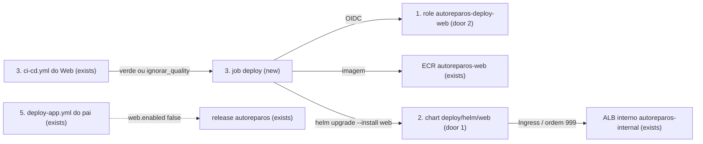

# Fase 4 - Deploy próprio do Web

**Approved**: 2026-11-17 - user: "Aprovo o plano do web-deploy com a D-72"

**Decisões de origem:** D-72 / AD-077 (Web com pipeline de deploy próprio, chart no próprio repositório, quality corrigido com escape; muda a D-45), D-45 / AD-048 (pai implantava o Web no release guarda-chuva), D-43 e D-60 (chart por repositório e escape `ignorar_quality` do Cadastros), D-61 (trust nas duas formas do `sub` do OIDC), D-03 / AD-028 (frontend isolado em `AutoReparos.Web`).

## Problem

O `AutoReparos.Web` não se implanta sozinho. O `ci-cd.yml` dele tem só `build`, `test` e `quality`, sem job `deploy`. O repositório não tem Environment `production`, role OIDC nem variáveis da AWS. Quem publica o Web é o `deploy-app.yml` do pai, que monta a imagem a partir do submódulo e roda `helm upgrade autoreparos` sobre o chart guarda-chuva do `AutoReparos.Infra.K8s`, junto com a observabilidade (D-45). Por isso, um merge na `main` do Web não chega à produção: alguém precisa disparar o pipeline do pai, e esse pipeline também mexe na Lambda e na observabilidade, que nada têm a ver com a mudança. O Ingress catch-all `/` do Web (`autoreparos-web-ingress`, `group.order: 1000`) também é do release do pai.

Além disso, o job `quality` do Web está vermelho desde 12/11 (run `43251757645`, `sonar-scanner` com código de saída 3). A causa não foi confirmada e o log daquela execução não está mais disponível. Enquanto ele estiver vermelho, nenhum deploy que dependa dele roda.

Quando esta entrega estiver pronta, um push na `main` do Web, ou um disparo manual na `main`, monta a imagem, publica no ECR `autoreparos-web` e implanta o release `web` no namespace `web` do EKS pelo próprio repositório, como já acontece com OS, Cobrança, Execução e Cadastros. O pai deixa de implantar o Web, e o `quality` volta a ficar verde ou tem o mesmo escape do Cadastros.

## Shape

A entrega repete o padrão dos 4 serviços (`deploy-servicos`): chart no repositório, role OIDC por repositório criada pela plataforma e job `deploy` atrás do Environment `production`. O Web não tem Terraform próprio: não cria fila, banco nem role IRSA, e o ECR `autoreparos-web` continua no `stacks/base`.

1. `Plataforma` (`AutoReparos.Infra.K8s/terraform/stacks/base`) (exists): ganha o namespace `web`, a role `autoreparos-deploy-web` (door 2) com política própria e mínima e o acesso de edição no EKS limitado ao namespace `web`.
2. `Chart do Web` (`AutoReparos.Web/deploy/helm/web`) (new): leva `Deployment`, `Service` e o Ingress catch-all, que hoje estão no subchart `web` e em `k8s/templates/ingress.yaml` do Infra.K8s (door 1).
3. `Pipeline do Web` (`AutoReparos.Web/.github/workflows/ci-cd.yml`) (exists): ganha `workflow_dispatch` com `ignorar_quality` e o job `deploy` (imagem → ECR → `helm upgrade --install web` → rollout → `GET /` 200).
4. `Quality do Web` (`sonar-project.properties`, configuração do SonarCloud) (exists): causa do código 3 diagnosticada e corrigida.
5. `Pai e guarda-chuva` (`.github/workflows/deploy-app.yml`, `destroy-aws.yml`, `k8s/Chart.yaml`, `values*.yaml`) (exists): o subchart `web` passa a ter `condition: web.enabled`, desligado em produção; o `deploy-app.yml` deixa de montar e implantar o Web; o `destroy-aws.yml` desinstala também o release `web`.

Data: none - não há tabela, migration nem segredo novo; o Web continua sem estado no servidor.

**Changes underneath**

| Front | What changes |
| --- | --- |
| domain | Nada; a aplicação Angular, o `Dockerfile`, o `nginx.conf` e o `docker-entrypoint.sh` não mudam. |
| stored data | Nada. |
| readers | O ALB interno passa a encaminhar `/` ao Service `autoreparos-web` do namespace `web`; o `nginx` do Web envia traces ao collector pelo nome completo `autoreparos-otel-collector.autoreparos.svc.cluster.local`. |

## Surface

None - nenhuma rota HTTP nova. Mudam só o pipeline e a infraestrutura:

- **GitHub (`AutoReparos.Web`):** Environment `production` com as variáveis `AWS_ROLE_ARN` (`arn:aws:iam::198903849859:role/autoreparos-deploy-web`) e `EKS_CLUSTER_NAME` (`AutoReparosEKS`); `workflow_dispatch` com o input booleano `ignorar_quality` (padrão `false`).
- **AWS/EKS:** role `autoreparos-deploy-web`, namespace `web`, release Helm `web`, Ingress `autoreparos-web-ingress` no namespace `web`.

## Landing

| One-way door | Literal shape | Alternative rejected |
| --- | --- | --- |
| 1 - Dono da rota catch-all `/` | O Ingress `autoreparos-web-ingress` do release `web` (namespace `web`) entra no grupo `autoreparos-internal` com `group.order: "999"`, antes do 1000 do guarda-chuva. Ele assume o `/` sem janela fora do ar e só depois o pai desliga o subchart (`web.enabled: false`). Para voltar atrás, basta religar `web.enabled` e desinstalar o release `web`. | Desligar o Web no pai antes do primeiro deploy próprio (minutos fora do ar); fazer o job do Web atualizar o release `autoreparos` com `--reuse-values` (o Web passaria a depender do chart de outro repositório e ganharia permissão sobre a observabilidade; recusado pelo usuário). |
| 2 - Role de deploy do Web | `autoreparos-deploy-web` no `stacks/base`, com trust só em `repo:Grupo78-PosTech-15SOAT/AutoReparos.Web:environment:production` e na forma imutável `repo:Grupo78-PosTech-15SOAT@<org_id>/AutoReparos.Web@1454153026:environment:production` (D-61). A política `deploy-web.json.tftpl` dá `ecr:GetAuthorizationToken`, `ecr:*` só em `repository/autoreparos-web` e `eks:DescribeCluster` só no cluster. O acesso no EKS é `AmazonEKSEditPolicy` com escopo no namespace `web`. | Reusar `deploy-servico.json.tftpl` com `servico = web`: daria SQS, SNS, DynamoDB, Secrets Manager e criação de role IRSA que o Web não usa. |

## Criteria

### S1: Acesso de deploy na plataforma (P1)

**Acceptance Criteria**

1. WHEN o `stacks/base` do `AutoReparos.Infra.K8s` for aplicado THEN SHALL existir o namespace `web` (rótulo `app.kubernetes.io/part-of: autoreparos`), a role `autoreparos-deploy-web` com o trust nas duas formas do `sub` da door 2 e `github_repo_ids.web = "1454153026"`, e o acesso `AmazonEKSEditPolicy` com escopo só no namespace `web`.
2. The política da role `autoreparos-deploy-web` SHALL conter só `ecr:GetAuthorizationToken` (`*`), `ecr:*` em `arn:aws:ecr:us-east-1:198903849859:repository/autoreparos-web` e `eks:DescribeCluster` no cluster `AutoReparosEKS`; IF a role tentar qualquer ação em SQS, SNS, DynamoDB, Secrets Manager ou IAM THEN a AWS SHALL negar.

### S2: Chart próprio do Web (P1)

**Acceptance Criteria**

3. The chart `deploy/helm/web` do `AutoReparos.Web` SHALL renderizar o `Deployment` e o `Service` `autoreparos-web` (porta 80 → 8080 do container) e o Ingress `autoreparos-web-ingress` com `group.name: autoreparos-internal`, `group.order: "999"`, `scheme: internal`, `target-type: ip`, `healthcheck-path: /` e caminho `/` `Prefix`, com `helm lint` e `helm template` sem erro.
4. The chart SHALL definir `OTEL_COLLECTOR_HOST` como `autoreparos-otel-collector.autoreparos.svc.cluster.local` e `API_URL` vazio (URLs relativas atrás do ALB), além de `image.pullPolicy: Always` e os mesmos `resources` de hoje (requests `50m`/`64Mi`, limits `250m`/`128Mi`).

### S3: Pipeline de deploy do Web (P1)

**Acceptance Criteria**

5. WHEN houver push na `main` do Web com `build`, `test` e `quality` verdes THEN o job `deploy` SHALL rodar no Environment `production`, assumir `vars.AWS_ROLE_ARN` por OIDC (`id-token: write`), montar a imagem pelo `Dockerfile` com tag igual a `github.sha`, publicar em `autoreparos-web`, rodar `helm upgrade --install web deploy/helm/web --namespace web --atomic --wait --timeout 10m` e confirmar `kubectl rollout status deployment/autoreparos-web -n web`.
6. WHEN o rollout terminar THEN o job SHALL fazer `GET /` no Service `autoreparos-web` por `port-forward` e falhar se a resposta não for `200` em até 15 tentativas.
7. WHEN o disparo for `workflow_dispatch` na `main` com `ignorar_quality: true` THEN o `deploy` SHALL rodar mesmo com o `quality` vermelho; IF `build` ou `test` estiverem vermelhos, ou a ref não for `main`, THEN o `deploy` SHALL ser pulado (igual ao Cadastros, D-60).
8. The job `deploy` SHALL usar `concurrency: deploy-web-production` sem cancelar o deploy em andamento, e um push na `develop` ou um PR SHALL rodar só `build` e `test`, nunca o `deploy`.

### S4: Quality verde (P2)

**Acceptance Criteria**

9. WHEN o `quality` rodar num PR para a `main` ou num push na `main` THEN SHALL terminar verde. A causa do código 3 do run `43251757645` fica registrada no handoff, seja quality gate reprovado (cobertura ou duplicação do código novo) ou conflito com a Automatic Analysis do SonarCloud, e é corrigida na configuração ou no código, sem baixar o quality gate da organização.

### S5: Pai deixa de implantar o Web (P1)

**Acceptance Criteria**

10. WHEN o `.github/workflows/deploy-app.yml` do pai rodar THEN SHALL não montar nem publicar a imagem do Web e SHALL implantar o release `autoreparos` com `web.enabled: false`, sem `kubectl rollout status deployment/autoreparos-web`; o subchart `web` e o `submodules/AutoReparos.Infra.K8s/k8s/templates/ingress.yaml` do guarda-chuva SHALL só renderizar com `web.enabled: true`.
11. WHEN o `.github/workflows/destroy-aws.yml` rodar THEN SHALL desinstalar também o release `web` do namespace `web` e apagar os Ingress dele antes de esperar o fim dos load balancers.
12. WHEN a migração terminar THEN o ALB interno SHALL encaminhar `/` ao namespace `web`, sem nenhum Ingress `autoreparos-web-ingress` no namespace `autoreparos`, e a ordem de execução SHALL ser: (a) `stacks/base` aplicado; (b) Environment `production` do Web configurado; (c) primeiro deploy do Web; (d) pai com `web.enabled: false`.

## Out of scope

| Excluded | Why |
| --- | --- |
| Proteção da `main` do Web e regra de aprovação do Environment `production` | Entra amanhã junto com os outros 4 repositórios, antes do vídeo (usuário). |
| Terraform próprio no repositório do Web | O Web não tem fila, banco, segredo nem IRSA; o ECR `autoreparos-web` continua no `stacks/base`. |
| Mudanças na aplicação Angular, no `Dockerfile`, no `nginx.conf` ou no `docker-entrypoint.sh` | A feature `web-coerencia-negocio` mexe em `src/` em paralelo; esta entrega só toca em `.github/`, `deploy/` e `sonar-project.properties`. |
| Chaves estáticas da AWS (`AWS_ACCESS_KEY_ID`/`AWS_SECRET_ACCESS_KEY`) nos Environments `copilot` do Infra.K8s e do Infra.Database | Risco anotado para depois da entrega: conferir a conta e revogar. Não é deste repositório. |
| Deploy automatizado da `AuthLambda` | Continua pelo pai (D-45). |

## Assumptions

| Assumption | Chosen default | Rationale | Confirmed? |
| --- | --- | --- | --- |
| Onde fica o chart do Web | `deploy/helm/web` no repositório do Web, release `web`, namespace `web`, role `autoreparos-deploy-web` | Mesmo padrão dos 4 serviços (D-43, ADR-005) | y - user: "Chart próprio no Web (Recommended)" |
| Quality vermelho | Diagnosticar e corrigir a causa, mais o escape `workflow_dispatch` com `ignorar_quality` igual ao Cadastros | Não trava o deploy na entrega e não esconde a causa | y - user: "Corrigir e ter escape (Recommended)" |
| Proteção da `main` | Fora desta spec, feita amanhã com os outros repositórios | Já estava prevista | y - user: "Fica para amanhã (Recommended)" |
| Troca sem janela fora do ar | Ingress novo com `group.order: "999"` assume o `/` antes de o pai desligar o subchart | O AWS Load Balancer Controller avalia primeiro a menor ordem do grupo | n |
| Namespace da observabilidade | `autoreparos` (`vars.K8S_NAMESPACE` do pai), sem NetworkPolicy no chart da observabilidade que bloqueie o namespace `web` | Lido do Environment `production` do pai e dos templates do subchart | n |
| Configuração do Environment do Web | Feita por `gh api` (Environment `production` e as 2 variáveis), com confirmação do usuário antes de rodar | É uma mudança no GitHub fora do código | n |

**Open questions:** none.

## Differences from the source

| Source shows | Product shows | Confirmed |
| --- | --- | --- |
| D-45: o pai implanta o Web no release guarda-chuva | O Web se implanta pelo próprio `ci-cd.yml`; o pai fica com a plataforma, a observabilidade e a `AuthLambda` | y - AD-077 |

## Sources

- [Plano `deploy-servicos`](../deploy-servicos/plan.md) - padrão do job `deploy`, da role OIDC e do chart por repositório (binding).
- [CI/CD § 4](../especificacao/cicd/fase4_spec_cicd_e_protecao_de_branches.md#4-proposta-a-validar) - pipeline por repositório.
- [ADR-005](../../../../docs/architecture/ADR-005-deploy-independente-por-microsservico.md) - deploy independente por repositório.
- Código atual: `submodules/AutoReparos.Infra.K8s/terraform/stacks/base/servicos.tf`, `k8s/charts/web/`, `k8s/templates/ingress.yaml`, `.github/workflows/deploy-app.yml` e `destroy-aws.yml` do pai, `submodules/AutoReparos.Cadastros/.github/workflows/ci-cd.yml` (job `deploy`) e `submodules/AutoReparos.Web/.github/workflows/ci-cd.yml` (binding para o estado atual).
