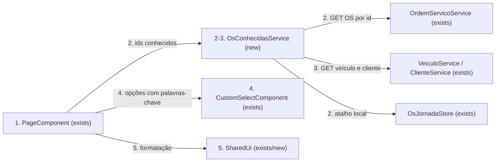
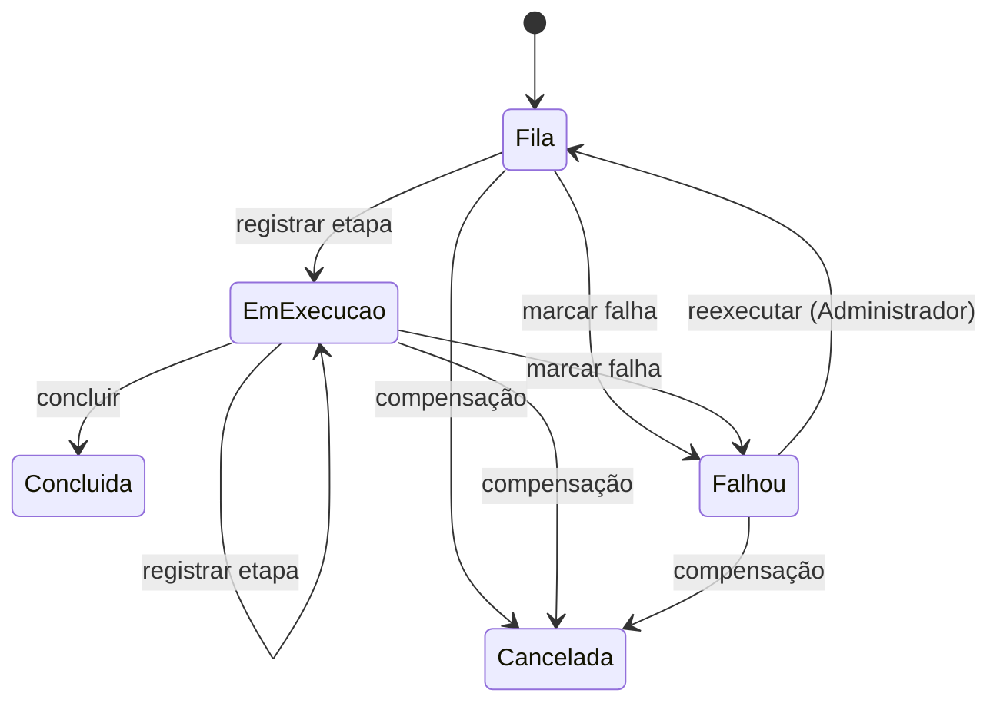

# Fase 4 - Polimento de UI do Web

**Approved**: 2026-11-17 - user: "Sim, aprovar junto (Recomendado)"

**Decisões de origem:** D-75 / AD-080 (polimento de UI 100% Web-only, drawer da Saga, placa e modelo na Fila e no Kanban), D-70 / AD-075 (identidade visual e componentes compartilhados), D-71 / AD-076 (`OsJornadaStore` só com ids, sem dados pessoais em URL).

## Problem

As telas operacionais do `AutoReparos.Web` atrapalham quem usa a oficina. No console de Sagas os filtros ficam desalinhados (o `.form-group` global tem `margin-bottom: 1.25rem` e o botão ao lado não), o campo "Parada há" é um `<input>` sem estilo, o botão "Ver detalhe" usa `btn-sm`, que não existe, e o detalhe ocupa metade da grade e cresce sem limite, gerando rolagem na página toda. As datas saem em en-US (`date:'short'` sem `LOCALE_ID`) e as dos registros, comandos e etapas nem aparecem. GUIDs inteiros ocupam a tela em Sagas, Fila e Aprovação. Estados como `AguardandoInsumos` e `Falhou` aparecem crus e em cinza. Na Fila de Execução cada card mostra cinco botões sólidos lado a lado, inclusive para estados em que a Execução recusa a ação. No Orçamento, o seletor de OS lista só `OS xxxxxxxx...`, não deixa digitar código, placa ou modelo, e o dropdown fica por baixo dos cards seguintes (o `backdrop-filter` do `.card-panel` cria um contexto de empilhamento por card), que também capturam a rolagem; o mesmo vale para o Pagamento e para selects dentro de modais. No menu, "Fila Kanban" e "Ordens de Serviço" levam à mesma tela. Valores em R$ saem com separadores en-US, `--accent-green` não existe e o botão "Aprovar Orçamento" fica transparente. Evidência: relato do José em 17/11 e leitura do código (`sagas-page.component.ts:52,117,219`, `styles.css:146,159`, `orcamento-page.component.ts:34-44`, `navbar.component.ts:58-65`).

Quando esta entrega estiver pronta, o operador filtra e lê Sagas, Fila e Kanban sem rolagem inútil, identifica cada OS pela placa e pelo modelo, escolhe a OS do orçamento digitando código, placa ou modelo, vê ids curtos copiáveis, datas e valores em pt-BR, e encontra um único item "Ordens de Serviço" no menu.

## Shape

Reaproveita `styles.css`, `app-drawer` (hoje sem uso), `app-custom-select`, `app-id-badge`, `app-status-badge`, `app-placa-badge`, `app-documento-badge`, `OrdemServicoService`, `VeiculoService`, `ClienteService` e `OsJornadaStore`, sem backend novo. As regras que mudam o que o usuário vê (formatação de data e moeda, rótulos de estado, busca por palavras-chave, agregação e ordenação das OS conhecidas, ações por estado da Execução) ficam em utilitários, serviços e componentes cobertos pelo Vitest.

1. operador abre uma tela -> `PageComponent` (exists) - pede dados aos serviços de feature e monta filtros na `.filter-bar`
2. `OsConhecidasService` (new) - junta ids de `OsJornadaStore` (exists), `OrdemServicoService.listarSagasAdmin` (exists, só Administrador) e `listarFilaExecucao` (exists, 403 vira lista vazia), deduplica e busca cada OS por id
3. `OsConhecidasService` (new) - busca `VeiculoService.getById` e `ClienteService.getById` (exists) com cache por id e devolve `OsEnriquecida` (código, status, placa, modelo, marca, cliente)
4. `CustomSelectComponent` (exists) - filtra opções por rótulo, descrição e palavras-chave e desenha o painel anexado ao `document.body`
5. out: tela formatada por `SharedUi` (exists/new): id-badge, data-hora, moeda e rótulos de estado

Data: none - nada novo é persistido; o `OsJornadaStore` continua só com ids no `localStorage` e o cache de veículos e clientes vive só em memória.

**Changes underneath**

| Front | What changes |
| --- | --- |
| domain | `getStatusOsInfo` passa a reconhecer também os estados de Saga e de Execução (rótulo pt-BR e classe); `STATUS_OS` continua com os 7 status, lidos pelas colunas do Kanban |
| stored data | nada a migrar |
| readers | Sagas, Fila de Execução, Orçamento, Pagamento, Kanban, Detalhe da OS, Home, Navbar, Aprovação, Clientes, Veículos, Usuários, Insumos, Serviços e Nova OS |

## Surface

None - nenhuma rota de backend nova ou alterada; o Web segue consumindo só as rotas já em produção (`GET /api/v1/ordens-servico/{id}`, `GET /api/v1/admin/sagas`, `GET /api/v1/fila-execucao`, `GET /api/v1/{veiculos,clientes}/{id}`).

## Landing

| One-way door | Literal shape | Alternative rejected |
| --- | --- | --- |
| None | - | - |

- Nothing else in this change is hard to reverse: são estilos, componentes e serviços de leitura no frontend, sem contrato consumido por terceiros nem dado persistido novo

## Criteria

### S1: Fundação compartilhada (P1)

Ids, datas, moeda, estados, botões e o seletor se comportam igual em todas as telas.

**Acceptance Criteria**

1. The `app-id-badge` SHALL show `#` followed by the first 8 characters of the id and carry the full id in its `title`
   - `3f2a9c1e-...` → `#3f2a9c1e`; id with 6 characters → shown whole
2. WHEN the operator clicks the copy button of an `app-id-badge` THEN the system SHALL write the full id to the clipboard and show "Copiado" for 1,5 s
3. The `formatarDataHora` utility in mode `relativo` SHALL return "agora" under 1 minute, "há N min" under 1 hour, "há N h" under 24 hours, `dd/MM HH:mm` from 24 hours in the same year and `dd/MM/yyyy HH:mm` in another year
   - 30 s → "agora"; 5 min → "há 5 min"; 3 h → "há 3 h"; 2 days, same year → "15/11 14:32"; 2025 → "16/11/2025 14:32"
4. IF the date is empty or invalid THEN `formatarDataHora` SHALL return "—"
5. The `moeda` pipe SHALL format numbers as BRL in pt-BR and return "—" for a non-numeric value
   - 1234.5 → "R$ 1.234,50"; 0 → "R$ 0,00"; null → "—"
6. The `getStatusOsInfo` function SHALL return a pt-BR label and a non-fallback class for each of the 10 Saga states and the 5 Execução states, and `STATUS_OS` SHALL keep exactly 7 statuses
   - `AguardandoInsumos` → "Aguardando insumos"; `Falhou` → "Falhou" com `status-falha`; `Fila` → "Na fila"
7. WHERE `buscaSempre` is set the `app-custom-select` SHALL show the search field with any number of options and match the typed text against label, description and keywords, ignoring case and accents
   - "abc1d23" acha a opção com palavra-chave "ABC-1D23"; "gol" acha "Gol 1.0"; "joao" acha "João"
8. WHEN the `app-custom-select` opens THEN the system SHALL attach the panel to `document.body`, and WHEN the operator clicks outside the trigger and the panel THEN the system SHALL close it
9. WHEN the `app-custom-select` is destroyed while open THEN the system SHALL remove the panel from `document.body`
10. The global stylesheet SHALL define `.btn-ghost`, `.btn-sm`, `.btn-icon`, `.filter-bar` with `.form-group` at `margin-bottom: 0`, the tokens `--accent-green`, `--accent-red`, `--accent-cyan` and `--accent-yellow`, and SHALL NOT apply `backdrop-filter` to `.card-panel`
11. The `OsConhecidasService` SHALL return the deduplicated union of the ids from `OsJornadaStore`, the Administrador's Sagas and the execution queue, each enriched with placa, modelo, marca and cliente
12. IF the execution queue answers 403 or an OS answers 404 THEN the `OsConhecidasService` SHALL ignore that source or OS and return the rest
13. IF a veículo or cliente lookup fails THEN the `OsConhecidasService` SHALL return the OS with those fields empty
14. WHEN two OS share the same veículo THEN the `OsConhecidasService` SHALL request that veículo only once

### S2: Console de Sagas (P1)

Filtros alinhados e detalhe num drawer com rolagem própria.

**Acceptance Criteria**

15. The Sagas page SHALL offer the "Parada há" filter as a select with "Qualquer tempo", "15 min", "1 h", "6 h" and "24 h", and the Estado filter with pt-BR labels
16. WHEN the operator picks "1 h" and clicks "Atualizar" THEN the system SHALL request the Sagas with `paradaHaMinutos=60`
17. The Sagas table SHALL show each row with the short OS id, the state label and the relative update time
18. WHEN the operator clicks "Detalhes" on a row THEN the system SHALL open a side drawer with the OS, the state and the tabs "Etapas", "Comandos" and "Registros", showing "Etapas" first
19. WHEN the operator clicks the "Registros" tab THEN the system SHALL list each record with its formatted `em`, event and description
20. WHEN the operator closes the drawer THEN the system SHALL hide it and keep the table
21. WHILE the drawer shows a Saga in `AguardandoInsumos` the system SHALL show the retry block, and SHALL NOT show it for other states

### S3: Fila de Execução (P1)

Cada card mostra o veículo e só as ações que a Execução aceita.

**Acceptance Criteria**

22. WHEN the veículo of an execution resolves THEN the card SHALL show its placa and modelo
23. IF the veículo lookup fails THEN the card SHALL show the short OS id without breaking
24. The card actions SHALL follow the execution state
    - `Fila`: etapas e "Reportar falha", sem "Concluir"; `EmExecucao`: etapas, "Concluir" e "Reportar falha"; `Falhou`: só "Reexecutar" para Administrador; `Concluida` e `Cancelada`: nenhuma ação
25. WHEN the operator clicks "Reportar falha" THEN the system SHALL show the motivo field and "Confirmar falha", disabled while the motivo is empty
26. The card SHALL show each recorded step with its type label, description, responsável and formatted `registradaEm`

### S4: Orçamento e Pagamento (P1)

A OS é escolhida digitando código, placa ou modelo.

**Acceptance Criteria**

27. The Orçamento OS selector SHALL list the known OS with code, placa and modelo in the label and cliente and state in the description, `Recebida` first
28. WHEN the operator types a placa without mask or a modelo THEN the selector SHALL show only the matching OS
29. WHEN the operator pastes a full UUID that is not in the list THEN the selector SHALL offer "Usar OS #<8 caracteres>", and WHEN chosen THEN the system SHALL load that OS and select it
30. IF the pasted OS answers 404 THEN the system SHALL show "OS não encontrada para o código informado."
31. WHEN an OS is selected THEN the system SHALL fill the cliente from the OS, show the cliente name and the veículo placa and modelo, and send that `clienteId` on "Enviar Orçamento"
32. WHEN the page opens with `ordemServicoId` in the route or query THEN the system SHALL preselect that OS
33. The Orçamento and Pagamento pages SHALL show money with the `moeda` format
34. The Pagamento checkout button SHALL read "Abrir checkout" without the URL in its text

### S5: Navegação, Kanban, Detalhe e Home (P1)

Um único caminho para as Ordens de Serviço.

**Acceptance Criteria**

35. The navbar SHALL have exactly one item for the OS area, labelled "Ordens de Serviço", pointing to `/ordens-servico`, and no item labelled "Fila Kanban"
36. WHILE the URL is `/ordens-servico/<id>` the navbar SHALL mark "Ordens de Serviço" as active
37. The Kanban page SHALL be titled "Ordens de Serviço" and each card SHALL show placa and modelo when the veículo resolves and a "Detalhes" link to `/ordens-servico/<id>`
38. The OS detail SHALL show the back link "Ordens de Serviço" and the execution state with its pt-BR label
39. The Home page SHALL NOT show the word "Kanban" in its links and SHALL point its OS links to `/ordens-servico`

### S6: Consistência das demais telas (P2)

As demais telas usam o mesmo sistema visual.

**Acceptance Criteria**

40. The Clientes, Veículos and Usuários tables SHALL show row actions as icon buttons with `aria-label` "Editar <nome>" and "Excluir <nome>" and SHALL NOT use solid `btn-danger` in rows
41. The feature components SHALL NOT redefine `.btn-sm`, `.form-control`, `.form-group`, `.form-label` or `.card-panel` locally, nor use `number:'1.2-2'` for money
42. The Aprovação page SHALL use the global `btn-success` and `btn-primary` and show the `pagamentoId` in a copyable `app-id-badge`
43. The Nova OS veículo options SHALL include the placa in the label

## Out of scope

| Excluded | Why |
| --- | --- |
| Listagem de OS no backend e busca de OS por placa no servidor | O José pediu só Web; o OS expõe apenas `GET /api/v1/ordens-servico/{id}` |
| Tela de listagem de Ordens de Serviço separada do quadro | Sem listagem no backend; o item duplicado sai do menu |
| Migrar o modal próprio de Usuários para `app-modal-dialog` | Fora do pedido; o painel do select já escapa de qualquer modal |
| Paginação de Insumos e Serviços | Catálogo pequeno (seed de 5) e sem paginação no backend |

## Assumptions

| Assumption | Chosen default | Rationale | Confirmed? |
| --- | --- | --- | --- |
| Botão "Ordens de Serviço" que leva ao Kanban | Remover o item duplicado e manter um só, apontando para o quadro | José: "conserte ou remova de acordo com a necessidade" - user delegated | y |
| Detalhe da Saga | Drawer lateral com abas | José: "Drawer lateral (Recomendado)" | y |
| Placa e modelo fora do seletor | Também na Fila e no Kanban | José: "Fila e Kanban também (Recomendado)" | y |
| OS que o seletor conhece | Atalho local, Sagas (Administrador) e fila de execução | Única fonte sem backend novo | y |
| Larguras de tela | Desktop a partir de 1280 px e o layout atual de celular do navbar | Mesmas larguras das entregas anteriores | n |

**Open questions:** none - all resolved or logged above.

## Differences from the source

None - the product matches the source

## Sources

- Relato do José em 17/11 na sessão - binding - lista de problemas de Sagas, Fila, Orçamento, botões e item "Ordens de Serviço"
- [Índice da Fase 4, D-75](../especificacao/index.md) - binding - escopo e decisões
- [Separação § 5](../especificacao/microsservicos/fase4_spec_separacao_microsservicos.md#etapa-5--frontend-d-03) - binding - frontend isolado no `AutoReparos.Web`
