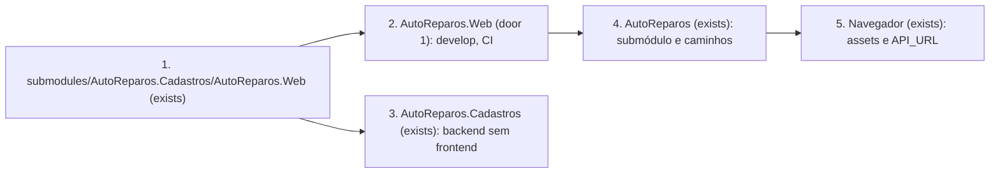

# Fase 4 - Extração da aplicação Web

**Approved**: 2026-11-11 - user: "Aprovo o plano web"

**Decisões de origem:** D-03 / AD-028 (extração agora, `develop` no Web, sem novas APIs ou telas nesta etapa); D-13 / AD-016 (cada repositório mantém seu pipeline); D-25 / AD-026 (`main` protegida com `build`, `test` e `quality`).

## Problem

A aplicação Angular 22 continua dentro do repositório Cadastros, enquanto `AutoReparos.Web` contém apenas um README. O build do frontend depende de caminhos do Cadastros em workflows, scripts e Compose, e o repositório Web não consegue compilar nem testar sua própria aplicação. Quem trabalha ou entrega o frontend precisa continuar alterando o repositório de backend.

Ao final desta etapa, a aplicação existente será desenvolvida na `develop` de `AutoReparos.Web`, compilada e servida a partir desse repositório e consumida pelo pai como submódulo. O comportamento das telas e os contratos HTTP existentes não mudam nesta extração.

## Shape

Esta entrega move o projeto Angular existente sem recriá-lo; as regras de interface e a configuração de URL em tempo de execução permanecem no próprio frontend. Os checks de integridade da migração e dos caminhos rodam nos repositórios Web, Cadastros e pai.

1. O projeto em `submodules/AutoReparos.Cadastros/AutoReparos.Web` (exists) fornece código, assets, `yarn.lock`, Dockerfile e configuração Nginx para a raiz de `submodules/AutoReparos.Web` na nova branch `develop` (door 1).
2. `AutoReparos.Web` (door 1) compila e testa o Angular por comandos na própria raiz; seu workflow de CI (new) expõe `build`, `test` e `quality` conforme D-25, sem incluir credenciais no Git.
3. `AutoReparos.Cadastros` (exists) remove a cópia do frontend e as etapas de CI e Compose que dependem dela; o backend continua com seus próprios comandos.
4. `AutoReparos` pai (exists) fixa o novo commit do submódulo Web e atualiza Compose, workflows e scripts que montam ou publicam a imagem Web para apontar para `submodules/AutoReparos.Web`.
5. O navegador (exists) recebe os mesmos assets e usa `API_URL` na inicialização da imagem; as rotas Angular e os paths HTTP atuais permanecem como estão.

**Changes underneath**

| Front | What changes |
| --- | --- |
| ownership | O código Angular deixa o Cadastros e passa à raiz de `AutoReparos.Web` em `develop`; `main` do Web continua sob fluxo de PR. |
| build e deploy local | O contexto Docker, os workflows e os scripts passam a ler o submódulo Web, mantendo a injeção de `API_URL` e o caminho real de saída do Angular no Dockerfile. |
| readers | Desenvolvedores, CI do Web, CI do pai, Compose, scripts de imagem e README passam a usar a nova origem; rotas do navegador e paths de API não mudam. |
| stored data | Nenhum dado de negócio, banco ou migração é alterado. |

Data: none - esta etapa move código e configuração de build, sem alterar dados persistidos.

## Surface

None - nenhuma rota pública ou assinatura de API é criada ou alterada; a aplicação conserva as rotas Angular e os paths HTTP atuais.

## Landing

| One-way door | Literal shape | Alternative rejected |
| --- | --- | --- |
| 1 - propriedade e branch do frontend | `AutoReparos.Web` mantém o projeto Angular na raiz da branch `develop`, criada a partir da `main` inicial `91a1aa1`; o pai registra `branch = develop` em `.gitmodules` e fixa o commit dessa branch; a pasta `AutoReparos.Web` deixa de existir no Cadastros. | Manter uma cópia no Cadastros deixaria dois donos e builds divergentes; colocar o projeto só na `main` evitaria o fluxo de revisão decidido em D-25. |

- Nada mais nesta etapa é difícil de reverter.

## Criteria

### S1: Fonte única da aplicação (P1)

O Web passa a ter o código Angular completo; o Cadastros deixa de hospedá-lo.

**Acceptance Criteria**

1. WHEN a branch `develop` de `AutoReparos.Web` for criada a partir de `91a1aa1` THEN ela SHALL conter na raiz todos os arquivos rastreados do projeto Angular de `AutoReparos.Cadastros/AutoReparos.Web` em `3d71ba8`, salvo alterações documentadas de caminho, CI e README; `main` SHALL conservar o fluxo de PR.
2. WHEN o Cadastros for atualizado THEN `AutoReparos.Cadastros/AutoReparos.Web` SHALL deixar de existir como cópia rastreada, e seu workflow e Compose SHALL deixar de referenciar essa pasta.
3. WHEN o pai inicializar os submódulos recursivamente THEN `submodules/AutoReparos.Web` SHALL apontar para um commit de `origin/develop`, e `.gitmodules` SHALL declarar `branch = develop` para esse submódulo.

### S2: Build e execução a partir do Web (P1)

O projeto e a imagem rodam no novo repositório com a configuração de URL existente.

**Acceptance Criteria**

4. WHEN `yarn install --frozen-lockfile`, `yarn build` e `yarn test --watch=false` forem executados na raiz de `AutoReparos.Web` THEN cada comando SHALL sair com código 0, usando o `yarn.lock` migrado.
5. WHEN a imagem Docker do Web for construída a partir da raiz do novo repositório THEN ela SHALL conter o `index.html` gerado pelo Angular e servir `/` e `/login` por Nginx com resposta HTTP 200.
6. WHEN a imagem Web iniciar com `API_URL` definido THEN `env.js` SHALL expor exatamente esse valor para `window.__env.apiUrl`; sem valor, SHALL preservar o padrão já documentado pelo projeto.
7. WHEN o workflow do Web rodar em PR para `main` ou push em `develop` e `main` THEN SHALL oferecer jobs `build`, `test` e `quality`, usar o projeto da raiz e ler `SONAR_TOKEN` somente de secrets do GitHub.

### S3: Integração sem caminhos obsoletos (P1)

Os consumidores do projeto usam sua nova localização, mantendo explícito o trabalho funcional posterior.

**Acceptance Criteria**

8. WHEN o Compose, os workflows e os scripts ativos do pai compilarem ou publicarem Web THEN SHALL usar `submodules/AutoReparos.Web` como contexto/caminho, sem depender de `submodules/AutoReparos.Cadastros/AutoReparos.Web`.
9. WHEN o workflow do Cadastros rodar após a extração THEN SHALL compilar e testar apenas o backend; nenhuma etapa SHALL depender de arquivos Angular removidos.
10. WHEN a extração for concluída THEN o README do Web SHALL documentar `yarn install --frozen-lockfile`, `yarn build`, `yarn test --watch=false`, `API_URL`, a branch `develop` e a pendência de adaptar os paths HTTP legados às novas APIs.

## Out of scope

| Excluded | Why |
| --- | --- |
| Adaptar os paths legados de `api-endpoints.ts` às APIs de OS, Cobrança, Execução e Cadastros | O usuário escolheu somente a extração e a integração do repositório nesta etapa; os contratos dos serviços estão em evolução. |
| Criar ou redesenhar telas de orçamento, pagamento, fila, histórico da OS e console de Sagas | Fica para a etapa funcional posterior descrita na spec transversal § 5; a extração preserva as telas existentes. |
| Configurar o projeto SonarCloud, cadastrar `SONAR_TOKEN`, proteger `main` e implantar no EKS | Governança e deploy pertencem a `infra-ci-observabilidade`; o Web entregará o workflow pronto para consumir o secret. |
| Renomear a pasta de spec da OS | É uma organização de especificações histórica, sem relação técnica com a migração do Angular. |

## Assumptions

| Assumption | Chosen default | Rationale | Confirmed? |
| --- | --- | --- | --- |
| Escopo desta etapa | Extrair e integrar o repositório; não adaptar APIs nem criar telas novas agora | Resposta à pergunta de escopo nesta conversa | y - user: "Extração e integração do repositório (recomendado)" |
| Nome interno do projeto Angular | Preservar `app-temp` nesta migração | Evita alterar o diretório `dist/app-temp/browser` usado pelo Dockerfile sem ganho funcional | n |
| URL da API | Preservar `API_URL` como única URL base em tempo de execução | Configuração atual já injeta `window.__env.apiUrl`; D-03 prevê uma URL base | n |

**Open questions:** none - o escopo da etapa foi confirmado pelo usuário.

## Differences from the source

None - não foi fornecida captura ou design visual; as telas existentes não mudam nesta etapa.

## Sources

- [D-03 no índice da Fase 4](../especificacao/index.md#61-decididas) - decisão de extrair o Web agora e delimitar a etapa.
- [Separação de microsserviços § 4.2 e § 5](../especificacao/microsservicos/fase4_spec_separacao_microsservicos.md#42-repositórios) - repositório alvo e desenho transversal do frontend.
- [CI/CD § 4.3](../especificacao/cicd/fase4_spec_cicd_e_protecao_de_branches.md#43-proteção-de-branches) - jobs e proteção da `main`.
- `submodules/AutoReparos.Cadastros/AutoReparos.Web` em `3d71ba8` - aplicação Angular existente (fonte da migração).
- `submodules/AutoReparos.Web` em `91a1aa1` - repositório destino fornecido pelo usuário, atualmente só com README.
