# AutoReparos — Plataforma de Oficina Mecânica em Microsserviços

<p align="center">
  
  
  
  
  
  
  
  
  
  
</p>

Este é o **repositório pai (umbrella)** do **AutoReparos**, sistema de gestão de oficina mecânica desenvolvido no **Tech Challenge da Pós-Tech em Software Architecture (SOAT) da FIAP**. Ele reúne, como submódulos Git, os quatro microsserviços, o frontend, a função serverless de autenticação e os repositórios de infraestrutura, além da documentação de arquitetura, das especificações e dos workflows que provisionam a plataforma compartilhada na AWS.

Na **Fase 4**, a aplicação foi refatorada para **microsserviços independentes** — cada um com repositório, banco de dados, infraestrutura e pipeline de CI/CD próprios — e o ciclo de vida da ordem de serviço passou a ser coordenado por uma **Saga orquestrada** com compensações em caso de falha.

> **Ambiente em produção:** `https://8afyzjqfk2.execute-api.us-east-1.amazonaws.com` (API Gateway, região `us-east-1`, cluster EKS `AutoReparosEKS`).

---

## Sumário

1. [Visão geral da Fase 4](#1-visão-geral-da-fase-4)
2. [Evolução das entregas: o que cada fase deixou no projeto](#2-evolução-das-entregas-o-que-cada-fase-deixou-no-projeto)
   - [Fase 1 — DDD e Clean Architecture](#fase-1--ddd-e-clean-architecture)
   - [Fase 2 — Kubernetes, Terraform e CI/CD](#fase-2--kubernetes-terraform-e-cicd)
   - [Fase 3 — Lambda, banco gerenciado, gateway e monitoramento](#fase-3--lambda-banco-gerenciado-gateway-e-monitoramento)
   - [Fase 4 — Microsserviços e Saga](#fase-4--microsserviços-e-saga)
3. [Requisitos da Fase 4 e onde estão atendidos](#3-requisitos-da-fase-4-e-onde-estão-atendidos)
4. [Repositórios](#4-repositórios)
5. [Arquitetura final](#5-arquitetura-final)
6. [Divisão dos microsserviços](#6-divisão-dos-microsserviços)
7. [Bancos de dados](#7-bancos-de-dados)
8. [Comunicação entre microsserviços](#8-comunicação-entre-microsserviços)
9. [Saga Pattern](#9-saga-pattern)
10. [Autenticação e autorização](#10-autenticação-e-autorização)
11. [Observabilidade](#11-observabilidade)
12. [Testes e qualidade](#12-testes-e-qualidade)
13. [CI/CD e deploy](#13-cicd-e-deploy)
14. [Infraestrutura na AWS](#14-infraestrutura-na-aws)
15. [Execução local](#15-execução-local)
16. [Documentação da API (Swagger e Postman)](#16-documentação-da-api-swagger-e-postman)
17. [Documentação técnica e especificações](#17-documentação-técnica-e-especificações)
18. [Entregáveis e links](#18-entregáveis-e-links)
19. [Integrantes do grupo](#19-integrantes-do-grupo)

---

## 1. Visão geral da Fase 4

A oficina passou a operar em escala nacional, com várias filiais. O monólito das fases anteriores foi dividido em serviços especializados para que atendimento, diagnóstico, execução e cobrança evoluam, escalem e falhem de forma isolada.

| Antes (Fases 1 a 3) | Agora (Fase 4) |
| --- | --- |
| Uma API .NET (`AutoReparos.App`) com todo o domínio e um banco PostgreSQL | Quatro microsserviços .NET 10, cada um com banco próprio |
| Transições da OS em uma única transação local | **Saga orquestrada** pelo OS, com estado no **DynamoDB** e compensações em ordem inversa |
| Chamadas internas em memória | REST só onde a resposta precisa ser imediata; **SQS com DLQ** e **SNS** para comandos e eventos |
| Pagamento fora do sistema | **Mercado Pago Checkout Pro** com webhook de assinatura validada |
| Um pipeline e um deploy para tudo | **Um pipeline por microsserviço**: build, testes, cobertura ≥ 80%, SonarCloud e deploy no EKS com aprovação |

> **Evolução:** o DDD da Fase 1, o Kubernetes e o Terraform da Fase 2 e a Lambda e o monitoramento da Fase 3 continuam no código, adaptados aos microsserviços. A [§ 2](#2-evolução-das-entregas-o-que-cada-fase-deixou-no-projeto) mostra, fase por fase, o que foi entregue e onde está hoje.

Fluxo de negócio coberto de ponta a ponta:

```mermaid
flowchart LR
    A(["🧾 Abertura da OS"]) --> B(["💰 Orçamento"])
    B --> C(["✅ Aprovação do cliente"])
    C --> D(["📦 Reserva de insumos"])
    D --> E(["🔧 Diagnóstico e reparo"])
    E --> F(["🏁 Conclusão"])
    F --> G(["💳 Pagamento Mercado Pago"])
    G --> H(["🚗 OS paga"])

    classDef os fill:#dbeafe,stroke:#2563eb,color:#1e3a8a
    classDef cob fill:#fef3c7,stroke:#d97706,color:#78350f
    classDef exe fill:#dcfce7,stroke:#16a34a,color:#14532d
    class A,H os
    class B,C,G cob
    class D,E,F exe
```

<sub>Cores: azul = OS · amarelo = Cobrança · verde = Execução.</sub>

---

## 2. Evolução das entregas: o que cada fase deixou no projeto

O AutoReparos foi construído em quatro entregas. Cada fase acrescentou uma camada e o que foi entregue antes continua no código de hoje, adaptado aos microsserviços. Esta seção mostra, fase por fase, o que foi pedido, o que foi feito e onde está agora.

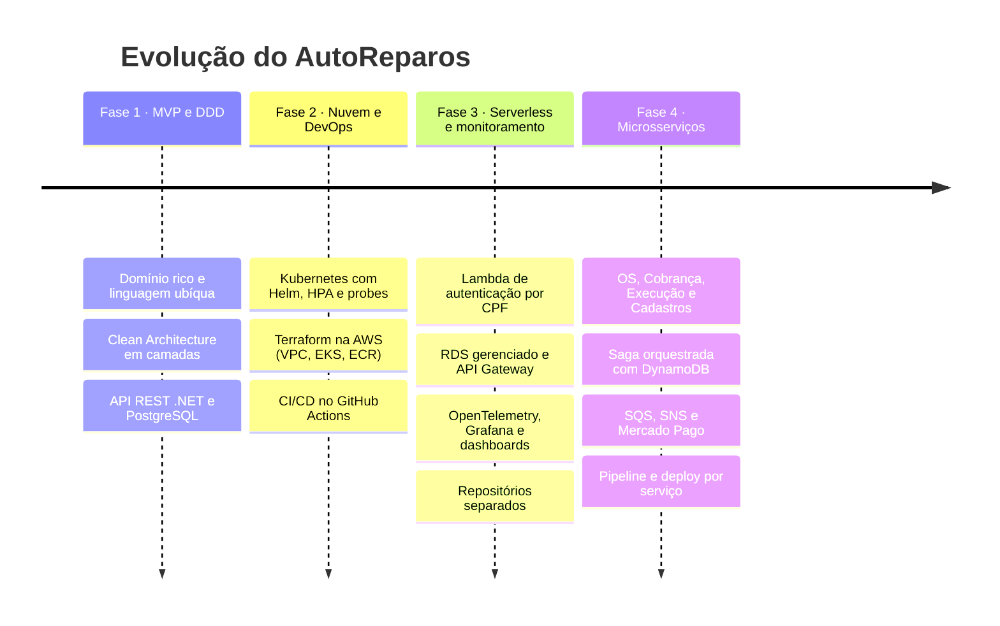

| Fase | Pedido no enunciado | Onde está hoje |
| --- | --- | --- |
| **1 — MVP e DDD** | Modelagem DDD, API REST, persistência relacional | Domínio de cada microsserviço (`*.Domain`), value objects do Cadastros, Clean Architecture nos quatro serviços |
| **2 — Nuvem e DevOps** | Kubernetes escalável, IaC, CI/CD, observabilidade | Charts Helm com HPA e probes em cada serviço, Terraform no Infra.K8s e em cada serviço, `ci-cd.yml` por repositório |
| **3 — Serverless e monitoramento** | Lambda de autenticação, banco gerenciado, gateway, dashboards, multi-repo | AuthLambda, Infra.Database (RDS), API Gateway no Infra.K8s, chart de observabilidade, 8 repositórios |
| **4 — Microsserviços** | 3+ serviços, Saga, mensageria, BDD, 80% de cobertura, deploy independente | Seções [5](#5-arquitetura-final) a [13](#13-cicd-e-deploy) deste README |

### Fase 1 — DDD e Clean Architecture

**O que foi pedido:** modelar o domínio da oficina com DDD (Event Storming, linguagem ubíqua, bounded contexts), construir a API e persistir em banco relacional.

**O que continua no código:** os bounded contexts levantados na Fase 1 viraram os microsserviços da Fase 4. Cada um tem seu próprio modelo de domínio, sem compartilhar entidades com os outros.

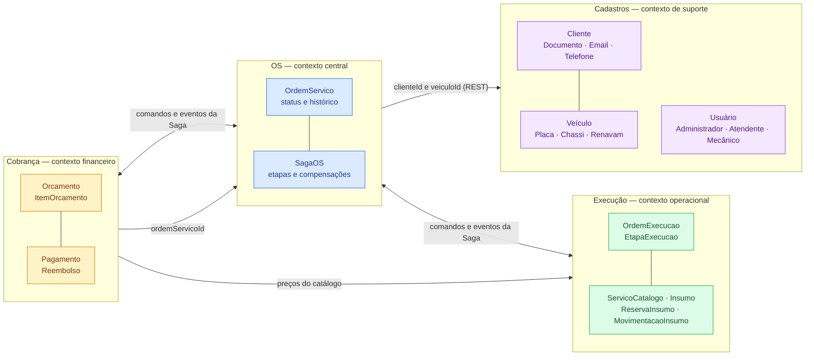

Os contextos só se conhecem por identificadores (`clienteId`, `veiculoId`, `ordemServicoId`, `orcamentoId`) e por contratos de mensagem; nenhum serviço importa entidades de outro.

| Conceito de DDD | Onde está no código |
| --- | --- |
| **Value objects** com validação embutida | No Cadastros: `Documento` (CPF e CNPJ com dígitos verificadores de módulo 11), `Placa` (padrão antigo e Mercosul), `Chassi`, `Renavam`, `Email` e `Telefone` |
| **Entidades com invariantes** | `Cliente`, `Veiculo` e `Usuario` (Cadastros); `OrdemServico` e `SagaOS` (OS); `Orcamento`, `Pagamento` e `Reembolso` (Cobrança); `OrdemExecucao`, `Insumo` e `ReservaInsumo` (Execução) |
| **Máquinas de estado no domínio** | `EstadoSaga` e `StatusOS` (OS), `StatusOrcamento` e `StatusPagamento` (Cobrança), `EstadoExecucao` e `StatusReserva` (Execução); transição inválida gera exceção de domínio |
| **Exceções de domínio** | `DomainException` e exceções específicas (`InvalidDocumentoException`, `InvalidPlacaException`, `DuplicatedPlacaException`, `TransicaoInvalidaException`) |
| **Repositórios como interfaces do domínio** | `IClienteRepository`, `IVeiculoRepository`, `IUsuarioRepository` no Cadastros, implementados na `Infrastructure` com EF Core |
| **Linguagem ubíqua** | Código, rotas, eventos e filas em português (`ordem-servico.liberada.v1`, `insumos.reservados.v1`), registrados no [Miro](https://miro.com/app/board/uXjVGw2wAXY=/?share_link_id=246372446405) |

**Clean Architecture**, igual nos quatro serviços:

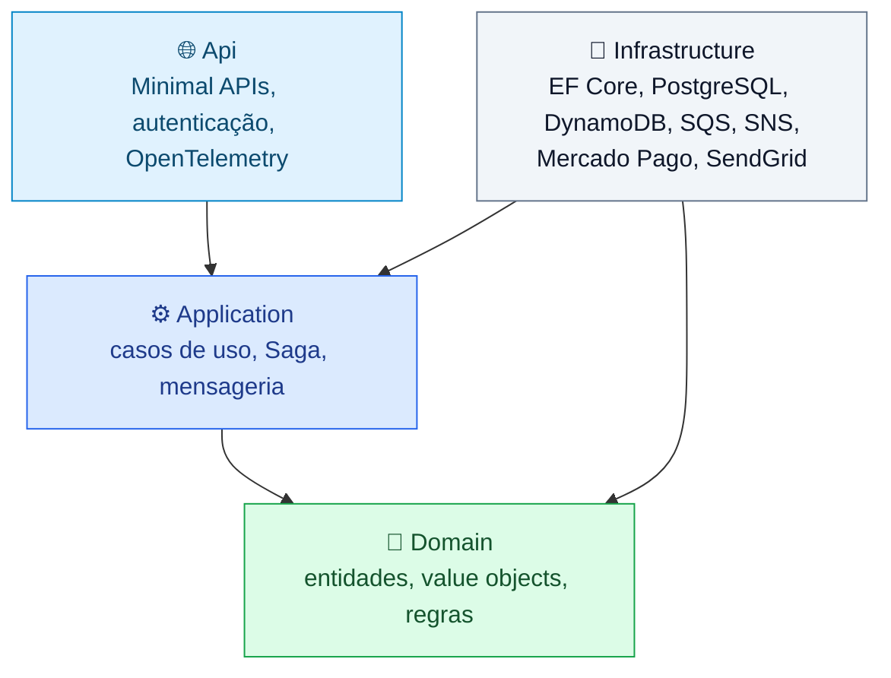

O `Domain` não depende de nenhum framework; a `Infrastructure` implementa as portas definidas nas camadas internas. Os testes de domínio e aplicação da Fase 1 (xUnit, FluentAssertions e NSubstitute) seguem no Cadastros e o mesmo padrão foi usado nos serviços novos.

| Na Fase 1 | Na Fase 4 |
| --- | --- |
| Um domínio único na `AutoReparos.App` | Quatro domínios, um por microsserviço |
| Estoque de peças dentro da OS | Insumos na Execução, com reserva em duas fases (reservar, confirmar ou cancelar) |
| Aprovação do orçamento por link enviado por e-mail | Aprovação pelo cliente autenticado (`POST /api/v1/orcamentos/{id}/aprovacao` com a claim `clienteId`) |

### Fase 2 — Kubernetes, Terraform e CI/CD

**O que foi pedido:** levar a aplicação para a nuvem com escalabilidade automática, infraestrutura como código, pipeline de CI/CD e observabilidade.

**O que continua no código:** o Terraform e os charts Helm da Fase 2 evoluíram para o modelo da Fase 4 — a plataforma no Infra.K8s e um chart e um Terraform em cada microsserviço.

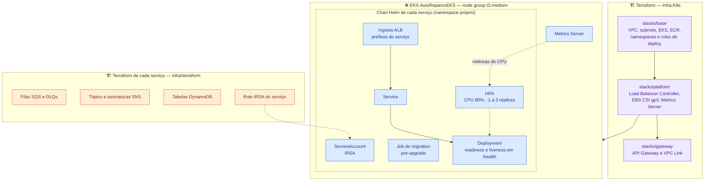

| Entrega da Fase 2 | Onde está hoje |
| --- | --- |
| **HPA** | `templates/hpa.yaml` em cada chart (OS, Cobrança, Execução, Cadastros), com alvo de CPU de 80%; o Metrics Server é instalado pelo `stacks/platform` |
| **Probes** | `readinessProbe` e `livenessProbe` em `GET /health` no `deployment.yaml` de cada serviço |
| **Helm** | `deploy/helm/<servico>` em cada repositório; `helm upgrade --atomic` volta a versão anterior se o rollout falhar |
| **Ingress** | Nginx na Fase 2; hoje ALB interno pelo AWS Load Balancer Controller, com um `IngressGroup` compartilhado e prefixos por serviço |
| **Terraform** | Módulos `vpc`, `eks`, `ecr`, `addons` e `apigateway` no Infra.K8s; state remoto no S3 com lock no DynamoDB, criado pelo `bootstrap` |
| **CI/CD no GitHub Actions** | De um pipeline único para um `ci-cd.yml` por serviço, com build, testes, SonarCloud e deploy ([§ 13](#13-cicd-e-deploy)) |
| **Segurança no cluster** | Um namespace por serviço, IRSA (role AWS por ServiceAccount) e `NetworkPolicy` no Cadastros |
| **Frontend Angular** | `AutoReparos.Web` com standalone components e signals, agora com repositório e deploy próprios |

### Fase 3 — Lambda, banco gerenciado, gateway e monitoramento

**O que foi pedido:** autenticar o cliente por CPF com uma função serverless, usar banco gerenciado, expor tudo por um API Gateway, separar os repositórios e criar dashboards de monitoramento.

**O que continua no código:**

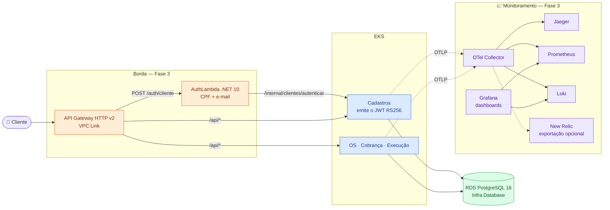

| Entrega da Fase 3 | Onde está hoje |
| --- | --- |
| **Lambda de autenticação** | [AutoReparos.AuthLambda](https://github.com/Grupo78-PosTech-15SOAT/AutoReparos.AuthLambda) atende `POST /auth/cliente`. Na Fase 4 ela deixou de consultar o banco: chama o endpoint interno do Cadastros, que valida o cliente e emite o JWT |
| **Banco gerenciado** | RDS PostgreSQL 16 do [Infra.Database](https://github.com/Grupo78-PosTech-15SOAT/AutoReparos.Infra.Database), agora com uma database e um usuário por serviço |
| **API Gateway** | HTTP API v2 com VPC Link no `stacks/gateway` do Infra.K8s; rotas `/auth/cliente`, `/api/{proxy+}`, `/health` e a raiz do Web |
| **Repositórios separados** | De 4 repositórios na Fase 3 para 8 na Fase 4, ligados a este pai por submódulos |
| **Isolamento do cliente (Zero-Trust)** | O titular vem da claim do token, nunca de um parâmetro (`GET /api/clientes/meus-veiculos`, `ClientePolicy`) — [ADR-002](./docs/architecture/ADR-002-data-isolation-and-zero-trust-claims.md) |
| **OpenTelemetry e stack de monitoramento** | Chart `k8s/charts/observability` do Infra.K8s: OTel Collector, Jaeger, Prometheus, Loki e Grafana, com exportação opcional para New Relic |
| **Dashboards** | Painéis da Fase 3 no Grafana, ao lado do painel **Saga** da Fase 4 (lista abaixo) |

| Dashboard | Origem | Fonte dos dados |
| --- | --- | --- |
| AutoReparos .NET 10 API Overview (taxa de requisições, latência p95 por rota, erros 5xx, memória) | Fase 3 | Métricas HTTP e de runtime de todos os serviços |
| Erros e Falhas nas Integrações (latência de banco e serviços externos, respostas 5xx) | Fase 3 | Métricas HTTP e de banco de todos os serviços |
| **Saga** (iniciadas, concluídas, compensações por passo, Sagas paradas, DLQ) | Fase 4 | `Meter("AutoReparos.OS.Saga")` do OS |

### Fase 4 — Microsserviços e Saga

É o foco deste README: divisão em serviços ([§ 6](#6-divisão-dos-microsserviços)), bancos ([§ 7](#7-bancos-de-dados)), comunicação ([§ 8](#8-comunicação-entre-microsserviços)), Saga ([§ 9](#9-saga-pattern)), testes e qualidade ([§ 12](#12-testes-e-qualidade)) e CI/CD ([§ 13](#13-cicd-e-deploy)).

---

## 3. Requisitos da Fase 4 e onde estão atendidos

| Requisito do enunciado | Como foi atendido | Onde ver |
| --- | --- | --- |
| Mínimo de 3 microsserviços, cada um com repositório, infraestrutura e banco | **OS**, **Cobrança**, **Execução** e **Cadastros**, cada um com Terraform, chart Helm e database próprios | [§ 4](#4-repositórios), [§ 6](#6-divisão-dos-microsserviços) |
| Ao menos um banco SQL e um NoSQL | PostgreSQL (RDS) por serviço e **DynamoDB** para o estado da Saga | [§ 7](#7-bancos-de-dados) |
| Nenhum serviço acessa o banco de outro | Database e usuário por serviço; consultas entre serviços por REST ou mensagem | [§ 7](#7-bancos-de-dados), [§ 8](#8-comunicação-entre-microsserviços) |
| REST síncrono e mensageria assíncrona | REST para validação e consulta; SQS com DLQ e SNS para comandos e eventos | [§ 8](#8-comunicação-entre-microsserviços) |
| Saga com rollback e compensação; escolha justificada no README | Saga **orquestrada** no OS, compensações em ordem inversa, justificativa abaixo e no README do OS | [§ 9](#9-saga-pattern) |
| Testes unitários em todos os serviços e um fluxo completo em BDD | xUnit em todos; **6 cenários Reqnroll** no OS cobrindo o fluxo feliz e as compensações | [§ 12](#12-testes-e-qualidade) |
| Cobertura mínima de 80% e qualidade no CI | Gate de cobertura de linhas no pipeline e quality gate do **SonarCloud** | [§ 12](#12-testes-e-qualidade) |
| Pipeline independente com build, testes, qualidade e deploy no Kubernetes | `ci-cd.yml` em cada repositório de serviço, deploy no EKS com Helm | [§ 13](#13-cicd-e-deploy) |
| Mercado Pago | Checkout Pro na Cobrança, webhook com assinatura validada | [§ 9](#9-saga-pattern), [AutoReparos.Cobranca](https://github.com/Grupo78-PosTech-15SOAT/AutoReparos.Cobranca) |
| Observabilidade da Fase 3 | OpenTelemetry, Jaeger, Prometheus, Grafana (painel **Saga**) e Loki, com trace atravessando as filas | [§ 11](#11-observabilidade) |
| Dockerfile, manifestos Kubernetes, Swagger ou Postman | `Dockerfile`, `deploy/helm/` e coleções Postman em cada serviço | [§ 16](#16-documentação-da-api-swagger-e-postman) |

---

## 4. Repositórios

Todos os repositórios são públicos na organização [Grupo78-PosTech-15SOAT](https://github.com/Grupo78-PosTech-15SOAT) e estão registrados como submódulos em [`.gitmodules`](./.gitmodules).

### Microsserviços

| Serviço | Responsabilidade | CI/CD | Quality gate | Cobertura |
| --- | --- | --- | --- | --- |
| [**AutoReparos.OS**](https://github.com/Grupo78-PosTech-15SOAT/AutoReparos.OS) | Ordem de serviço, histórico e **orquestrador da Saga** | [](https://github.com/Grupo78-PosTech-15SOAT/AutoReparos.OS/actions/workflows/ci-cd.yml) | [](https://sonarcloud.io/project/overview?id=Grupo78-PosTech-15SOAT_AutoReparos.OS) | [](https://sonarcloud.io/component_measures?id=Grupo78-PosTech-15SOAT_AutoReparos.OS&metric=coverage) |
| [**AutoReparos.Cobranca**](https://github.com/Grupo78-PosTech-15SOAT/AutoReparos.Cobranca) | Orçamento, aprovação, pagamento (Mercado Pago) e reembolso | [](https://github.com/Grupo78-PosTech-15SOAT/AutoReparos.Cobranca/actions/workflows/ci-cd.yml) | [](https://sonarcloud.io/project/overview?id=Grupo78-PosTech-15SOAT_AutoReparos.Cobranca) | [](https://sonarcloud.io/component_measures?id=Grupo78-PosTech-15SOAT_AutoReparos.Cobranca&metric=coverage) |
| [**AutoReparos.Execucao**](https://github.com/Grupo78-PosTech-15SOAT/AutoReparos.Execucao) | Fila de execução, diagnóstico, etapas, catálogo de serviços e insumos | [](https://github.com/Grupo78-PosTech-15SOAT/AutoReparos.Execucao/actions/workflows/ci-cd.yml) | [](https://sonarcloud.io/project/overview?id=Grupo78-PosTech-15SOAT_AutoReparos.Execucao) | [](https://sonarcloud.io/component_measures?id=Grupo78-PosTech-15SOAT_AutoReparos.Execucao&metric=coverage) |
| [**AutoReparos.Cadastros**](https://github.com/Grupo78-PosTech-15SOAT/AutoReparos.Cadastros) | Clientes, veículos, usuários, emissão do JWT e JWKS | [](https://github.com/Grupo78-PosTech-15SOAT/AutoReparos.Cadastros/actions/workflows/ci-cd.yml) | [](https://sonarcloud.io/project/overview?id=Grupo78-PosTech-15SOAT_AutoReparos.Cadastros) | [](https://sonarcloud.io/component_measures?id=Grupo78-PosTech-15SOAT_AutoReparos.Cadastros&metric=coverage) |

### Frontend, autenticação e infraestrutura

| Repositório | Responsabilidade | CI |
| --- | --- | --- |
| [**AutoReparos.Web**](https://github.com/Grupo78-PosTech-15SOAT/AutoReparos.Web) | Aplicação Angular da oficina e portal do cliente, servida na raiz do gateway | [](https://github.com/Grupo78-PosTech-15SOAT/AutoReparos.Web/actions/workflows/ci-cd.yml) |
| [**AutoReparos.AuthLambda**](https://github.com/Grupo78-PosTech-15SOAT/AutoReparos.AuthLambda) | AWS Lambda que autentica o cliente por CPF e e-mail | [](https://github.com/Grupo78-PosTech-15SOAT/AutoReparos.AuthLambda/actions/workflows/ci.yml) |
| [**AutoReparos.Infra.K8s**](https://github.com/Grupo78-PosTech-15SOAT/AutoReparos.Infra.K8s) | Terraform de VPC, EKS, ECR, add-ons, API Gateway e chart de observabilidade | [](https://github.com/Grupo78-PosTech-15SOAT/AutoReparos.Infra.K8s/actions/workflows/ci.yml) |
| [**AutoReparos.Infra.Database**](https://github.com/Grupo78-PosTech-15SOAT/AutoReparos.Infra.Database) | Terraform do RDS PostgreSQL e do provisionador de databases por serviço | [](https://github.com/Grupo78-PosTech-15SOAT/AutoReparos.Infra.Database/actions/workflows/ci.yml) |
| [**AutoReparos**](https://github.com/Grupo78-PosTech-15SOAT/AutoReparos) (este) | Submódulos, documentação, especificações e workflows da plataforma compartilhada | [](https://github.com/Grupo78-PosTech-15SOAT/AutoReparos/actions/workflows/ci.yml) |

### Organização deste repositório

```text
AutoReparos/
├── .github/workflows/        # CI do pai e workflows manuais da plataforma AWS
├── .specs/                   # Especificações da Fase 4 (TLC Spec Lean) e STATE.md
├── docs/
│   ├── architecture/         # RFCs, ADRs e diagramas
│   ├── entrega/fase4/        # Arquitetura e justificativa, roteiro do vídeo, minuta do PDF
│   ├── specs/                # Especificações históricas das Fases 1 a 3
│   └── tech-challenge/       # Enunciados oficiais (PDFs das Fases 1 a 4)
├── scripts/                  # Smoke tests de produção, infra, specs e utilitários
├── submodules/
│   ├── AutoReparos.OS/
│   ├── AutoReparos.Cobranca/
│   ├── AutoReparos.Execucao/
│   ├── AutoReparos.Cadastros/
│   ├── AutoReparos.Web/
│   ├── AutoReparos.AuthLambda/
│   ├── AutoReparos.Infra.K8s/
│   └── AutoReparos.Infra.Database/
├── docker-compose.yml        # Ambiente local (Cadastros, Web, PostgreSQL e observabilidade)
└── AutoReparos.slnx          # Solution com Cadastros e AuthLambda
```

---

## 5. Arquitetura final

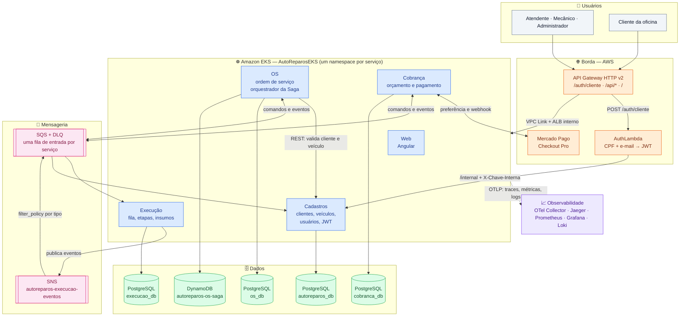

**Como a requisição chega a cada serviço.** O API Gateway encaminha `/api/*` por VPC Link a um ALB interno compartilhado (`IngressGroup` `autoreparos-internal`); cada chart Helm declara os próprios caminhos:

| Caminho | Serviço |
| --- | --- |
| `POST /auth/cliente` | AuthLambda (integração direta do gateway) |
| `/api/v1/ordens-servico`, `/api/v1/admin/sagas` | OS |
| `/api/v1/orcamentos`, `/api/v1/pagamentos`, `/api/v1/webhooks/mercado-pago` | Cobrança |
| `/api/v1/execucoes`, `/api/v1/fila-execucao`, `/api/v1/servicos`, `/api/v1/insumos` | Execução |
| `/api` (demais rotas: `auth`, `clientes`, `veiculos`, `usuarios`) | Cadastros |
| `/` | Web |

Imagens do diagrama para o PDF: [`docs/entrega/fase4/diagrama_arquitetura.png`](./docs/entrega/fase4/diagrama_arquitetura.png) e [`.svg`](./docs/entrega/fase4/diagrama_arquitetura.svg).

---

## 6. Divisão dos microsserviços

A divisão segue os três serviços sugeridos no enunciado (OS, Cobrança e Execução) e acrescenta o **Cadastros**, que reaproveita o código já testado da aplicação original.

| Serviço | Responsabilidade | Por que é um serviço próprio |
| --- | --- | --- |
| **OS** | Abertura, status e histórico da OS; orquestração e estado da Saga | É o dono do ciclo de vida da OS e o único que precisa conhecer o fluxo inteiro; concentrar a orquestração aqui evita que cada serviço saiba o que vem antes e depois dele |
| **Cobrança** | Orçamento, aprovação pelo cliente, pagamento no Mercado Pago e reembolso | Tem integração externa e regras financeiras próprias; isolar limita o impacto de uma falha do provedor |
| **Execução** | Fila, diagnóstico, etapas, catálogo de serviços e insumos com reserva | A reserva de insumos é passo e compensação da Saga e precisa da mesma transação da execução |
| **Cadastros** | Clientes, veículos, usuários, emissão do JWT e JWKS | Reaproveita o código verificado das fases anteriores; os demais serviços só validam o token |

Alternativas descartadas: um quinto serviço de Estoque (mais um repositório, pipeline e chart sem ganho de domínio) e o Cadastros dentro do OS (reescreveria código já verificado dentro do serviço mais crítico).

Todos os serviços seguem **Clean Architecture** com projetos `Domain`, `Application`, `Infrastructure` e `Api` (Minimal APIs), e testes em projetos separados. Detalhes de cada um no README do respectivo repositório.

---

## 7. Bancos de dados

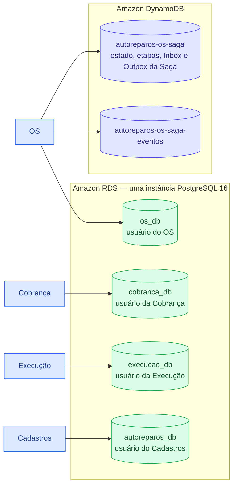

| Decisão | Justificativa |
| --- | --- |
| **PostgreSQL por serviço**, com database e usuário próprios em uma instância RDS compartilhada | Cumpre a regra de nenhum serviço acessar o banco de outro sem o custo de uma instância por serviço. O pipeline de cada serviço cria a própria database e o próprio usuário pelo provisionador `autoreparos-provisionador-db` |
| **DynamoDB para o estado da Saga** | Atende ao requisito de um banco NoSQL e combina com o acesso por chave: a Saga é lida e gravada por `ordemServicoId`, com escrita condicional por versão para evitar concorrência |
| **Sem leitura cruzada** | Os serviços consultam uns aos outros por REST (o OS valida cliente e veículo no Cadastros) e a AuthLambda chama um endpoint interno em vez de acessar o banco |
| **Migrations por Job Helm `pre-upgrade`** | A migration roda com a imagem do serviço antes do rollout; se falhar, a versão em produção não muda ([ADR-004](./docs/architecture/ADR-004-migrations-por-job-pre-upgrade.md)) |

O Cadastros usa a database `autoreparos_db` no RDS, herdada das fases anteriores; `cadastros_db` existe só no ambiente local.

---

## 8. Comunicação entre microsserviços

### Síncrona (REST)

Usada apenas quando quem chama precisa da resposta para continuar.

| Origem | Destino | Uso |
| --- | --- | --- |
| Web e clientes HTTP | Serviços, via API Gateway | Operação da oficina e portal do cliente, com JWT |
| OS | Cadastros | Validar cliente e veículo ao abrir a OS (`X-Chave-Interna`) |
| Cobrança | OS | Conferir a OS ao gerar o orçamento (`GET /api/v1/ordens-servico/{id}`) |
| Cobrança | Execução | Ler os preços vigentes do catálogo (`GET /api/v1/servicos` e `/api/v1/insumos`) |
| AuthLambda | Cadastros | `POST /internal/clientes/autenticar` com `X-Chave-Interna` |
| OS, Cobrança e Execução | Cadastros | Descoberta OIDC e JWKS para validar o JWT |
| Cobrança | Mercado Pago | Criar a preferência do Checkout Pro e consultar o pagamento |
| Mercado Pago | Cobrança | Webhook `POST /api/v1/webhooks/mercado-pago` (assinatura validada) |

### Assíncrona (SQS e SNS)

Cada serviço tem sua fila de entrada com **DLQ**. As mensagens usam um envelope versionado (`tipo` no formato `contexto.acao.v1`), **Outbox** na mesma transação do banco, **Inbox** para descartar duplicatas por `eventId` e `traceparent` para o trace atravessar as filas.

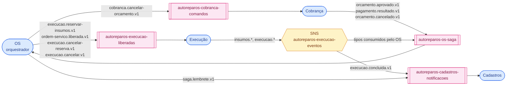

| Decisão | Justificativa |
| --- | --- |
| **SQS com DLQ** | Desacopla os serviços e tolera indisponibilidade de um participante: a mensagem espera na fila; a que esgota as tentativas vai para a DLQ e pode ser reprocessada (`POST /api/v1/admin/dlq/reprocessar` em cada serviço) |
| **SNS no produtor de eventos da Execução** | Um evento da Execução chega a vários consumidores (OS e Cadastros) sem a Execução conhecer as filas deles; cada consumidor cria a própria assinatura com `filter_policy` em `tipo` |
| **`AWSSDK.SQS` com Outbox e Inbox, sem MassTransit** | Controle explícito de retentativas e idempotência, sem uma dependência a mais |

---

## 9. Saga Pattern

### Escolha: Saga **orquestrada**, com o orquestrador no OS

**Por que orquestração e não coreografia:**

1. **Fluxo sequencial com dependências claras** — orçamento aprovado → reserva de insumos → liberação → execução → pagamento. O orquestrador deixa a ordem dos passos e das compensações explícita em um só lugar.
2. **O OS já é dono do ciclo de vida da OS** e responde por status e histórico; o estado da Saga alimenta esse histórico.
3. **Rastreabilidade e operação** — etapa atual, compensações e Sagas paradas de cada OS ficam em um único registro, consultável no console `GET /api/v1/admin/sagas` e no painel **Saga** do Grafana.
4. **Evita lógica espalhada** — na coreografia, cada serviço precisaria conhecer os eventos dos outros e a ordem de compensação ficaria implícita.
5. **Custo aceito** — o orquestrador é um ponto central, mas conhece só contratos (comandos e eventos), nunca o banco ou o código dos participantes, e roda com concorrência otimista sobre o estado no DynamoDB.

### Fluxo feliz

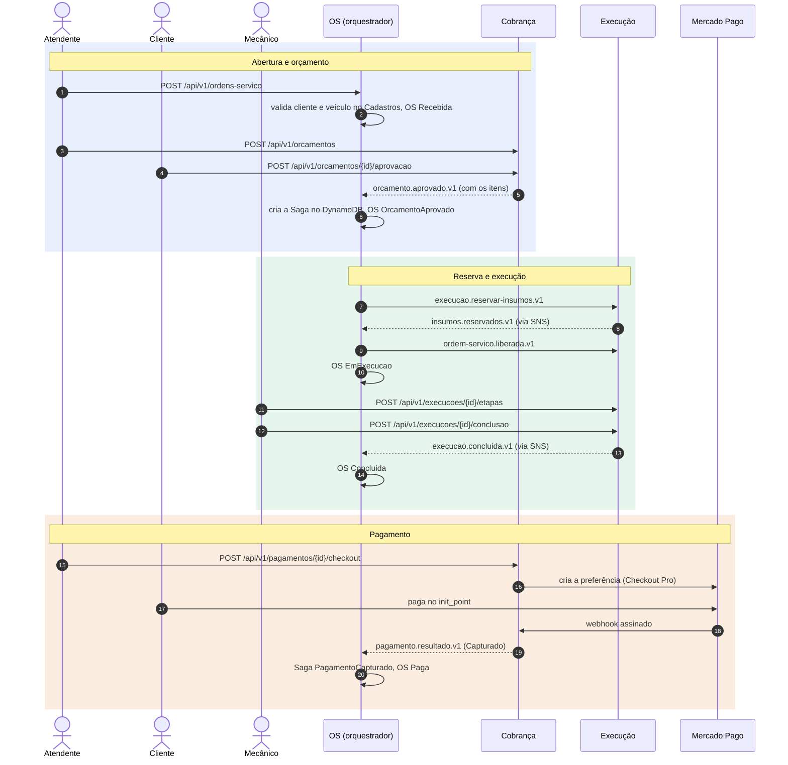

Quando o orçamento só tem mão de obra (sem insumos), a Saga pula a reserva e libera a execução direto.

### Máquina de estados da Saga

Estados reais do agregado `SagaOS` (`EstadoSaga`), persistido no DynamoDB:

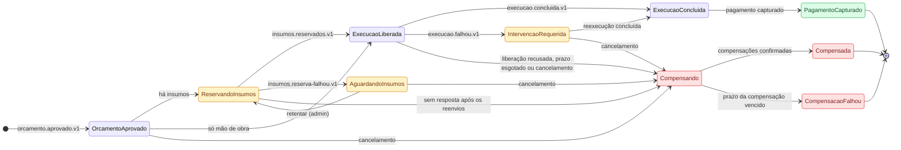

O status da OS no PostgreSQL acompanha a Saga: `Recebida` → `OrcamentoAprovado` → `EmExecucao` → `Concluida` → `Paga`, com `IntervencaoRequerida` e `Cancelada` como desvios.

### Compensações (rollback)

| Etapa | Serviço | Compensação |
| --- | --- | --- |
| Orçamento aprovado | Cobrança | `cobranca.cancelar-orcamento.v1` → `orcamento.cancelado.v1` |
| Insumos reservados | Execução | `execucao.cancelar-reserva.v1` → `insumos.reserva-cancelada.v1` |
| Execução liberada | Execução | `execucao.cancelar.v1` → `execucao.cancelada.v1` |
| Execução concluída / pagamento capturado | — | **Ponto de não retorno:** cancelamento recusado; pagamento nunca é estornado automaticamente |

As compensações rodam **em ordem inversa**, uma por vez, cada uma idempotente e reenviada até confirmar. Sem confirmação no prazo, a Saga vai para `CompensacaoFalhou` e exige intervenção.

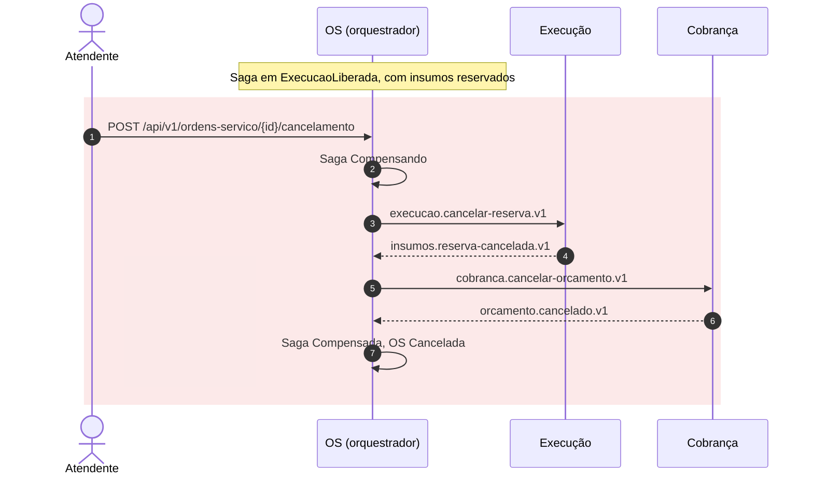

### Garantias de consistência

| Mecanismo | O que garante |
| --- | --- |
| **Outbox** (PostgreSQL ou DynamoDB) | Estado de negócio e mensagem gravados na mesma transação; nenhuma mensagem se perde nem sai sem o estado |
| **Inbox** por `eventId` | Mensagem repetida (reentrega do SQS ou reprocessamento da DLQ) é descartada |
| **Escrita condicional por versão** no DynamoDB | Dois eventos concorrentes da mesma Saga não avançam os dois |
| **Trava `409 saga_em_andamento`** | Cancelamento durante a reserva de insumos espera a resposta da Execução |
| **Prazos técnicos e reenvios** | Reserva ou liberação sem resposta são reenviadas; esgotados os reenvios, a Saga compensa |
| **Lembretes de negócio** | `saga.lembrete.v1` enquanto aguarda pagamento (a cada 24 h) e alerta diário enquanto aguarda insumos; nada expira sozinho |
| **Console de administração** | `GET /api/v1/admin/sagas`, `POST /api/v1/admin/sagas/{id}/retentar` e reprocessamento de DLQ |

### Como provocar falhas (vídeo e testes)

| Cenário | Como provocar | Resultado esperado |
| --- | --- | --- |
| Falta de saldo | Orçamento com insumo sem estoque | Saga `AguardandoInsumos`; cancelar compensa só o orçamento |
| Cancelamento com reserva feita | `POST /api/v1/ordens-servico/{id}/cancelamento` após a reserva | Cancela a reserva e depois o orçamento |
| Participante fora do ar | Escalar a Execução ou a Cobrança para 0 réplicas e voltar | Mensagens esperam na fila e o fluxo continua |
| Falha na execução | `POST /api/v1/execucoes/{id}/falha` e depois `.../reexecucao` | `IntervencaoRequerida` e retomada |
| Pagamento recusado | Cartão de teste do Mercado Pago com titular `OTHE` | Fica registrado no histórico; a Saga continua aguardando pagamento |

---

## 10. Autenticação e autorização

| Quem | Como entra | Token |
| --- | --- | --- |
| Operador (Administrador, Atendente, Mecânico) | `POST /api/auth/login` no Cadastros | JWT **RS256** emitido pelo Cadastros |
| Cliente da oficina | `POST /auth/cliente` com CPF e e-mail, na AuthLambda | JWT emitido pelo Cadastros e repassado pela Lambda |

OS, Cobrança e Execução validam o token pela descoberta OIDC do Cadastros (`/.well-known/openid-configuration` e `/.well-known/jwks.json`), sem compartilhar segredo de assinatura. Rotas `/internal` do Cadastros exigem o cabeçalho `X-Chave-Interna` e ficam num Ingress interno.

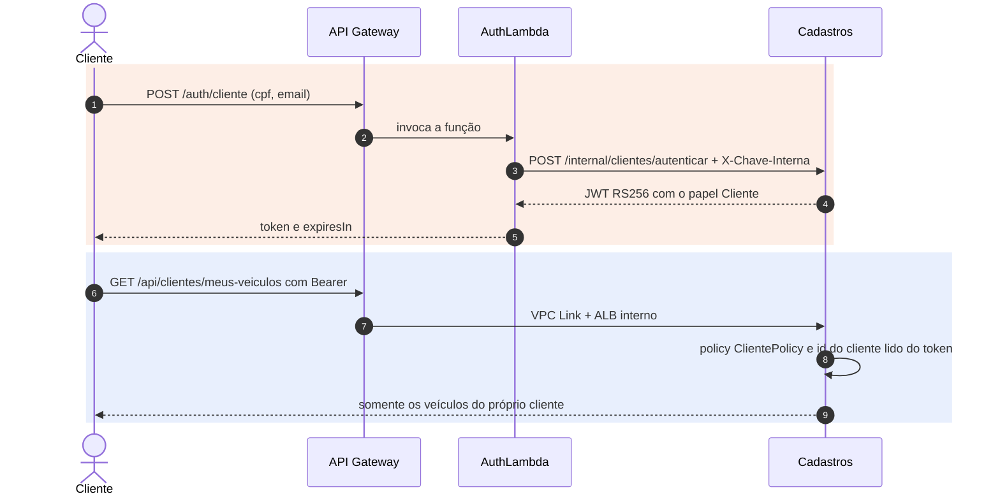

Políticas de autorização: no Cadastros, `OperadorOficina`, `ClientePolicy` e `ChaveInterna`; no OS, `OperarOS` (Administrador, Atendente, Mecânico), `CancelarOS` (Administrador, Atendente) e `AdministrarSagas` (Administrador).

---

## 11. Observabilidade

A stack da Fase 3 foi mantida e aplicada aos microsserviços. Ela roda no namespace `autoreparos` do EKS, implantada pelo chart `k8s/charts/observability` do [Infra.K8s](https://github.com/Grupo78-PosTech-15SOAT/AutoReparos.Infra.K8s).

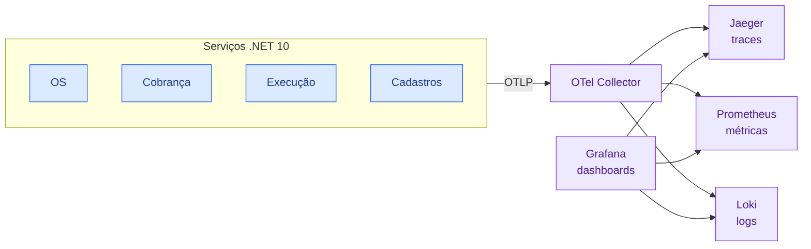

- **Rastreamento distribuído:** o `traceparent` (W3C) viaja no envelope das mensagens, então um único trace no Jaeger mostra a requisição HTTP, a publicação no SQS ou SNS e o consumo no outro serviço.
- **Métricas da Saga** (`Meter("AutoReparos.OS.Saga")`): Sagas iniciadas, concluídas, compensadas por passo, paradas e mensagens na DLQ da Saga.
- **Dashboards no Grafana:** **Saga** (Sagas iniciadas, concluídas, paradas, compensações por passo e DLQ da Saga), visão geral das APIs .NET e erros e falhas nas integrações.
- **Logs estruturados** com `TraceId` e `SpanId`, consultáveis no Loki a partir do trace.

---

## 12. Testes e qualidade

| Serviço | Testes | BDD | Cobertura e qualidade |
| --- | --- | --- | --- |
| OS | Unitários (domínio e aplicação), API e integração | **6 cenários Reqnroll** (`AutoReparos.OS.BddTests`) | ≥ 80% + [SonarCloud](https://sonarcloud.io/project/overview?id=Grupo78-PosTech-15SOAT_AutoReparos.OS) |
| Cobrança | Unitários e integração com Testcontainers | — | ≥ 80% + [SonarCloud](https://sonarcloud.io/project/overview?id=Grupo78-PosTech-15SOAT_AutoReparos.Cobranca) |
| Execução | Unitários e integração com Testcontainers | — | ≥ 80% + [SonarCloud](https://sonarcloud.io/project/overview?id=Grupo78-PosTech-15SOAT_AutoReparos.Execucao) |
| Cadastros | Domínio, aplicação e integração com Testcontainers | — | ≥ 80% + [SonarCloud](https://sonarcloud.io/project/overview?id=Grupo78-PosTech-15SOAT_AutoReparos.Cadastros) |
| Web | Vitest | — | [SonarCloud](https://sonarcloud.io/project/overview?id=Grupo78-PosTech-15SOAT_AutoReparos.Web) |
| AuthLambda | Unitários xUnit | — | Pipeline próprio |

**Cenários BDD do fluxo completo** (Reqnroll, em português):

| Funcionalidade | Cenário |
| --- | --- |
| Fluxo completo da ordem de serviço na Saga | Pagamento aprovado conclui a Saga e marca a OS como paga |
| | OS só de mão de obra pula a reserva e libera a execução direto |
| Compensações da Saga do OS | Pagamento recusado não dispara compensação e deixa a Saga aguardando |
| | Falha na reserva de insumos aguarda saldo e o cancelamento compensa só o orçamento |
| | Liberação recusada pelo Execução compensa a reserva e o orçamento em ordem inversa |
| | Cancelamento pelo atendente com insumos reservados compensa em ordem inversa |

Os percentuais atualizados de cobertura e as evidências estão nos badges da [§ 4](#4-repositórios) e na seção **Cobertura** do README de cada serviço.

---

## 13. CI/CD e deploy

Cada microsserviço tem um pipeline **independente** (`.github/workflows/ci-cd.yml`) que roda em pull requests e pushes para `develop` e `main`:

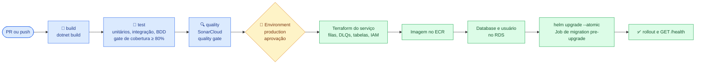

- **Qualidade** roda em PR para `main` e em push na `main`; o **deploy** só roda na `main` (push ou `workflow_dispatch`) e espera aprovação no Environment `production`.
- O deploy usa identidade **OIDC** do GitHub na AWS (nenhuma chave estática) e `helm upgrade --atomic`: se o `/health` falhar, a versão anterior volta sozinha.
- Branches: trabalho em `develop` e `feature/*`, PR para `main` ([ADR-005](./docs/architecture/ADR-005-deploy-independente-por-microsservico.md)).

### Workflows deste repositório (plataforma compartilhada)

O pai não implanta os microsserviços nem o Web (cada um tem o próprio `ci-cd.yml`): fica com a plataforma compartilhada, a Lambda e a observabilidade.

| Workflow | Gatilho | O que faz |
| --- | --- | --- |
| `CI` ([`ci.yml`](./.github/workflows/ci.yml)) | PR e push | Build e testes da solution (Cadastros e AuthLambda), build do Web, `terraform fmt/validate` e `helm lint` |
| `Bootstrap AWS Terraform backend` ([`bootstrap-aws.yml`](./.github/workflows/bootstrap-aws.yml)) | Manual, `CONFIRMAR-BOOTSTRAP` | Bucket S3 de state e tabela DynamoDB de lock |
| `Provision AWS` ([`provision-aws.yml`](./.github/workflows/provision-aws.yml)) | Manual, `CONFIRMAR-PROVISIONAMENTO` | Rede, EKS, ECR, add-ons, RDS, Lambda, chart da plataforma (observabilidade) e API Gateway |
| `Deploy application` ([`deploy-app.yml`](./.github/workflows/deploy-app.yml)) | Manual, `DEPLOY-PRODUCTION` | Atualiza a Lambda e o chart da plataforma (observabilidade) |
| `Teardown AWS` ([`destroy-aws.yml`](./.github/workflows/destroy-aws.yml)) | Manual, `CONFIRMAR-DESTRUICAO` | Remove gateway, aplicação, stacks dos serviços, Lambda e add-ons; RDS e rede só com confirmações extras |

---

## 14. Infraestrutura na AWS

### Ordem dos states do Terraform

| Ordem | State | Dono | Entrega |
| ---: | --- | --- | --- |
| 1 | `bootstrap/terraform.tfstate` | Bootstrap (pai) | Bucket S3 versionado e tabela DynamoDB de lock |
| 2 | `network/production/terraform.tfstate` | Infra.K8s | VPC, subnets, security groups, EKS, ECR, namespaces e roles de deploy dos serviços |
| 3 | `platform/production/terraform.tfstate` | Infra.K8s | EBS CSI, Metrics Server e AWS Load Balancer Controller |
| 4 | `database/terraform.tfstate` | Infra.Database | RDS privado, regras de acesso e provisionador de databases |
| 5 | `lambda-auth/terraform.tfstate` | AuthLambda | Função .NET 10, role e acesso à VPC |
| 6 | Helm | Pai | Chart da plataforma (observabilidade) |
| 7 | `gateway/production/terraform.tfstate` | Infra.K8s | API Gateway, VPC Link, rotas da Lambda, da API e do Web |
| — | `servicos/<servico>/production.tfstate` | Cada microsserviço | Filas, DLQs, tópico SNS e assinaturas, tabelas DynamoDB e IAM do serviço |

### Configuração do GitHub (repositório pai)

| Tipo | Nome | Uso |
| --- | --- | --- |
| Repository variable | `AWS_ACCOUNT_ID`, `AWS_REGION`, `TF_STATE_BUCKET`, `TF_LOCK_TABLE` | Conta, região e backend do Terraform, compartilhados por todos os workflows |
| Repository variable + secret | `SUBMODULES_APP_ID` + `SUBMODULES_APP_PRIVATE_KEY` | Só se houver submódulos privados (GitHub App com leitura) |
| Environment `aws-bootstrap` | secret `AWS_ROLE_ARN` | Role OIDC do bootstrap |
| Environment `production` — variables | `AWS_ROLE_ARN`, `EKS_CLUSTER_NAME`, `K8S_NAMESPACE`, `CADASTROS_INTERNAL_URL` | Role OIDC de provisionamento e deploy, cluster, namespace da plataforma e URL interna do Cadastros usada pela Lambda |
| Environment `production` — secrets | `CHAVE_INTERNA`, `GRAFANA_ADMIN_PASSWORD` | Chave das rotas `/internal` e senha do Grafana |

Os Environments só aceitam a branch `main`. As roles OIDC confiam apenas no `sub` do Environment (`repo:Grupo78-PosTech-15SOAT/AutoReparos:environment:<nome>`). Senhas do RDS ficam no Secrets Manager e nunca são cadastradas no GitHub. Detalhes de cada stack nos READMEs do [Infra.K8s](https://github.com/Grupo78-PosTech-15SOAT/AutoReparos.Infra.K8s) e do [Infra.Database](https://github.com/Grupo78-PosTech-15SOAT/AutoReparos.Infra.Database).

### Sequência de provisionamento

1. **Bootstrap AWS Terraform backend** em `main`, com `CONFIRMAR-BOOTSTRAP` e `existing_resources_reviewed`.
2. **Provision AWS** em `main`, com `CONFIRMAR-PROVISIONAMENTO` e `inventory_reviewed`. Os jobs seguem a ordem dos states e param na primeira falha.
3. Disparar o `ci-cd.yml` de cada microsserviço e do Web na `main` (OS, Cobrança, Execução, Cadastros, Web) e aprovar o Environment `production`.
4. Mudanças só da Lambda ou da observabilidade: **Deploy application** com `DEPLOY-PRODUCTION`.
5. **Teardown AWS** remove o ambiente; apagar o RDS exige `DELETE-RDS-DATA` (com snapshot final) e apagar rede e EKS exige `DELETE-NETWORK`. O backend S3 sempre é preservado.

Validação pós-deploy: [`scripts/smoke/`](./scripts/smoke/README.md) (deploy, rollback, Mercado Pago e credenciais AWS dos pods).

---

## 15. Execução local

### Pré-requisitos

- Docker e Docker Compose
- .NET 10 SDK
- Node.js 22 (para o Web fora do Docker)
- Git

### Clonar com os submódulos

```bash
git clone --recurse-submodules https://github.com/Grupo78-PosTech-15SOAT/AutoReparos.git
```

```bash
git submodule update --init --recursive
```

### Ambiente local do pai (Cadastros, Web e observabilidade)

Copie [`.env.example`](./.env.example) para `.env` e preencha os valores (senha do PostgreSQL, chave RSA PKCS#8 do JWT, `CHAVE_INTERNA`, usuário administrador inicial, pgAdmin e SendGrid). Depois:

```bash
docker compose up -d --build
```

| Serviço | Endereço |
| --- | --- |
| Web (Angular) | http://localhost:4200 |
| Cadastros (API e Swagger) | http://localhost:8080/swagger |
| pgAdmin | http://localhost:5050 |
| Grafana | http://localhost:3000 |
| Jaeger | http://localhost:16686 |
| Prometheus | http://localhost:9090 |
| PostgreSQL | `localhost:5433` |

### Microsserviços

OS, Cobrança e Execução rodam com `dotnet run` a partir do próprio repositório; as instruções, variáveis e dependências de cada um estão no README do serviço. Para testar:

```bash
dotnet test submodules/AutoReparos.OS/AutoReparos.OS.slnx
```

```bash
dotnet test submodules/AutoReparos.Cobranca/AutoReparos.Cobranca.slnx
```

```bash
dotnet test submodules/AutoReparos.Execucao/AutoReparos.Execucao.slnx
```

```bash
dotnet test submodules/AutoReparos.Cadastros/AutoReparos.Cadastros.slnx
```

```bash
dotnet test submodules/AutoReparos.AuthLambda/AutoReparos.AuthLambda.slnx
```

Os testes de integração usam **Testcontainers** e precisam apenas do Docker.

---

## 16. Documentação da API (Swagger e Postman)

| Serviço | Coleção Postman | OpenAPI |
| --- | --- | --- |
| OS | [`AutoReparos.OS.postman_collection.json`](./submodules/AutoReparos.OS/postman/AutoReparos.OS.postman_collection.json) | `/openapi/v1.json` em `Development` |
| Cobrança | [`AutoReparos.Cobranca.postman_collection.json`](./submodules/AutoReparos.Cobranca/postman/AutoReparos.Cobranca.postman_collection.json) | `/openapi/v1.json` em `Development` |
| Execução | [`AutoReparos.Execucao.postman_collection.json`](./submodules/AutoReparos.Execucao/postman/AutoReparos.Execucao.postman_collection.json) | `/openapi/v1.json` em `Development` |
| Cadastros | [`Postman/AutoReparos.postman_collection.json`](./Postman/AutoReparos.postman_collection.json) (pastas Autenticação, Clientes, Veículos e Usuários) | Swagger UI em `/swagger` |

A coleção do pai foi criada nas fases anteriores: as pastas de serviços, insumos e ordens de serviço usam as rotas do antigo monólito e foram substituídas pelas coleções de OS, Cobrança e Execução.

---

## 17. Documentação técnica e especificações

### Fase 4

| Documento | Conteúdo |
| --- | --- |
| [`docs/entrega/fase4/arquitetura_e_justificativa.md`](./docs/entrega/fase4/arquitetura_e_justificativa.md) | Diagrama final, justificativas da divisão, dos bancos, da comunicação e da Saga |
| [`docs/entrega/fase4/roteiro_video_fase4.md`](./docs/entrega/fase4/roteiro_video_fase4.md) | Roteiro do vídeo de demonstração |
| [`docs/entrega/fase4/template_entrega_portal_fiap.md`](./docs/entrega/fase4/template_entrega_portal_fiap.md) | Minuta do PDF de entrega |
| [`.specs/features/fase4/especificacao/index.md`](./.specs/features/fase4/especificacao/index.md) | Requisitos, decisões (`D-xx`), cronograma e mapa das especificações |
| [`.specs/features/fase4/FEATURES.md`](./.specs/features/fase4/FEATURES.md) | Features da fase, com plano, checks, provas e verificação de cada uma |
| [`.specs/STATE.md`](./.specs/STATE.md) | Estado atual, pendências e decisões para agentes |

Especificações transversais: [separação em microsserviços](./.specs/features/fase4/especificacao/microsservicos/fase4_spec_separacao_microsservicos.md), [bancos de dados](./.specs/features/fase4/especificacao/microsservicos/fase4_spec_bancos_de_dados.md), [Mercado Pago](./.specs/features/fase4/especificacao/microsservicos/fase4_spec_integracao_mercado_pago.md), [comunicação](./.specs/features/fase4/especificacao/comunicacao/fase4_spec_comunicacao_microsservicos.md), [Saga](./.specs/features/fase4/especificacao/saga/fase4_spec_saga_pattern.md), [infraestrutura e mensageria](./.specs/features/fase4/especificacao/infraestrutura/fase4_spec_infraestrutura_k8s_e_mensageria.md), [observabilidade](./.specs/features/fase4/especificacao/infraestrutura/fase4_spec_observabilidade_distribuida.md), [testes e qualidade](./.specs/features/fase4/especificacao/testes-qualidade/fase4_spec_testes_e_qualidade.md) e [CI/CD](./.specs/features/fase4/especificacao/cicd/fase4_spec_cicd_e_protecao_de_branches.md).

### Arquitetura (RFCs e ADRs)

Índice completo em [`docs/architecture/`](./docs/architecture/README.md), com destaque para [ADR-004 — migrations por Job `pre-upgrade`](./docs/architecture/ADR-004-migrations-por-job-pre-upgrade.md) e [ADR-005 — deploy independente por microsserviço](./docs/architecture/ADR-005-deploy-independente-por-microsservico.md).

### Fases anteriores

Especificações históricas em [`docs/specs/`](./docs/specs/) e enunciados oficiais em [`docs/tech-challenge/`](./docs/tech-challenge/).

---

## 18. Entregáveis e links

| Entregável | Link |
| --- | --- |
| Repositórios | [OS](https://github.com/Grupo78-PosTech-15SOAT/AutoReparos.OS) · [Cobrança](https://github.com/Grupo78-PosTech-15SOAT/AutoReparos.Cobranca) · [Execução](https://github.com/Grupo78-PosTech-15SOAT/AutoReparos.Execucao) · [Cadastros](https://github.com/Grupo78-PosTech-15SOAT/AutoReparos.Cadastros) · [Web](https://github.com/Grupo78-PosTech-15SOAT/AutoReparos.Web) · [AuthLambda](https://github.com/Grupo78-PosTech-15SOAT/AutoReparos.AuthLambda) · [Infra.K8s](https://github.com/Grupo78-PosTech-15SOAT/AutoReparos.Infra.K8s) · [Infra.Database](https://github.com/Grupo78-PosTech-15SOAT/AutoReparos.Infra.Database) |
| Vídeo de demonstração (até 15 min) | [youtu.be/BqWcQaEuKAs](https://youtu.be/BqWcQaEuKAs) |
| Arquitetura e justificativa | [`docs/entrega/fase4/arquitetura_e_justificativa.md`](./docs/entrega/fase4/arquitetura_e_justificativa.md) |
| Desenho estratégico DDD (Miro) | [Miro](https://miro.com/app/board/uXjVGw2wAXY=/?share_link_id=246372446405) |
| Qualidade | [SonarCloud — organização grupo78-postech-15soat](https://sonarcloud.io/organizations/grupo78-postech-15soat/projects) |

---

## 19. Integrantes do grupo

**Grupo 78 — Pós-Tech em Software Architecture (SOAT) — FIAP**

| Integrante | RM |
| --- | --- |
| Enrico Gollner | rm370737 |
| José Dotta | rm372959 |
| Júlia Santos | rm370364 |
| Lucas Bastos | rm370749 |
| Mateus Lecchi | rm371085 |
