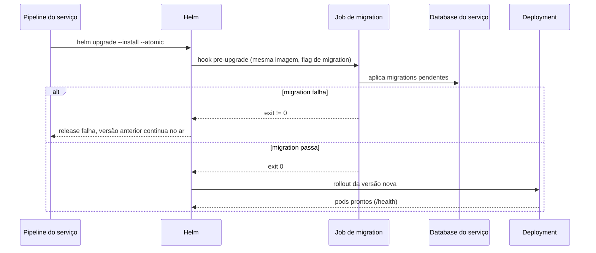

# ADR-004 — Migrations por Job Helm antes do rollout de cada serviço

> **Projeto:** AutoReparos — Sistema Integrado de Oficina Mecânica
> **Fase:** Tech Challenge FIAP SOAT — Fase 4
> **Status:** Aceito em 15/11/2026, implementação na feature `deploy-servicos`
> **Decisão de origem:** D-47 no [índice da Fase 4](../../.specs/features/fase4/especificacao/index.md#61-decididas) · AD-050 no [`STATE.md`](../../.specs/STATE.md)
> **Documentos relacionados:** [ADR-005](./ADR-005-deploy-independente-por-microsservico.md), [spec de CI/CD](../../.specs/features/fase4/especificacao/cicd/fase4_spec_cicd_e_protecao_de_branches.md)

---

## Contexto

Cada microsserviço tem a sua própria database no RDS e evolui o schema com migrations do EF Core. Em 13/11 os quatro serviços seguiam três modelos diferentes:

| Serviço | Modelo | Problema |
|---|---|---|
| Cadastros | Job Kubernetes com a imagem da API e `Database__RunMigrations=true`, que migra e sai; criado pelo workflow do pai antes do `helm upgrade` | Depende do pai, que deixa de implantar serviços (D-45) |
| Cobrança e Execução | `MigrateAsync()` incondicional no startup | Duas réplicas iniciando juntas disputam a mesma migration; uma migration que falha derruba o pod em loop, com a versão nova já no ar |
| OS | Nenhum | Alguém precisa rodar `dotnet ef database update` à mão contra o RDS |

O deploy precisa ser automatizado por serviço (PDF da Fase 4) e uma migration que falha não pode deixar o serviço sem versão funcionando.

## Decisão

**Todos os serviços migram por um Job Helm com hook `pre-install,pre-upgrade`, que roda a própria imagem do serviço com uma flag que aplica as migrations e encerra o processo.** O modelo é o que o Cadastros já usava, levado para o chart de cada repositório.

Regras:

- A flag é uma configuração do serviço (no Cadastros, `Database:RunMigrations`); com ela ligada a aplicação migra e sai com código 0, sem abrir a porta HTTP.
- No cluster a migração no startup fica desligada; no `docker compose` e nos testes ela pode continuar ligada.
- O Job usa a mesma connection string do serviço, lida do Secret do próprio serviço; nenhum serviço migra a database de outro.
- O hook tem `hook-delete-policy: before-hook-creation,hook-succeeded`, para que o Job de uma falha fique disponível para `kubectl logs`.

## Alternativas consideradas

| Alternativa | Por que não |
|---|---|
| Migração no startup com 1 réplica | Volta a disputar a migration assim que o HPA sobe réplicas durante o rollout; a falha aparece como pod em `CrashLoopBackOff`, não como deploy falho |
| Job criado pelo workflow, fora do chart | É o modelo do pai; espalha o deploy entre YAML do workflow e chart, e o `--atomic` não cobre o Job |
| Init container no Deployment | Roda uma vez por pod: com N réplicas, N migrations concorrentes |
| Bundle de migration do EF (`efbundle`) | Imagem e ferramenta a mais para manter em quatro repositórios, sem ganho para o prazo |

## Consequências

- OS, Cobrança e Execução ganham a flag de "migrar e sair" no `Program.cs`; o OS passa a ter migrations aplicadas automaticamente.
- Um deploy com migration inválida falha no pipeline e não troca a versão em produção; o motivo fica no log do Job.
- Migrations precisam continuar compatíveis com a versão anterior durante o rollout (só aditivas), porque os pods antigos atendem enquanto os novos sobem.
