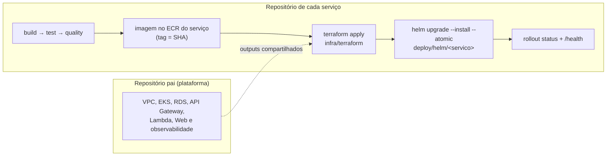

# ADR-005 — Deploy independente por microsserviço

> **Projeto:** AutoReparos — Sistema Integrado de Oficina Mecânica
> **Fase:** Tech Challenge FIAP SOAT — Fase 4
> **Status:** Aceito em 15/11/2026, implementação na feature `deploy-servicos`
> **Decisões de origem:** D-40 a D-56 no [índice da Fase 4](../../.specs/features/fase4/especificacao/index.md#61-decididas) · AD-043 a AD-053 no [`STATE.md`](../../.specs/STATE.md)
> **Documentos relacionados:** [ADR-004](./ADR-004-migrations-por-job-pre-upgrade.md), [RFC-001](./RFC-001-cloud-architecture-and-repo-segregation.md), [spec de CI/CD](../../.specs/features/fase4/especificacao/cicd/fase4_spec_cicd_e_protecao_de_branches.md)

---

## Contexto

O PDF da Fase 4 exige que cada microsserviço tenha **repositório, infraestrutura e banco próprios** e um **pipeline independente** com build, testes, qualidade e **deploy automatizado em Kubernetes**.

Em 13/11 o único caminho até o EKS era o `deploy-app.yml` manual do repositório pai, que publicava só o Cadastros e o Web num release Helm único. OS, Cobrança e Execução não tinham imagem, repositório ECR, chart, rota, filas, tabelas nem database na AWS, e nenhum pod tinha identidade AWS para usar SQS ou DynamoDB.

## Decisão

**Cada repositório de serviço (OS, Cobrança, Execução, Cadastros) é dono do próprio caminho até a produção:** Terraform dos recursos exclusivos, chart Helm e job de deploy no próprio `ci-cd.yml`. O repositório pai fica só com a plataforma compartilhada.

| Aspecto | Decisão | Origem |
|---|---|---|
| Ambientes | Só produção: push na `main` implanta no EKS (`us-east-1`) com aprovação no Environment `production`; a `develop` roda só CI | D-41 |
| Recursos exclusivos | `infra/terraform` em cada serviço: ECR, filas e DLQs SQS, role IRSA, database e usuário no RDS e, no OS, as tabelas DynamoDB da Saga | D-42 |
| Chart | `deploy/helm/<servico>` em cada serviço, um release por serviço; o subchart `api` sai do guarda-chuva do Infra.K8s | D-43 |
| Capacidade | Node group `t3.medium` (variável), 2 a 3 nós, 1 réplica por serviço com HPA de 1 a 3 | D-44 |
| Pai | Plataforma, Lambda, Web e observabilidade; não implanta serviços | D-45 |
| Mensageria | Só as filas SQS que o código usa; tópicos SNS e assinaturas entram depois como recurso aditivo, sem trocar as filas | D-46 |
| Migrations | Job Helm `pre-upgrade` por serviço | D-47, [ADR-004](./ADR-004-migrations-por-job-pre-upgrade.md) |
| Conta | `198903849859`, do José (plano gratuito, US$ 100) | D-50 |
| Database e usuário | O pipeline de cada serviço chama a Lambda `autoreparos-provisionador-db` da plataforma, assinando com a própria role; a Lambda deriva o serviço da role que chamou e cria, de forma idempotente, só a database e o usuário daquele serviço. A credencial admin do RDS fica só na Lambda; a senha do usuário vem do Terraform do serviço | D-54 (substitui a D-49) |
| Acesso de deploy | Role OIDC `autoreparos-deploy-<servico>` por repositório, criada pela plataforma, limitada aos recursos `autoreparos-<servico>-*` e ao namespace do serviço | AD-053 |

## Alternativas consideradas

| Alternativa | Por que não |
|---|---|
| Manter o deploy centralizado no pai | Não atende ao "pipeline independente" do PDF; um release único acopla o ciclo de vida dos serviços |
| Recursos exclusivos num stack central do Infra.K8s | Mais rápido, mas fraco frente a "infraestrutura própria" por serviço |
| Staging e produção (D-22 original) | Dobra filas, tabelas e databases, e o cluster, em dois dias de construção; o PDF pede um ambiente Kubernetes |
| SNS junto com o deploy | Mudaria publicador e consumidores dos quatro serviços e as provas da Saga no mesmo prazo |

## Consequências

- Um merge na `main` de um serviço atualiza só aquele serviço no cluster; uma falha de readiness desfaz a release (`--atomic`).
- Cada repositório passa a precisar de uma role OIDC própria, com permissão restrita ao próprio ECR, aos próprios recursos e ao próprio namespace no EKS.
- O state do Terraform de cada serviço fica no bucket compartilhado da plataforma, com chave por serviço; o serviço lê a plataforma (cluster, provedor OIDC, RDS, API Gateway) pelos parâmetros SSM `/autoreparos/production/*`, sem `terraform_remote_state`, para não depender do layout do state de dois repositórios (D-53).
- EKS e NAT não são cobertos pelo free tier: o ambiente é destruído pelo `destroy-aws.yml` depois da gravação do vídeo.
- O SNS (D-19) continua como dívida registrada até ser implementado.
- **Credencial admin do RDS (D-54, substitui o risco aceito na D-49):** a D-49 punha a criação da database num Job do chart com a credencial admin, que o pipeline de qualquer serviço conseguia ler. Com o provisionador, o admin fica só na Lambda da plataforma; o pipeline de um serviço só consegue pedir a database dele, porque o serviço é deduzido da role que assinou a chamada. O ciclo de vida da database continua no pipeline do serviço.
- **Saída da VPC (D-55):** um NAT Gateway só, com endpoints gratuitos de S3 e DynamoDB; NAT por zona e endpoints de interface ficam fora do prazo.
