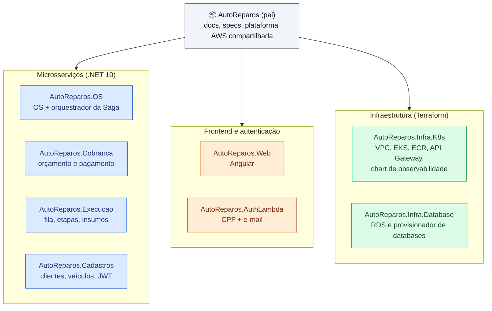
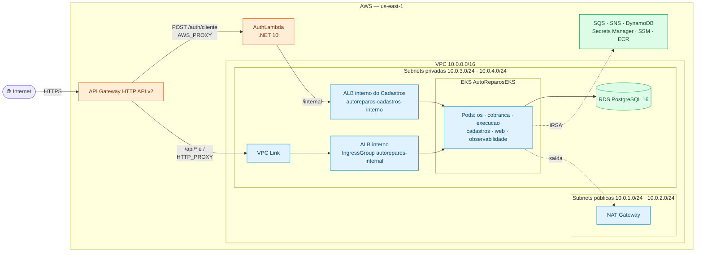

# AutoReparos — Arquitetura e Decisões Técnicas

> **Projeto:** AutoReparos — plataforma de oficina mecânica
> **Programa:** FIAP Tech Challenge — SOAT
> **Estado atual:** Fase 4 — microsserviços com Saga orquestrada, em produção na AWS (`us-east-1`, cluster EKS `AutoReparosEKS`)

Esta pasta reúne os documentos formais de arquitetura (RFCs e ADRs). A visão completa da Fase 4 — diagramas, Saga, mensageria, CI/CD e observabilidade — está no [README principal](../../README.md); as justificativas para a entrega estão em [`docs/entrega/fase4/arquitetura_e_justificativa.md`](../entrega/fase4/arquitetura_e_justificativa.md) e as decisões detalhadas (`D-xx`) no [índice da especificação da Fase 4](../../.specs/features/fase4/especificacao/index.md).

---

## 1. Visão geral (Fase 4)

O repositório pai é o hub de documentação e da plataforma compartilhada. Cada microsserviço tem repositório, banco, infraestrutura (Terraform) e pipeline próprios.

---

## 2. Topologia de rede na AWS

Tudo o que processa ou guarda dados fica em subnets privadas; a única entrada pública é o API Gateway.

| Origem | Destino | Protocolo | Finalidade |
| --- | --- | --- | --- |
| Internet | API Gateway | HTTPS | Ponto único de entrada |
| API Gateway | AuthLambda | Invocação `AWS_PROXY` | `POST /auth/cliente` |
| API Gateway | ALB interno (via VPC Link) | HTTP `HTTP_PROXY` | `/api/*`, `/health` e `/` (Web) |
| ALB interno | Pods do EKS | HTTP 8080 | Roteamento por caminho declarado no Ingress de cada serviço |
| AuthLambda | ALB interno do Cadastros (`autoreparos-cadastros-interno`) | HTTP + `X-Chave-Interna` | `POST /internal/clientes/autenticar`, fora do API Gateway |
| Pods | RDS | TCP 5432 | Cada serviço só na própria database, com usuário próprio |
| Pods | SQS, SNS, DynamoDB, Secrets Manager | HTTPS com IRSA | Mensageria, estado da Saga e segredos, com role por serviço |

---

## 3. Índice de decisões (RFCs e ADRs)

| Documento | Fase | Status | Resumo |
| --- | --- | --- | --- |
| [ADR-005 — Deploy independente por microsserviço](./ADR-005-deploy-independente-por-microsservico.md) | 4 | Aceito e implementado | Pipeline, Terraform e chart Helm em cada repositório de serviço; o pai fica com a plataforma compartilhada |
| [ADR-004 — Migrations por Job Helm `pre-upgrade`](./ADR-004-migrations-por-job-pre-upgrade.md) | 4 | Aceito e implementado | Migration com a imagem do serviço antes do rollout; falha não troca a versão em produção |
| [ADR-003 — Observabilidade ponta a ponta com OpenTelemetry](./ADR-003-end-to-end-observability-strategy.md) | 3 | Aceito, vigente | W3C TraceContext, OTLP e OTel Collector; na Fase 4 o `traceparent` também viaja nas mensagens |
| [ADR-002 — Isolamento de dados e Zero-Trust no portal do cliente](./ADR-002-data-isolation-and-zero-trust-claims.md) | 3 | Aceito, vigente | O titular vem das claims do JWT, sem parâmetro de identificação do cliente (OWASP BOLA) |
| [ADR-001 — API Gateway HTTP API v2 com VPC Link](./ADR-001-adoption-aws-api-gateway.md) | 3 | Aceito, vigente | Borda única com VPC Link privado; na Fase 4 aponta para o ALB interno compartilhado pelos serviços |
| [RFC-003 — Autenticação serverless de clientes](./RFC-003-serverless-client-authentication.md) | 3 | Aceito, revisto na Fase 4 | Lambda por CPF e e-mail; na Fase 4 a Lambda deixou de acessar o banco e chama o endpoint interno do Cadastros, que emite o JWT RS256 |
| [RFC-002 — Banco gerenciado no RDS](./RFC-002-managed-database-strategy-rds.md) | 3 | Aprovado, vigente | RDS PostgreSQL 16 em vez de StatefulSet; na Fase 4 a instância abriga uma database e um usuário por serviço |
| [RFC-001 — Arquitetura AWS e segregação de repositórios](./RFC-001-cloud-architecture-and-repo-segregation.md) | 3 | Aprovado, ampliado na Fase 4 | Multi-repo com submódulos; a Fase 4 passou de 4 para 8 repositórios |
| [Seleção de banco de dados e modelo de dados](./database-selection-and-data-model.md) | 3 | Histórico | Modelo do monólito; na Fase 4 cada serviço tem o próprio modelo e o estado da Saga fica no DynamoDB |
| [Diagrama de sequência do portal do cliente](./diagrams/sequence_portal_auth_and_query.md) | 3 | Histórico | Autenticação e consulta do portal na arquitetura da Fase 3 |

As decisões da Fase 4 que não viraram ADR estão no § 6 do [índice da especificação](../../.specs/features/fase4/especificacao/index.md) (por exemplo: D-04 DynamoDB para a Saga, D-05 PostgreSQL por serviço, D-06 SQS com DLQ, D-07 Saga orquestrada no OS, D-08 Outbox e Inbox sem MassTransit, D-21 JWT assimétrico, D-67 SNS da Execução).

---

## 4. Governança

1. **Branch `main`:** recebe mudanças por Pull Request vindo da `develop`; o deploy de cada serviço só roda na `main` e espera aprovação no Environment `production`. A regra de proteção com checks obrigatórios (D-25) ainda não está aplicada em todos os repositórios.
2. **Branches de trabalho:** `develop`, `feature/*` e `fix/*`; o ponteiro de cada submódulo no pai acompanha a `main` do respectivo repositório.
3. **Commits:** Gitmoji com descrição em português, em minúsculas e sem ponto final (ex.: `📝 atualiza a documentação de arquitetura`).
4. **Links relativos** em toda a documentação, verificados por `python3 scripts/specs/verificar_links.py`.
5. **Especificações:** a partir da Fase 4 ficam em [`.specs/features/fase4/`](../../.specs/features/fase4/); as das Fases 1 a 3 continuam em [`docs/specs/`](../specs/) como histórico.
