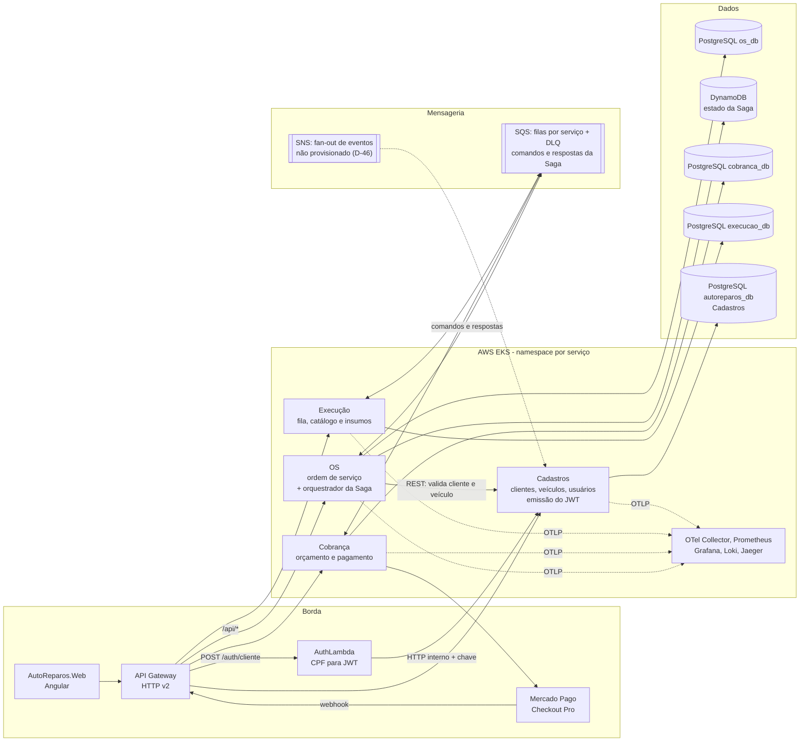

# Arquitetura final e justificativa — Fase 4

> Alimenta as seções 3 e 5 da [minuta do PDF](template_entrega_portal_fiap.md). Fontes: specs de [separação](../../../.specs/features/fase4/especificacao/microsservicos/fase4_spec_separacao_microsservicos.md), [bancos](../../../.specs/features/fase4/especificacao/microsservicos/fase4_spec_bancos_de_dados.md), [comunicação](../../../.specs/features/fase4/especificacao/comunicacao/fase4_spec_comunicacao_microsservicos.md) e [Saga](../../../.specs/features/fase4/especificacao/saga/fase4_spec_saga_pattern.md), e o registro de decisões (`D-xx`) do [índice](../../../.specs/features/fase4/especificacao/index.md).

## 1. Diagrama da arquitetura final

Mostra o que está implantado e o que ficou fora. O fan-out por SNS (D-19) e a fila de notificações do Cadastros não foram provisionados (D-35, D-46) e aparecem tracejados.

Legenda: linha cheia é chamada ou mensagem em uso; tracejada é telemetria (OTLP) ou item não provisionado. As quatro databases PostgreSQL ficam numa única instância RDS, cada uma com usuário próprio. Para exportar para o PDF, colar o bloco em [mermaid.live](https://mermaid.live) ou usar o `mermaid-cli`.

## 2. Justificativa da divisão dos microsserviços

A divisão segue o PDF (OS, Cobrança e Execução) e acrescenta o Cadastros (D-01).

| Serviço | Responsabilidade | Por que é um serviço próprio |
|---|---|---|
| **OS** | Abertura, status e histórico da ordem de serviço; orquestrador e estado da Saga | É o dono do ciclo de vida da OS e o único que conhece o fluxo inteiro; concentrar a orquestração aqui evita que cada serviço precise saber o que vem antes e depois dele |
| **Cobrança** | Orçamento, aprovação, pagamento (Mercado Pago) e reembolso | Tem integração externa e regras de dinheiro próprias; isolar limita o impacto de uma falha do provedor |
| **Execução** | Fila, diagnóstico, etapas, catálogo de serviços e insumos com reserva | A reserva de insumos é passo e compensação da Saga e precisa da mesma transação da execução (L-01) |
| **Cadastros** | Clientes, veículos, usuários, emissão do JWT e JWKS | Reaproveita o código testado do aplicativo original (93% de cobertura) em vez de reescrevê-lo; os demais serviços só validam o token |

Alternativas descartadas: quatro serviços com um Estoque separado (um repositório, pipeline, chart e Sonar a mais sem ganho de domínio) e o Cadastros dentro do OS (reescreveria código já verificado dentro de um serviço crítico).

## 3. Justificativa dos bancos de dados

| Decisão | Justificativa |
|---|---|
| **PostgreSQL por serviço** (D-05), em uma instância RDS compartilhada, com database e usuário próprios | Garante o requisito de nenhum serviço acessar o banco de outro, sem o custo de uma instância por serviço. O provisionador cria a database e o usuário de cada serviço pelo pipeline do próprio serviço |
| **DynamoDB para o estado da Saga** (D-04) | Atende ao requisito de um banco não relacional e combina com o acesso por chave: o estado da Saga é lido e gravado por `ordemServicoId`, com escrita condicional para evitar concorrência |
| **Sem leitura cruzada** | Os serviços consultam uns aos outros por REST (por exemplo, o OS valida cliente e veículo no Cadastros) e a AuthLambda chama um endpoint interno em vez de acessar o banco (D-11) |

Observação honesta: o Cadastros usa a database `autoreparos_db` no RDS (D-34); `cadastros_db` existe só no ambiente local.

## 4. Justificativa da comunicação e da mensageria

| Decisão | Justificativa |
|---|---|
| **REST síncrono só onde há resposta imediata** | Validação de cliente e veículo, consulta de dados e autenticação; o restante é assíncrono |
| **SQS com DLQ** (D-06) | Desacopla os serviços e tolera falha de um participante; mensagem que esgota as tentativas vai para a DLQ e pode ser reprocessada |
| **`AWSSDK.SQS` com Outbox e Inbox, sem MassTransit** (D-08) | A Outbox grava o evento na mesma transação do banco; a Inbox deduplica por `eventId`. Mantém o controle de retentativas e evita uma dependência a mais |
| **JWT assimétrico emitido pelo Cadastros** (D-21) | OS, Cobrança e Execução validam por `Authority`, sem compartilhar segredo de assinatura |
| **Pagamento depois da conclusão** (D-09) | Reflete o negócio da oficina: o cliente paga o serviço concluído, antes da entrega |
| **Mercado Pago Checkout Pro com webhook validado** (D-10) | Evita tratar dados de cartão e valida a origem das notificações |

## 5. Estratégia da Saga

**Orquestração**, com o OS como orquestrador (D-07). A OS tem passos sequenciais com compensação em ordem inversa (reservar insumos, aprovar o orçamento, executar, cobrar), e um ponto único que conhece o estado facilita travas, prazos, auditoria e intervenção manual. Na coreografia, esse conhecimento ficaria espalhado pelos eventos dos três serviços.

- **Estado persistido** em DynamoDB, com escrita condicional por versão.
- **Compensações:** cancelar reserva de insumos e cancelar orçamento, em ordem inversa; falha de compensação leva a `CompensacaoFalhou`, que exige intervenção.
- **Idempotência** por `eventId` (Inbox) e reenvio com prazo técnico por passo.
- **Operação:** console de Sagas para o administrador e reprocessamento da DLQ por serviço.
- **Limites conhecidos:** o pagamento recusado só entra no histórico e deixa a Saga aguardando; a falta de saldo deixa a OS em `AguardandoInsumos` até o cancelamento, que compensa só o orçamento.

## 6. Tecnologias

| Camada | Tecnologia | Motivo |
|---|---|---|
| Serviços | .NET 10, EF Core | Base do projeto desde a Fase 1; código testado reaproveitado |
| Frontend | Angular | Aplicação existente, extraída para o repositório próprio (D-03) |
| Dados | PostgreSQL (RDS), DynamoDB | Ver seção 3 |
| Mensageria | SQS | Ver seção 4 |
| Execução | AWS EKS, Helm, API Gateway HTTP v2, Lambda | Plataforma já provisionada nas fases anteriores; um chart e um pipeline por serviço |
| IaC | Terraform | Infraestrutura própria de cada serviço no repositório dele |
| CI/CD | GitHub Actions, SonarCloud | Pipeline independente por serviço: build, testes com cobertura mínima de 80%, quality gate e deploy com aprovação |
| Qualidade | xUnit, Reqnroll | Testes unitários e de integração; BDD do fluxo da OS e de compensações |
| Observabilidade | OpenTelemetry, Prometheus, Grafana, Loki, Jaeger | Mesma stack da Fase 3, aplicada aos serviços |
