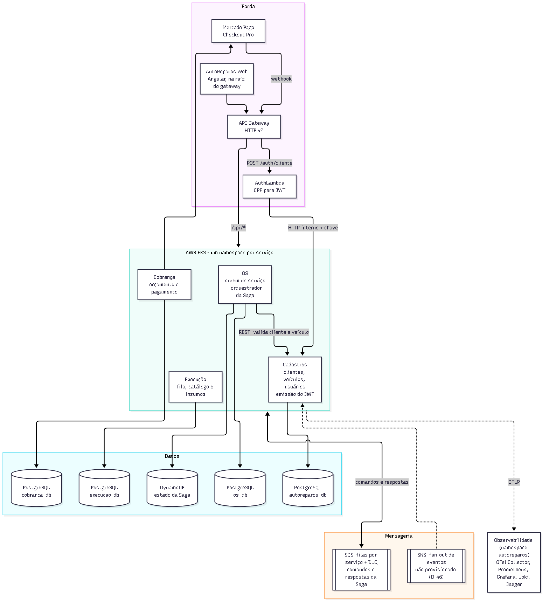

# Tech Challenge — Fase 4 — Documento de Entrega

> Minuta para o PDF do portal. Itens 🔲 dependem de informação que ainda não existe e **bloqueiam a submissão** (C5 e C7 do `pacote-entrega`).

## Capa

| | |
|---|---|
| **Curso** | Pós-Graduação em Software Architecture (SOAT) — FIAP |
| **Turma** | 15SOAT |
| **Grupo** | 78 |
| **Fase** | 4 — Microsserviços, Saga e CI/CD |
| **Projeto** | AutoReparos — Sistema Integrado de Oficina Mecânica |
| **Data de entrega** | 🔲 17/11/2026 (confirmar) |

### Integrantes

| Nome | RM |
|---|---|
| Enrico Gollner | rm370737 |
| José Dotta | rm372959 |
| Júlia Santos | rm370364 |
| Lucas Bastos | rm370749 |
| Mateus Lecchi | rm371085 |

🔲 Confirmar nomes e RMs (copiados do documento da Fase 3).

## 1. Repositórios

| Repositório | Responsabilidade | URL |
|---|---|---|
| AutoReparos (pai) | Orquestração por submódulos, specs, scripts e documentação | https://github.com/Grupo78-PosTech-15SOAT/AutoReparos |
| AutoReparos.OS | Ordens de serviço e orquestrador da Saga (PostgreSQL e DynamoDB) | https://github.com/Grupo78-PosTech-15SOAT/AutoReparos.OS |
| AutoReparos.Cobranca | Orçamento, pagamento e Mercado Pago (PostgreSQL) | https://github.com/Grupo78-PosTech-15SOAT/AutoReparos.Cobranca |
| AutoReparos.Execucao | Fila de execução, catálogo e insumos (PostgreSQL) | https://github.com/Grupo78-PosTech-15SOAT/AutoReparos.Execucao |
| AutoReparos.Cadastros | Clientes, veículos e usuários; emissão do JWT (PostgreSQL) | https://github.com/Grupo78-PosTech-15SOAT/AutoReparos.Cadastros |
| AutoReparos.Web | Aplicação Angular | https://github.com/Grupo78-PosTech-15SOAT/AutoReparos.Web |
| AutoReparos.AuthLambda | Autenticação serverless do cliente | https://github.com/Grupo78-PosTech-15SOAT/AutoReparos.AuthLambda |
| AutoReparos.Infra.Database | Terraform do RDS e provisionador de databases | https://github.com/Grupo78-PosTech-15SOAT/AutoReparos.Infra.Database |
| AutoReparos.Infra.K8s | Terraform do EKS, API Gateway e charts da plataforma | https://github.com/Grupo78-PosTech-15SOAT/AutoReparos.Infra.K8s |

🔲 Confirmar que os repositórios estão públicos ou com acesso para `soat-architecture`.

## 2. Vídeo

[https://youtu.be/BqWcQaEuKAs](https://youtu.be/BqWcQaEuKAs) (YouTube, até 15 min).

## 3. Arquitetura final

Diagrama em [`arquitetura_e_justificativa.md`](arquitetura_e_justificativa.md) (seção 1). Imagem pronta para o PDF:  (também em `diagrama_arquitetura.svg`).

## 4. Estratégia da Saga

Saga **orquestrada**, com o OS como orquestrador: estado em DynamoDB, comandos e respostas por SQS, Outbox e idempotência por `eventId`, compensações em ordem inversa, prazos técnicos com reenvio, console de Sagas e reprocessamento da DLQ. Os detalhes e a justificativa estão no [README do OS](https://github.com/Grupo78-PosTech-15SOAT/AutoReparos.OS) e na [spec da Saga](../../../.specs/features/fase4/especificacao/saga/).

Comportamentos que valem registrar como estão no código: o pagamento recusado só entra no histórico (a Saga fica aguardando), e a falta de saldo na reserva deixa a Saga em `AguardandoInsumos` até o cancelamento, que compensa só o orçamento.

## 5. Justificativa

Texto em [`arquitetura_e_justificativa.md`](arquitetura_e_justificativa.md) (seções 2 a 6). 🔲 Revisão do grupo.

## 6. Qualidade e entrega contínua

- Testes automatizados por serviço, com cobertura mínima de 80% medida no CI e SonarCloud como quality gate.
- BDD do fluxo completo e de compensações em `AutoReparos.OS.BddTests` (Reqnroll).
- Deploy por serviço no EKS com aprovação do Environment `production`; proteção da `main` com PR e checagens.

## Antes de gerar o PDF

- [ ] Todos os 🔲 resolvidos.
- [ ] Links testados em janela anônima.
- [ ] Revisão do grupo e autorização explícita para submeter (C8).
