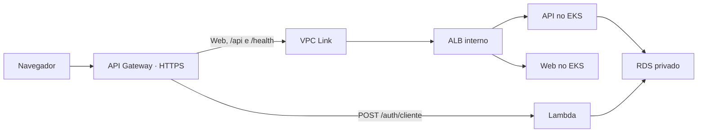

# Plano de provisionamento AWS centralizado no AutoReparos

> **Projeto:** AutoReparos
> **Data:** 04/11/2026
> **Status:** Implementação em revisão; provisionamento pendente
> **Branch de trabalho no repositório pai:** `feature/provisionamento-aws-centralizado`
> **Escopo desta entrega:** Documentar o plano. A criação deste documento não executa mudanças de infraestrutura.

## 1. Objetivo

Transformar o repositório pai `AutoReparos` no ponto único de provisionamento e deploy pela aba Actions do GitHub. Os Terraform, charts e códigos continuam nos submódulos responsáveis. O pai coordena a ordem das operações e passa os valores necessários entre as etapas.

O checkout recursivo deve utilizar os commits dos submódulos registrados no pai, sem atualizar automaticamente para a ponta de suas branches. Cada execução precisa registrar a versão exata de todos os componentes.

Este documento descreve o estado desejado. As configurações propostas ainda não são consumidas pelos workflows atuais. Os recursos e permissões existentes na conta AWS não foram inventariados nesta análise.

## 2. Responsabilidades por repositório

| Repositório | Responsabilidade proposta | Configuração AWS no GitHub |
|---|---|---|
| AutoReparos | Orquestrar bootstrap, infraestrutura, banco, Lambda e deploy | Concentrar acessos e segredos |
| AutoReparos.Infra.K8s | Manter Terraform de rede, EKS, ECR, add-ons, API Gateway e charts | Nenhuma para CI de validação |
| AutoReparos.Infra.Database | Manter Terraform de RDS e credenciais do banco | Nenhuma para CI de validação |
| AutoReparos.AuthLambda | Manter código, testes e Terraform da Lambda | Nenhuma para CI de validação |
| AutoReparos.App | Manter API, Web e testes | Nenhuma para CI de validação |

Os filhos continuam compilando e validando código. Seus caminhos de `apply` e `destroy` devem ser removidos ou desabilitados ao ativar a orquestração centralizada. A transição precisa impedir execuções concorrentes entre o pai e os filhos sobre o mesmo state.

Ao implementar alterações em um submódulo, criar nele uma branch com o mesmo nome da branch do pai. Publicar as alterações dos filhos antes de atualizar os ponteiros no pai. Seguir o fluxo de PRs do projeto: feature para `develop`, depois `develop` para `main`.

## 3. Diagnóstico que fundamenta o plano

Foram inspecionados os workflows, READMEs, Terraform e charts do checkout local. Os principais pontos a resolver são:

- O workflow raiz aplica Infra.K8s e faz deploy em push na `main`, mas não provisiona RDS nem Lambda.
- Há workflows concorrentes de provisionamento nos filhos, com autenticação OIDC e também access keys.
- O bootstrap utiliza state local e seu workflow de criação não o persiste ao encerrar o runner. O workflow de importação salva um artifact, mas não estabelece seu carregamento nas execuções seguintes.
- A camada K8s mistura recursos AWS com recursos Kubernetes e integrações dependentes de componentes criados posteriormente.
- Os workflows não conectam os Security Groups do EKS e da Lambda às regras de entrada do RDS.
- O Terraform cria o ECR da API, embora o deploy publique também a imagem Web.
- O deploy monta os nomes das imagens a partir de um output que já inclui o nome do repositório ECR; os outputs precisam distinguir registry e URL completa de cada imagem.
- O chart de produção utiliza Ingress `alb`, enquanto os add-ons instalam `ingress-nginx`.
- As rotas privadas do API Gateway dependem de um ARN de listener, mas os exemplos usam URL DNS. A integração Lambda também depende de valores não passados pelos workflows.
- O handler atual usa `APIGatewayProxyRequest`, enquanto a integração declara payload `2.0`; o contrato precisa ser alinhado.
- Há namespace `default` fixado em manifests, divergindo do uso de `autoreparos` documentado nos READMEs.
- O inicializador da aplicação executa migrations; seu comportamento precisa ser coordenado com um job dedicado.
- Existem definições de observabilidade em mais de uma camada, incluindo Grafana exposto por LoadBalancer com senha padrão.
- READMEs e workflows divergem sobre gatilhos de apply e parâmetros. Exemplos do banco também usam nomes diferentes das variáveis declaradas.

Referências locais principais:

- [Workflow raiz](../../../../.github/workflows/deploy.yml).
- [Infra.K8s](../../../../submodules/AutoReparos.Infra.K8s/README.md) e [bootstrap](../../../../submodules/AutoReparos.Infra.K8s/bootstrap/README.md).
- [Infra.Database](../../../../submodules/AutoReparos.Infra.Database/README.md).
- [AuthLambda](../../../../submodules/AutoReparos.AuthLambda/README.md).

## 4. Workflows propostos no pai

| Workflow | Finalidade | Gatilho |
|---|---|---|
| `ci.yml` | Build, testes e validação Terraform/Helm | Pull requests e pushes |
| `bootstrap-aws.yml` | Preparar ou recuperar o backend Terraform | Manual |
| `provision-aws.yml` | Provisionar ou atualizar o ambiente completo | Manual |
| `deploy-app.yml` | Publicar API, Web e Lambda em infraestrutura existente | Manual inicialmente |
| `destroy-aws.yml` | Desmontar o ambiente na ordem correta | Manual, separado |

O atual `deploy.yml` será reorganizado para que um push na `main` não execute apply automaticamente.

Parâmetros iniciais propostos:

| Parâmetro | Valor |
|---|---|
| Ambiente | `production` |
| Região | `us-east-1` |
| Branch autorizada a provisionar | `main` |
| Namespace Kubernetes | `autoreparos` |
| Confirmação de bootstrap | `CONFIRMAR-BOOTSTRAP` |
| Confirmação de provisionamento | `CONFIRMAR-PROVISIONAMENTO` |
| Confirmação de destruição | `CONFIRMAR-DESTRUICAO` |

Os workflows que alteram um mesmo ambiente devem compartilhar controle de concorrência no pai, com `cancel-in-progress: false`. O lock Terraform complementa esse controle. Actions devem ser fixadas por SHA, conforme as regras do projeto.

## 5. Preparação inicial na AWS

Antes da primeira execução, uma identidade administrativa existente precisa configurar a confiança entre GitHub e AWS:

1. Criar ou reutilizar o provedor OIDC do GitHub no IAM.
2. Criar a role de bootstrap.
3. Criar a role de provisionamento e deploy.
4. Restringir a confiança ao repositório pai e ao GitHub Environment correspondente.
5. Associar as permissões necessárias às operações de cada role.

| Role proposta | Finalidade |
|---|---|
| `AutoReparosGitHubBootstrapRole` | Criar e administrar bucket e mecanismo de lock do Terraform |
| `AutoReparosGitHubDeployRole` | Gerenciar infraestrutura da aplicação, publicar imagens e fazer deploy no EKS |

Configuração OIDC:

```text
Provider: https://token.actions.githubusercontent.com
Audience: sts.amazonaws.com
```

A condição `sub` deve corresponder ao formato efetivamente emitido para o repositório e ao Environment do job. Conferir também o uso de IDs imutáveis no subject, previsto na documentação atual do GitHub. Uma condição de branch não deve ser copiada como se fosse uma condição de Environment.

A role de deploy precisará de permissões para rede/EC2, EKS, ECR, RDS, Lambda, API Gateway, ELB, Secrets Manager, SSM, CloudWatch, KMS e IAM, além do backend Terraform. A política exata será derivada dos recursos implementados. Restringir operações IAM e `iam:PassRole` às roles do projeto.

O acesso IAM à AWS e o acesso Kubernetes são configurações distintas: a base deverá conceder explicitamente à role de deploy o acesso necessário ao cluster EKS.

## 6. Configuração no GitHub

Todas as configurações abaixo ficam no repositório **AutoReparos**.

### 6.1. Environments

Em **Settings → Environments**, criar:

| Environment | Uso | Branch permitida |
|---|---|---|
| `aws-bootstrap` | Preparar o backend Terraform | `main` |
| `production` | Provisionar e publicar a aplicação | `main` |

Cada job com credenciais deve declarar o Environment correspondente. Conferir a disponibilidade das regras de proteção no plano e na visibilidade do repositório.

### 6.2. Variables do repositório

Em **Settings → Secrets and variables → Actions → Variables**, cadastrar:

| Nome | Exemplo | Finalidade |
|---|---|---|
| `AWS_ACCOUNT_ID` | ID da conta AWS | Validar a conta autenticada antes de alterar recursos |
| `AWS_REGION` | `us-east-1` | Região de todas as etapas |
| `TF_STATE_BUCKET` | `autoreparos-tfstate-<ACCOUNT_ID>-us-east-1` | Bucket exclusivo dos states |
| `TF_LOCK_TABLE` | `autoreparos-terraform-locks` | Tabela de lock, preservando inicialmente o modelo atual |

O nome do bucket será passado ao bootstrap e a todos os `terraform init`, substituindo os nomes fixos. Uma migração futura do mecanismo de lock deve ser uma mudança explícita e coordenada.

### 6.3. Variables do Environment production

| Nome | Valor inicial sugerido |
|---|---|
| `EKS_CLUSTER_NAME` | `autoreparos-cluster` |
| `K8S_NAMESPACE` | `autoreparos` |
| `SEED_USER_EMAIL` | E-mail do administrador |
| `SENDGRID_FROM_EMAIL` | Remetente validado no SendGrid |
| `SENDGRID_FROM_NAME` | `AutoReparos` |

As variáveis SendGrid são necessárias quando o envio de e-mail estiver habilitado. A implementação deve definir claramente o comportamento com essa funcionalidade desabilitada.

### 6.4. Secrets por Environment

| Environment | Secret | Conteúdo |
|---|---|---|
| `aws-bootstrap` | `AWS_ROLE_ARN` | ARN da role de bootstrap |
| `production` | `AWS_ROLE_ARN` | ARN da role de provisionamento/deploy |
| `production` | `JWT_SECRET` | Chave forte compartilhada entre API e Lambda |
| `production` | `SEED_USER_PASSWORD` | Senha inicial do administrador |
| `production` | `APROVACAO_TOKEN_SECRET` | Chave dos tokens de aprovação |
| `production` | `SENDGRID_API_KEY` | Chave de envio de e-mails, quando habilitado |

O ARN é um identificador, mas permanece como secret para aproveitar a convenção existente. A autenticação OIDC dispensa `AWS_ACCESS_KEY_ID` e `AWS_SECRET_ACCESS_KEY` no fluxo proposto.

### 6.5. Submódulos privados

Se houver submódulos privados, usar uma GitHub App com permissão de leitura de conteúdo nos repositórios envolvidos. Configurar no pai:

| Tipo | Nome |
|---|---|
| Repository variable | `SUBMODULES_APP_ID` |
| Repository secret | `SUBMODULES_APP_PRIVATE_KEY` |

Esses itens são condicionais à necessidade de autenticação entre repositórios. O token temporário da App deve ser utilizado no checkout recursivo.

### 6.6. Valores gerados automaticamente

Não cadastrar manualmente `CONNECTION_STRING`, senha do RDS, IDs de rede/SGs, ARN da Lambda ou endereço do balanceador. O fluxo deve produzir esses valores e entregá-los às etapas dependentes.

A senha do RDS será gerada pelo Terraform e armazenada no Secrets Manager. Cada job que precisar da conexão deve consultá-la em tempo de execução, sem transportá-la por outputs compartilhados, resumos ou logs. Proteger também states e planos, que podem conter valores sensíveis.

Os testes de CI devem usar credenciais locais descartáveis, sem depender de secrets de produção.

## 7. Camadas Terraform e dependências

| Camada/state | Recursos principais | Dependências |
|---|---|---|
| Bootstrap | Bucket S3 e tabela de lock | Identidade OIDC inicial |
| Base AWS | VPC, subnets, SGs compartilhados, EKS, ECR API/Web | Backend Terraform |
| Plataforma Kubernetes | Add-ons, storage classes, controlador de balanceamento e observabilidade | EKS disponível e acesso Kubernetes |
| Database | RDS, regras de acesso e segredo do banco | Rede e SGs da base |
| AuthLambda | Função, permissões e configuração | Rede, SG e conexão do banco |
| Borda/API Gateway | VPC Link, rotas e integrações | ARN da Lambda e ARN do listener |

Os arquivos continuam nos submódulos responsáveis; os comandos são executados no pai. Cada camada tem state remoto e lock. Chaves de state devem distinguir ambientes, e cada recurso deve ter um único proprietário.

Criar o Security Group da Lambda na base AWS para resolver a dependência circular:

```text
Base cria SG da Lambda
    → Database autoriza esse SG
    → Lambda utiliza esse mesmo SG
```

Passar somente valores não sensíveis entre jobs, como IDs, ARNs e URLs. Recuperar secrets diretamente de sua origem no job consumidor.

### 7.1. Recursos existentes

Antes de dividir states em uma conta já provisionada:

1. Inventariar recursos, endereços Terraform e chaves dos states atuais.
2. Preservar cópias versionadas dos states.
3. Definir o destino e a transferência de propriedade de cada recurso.
4. Executar a migração controladamente, sem writers concorrentes.
5. Conferir planos para evitar recriação ou destruição involuntária.

Não assumir que a conta está vazia. A migração de state será detalhada após esse inventário.

## 8. Fluxo completo da primeira instalação

### Passo 1 — Validar a configuração

Conferir variables/secrets obrigatórios, identidade AWS, conta, região, branch, Environment e checkout dos submódulos. Registrar commits utilizados.

### Passo 2 — Executar o bootstrap

Criar bucket e tabela de lock. Na primeira execução, persistir o state do próprio bootstrap no S3 antes de encerrar o runner. Nas seguintes, carregar o state remoto. Prever recuperação por importação para criação parcial ou recursos existentes; a simples existência de um bucket não comprova sua propriedade.

### Passo 3 — Compilar e preparar os artefatos

Executar CI e gerar o ZIP da Lambda. Identificar as versões das imagens e do ZIP pelos commits utilizados. Fixar versões de ferramentas e Actions de forma reproduzível.

### Passo 4 — Provisionar a base AWS

Criar rede, EKS, Security Groups e os dois ECRs. Configurar acesso da role de deploy ao Kubernetes e exportar os identificadores necessários.

### Passo 5 — Preparar o cluster

Instalar add-ons e aguardar disponibilidade. Para a primeira versão, manter o endpoint público autenticado do EKS já previsto no projeto, garantindo conectividade do runner. Um endpoint exclusivamente privado exigirá runner com acesso à VPC.

### Passo 6 — Provisionar o RDS

Receber rede/SGs da base. Autorizar PostgreSQL somente para as origens previstas. Gerar e armazenar as credenciais no Secrets Manager.

### Passo 7 — Publicar imagens e preparar secrets

Enviar API e Web aos respectivos ECRs. Usar URLs completas de repositório sem duplicar seus nomes. Criar namespace e secrets da aplicação em `autoreparos`, consultando a conexão do banco no Secrets Manager.

### Passo 8 — Executar migrations

Executar um job controlado no EKS, com acesso ao RDS privado. Coordenar a mudança com o `DbInitializer`, que atualmente chama `MigrateAsync`, para evitar execução concorrente pelas réplicas. O rollout da aplicação deve depender do sucesso das migrations.

### Passo 9 — Provisionar a Lambda

Consumir ZIP, subnets, SG, conexão do banco e chave JWT compartilhada com a API. Alinhar o contrato do evento e da resposta com a versão de payload escolhida no API Gateway.

### Passo 10 — Instalar aplicação e criar balanceador

Executar Helm com imagens, namespace, secrets e probes corretos. Aguardar pods, balanceador e listener. Ajustar os health checks de API e Web separadamente quando necessário.

### Passo 11 — Provisionar a borda

Consumir ARN da Lambda e ARN do listener do ALB interno. Criar VPC Link, rotas e permissão de invocação. O ARN do listener, e não a URL DNS, deve alimentar a integração privada.

### Passo 12 — Verificar e apresentar o resultado

Conferir rollout, health check, Web, assets, navegação Angular e autenticação com dados controlados. Publicar resumo com URLs, versões e recursos, sem secrets.

Cada camada gera um plano e aplica aquele arquivo de plano. Em ambiente novo, os planos das camadas seguintes dependem de recursos criados pelas anteriores. Não apresentar um único plano antecipado como se cobrisse recursos ainda indisponíveis.

## 9. Arquitetura de entrada proposta

Adotar AWS Load Balancer Controller com ALB interno, compatível com a intenção do chart `alb`. O `ingress-nginx` atual deve ser substituído; o projeto foi aposentado em março de 2026.



A URL HTTPS do API Gateway será a entrada inicial, incluindo frontend por rota de fallback. Validar assets, caminhos, headers e navegação Angular. Domínio próprio e certificado personalizado ficam para uma etapa posterior.

Manter uma instalação de cada componente de observabilidade. Remover a exposição do Grafana por LoadBalancer com senha padrão; o acesso inicial será autenticado e por encaminhamento local de porta. Definir a origem da credencial sem armazená-la no chart.

## 10. Mudanças previstas

| Local | Alterações |
|---|---|
| Pai | Workflows, dependências entre jobs, configuração central, resumos e documentação |
| Infra.K8s | Separar camadas; backend configurável; ECR Web; SG compartilhado da Lambda; acesso EKS; controlador ALB; namespace; integrações |
| Infra.Database | Receber rede/SGs explicitamente; corrigir exemplos; fornecer ARN do segredo |
| AuthLambda | Receber rede/SG existentes; alinhar handler e payload do Gateway |
| App/charts | Migrations controladas; secrets e namespace consistentes; imagens corretas; acesso pela borda |
| Workflows dos filhos | Preservar CI e retirar provisionamento/destruição concorrentes |
| READMEs e documentação | Atualizar gatilhos, configuração, execução e recuperação |

Antes de fixar versões, conferir disponibilidade de EKS, PostgreSQL e runtime Lambda, além da compatibilidade de providers, charts e add-ons. Dimensionar os nós considerando aplicação e observabilidade; não assumir que a configuração atual garante capacidade ou custo zero.

## 11. Operação pelo GitHub

1. Configurar OIDC e roles na AWS.
2. Criar Environments, variables e secrets no pai.
3. Publicar os workflows na branch padrão; isso é necessário para disponibilizar o disparo manual.
4. Abrir **AutoReparos → Actions → Bootstrap AWS → Run workflow**.
5. Informar `CONFIRMAR-BOOTSTRAP` e acompanhar a execução.
6. Após sucesso, abrir **Provisionar AWS → Run workflow**.
7. Selecionar `production`, branch `main` e informar `CONFIRMAR-PROVISIONAMENTO`.
8. Acompanhar os jobs e acessar a URL apresentada no resumo final.

Para mudanças de código em ambiente existente, executar **Deploy da aplicação**. Para alterações de infraestrutura, executar **Provisionar AWS**. O deploy da Lambda deve usar o mesmo proprietário/state que administra seu código e configuração, evitando disputa entre atualização via CLI e Terraform.

## 12. Falhas, retomada e teardown

Uma falha interrompe os jobs dependentes e preserva os states e recursos já criados. A próxima execução deve reconciliar o ambiente a partir do estado remoto, sem destruir automaticamente o que funcionou.

O teardown deve remover primeiro integrações e cargas de trabalho, depois recursos dependentes como balanceadores e ENIs, e finalmente cluster e rede. Definir explicitamente retenção ou snapshot do RDS e tratamento dos volumes persistentes. O backend de states deve permanecer preservado.

Rollback de aplicação não implica rollback automático de migrations. Planejar mudanças de schema compatíveis e recuperação de dados antes de alterações destrutivas.

## 13. Etapas de implementação e critérios de conclusão

1. Inventariar ambiente existente e definir migração de states, quando aplicável.
2. Preparar contratos de outputs/inputs e separar as camadas Terraform.
3. Corrigir bootstrap, ECR, SGs, acesso EKS e balanceamento.
4. Criar os workflows no pai e desativar os writers antigos.
5. Integrar secrets, migrations, Lambda, charts e API Gateway.
6. Atualizar documentação e validar o fluxo em ambiente autorizado.

Critérios de conclusão:

- O pai é a única origem de alterações AWS pelo GitHub Actions.
- Configurações manuais limitam-se à identidade inicial e à matriz de variables/secrets deste plano.
- O bootstrap preserva seu state e permite recuperação de execução parcial.
- IDs de rede, SGs e integrações são passados automaticamente.
- RDS aceita conexões das origens previstas; API e Lambda utilizam credenciais corretas.
- API, Web e Lambda correspondem aos commits registrados na execução.
- Migrations terminam antes do rollout dependente.
- Web, API, health check e autenticação funcionam pela entrada definida.
- Reexecução sem mudanças não recria recursos desnecessariamente.
- Falhas e teardown respeitam dependências e retenção de dados.
- Resumos e logs não expõem segredos.

## 14. Referências oficiais

Fontes consultadas durante o planejamento em 04/11/2026; reconferir versões e requisitos na implementação:

- [GitHub: OIDC com AWS e condições de confiança](https://docs.github.com/en/actions/how-tos/secure-your-work/security-harden-deployments/oidc-in-aws).
- [GitHub: execução manual de workflows](https://docs.github.com/en/actions/how-tos/manage-workflow-runs/manually-run-a-workflow).
- [AWS: integrações privadas do API Gateway e ARN do listener](https://docs.aws.amazon.com/en_en/apigateway/latest/developerguide/http-api-develop-integrations-private.html).
- [AWS: Load Balancer Controller no EKS](https://docs.aws.amazon.com/eks/latest/userguide/aws-load-balancer-controller.html).
- [Kubernetes: aposentadoria do ingress-nginx](https://kubernetes.io/blog/2026/03/30/kubernetes-v1-36-sneak-peek/).
