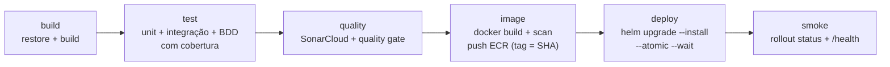

# Especificação Fase 4 — CI/CD por Microsserviço e Proteção de Branches

> **Projeto:** AutoReparos - Sistema Integrado de Oficina Mecânica  
> **Fase:** Tech Challenge FIAP SOAT - Fase 4 (15SOAT)  
> **Critério do PDF:** Requisitos obrigatórios → *CI/CD Automatizado* e Infraestrutura → *Deploy automatizado para ambiente Kubernetes*  
> **Requisitos cobertos (índice):** R22, R23, R24, R25, R26, R28, R33  
> **Repositórios afetados:** os 4 serviços, `AutoReparos.Web`, `AutoReparos.AuthLambda`, `AutoReparos.Infra.K8s`, `AutoReparos.Infra.Database`, `AutoReparos` (pai e `scripts/infra/setup-github-governance.sh`)  
> **Base:** [Diagnóstico do estado atual](../diagnostico/fase4_diagnostico_estado_atual.md) · **Índice:** [`../index.md`](../index.md)  
> **Status:** Rascunho inicial — papel do pai no provisionamento a validar (D-13)

---

## 1. Critério

> Cada microsserviço deverá ter **pipeline independente de CI/CD** com:
> - Build;
> - Testes automatizados;
> - Verificação de qualidade;
> - Deploy automatizado em ambiente Kubernetes.
>
> **Repositórios protegidos** (branch `main` com PR obrigatório e checagens automáticas).

---

## 2. Estado atual

| Repositório | Gatilhos | Build | Testes | Qualidade | Imagem | Deploy K8s |
|---|---|---|---|---|---|---|
| AutoReparos.App | push/PR em `main` e `develop` | ✅ | ✅ | ❌ | ❌ | ❌ |
| AutoReparos (pai) — `ci.yml` | push/PR | ✅ (todos os submódulos) | ✅ | ❌ (SonarCloud automático fora do workflow) | — | — |
| AutoReparos (pai) — `provision-aws.yml` / `deploy-app.yml` (desde 06/11) | **Manual** (Environment `production` + confirmação por texto) | ✅ | — | ❌ | ✅ API e Web no ECR | ✅ `helm upgrade` do chart do Infra.K8s |
| AutoReparos.AuthLambda | push/PR + `workflow_dispatch` com confirmação | ✅ | ✅ | ❌ | n/a | n/a (Terraform da Lambda) |
| Infra.Database / Infra.K8s | push/PR + manuais | n/a | `fmt`/`validate` | ❌ | n/a | Provisionamento manual |

Outros pontos:

- Autenticação na AWS por OIDC (`AWS_ROLE_ARN`) já usada no pai e na Lambda.
- Segredos da API lidos do Secrets Manager e injetados no cluster pelo workflow do pai.
- Migrations controladas por configuração (`Database:RunMigrations`), executadas pelo fluxo de deploy antes do rollout.
- Actions referenciadas por tag (ex.: `@v6.0.2`) desde o PR #44 (06/11). O SonarCloud reprovou esse PR (Security Rating C), mas ele foi mesclado porque a `main` não exige o check — exemplo concreto da lacuna de proteção de branches.
- Desde 06/11 o **provisionamento e o deploy são centralizados no pai e manuais** (ver [diagnóstico § 8](../diagnostico/fase4_diagnostico_estado_atual.md#8-provisionamento-aws-centralizado-mesclado-em-0611)). Nenhum repositório de serviço faz deploy.

### 2.1 Proteção de branches (GitHub API, 04/11/2026 — confirmado sem mudanças em 09/11/2026)

| Repositório | `main` | Status checks obrigatórios | `develop` |
|---|---|---|---|
| App, AuthLambda, Infra.Database, Infra.K8s | PR + 1 aprovação, `strict`, vale para admins | **Nenhum** (`contexts: []`) | sem proteção |
| AutoReparos (pai) | PR sem aprovação mínima, não vale para admins | **Nenhum** | sem proteção |

---

## 3. Lacunas

1. Nenhum repositório de serviço faz deploy no Kubernetes; o deploy da aplicação está no pai.
2. Nenhuma verificação de qualidade (Sonar) dentro dos pipelines.
3. Nenhum repositório exige status checks para o merge; o pai nem exige aprovação.
4. Os repositórios novos (OS, Billing, Execution) existem só com a branch de feature, sem `main`, sem proteção e fora do script de governança; Web ainda não existe. Execution já tem `ci.yml`.

---

## 4. Proposta (a validar)

### 4.1 Pipeline padrão de cada serviço (`.github/workflows/ci-cd.yml`)

| Job | Quando roda | Detalhes |
|---|---|---|
| `build` | PR e push | `dotnet restore`/`build` |
| `test` | PR e push | Testcontainers no runner; publica `.trx` e cobertura como artefatos |
| `quality` | PR e push | SonarCloud com `sonar.qualitygate.wait=true` ([spec de testes](../testes-qualidade/fase4_spec_testes_e_qualidade.md)) |
| `image` | push em `develop` e `main` | Build da imagem, scan (ECR scan on push já existe), push no ECR do próprio serviço |
| `deploy` | push em `develop` → staging (namespace compartilhado); push em `main` → produção com aprovação no Environment `production` (D-22) | OIDC → role do repositório → `aws eks update-kubeconfig` → Job de migration (hook do Helm) → `helm upgrade --install --atomic` no namespace do serviço |
| `smoke` | após o deploy | `kubectl rollout status` e chamada ao `/health` do serviço pelo ingress |

Regras:

- **Rollback automático:** `--atomic` desfaz a release se os pods não ficarem prontos.
- **OIDC por repositório:** uma role IAM por serviço, com trust policy restrita a `repo:Grupo78-PosTech-15SOAT/<repo>:ref:refs/heads/main` e permissões mínimas (push no próprio ECR, `eks:DescribeCluster`), mapeada por *access entry* do EKS para um papel RBAC limitado ao namespace do serviço.
- **Segredos:** GitHub Secrets do próprio repositório ou External Secrets lendo o Secrets Manager. Não usar um segredo compartilhado entre serviços.
- **Versão:** a tag da imagem é o SHA do commit; o chart fica em `deploy/helm/<servico>` no repositório do serviço.
- **Versão das actions:** fixar por SHA completo com a tag em comentário (`uses: actions/checkout@<sha> # v6.0.2`), como pede a regra em `.agents/` e o SonarCloud; o Dependabot atualiza o SHA e o comentário.
- **Environment `production`** no GitHub com proteção (aprovação opcional) para o job de deploy.

### 4.2 Repositórios de plataforma e o pai (D-13)

| Repositório | Papel no CI/CD |
|---|---|
| Infra.K8s, Infra.Database, AuthLambda | CI de validação (`fmt`, `validate`, `tflint`, `helm lint`, testes da Lambda) e `apply` manual ou na `main` com Environment protegido |
| AutoReparos (pai) | CI de integração (build e testes dos submódulos, BDD ponta a ponta opcional) e o **provisionamento da plataforma** que já existe (`Bootstrap`, `Provision AWS`, `Teardown AWS`). **Deixa de fazer** o deploy dos serviços |

**D-13 decidido (convergente com o plano `infra-ci-observabilidade` do Enrico, que rejeita a pipeline única no pai):** manter o provisionamento centralizado do pai (mesclado em 06/11) para a **plataforma** (rede, EKS, RDS, gateway, Lambda) e mover o **deploy dos serviços** para o pipeline de cada repositório, como o PDF exige. O `Deploy application` do pai pode continuar como atalho manual para subir tudo de uma vez (por exemplo, antes de gravar o vídeo), desde que chame os mesmos charts dos repositórios dos serviços. A retirada do `Deploy application` como caminho principal é combinada com o Enrico, autor do modelo atual.

### 4.3 Proteção de branches

Atualizar [`scripts/infra/setup-github-governance.sh`](../../../../scripts/infra/setup-github-governance.sh):

1. Incluir os repositórios novos com os nomes em português (OS, Cobranca, Execucao, Cadastros, Web e, se houver, Notificacao).
2. Preencher `required_status_checks.contexts` por repositório com os nomes dos jobs (por exemplo, `build`, `test`, `quality`) em vez de `[]`.
3. Aplicar no pai a mesma regra dos filhos (1 aprovação, checks, vale para admins).
4. Proteger também a `develop` (PR obrigatório e checks), já que ela é a branch de integração.
5. Gerar uma evidência (saída do `gh api .../branches/main/protection` e print da tela de configurações) para o README e o vídeo, atendendo ao feedback da Fase 3.

---

## 5. Passos para a mudança

1. Fechar D-13.
2. Criar o template de workflow `ci-cd.yml` e aplicá-lo nos 4 serviços (a partir do `ci.yml` atual do App e do Execution).
3. Criar o ECR de cada serviço (no Terraform do próprio serviço ou na plataforma) e a role OIDC de cada repositório, com access entry no EKS.
4. Mover o chart da API de `Infra.K8s/k8s/charts/api` para `deploy/helm/` do Cadastros e criar os charts de OS, Cobrança e Execução (ver [spec de infraestrutura](../infraestrutura/fase4_spec_infraestrutura_k8s_e_mensageria.md)).
5. Levar para o chart de cada serviço a execução de migrations que hoje está no fluxo do pai (Job com hook `pre-upgrade`).
6. Ajustar `provision-aws.yml` e `deploy-app.yml` do pai para não publicar mais as imagens nem o chart dos serviços (ou para delegar aos charts dos repositórios); manter CI de integração e provisionamento da plataforma.
7. Configurar o SonarCloud em cada repositório e incluir o job `quality`.
8. Atualizar e executar o script de governança; registrar a evidência.
9. Voltar as actions para SHA completo com a tag em comentário e ativar o Dependabot para `github-actions`, deixando o quality gate do SonarCloud verde novamente.
10. Teste do processo: abrir um PR com um teste quebrado e confirmar que o merge é bloqueado; fazer merge de um PR válido e confirmar o deploy automático (roteiro do vídeo).

---

## 6. Critérios de aceite

- [ ] Cada serviço tem seu workflow com build, testes, qualidade e deploy no EKS, sem depender do pai.
- [ ] Merge na `main` de um serviço publica a imagem e atualiza só aquele serviço no cluster.
- [ ] Release com falha de readiness é revertida automaticamente.
- [ ] `main` de todos os repositórios exige PR, aprovação e status checks (incluindo o quality gate).
- [ ] PR com teste falhando ou quality gate reprovado não pode ser mesclado.
- [ ] Evidência da proteção no README e no vídeo.
